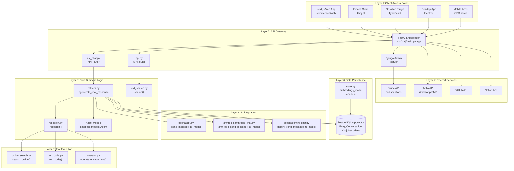
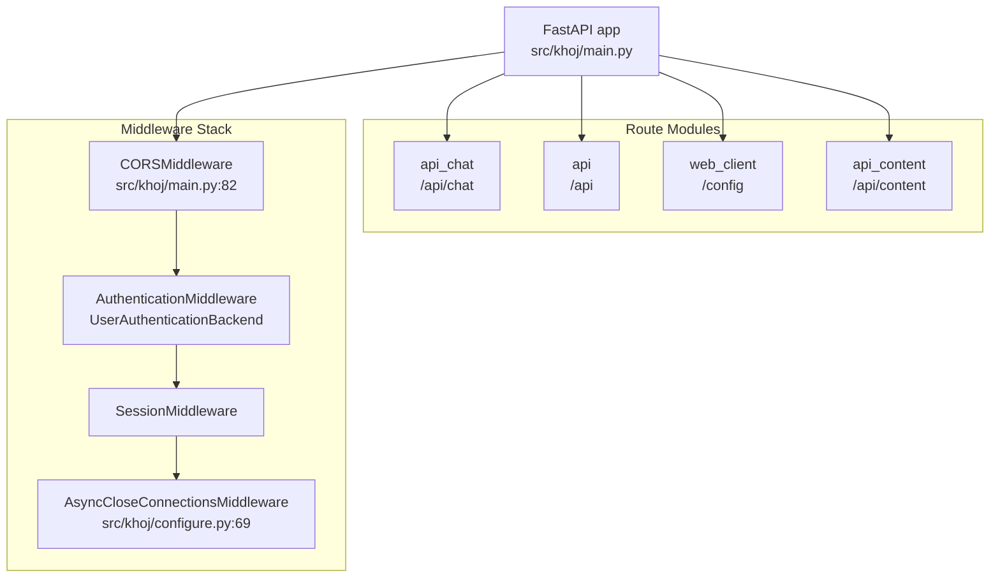
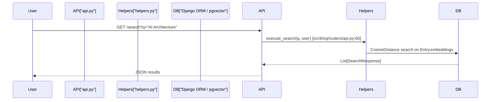

<!-- source: DeepWiki mcp.deepwiki.com · repo khoj-ai/khoj · page 1.1 System Architecture · fetched 2026-10-29 -->

# System Architecture

Relevant source files

The following files were used as context for generating this wiki page:

- [documentation/package.json](documentation/package.json)
- [documentation/yarn.lock](documentation/yarn.lock)
- [pyproject.toml](pyproject.toml)
- [src/interface/desktop/yarn.lock](src/interface/desktop/yarn.lock)
- [src/interface/obsidian/yarn.lock](src/interface/obsidian/yarn.lock)
- [src/interface/web/bun.lock](src/interface/web/bun.lock)
- [src/interface/web/tsconfig.json](src/interface/web/tsconfig.json)
- [src/khoj/app/settings.py](src/khoj/app/settings.py)
- [src/khoj/configure.py](src/khoj/configure.py)
- [src/khoj/database/adapters/__init__.py](src/khoj/database/adapters/__init__.py)
- [src/khoj/database/admin.py](src/khoj/database/admin.py)
- [src/khoj/database/models/__init__.py](src/khoj/database/models/__init__.py)
- [src/khoj/main.py](src/khoj/main.py)
- [src/khoj/routers/api.py](src/khoj/routers/api.py)
- [src/khoj/routers/web_client.py](src/khoj/routers/web_client.py)
- [src/khoj/utils/cli.py](src/khoj/utils/cli.py)
- [src/khoj/utils/config.py](src/khoj/utils/config.py)
- [src/khoj/utils/rawconfig.py](src/khoj/utils/rawconfig.py)
- [src/khoj/utils/state.py](src/khoj/utils/state.py)
- [uv.lock](uv.lock)

## Purpose and Scope

This document describes Khoj's layered architecture, explaining how components across the API gateway, business logic, AI integration, tool execution, and data persistence layers interact to provide a unified AI-powered personal assistant. It covers the request flow patterns, component relationships, and architectural decisions that enable Khoj to support multiple clients, AI providers, and data sources.

For information about specific features and capabilities, see [Feature Overview](#1.2). For deployment configuration and operations, see [6. Deployment and Operations]().

---

## Architectural Overview

Khoj implements a seven-layer architecture that separates concerns and enables flexibility:

**Sources:** [src/khoj/main.py:1-230](), [src/khoj/database/models/__init__.py:1-500]()

---

## Layer 1: API Gateway

The API Gateway layer consists of two main components: FastAPI for the core application API and Django for administrative functions and database ORM.

### FastAPI Application Structure

The main application is instantiated in [src/khoj/main.py:61-64]() and configured with multiple routers. The routing configuration is handled via `configure_routes(app)` in [src/khoj/main.py:185]().

The app mounts several core sub-applications and static files:
- **`/api`**: Core API endpoints like search, transcription, and settings [src/khoj/routers/api.py:31]().
- **`/server`**: The Django ASGI application for administrative tasks [src/khoj/main.py:188]().
- **`/static`**: Static files for the web interface [src/khoj/main.py:192]().

### Authentication Architecture

Authentication is handled by the `UserAuthenticationBackend` in [src/khoj/configure.py:98-167](). It supports several mechanisms:

| Authentication Method | Use Case | Implementation |
|----------------------|----------|-----------------|
| Session Cookie | Web browser clients | `request.session.get("user")` [src/khoj/configure.py:124]() |
| Bearer Token | Desktop/Emacs/Obsidian clients | `Authorization: Bearer <token>` [src/khoj/configure.py:145]() |
| Default User | Local development/Self-hosted | `username="default"` [src/khoj/configure.py:109]() |

The `AuthenticatedKhojUser` class wraps the Django `KhojUser` model for use within FastAPI's request context [src/khoj/configure.py:62-66]().

**Sources:** [src/khoj/main.py:61-192](), [src/khoj/configure.py:62-167](), [src/khoj/routers/api.py:31-183]()

---

## Layer 2: Core Business Logic

### Database Models and ORM

Khoj uses Django ORM for data persistence. The models define the "Code Entity Space" for user data and AI configurations.

| Code Entity | File Path | Purpose |
|-------------|-----------|---------|
| `KhojUser` | [src/khoj/database/models/__init__.py:153]() | Extends `AbstractUser` with UUID and verification fields. |
| `Conversation` | [src/khoj/database/models/__init__.py:476]() | Stores chat history and associated metadata. |
| `Entry` | [src/khoj/database/models/__init__.py:640]() | Represents a single indexed item (note, file chunk) with vector embeddings. |
| `Agent` | [src/khoj/database/models/__init__.py:534]() | Configuration for AI personas, including tools and personality. |
| `AiModelApi` | [src/khoj/database/models/__init__.py:206]() | Stores API keys and base URLs for LLM providers. |

### Data Flow: Search and Transcription

The system bridges natural language queries to database entities through the API.

For voice interactions, the `/transcribe` endpoint [src/khoj/routers/api.py:108]() takes an audio file, stores it temporarily, and sends it to the configured `SpeechToTextModelOptions` via `transcribe_audio` [src/khoj/routers/api.py:152]().

**Sources:** [src/khoj/database/models/__init__.py:153-640](), [src/khoj/routers/api.py:46-172](), [src/khoj/database/adapters/__init__.py:1-230]()

---

## Layer 3: AI and Provider Integration

Khoj supports multiple LLM providers (OpenAI, Anthropic, Google) through a unified configuration system.

### Multi-Provider Configuration

Providers are managed via `AiModelApi` [src/khoj/database/models/__init__.py:206](). Specific models for chat, vision, and speech-to-text are configured using:
- `ChatModel` [src/khoj/database/models/__init__.py:220]()
- `SpeechToTextModelOptions` [src/khoj/database/models/__init__.py:414]()

### Implementation of AI Response

The system uses `ChatMessageModel` [src/khoj/database/models/__init__.py:117]() as a standard Pydantic schema to validate and transport messages between the frontend and backend. This model includes:
- `message`: The actual text or multi-modal content.
- `trainOfThought`: Internal reasoning steps.
- `context`: Retrieved documents or web search results.
- `intent`: Classified user intent (e.g., search vs chat).

**Sources:** [src/khoj/database/models/__init__.py:117-414](), [src/khoj/routers/api.py:139-154]()

---

## Layer 4: System Initialization and State

Khoj manages global state and background tasks to ensure high performance and data consistency.

### Server Bootstrap

When `khoj.main:run` is called [src/khoj/main.py:119](), the following occurs:
1. **Django Initialization**: `django.setup()` and database migrations via `call_command("migrate")` [src/khoj/main.py:39-53]().
2. **Task Scheduling**: A `BackgroundScheduler` is started [src/khoj/main.py:156]().
3. **Leader Election**: To prevent duplicate task execution in distributed environments, Khoj uses a `ProcessLock` named `SCHEDULE_LEADER` [src/khoj/main.py:103, 167]().

### State Management

The `state` module (referenced in [src/khoj/configure.py:55]()) tracks:
- `openai_client`: A shared OpenAI client instance.
- `scheduler`: The active background job manager.
- `schedule_leader_process_lock`: The lock held if the current process is the task leader [src/khoj/main.py:109]().

**Sources:** [src/khoj/main.py:38-182](), [src/khoj/configure.py:1-59]()

---

## Layer 5: Deployment and Infrastructure

Khoj is designed to be cross-platform, with deployment options ranging from local pip installation to Dockerized cloud environments.

### Dependency Management

The project uses `pyproject.toml` for dependency management [pyproject.toml:5](). Key dependencies include:
- **FastAPI/Uvicorn**: Web server stack [pyproject.toml:42, 59]().
- **Django**: Database and admin interface [pyproject.toml:66]().
- **PyTorch/Sentence-Transformers**: Local embedding and search capabilities [pyproject.toml:55, 58]().
- **Pgvector**: Vector similarity search in PostgreSQL [pyproject.toml:71]().

### Docker and PostgreSQL

In production, Khoj typically connects to a PostgreSQL database. For local or simplified setups, it supports an embedded database via `pgserver` if `USE_EMBEDDED_DB` is enabled [src/khoj/app/settings.py:127](). This automatically initializes the `vector` extension and creates the necessary database schema [src/khoj/app/settings.py:151-158]().

**Sources:** [pyproject.toml:5-98](), [src/khoj/app/settings.py:121-189]()

---

