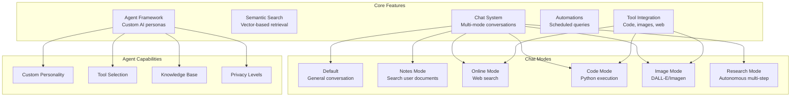
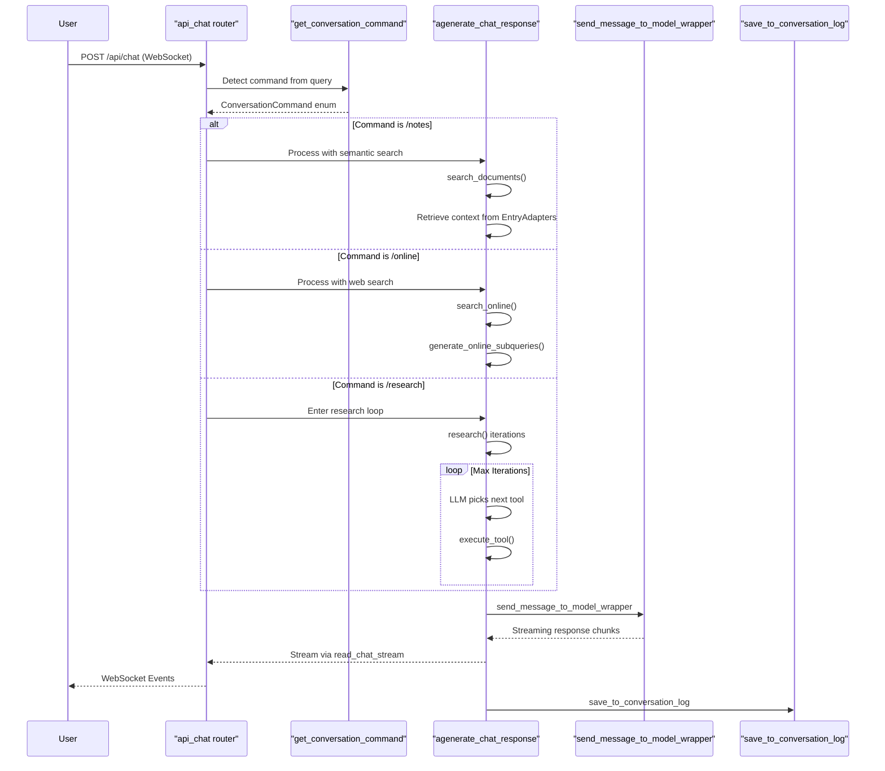
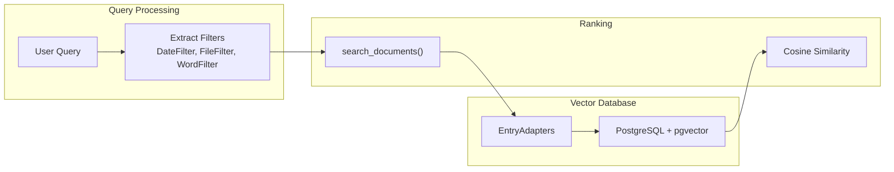

<!-- source: DeepWiki mcp.deepwiki.com · repo khoj-ai/khoj · page 1.2 Feature Overview · fetched 2026-10-29 -->

# Feature Overview

Relevant source files

The following files were used as context for generating this wiki page:

- [documentation/assets/img/khoj_automation_email.png](documentation/assets/img/khoj_automation_email.png)
- [documentation/assets/img/khoj_create_automation.png](documentation/assets/img/khoj_create_automation.png)
- [documentation/assets/img/speaker_icon.png](documentation/assets/img/speaker_icon.png)
- [documentation/assets/img/summarize.jpg](documentation/assets/img/summarize.jpg)
- [documentation/docs/advanced/_category_.json](documentation/docs/advanced/_category_.json)
- [documentation/docs/advanced/support-multilingual-docs.md](documentation/docs/advanced/support-multilingual-docs.md)
- [documentation/docs/clients/desktop.md](documentation/docs/clients/desktop.md)
- [documentation/docs/clients/emacs.md](documentation/docs/clients/emacs.md)
- [documentation/docs/clients/obsidian.md](documentation/docs/clients/obsidian.md)
- [documentation/docs/clients/whatsapp.md](documentation/docs/clients/whatsapp.md)
- [documentation/docs/data-sources/_category_.json](documentation/docs/data-sources/_category_.json)
- [documentation/docs/data-sources/github_integration.md](documentation/docs/data-sources/github_integration.md)
- [documentation/docs/data-sources/notion_integration.md](documentation/docs/data-sources/notion_integration.md)
- [documentation/docs/features/automations.md](documentation/docs/features/automations.md)
- [documentation/docs/features/chat.md](documentation/docs/features/chat.md)
- [documentation/docs/features/code_execution.md](documentation/docs/features/code_execution.md)
- [documentation/docs/features/image_generation.md](documentation/docs/features/image_generation.md)
- [documentation/docs/features/online_search.md](documentation/docs/features/online_search.md)
- [documentation/docs/features/search.md](documentation/docs/features/search.md)
- [documentation/docs/features/voice-chat.md](documentation/docs/features/voice-chat.md)
- [documentation/docs/miscellaneous/_category_.json](documentation/docs/miscellaneous/_category_.json)
- [documentation/docs/miscellaneous/credits.md](documentation/docs/miscellaneous/credits.md)
- [documentation/docs/miscellaneous/performance.md](documentation/docs/miscellaneous/performance.md)
- [documentation/docs/miscellaneous/query-filters.md](documentation/docs/miscellaneous/query-filters.md)
- [src/khoj/database/migrations/0095_alter_webscraper_type.py](src/khoj/database/migrations/0095_alter_webscraper_type.py)
- [src/khoj/processor/conversation/prompts.py](src/khoj/processor/conversation/prompts.py)
- [src/khoj/processor/conversation/utils.py](src/khoj/processor/conversation/utils.py)
- [src/khoj/processor/image/generate.py](src/khoj/processor/image/generate.py)
- [src/khoj/processor/tools/online_search.py](src/khoj/processor/tools/online_search.py)
- [src/khoj/processor/tools/run_code.py](src/khoj/processor/tools/run_code.py)
- [src/khoj/routers/api_chat.py](src/khoj/routers/api_chat.py)
- [src/khoj/routers/helpers.py](src/khoj/routers/helpers.py)
- [src/khoj/routers/research.py](src/khoj/routers/research.py)
- [src/khoj/utils/helpers.py](src/khoj/utils/helpers.py)

This document provides a comprehensive overview of Khoj's core user-facing features and their implementation. It covers the chat system with its various modes, semantic search capabilities, agent framework, automation system, and tool integrations.

For architectural details on how these features are implemented at the system level, see [System Architecture](#1.1). For specific subsystem implementations, see [Core Backend System](#2), [Conversation and AI System](#3), and [Content Processing and Search](#4).

---

## Feature Categories

Khoj provides five primary feature categories that users can access through multiple client interfaces:

**Sources:** [src/khoj/utils/helpers.py:83-135](), [src/khoj/routers/helpers.py:120-145](), [src/khoj/database/models.py:60-76]()

---

## Chat System

The chat system provides conversational AI capabilities with multiple specialized modes. Users can interact via natural language queries that are processed through the appropriate pipeline based on the conversation command.

### Conversation Commands

| Command | Value | Description | Implementation |
|---------|-------|-------------|----------------|
| `/default` | `ConversationCommand.Default` | General conversation with context awareness | Auto-selects appropriate tools |
| `/general` | `ConversationCommand.General` | General conversation without tool use | Direct LLM response |
| `/notes` | `ConversationCommand.Notes` | Search and answer from user documents | Semantic search + retrieval |
| `/online` | `ConversationCommand.Online` | Web search for real-time information | Search API integration |
| `/code` | `ConversationCommand.Code` | Execute Python code | Sandboxed execution |
| `/image` | `ConversationCommand.Image` | Generate images from descriptions | Text-to-image models |
| `/diagram` | `ConversationCommand.Diagram` | Create diagrams (Excalidraw/Mermaid) | Structured generation |
| `/research` | `ConversationCommand.Research` | Autonomous multi-step research | Iterative tool selection |

**Sources:** [src/khoj/utils/helpers.py:122-137](), [src/khoj/routers/api_chat.py:82-92](), [documentation/docs/features/chat.md:37-48]()

### Chat Message Flow

**Sources:** [src/khoj/routers/api_chat.py:55-78](), [src/khoj/routers/helpers.py:55-78](), [src/khoj/processor/conversation/utils.py:43-47]()

### Chat API Endpoints

The chat system exposes several REST and WebSocket endpoints:

| Endpoint | Method | Purpose |
|----------|--------|---------|
| `/api/chat` | `POST/WebSocket` | Main chat interface with streaming |
| `/api/chat/stats` | `GET` | Retrieve conversation statistics |
| `/api/chat/export` | `GET` | Export all conversations for a user |
| `/api/chat/conversation/file-filters` | `POST/DELETE` | Manage per-conversation file filters |
| `/api/chat/feedback` | `POST` | Submit response feedback |

**Sources:** [src/khoj/routers/api_chat.py:108-186]()

### Streaming Response Protocol

Chat responses are streamed using a custom event protocol defined in `ChatEvent`:

**Event Types:**
- `STATUS`: Status message (e.g., "**Searching the web for**...")
- `MESSAGE`: Text response chunks from the LLM.
- `REFERENCES`: Context sources (notes, webpages) used for the response.
- `IMAGE`: Generated image data or URLs.
- `COMPUTED_DATA`: Results from code execution or research iterations.

**Sources:** [src/khoj/processor/conversation/utils.py:161-235](), [src/khoj/routers/api_chat.py:58-60](), [src/khoj/processor/tools/online_search.py:120-121]()

---

## Semantic Search

Khoj provides vector-based semantic search over user-uploaded documents. Unlike keyword search, semantic search understands meaning and returns conceptually relevant results.

### Search Architecture

**Sources:** [src/khoj/routers/helpers.py:75-78](), [src/khoj/search_filter/date_filter.py:1-10](), [src/khoj/search_type/text_search.py:1-10]()

### Search Filters

Users can filter search results using natural language or explicit syntax:

| Filter Type | Class | Implementation |
|-------------|-------|----------------|
| **Date Filter** | `DateFilter` | Parses relative dates like "last week" |
| **File Filter** | `FileFilter` | Matches specific filenames or extensions |
| **Word Filter** | `WordFilter` | Includes/Excludes specific keywords |

**Sources:** [src/khoj/search_filter/date_filter.py](), [src/khoj/search_filter/file_filter.py](), [src/khoj/search_filter/word_filter.py]()

---

## Agent System

Agents are customizable AI personas with specific capabilities and personalities.

### Agent Configuration

Agents are defined by the `Agent` model in the database. Key properties include:
- `personality`: A custom system prompt (e.g., `prompts.custom_personality`).
- `input_tools`: List of tools the agent can invoke.
- `privacy_level`: Controls visibility (Private, Public).

**Sources:** [src/khoj/database/models.py:61-62](), [src/khoj/processor/conversation/prompts.py:30-51]()

### Default Personality
The default Khoj personality is defined as a `PromptTemplate` that instructs the model to be a "smart, curious, empathetic and helpful personal assistant" and provides information about Khoj Inc.

**Sources:** [src/khoj/processor/conversation/prompts.py:5-28]()

---

## Tool Integration

Khoj integrates multiple external tools that agents can use to extend their capabilities.

### Web Search
Web search is handled by `search_online`. It supports multiple engines including Serper, Exa, Firecrawl, Google, and SearXNG. It can also read and extract content from specific webpages using `read_webpages_content`.

**Sources:** [src/khoj/processor/tools/online_search.py:56-184](), [src/khoj/routers/research.py:23]()

### Code Execution
The `run_code` tool allows agents to generate and execute Python code in a sandboxed environment.
- **Sandbox**: Supports local `SANDBOX_URL` (Terrarium) or cloud-based E2B.
- **Data Flow**: LLM generates code -> `execute_sandboxed_python` -> returns stdout/stderr/files.

**Sources:** [src/khoj/processor/tools/run_code.py:53-108](), [src/khoj/processor/tools/run_code.py:143-147]()

### Image Generation
The `text_to_image` function orchestrates image creation.
- **Prompt Enhancement**: Uses `generate_better_image_prompt` to turn simple user requests into detailed artistic descriptions.
- **Providers**: Supports OpenAI (DALL-E), Google (Imagen), and Replicate (Flux, Stable Diffusion).

**Sources:** [src/khoj/processor/image/generate.py:41-164](), [src/khoj/processor/conversation/prompts.py:116-149]()

---

## Research Mode

Research mode enables autonomous, multi-step investigation by iteratively selecting and executing tools.

### Research Iteration
Each step in research mode is encapsulated in a `ResearchIteration`. The system uses `apick_next_tool` to decide whether to search the web, query documents, or run code based on the current context and previous results.

**Sources:** [src/khoj/routers/research.py:64-121](), [src/khoj/processor/conversation/utils.py:210-235]()

---

## Automations

Automations allow users to schedule repeated jobs (queries) using cron-like scheduling.

- **Implementation**: Uses `APScheduler` to manage jobs.
- **Data Flow**: User creates `Automation` -> `CronTrigger` is calculated -> `send_task_email` delivers results.
- **Natural Language**: Uses `cron_descriptor` to provide human-readable descriptions of schedules.

**Sources:** [src/khoj/routers/helpers.py:27-32](), [src/khoj/database/models.py:45-46](), [documentation/docs/features/automations.md:1-15]()

---

