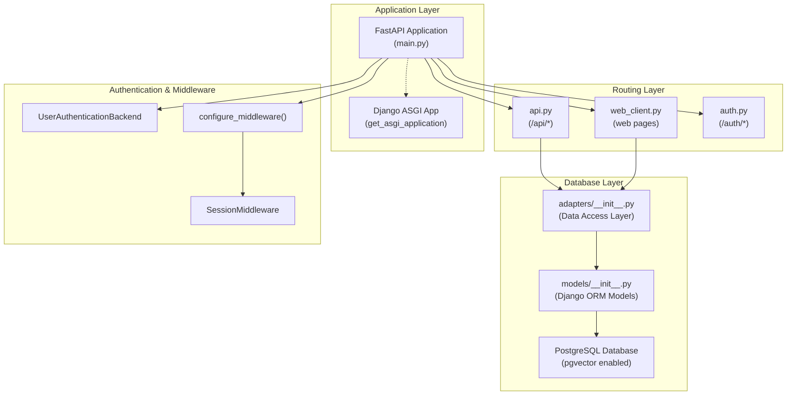
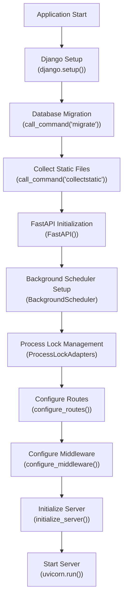
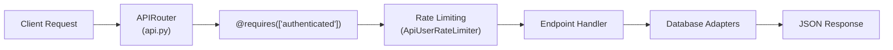
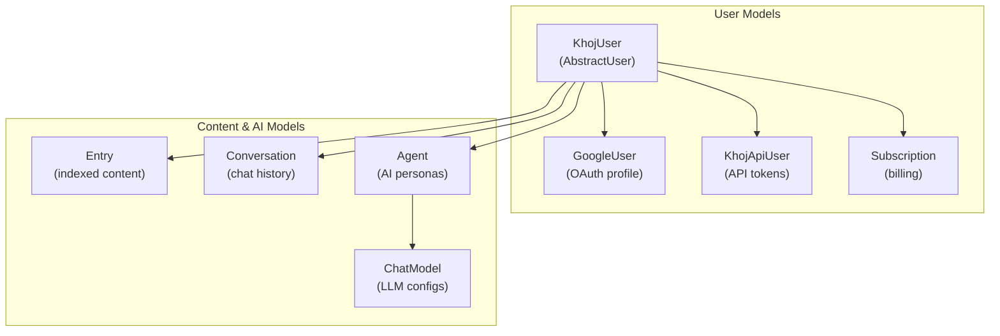
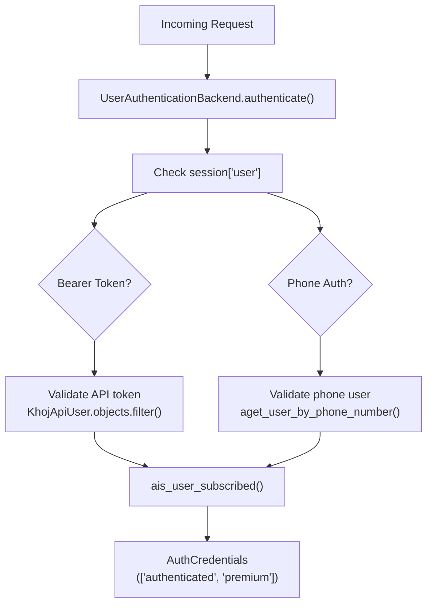

<!-- source: DeepWiki mcp.deepwiki.com · repo khoj-ai/khoj · page 2 Core Backend System · fetched 2026-10-29 -->

# Core Backend System

Relevant source files

The following files were used as context for generating this wiki page:

- [src/khoj/app/settings.py](src/khoj/app/settings.py)
- [src/khoj/configure.py](src/khoj/configure.py)
- [src/khoj/database/adapters/__init__.py](src/khoj/database/adapters/__init__.py)
- [src/khoj/database/admin.py](src/khoj/database/admin.py)
- [src/khoj/database/models/__init__.py](src/khoj/database/models/__init__.py)
- [src/khoj/main.py](src/khoj/main.py)
- [src/khoj/routers/api.py](src/khoj/routers/api.py)
- [src/khoj/routers/web_client.py](src/khoj/routers/web_client.py)
- [src/khoj/utils/cli.py](src/khoj/utils/cli.py)
- [src/khoj/utils/state.py](src/khoj/utils/state.py)

## Purpose and Scope

This document covers Khoj's core backend infrastructure, including application initialization, API routing, database management, and authentication systems. The backend serves as the central hub that coordinates between multiple client interfaces and AI processing services.

For information about conversation processing and AI integration, see [Conversation and AI System](#3). For content indexing and search capabilities, see [Content Processing and Search](#4). For client-side applications, see [User Interfaces](#5).

## Application Architecture Overview

Khoj's backend uses a dual-framework architecture combining FastAPI for API endpoints with Django for database management and admin functionality.

### Core Architecture

**Sources:** [src/khoj/main.py:61-68](), [src/khoj/configure.py:30-36](), [src/khoj/routers/api.py:31](), [src/khoj/database/models/__init__.py:136-141](), [src/khoj/database/adapters/__init__.py:38-71]()

### Application Bootstrap Process

The application initialization sequence ensures the database is migrated, static files are collected, and background services are started before the web server begins accepting requests.

**Sources:** [src/khoj/main.py:38-58](), [src/khoj/main.py:150-185](), [src/khoj/configure.py:195-197]()

For details on initialization logic and environment variables, see [Application Bootstrap and Configuration](#2.1).

## API Router System

The backend exposes functionality through multiple specialized API routers. The primary `api` router handles core system functions, while `web_client` serves the frontend application.

### Router Structure

| Router | Path Prefix | Purpose | Key Endpoints |
|--------|-------------|---------|---------------|
| `api` | `/api` | Core system functions | `/search`, `/update`, `/transcribe`, `/settings` |
| `web_client` | `/` | Web interface and static pages | `/`, `/home`, `/chat`, `/settings` |

**Sources:** [src/khoj/routers/api.py:31-218](), [src/khoj/routers/web_client.py:15-139]()

### Core API Endpoints Flow

Endpoints are protected by authentication scopes and often include rate limiting dependencies to prevent abuse.

**Sources:** [src/khoj/routers/api.py:46-58](), [src/khoj/routers/api.py:108-120]()

For details on routing, middleware, and request handling, see [API Routers and Middleware](#2.2).

## Database Architecture

Khoj uses Django ORM with PostgreSQL as the primary database. It supports an embedded mode using `pgserver` for simplified local deployments. The schema includes support for vector embeddings via the `pgvector` extension.

### Core Model Hierarchy

The data model is centered around the `KhojUser` and their associated content, conversations, and AI agents.

**Sources:** [src/khoj/database/models/__init__.py:153-168](), [src/khoj/database/models/__init__.py:185-193](), [src/khoj/database/models/__init__.py:194-205](), [src/khoj/database/models/__init__.py:220-230]()

### Database Adapter Pattern

The system uses adapter functions (primarily in `src/khoj/database/adapters/`) to provide a clean interface for data operations, abstracting the underlying Django ORM calls.

**Sources:** [src/khoj/database/adapters/__init__.py:141-228]()

For details on models, migrations, and multi-tenant isolation, see [Database Models and Adapters](#2.3).

## Authentication System

Khoj implements a multi-method authentication system supporting session-based auth (for the web app), Bearer tokens (for API clients), and phone-based authentication.

### Authentication Backend Flow

The `UserAuthenticationBackend` handles the logic of identifying users across different request types.

**Sources:** [src/khoj/configure.py:98-166](), [src/khoj/configure.py:168-184]()

For details on OAuth, magic links, and subscription-based access control, see [Authentication and Authorization](#2.4).

## Configuration Management

The system maintains global state through the `state` module, managing shared resources like LLM clients, background schedulers, and model instances.

| State Variable | Type | Purpose |
|---------------|------|---------|
| `openai_client` | `OpenAI` | Shared OpenAI API client instance |
| `scheduler` | `BackgroundScheduler` | Manages scheduled background tasks |
| `embeddings_model` | `Dict[str, EmbeddingsModel]` | Cached embedding models for indexing |
| `anonymous_mode` | `bool` | Flag for single-user mode without login |

**Sources:** [src/khoj/utils/state.py:17-41]()

---

