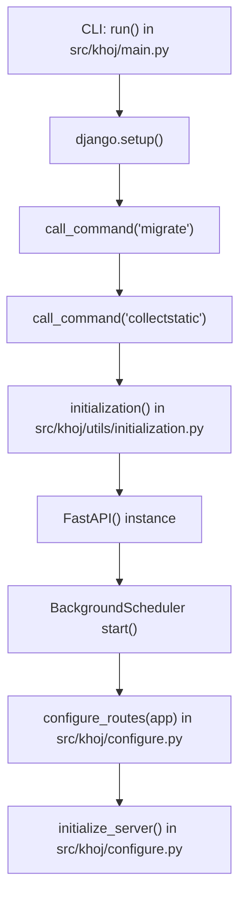
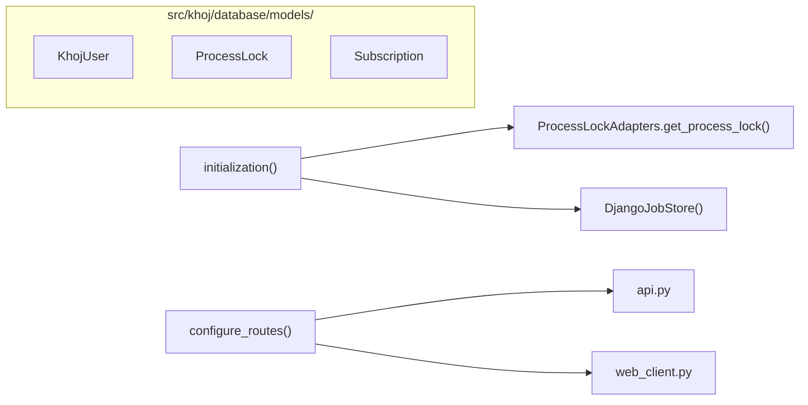

<!-- source: DeepWiki mcp.deepwiki.com · repo khoj-ai/khoj · page 2.1 Application Bootstrap and Configuration · fetched 2026-10-29 -->

# Application Bootstrap and Configuration

Relevant source files

The following files were used as context for generating this wiki page:

- [documentation/package.json](documentation/package.json)
- [documentation/yarn.lock](documentation/yarn.lock)
- [pyproject.toml](pyproject.toml)
- [src/interface/desktop/yarn.lock](src/interface/desktop/yarn.lock)
- [src/interface/obsidian/yarn.lock](src/interface/obsidian/yarn.lock)
- [src/interface/web/bun.lock](src/interface/web/bun.lock)
- [src/interface/web/tsconfig.json](src/interface/web/tsconfig.json)
- [src/khoj/app/settings.py](src/khoj/app/settings.py)
- [src/khoj/configure.py](src/khoj/configure.py)
- [src/khoj/database/adapters/__init__.py](src/khoj/database/adapters/__init__.py)
- [src/khoj/database/admin.py](src/khoj/database/admin.py)
- [src/khoj/database/models/__init__.py](src/khoj/database/models/__init__.py)
- [src/khoj/main.py](src/khoj/main.py)
- [src/khoj/routers/api.py](src/khoj/routers/api.py)
- [src/khoj/routers/web_client.py](src/khoj/routers/web_client.py)
- [src/khoj/utils/cli.py](src/khoj/utils/cli.py)
- [src/khoj/utils/config.py](src/khoj/utils/config.py)
- [src/khoj/utils/rawconfig.py](src/khoj/utils/rawconfig.py)
- [src/khoj/utils/state.py](src/khoj/utils/state.py)
- [uv.lock](uv.lock)

This page documents how the Khoj application initializes, including dependency management, configuration systems, environment variables, and the bootstrap process. This covers the foundational setup that occurs before the FastAPI application begins handling requests.

For information about the FastAPI routing structure and middleware, see [API Routers and Middleware](2.2). For database model definitions, see [Database Models and Adapters](2.3).

---

## Overview

Khoj's bootstrap process consists of several phases:

1.  **Dependency Resolution**: Python dependencies defined in `pyproject.toml` are installed.
2.  **Container Build**: Multi-stage build process creates the application container.
3.  **Environment Configuration**: Environment variables are loaded and validated.
4.  **Database Migrations**: Django migrations ensure the database schema is current.
5.  **Application Initialization**: Admin users and AI model configurations are created.
6.  **Server Startup**: Uvicorn or Gunicorn workers begin accepting requests.

---

## Dependency Management

### Project Metadata and Dependencies

The application's dependencies and metadata are defined in `pyproject.toml` using the `hatchling` build system with dynamic versioning from git tags via `hatch-vcs` [pyproject.toml:1-3]().

**Core Dependency Groups:**

| Dependency Group | Purpose | Key Packages |
| :--- | :--- | :--- |
| **Core Runtime** | Essential application dependencies | `fastapi >= 0.110.0`, `django == 5.1.15`, `uvicorn >= 0.31.1`, `pydantic >= 2.0.0` |
| **AI/ML** | Machine learning and LLM integration | `torch == 2.6.0`, `transformers >= 4.53.0`, `sentence-transformers == 3.4.1`, `openai >= 2.0.0`, `anthropic == 0.75.0`, `google-genai == 1.52.0` |
| **Database** | PostgreSQL with vector search | `psycopg2-binary == 2.9.9`, `pgvector == 0.2.4` |
| **Content Processing** | Document parsing and indexing | `pymupdf == 1.24.11`, `beautifulsoup4 ~= 4.12.3`, `langchain-text-splitters == 0.3.11`, `rapidocr-onnxruntime == 1.4.4` |
| **Background Tasks** | Job scheduling | `apscheduler ~= 3.10.0`, `django_apscheduler == 0.7.0` |
| **Authentication** | Auth and security | `authlib == 1.6.9`, `itsdangerous == 2.1.2`, `django-phonenumber-field == 7.3.0` |
| **Production** (`prod`) | Production deployment | `gunicorn == 22.0.0`, `stripe == 7.3.0`, `twilio == 8.11`, `boto3 >= 1.34.57` |
| **Local** (`local`) | Local PostgreSQL server | `pgserver == 0.1.4` |
| **Development** (`dev`) | Testing and linting | `pytest >= 7.1.2`, `mypy >= 1.0.1`, `ruff >= 0.12.0` |

**Build Configuration:**

The project defines a CLI entry point: running `khoj` executes the `run()` function in `src/khoj/main.py` [pyproject.toml:106-107]().

**Python Version Constraint:**

The application requires Python versions `3.10`, `3.11`, or `3.12` [pyproject.toml:10]().

Sources: [pyproject.toml:1-133]()

---

## Application Entry Point

The application bootstrap follows a strict sequence where each phase must complete before the next begins. The `khoj.main:run` entry point orchestrates this sequence.

### Natural Language to Code: Bootstrap Flow

This diagram maps the high-level bootstrap concepts to the specific functions and modules in the codebase.

| High-Level Concept | Code Entity |
| :--- | :--- |
| Entry Point | `khoj.main:run` [src/khoj/main.py:119]() |
| CLI Parsing | `khoj.utils.cli:cli` [src/khoj/main.py:125]() |
| Django Setup | `django.setup()` [src/khoj/main.py:39]() |
| DB Migrations | `call_command("migrate", "--noinput")` [src/khoj/main.py:53]() |
| Static Files | `call_command("collectstatic", "--noinput")` [src/khoj/main.py:58]() |
| Logic Init | `initialization()` [src/khoj/main.py:138]() |
| FastAPI Init | `FastAPI()` [src/khoj/main.py:62]() |

### System Bootstrap Diagram

"Application Bootstrap Flow"

Sources: [src/khoj/main.py:1-198](), [src/khoj/configure.py:94-197]()

---

## Initialization Logic

### Database and Django Integration

Khoj initializes Django settings by setting `DJANGO_SETTINGS_MODULE` to `khoj.app.settings` [src/khoj/main.py:38](). The database configuration supports both standard PostgreSQL and an embedded `pgserver` for local use if `USE_EMBEDDED_DB` is enabled [src/khoj/app/settings.py:127-189]().

### Scheduler and Leader Election

Khoj uses `BackgroundScheduler` with a `DjangoJobStore` to manage scheduled tasks [src/khoj/main.py:156-163](). In distributed environments, it uses a `ProcessLock` mechanism to elect a "Schedule Leader" so only one instance executes jobs [src/khoj/main.py:166-182]().

### Natural Language to Code: Initialization Entities

This diagram associates initialization logic with specific Django models and configuration functions.

| Concept | Code Entity |
| :--- | :--- |
| User Model | `KhojUser` [src/khoj/database/models/__init__.py:153]() |
| Distributed Lock | `ProcessLock` [src/khoj/database/models/__init__.py:28]() |
| Route Setup | `configure_routes` [src/khoj/configure.py:94]() |
| Content Init | `initialize_content` [src/khoj/routers/api.py:13]() |
| App Settings | `src/khoj/app/settings.py` |

"Initialization Logic Map"

Sources: [src/khoj/main.py:103-182](), [src/khoj/app/settings.py:178-192](), [src/khoj/configure.py:38-51]()

---

## Environment Configuration

Khoj uses environment variables for core application settings, defined primarily in `src/khoj/app/settings.py`.

### Core Settings

| Variable | Code Reference | Purpose |
| :--- | :--- | :--- |
| `KHOJ_DJANGO_SECRET_KEY` | `SECRET_KEY` [src/khoj/app/settings.py:26]() | Django security key |
| `KHOJ_DOMAIN` | `KHOJ_DOMAIN` [src/khoj/app/settings.py:29]() | Primary application domain |
| `KHOJ_NO_HTTPS` | `DISABLE_HTTPS` [src/khoj/app/settings.py:44]() | Toggle for HTTPS enforcement |
| `POSTGRES_DB` | `DB_NAME` [src/khoj/app/settings.py:122]() | Database name |
| `USE_EMBEDDED_DB` | `USE_EMBEDDED_DB` [src/khoj/app/settings.py:127]() | Flag for `pgserver` usage |

### CORS and Trusted Origins

The application dynamically configures CORS based on `KHOJ_DOMAIN` and `KHOJ_NO_HTTPS` [src/khoj/main.py:70-88](). It also includes default origins for desktop and mobile clients like Obsidian and the Khoj Desktop app [src/khoj/main.py:73-80]().

Sources: [src/khoj/app/settings.py:22-115](), [src/khoj/main.py:70-88]()

---

## Middleware Configuration

The bootstrap process configures several FastAPI middlewares via `configure_middleware` in `src/khoj/configure.py`.

### Middleware Stack

| Middleware Class | Purpose |
| :--- | :--- |
| `CORSMiddleware` | Handles cross-origin requests [src/khoj/main.py:82]() |
| `AsyncCloseConnectionsMiddleware` | Ensures Django DB connections are closed after requests [src/khoj/configure.py:69-87]() |
| `SessionMiddleware` | Manages user sessions [src/khoj/configure.py:34]() |
| `AuthenticationMiddleware` | Integrates `UserAuthenticationBackend` [src/khoj/configure.py:31]() |

### Authentication Backend

The `UserAuthenticationBackend` supports multiple authentication methods during initialization:
1.  **Session Auth**: Checks `request.session.get("user")` [src/khoj/configure.py:124]().
2.  **Bearer Token**: Validates `Authorization` headers for API keys (`KhojApiUser`) [src/khoj/configure.py:145-155]().
3.  **Twilio Auth**: Authenticates requests from WhatsApp via phone number [src/khoj/configure.py:169-173]().

Sources: [src/khoj/configure.py:31-173](), [src/khoj/main.py:82-88]()

---

