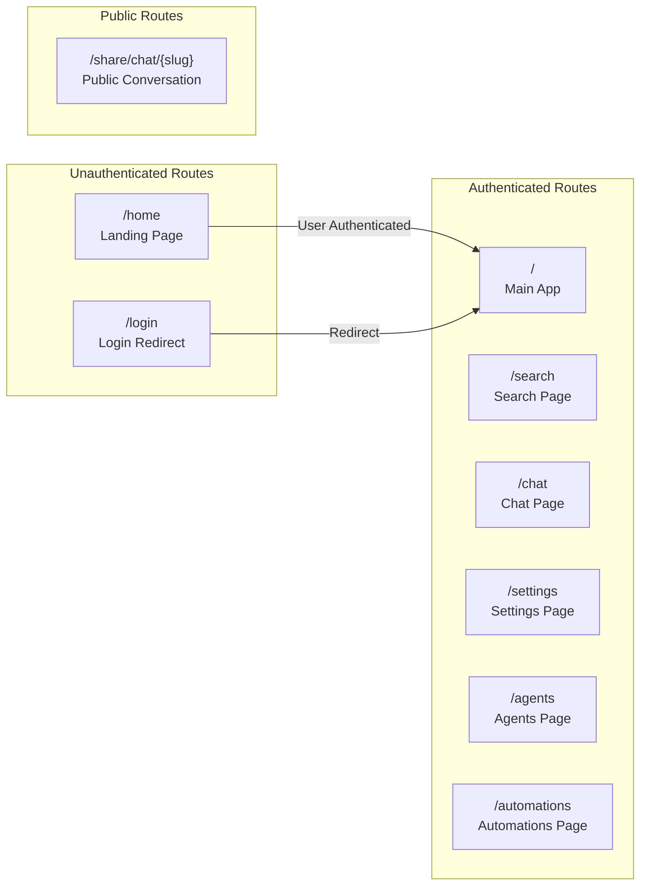
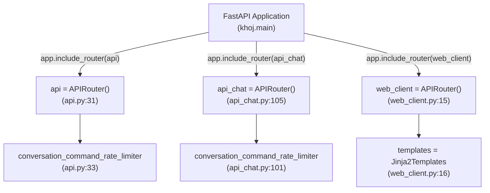
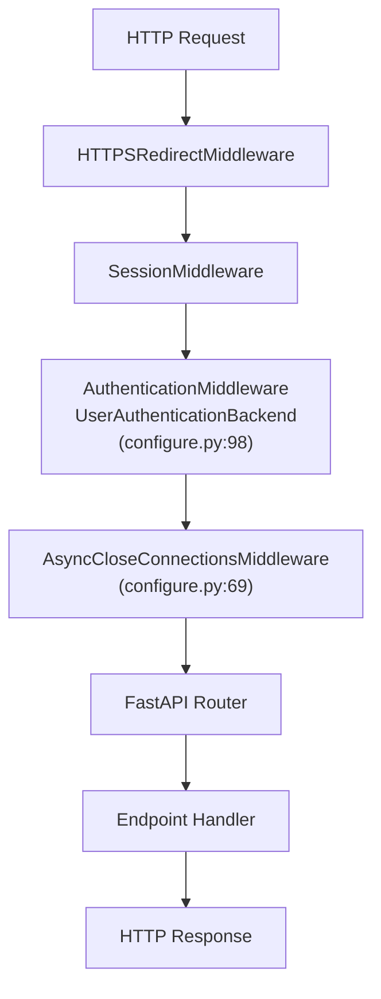
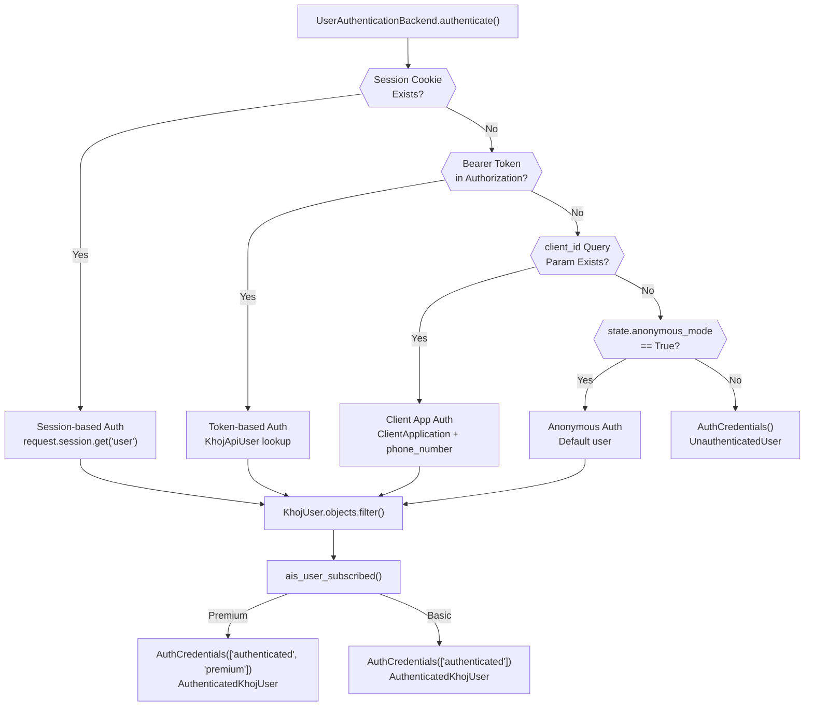

<!-- source: DeepWiki mcp.deepwiki.com · repo khoj-ai/khoj · page 2.2 API Routers and Middleware · fetched 2026-10-29 -->

# API Routers and Middleware

<details>
<summary>Relevant source files</summary>

The following files were used as context for generating this wiki page:

- [src/khoj/configure.py](src/khoj/configure.py)
- [src/khoj/database/adapters/__init__.py](src/khoj/database/adapters/__init__.py)
- [src/khoj/database/admin.py](src/khoj/database/admin.py)
- [src/khoj/database/models/__init__.py](src/khoj/database/models/__init__.py)
- [src/khoj/processor/content/github/github_to_entries.py](src/khoj/processor/content/github/github_to_entries.py)
- [src/khoj/processor/content/notion/notion_to_entries.py](src/khoj/processor/content/notion/notion_to_entries.py)
- [src/khoj/processor/conversation/prompts.py](src/khoj/processor/conversation/prompts.py)
- [src/khoj/processor/conversation/utils.py](src/khoj/processor/conversation/utils.py)
- [src/khoj/processor/image/generate.py](src/khoj/processor/image/generate.py)
- [src/khoj/processor/tools/online_search.py](src/khoj/processor/tools/online_search.py)
- [src/khoj/processor/tools/run_code.py](src/khoj/processor/tools/run_code.py)
- [src/khoj/routers/api.py](src/khoj/routers/api.py)
- [src/khoj/routers/api_agents.py](src/khoj/routers/api_agents.py)
- [src/khoj/routers/api_automation.py](src/khoj/routers/api_automation.py)
- [src/khoj/routers/api_chat.py](src/khoj/routers/api_chat.py)
- [src/khoj/routers/api_content.py](src/khoj/routers/api_content.py)
- [src/khoj/routers/api_model.py](src/khoj/routers/api_model.py)
- [src/khoj/routers/helpers.py](src/khoj/routers/helpers.py)
- [src/khoj/routers/research.py](src/khoj/routers/research.py)
- [src/khoj/routers/web_client.py](src/khoj/routers/web_client.py)
- [src/khoj/utils/helpers.py](src/khoj/utils/helpers.py)
- [tests/test_api_automation.py](tests/test_api_automation.py)
- [tests/test_online_chat_actors.py](tests/test_online_chat_actors.py)
- [tests/test_online_chat_director.py](tests/test_online_chat_director.py)

</details>


This document describes the FastAPI routing architecture and middleware stack that handles HTTP requests in Khoj. It covers the three main routers (`api.py`, `api_chat.py`, `web_client.py`), authentication mechanisms, rate limiting, and request/response processing pipelines.

For conversation processing logic that occurs after routing, see [Chat Processing Pipeline](). For database models used in authentication, see [Database Models and Adapters]().

## Router Architecture

Khoj organizes its API surface into three FastAPI routers that handle distinct concerns:

### Main API Router (`api`)

The `api` router in [src/khoj/routers/api.py]() handles core platform operations:

| Endpoint | Method | Purpose | Authentication |
|----------|--------|---------|----------------|
| `/search` | GET | Semantic search over user documents | Required |
| `/update` | GET | Trigger content reindexing | Required |
| `/transcribe` | POST | Audio-to-text transcription | Required |
| `/settings` | GET | Retrieve user configuration | Required |
| `/user/name` | PATCH | Update user name | Required |
| `/user/memory` | PATCH | Toggle memory feature | Required |
| `/self` | DELETE | Delete user account | Required |

Sources: [src/khoj/routers/api.py:31-269]()

### Chat API Router (`api_chat`)

The `api_chat` router in [src/khoj/routers/api_chat.py]() manages conversation-related operations:

| Endpoint Group | Key Endpoints | Purpose |
|----------------|---------------|---------|
| **Session Management** | `GET /sessions`, `POST /sessions` | List and create conversations |
| **History** | `GET /history`, `DELETE /history` | Retrieve and clear conversation logs |
| **Sharing** | `POST /share`, `DELETE /share`, `POST /share/fork` | Public conversation management |
| **File Filters** | `POST /conversation/file-filters`, `DELETE /conversation/file-filters` | Scope conversations to specific files |
| **Title Management** | `POST /title`, `PATCH /title` | Generate or set conversation titles |
| **Message Operations** | `DELETE /conversation/message` | Delete individual messages |
| **Utilities** | `GET /stats`, `GET /export` | Metadata and configuration |
| **Feedback** | `POST /feedback` | Submit query feedback |
| **Speech** | `POST /speech` | Text-to-speech synthesis |

Sources: [src/khoj/routers/api_chat.py:105-186]()

### Web Client Router (`web_client`)

The `web_client` router in [src/khoj/routers/web_client.py]() serves HTML pages using Jinja2 templates:



**Diagram: Web Client Route Structure**

Sources: [src/khoj/routers/web_client.py:21-139]()

## Router Initialization Flow



**Diagram: Router Registration and Dependencies**

Sources: [src/khoj/routers/api.py:31-35](), [src/khoj/routers/api_chat.py:101-105](), [src/khoj/routers/web_client.py:15-17]()

## Middleware Stack

Khoj implements a middleware stack for request processing, authentication, and connection management in [src/khoj/configure.py]().

### Middleware Execution Order



**Diagram: Middleware Stack Processing Order**

The middleware stack is configured in [src/khoj/configure.py]() with the following components:

1. **HTTPSRedirectMiddleware**: Redirects HTTP to HTTPS (if enabled).
2. **SessionMiddleware**: Manages user sessions with encrypted cookies.
3. **AuthenticationMiddleware**: Authenticates requests via `UserAuthenticationBackend`.
4. **AsyncCloseConnectionsMiddleware**: Manages Django database connections in async context.

Sources: [src/khoj/configure.py:30-36](), [src/khoj/configure.py:69-95]()

### AsyncCloseConnectionsMiddleware

This middleware solves Django connection management issues in mixed sync/async contexts:

```python
# From src/khoj/configure.py:69-95
class AsyncCloseConnectionsMiddleware(BaseHTTPMiddleware):
    async def dispatch(self, request, call_next):
        await run_in_threadpool(close_old_connections)
        await sync_to_async(close_old_connections)()
        try:
            response = await call_next(request)
        finally:
            if getattr(settings, "CLOSE_CONNECTIONS_AFTER_REQUEST", False):
                await run_in_threadpool(connections.close_all)
                await sync_to_async(connections.close_all)()
        return response
```

Sources: [src/khoj/configure.py:69-95]()

## Authentication System

### Authentication Backend

The `UserAuthenticationBackend` in [src/khoj/configure.py:98-231]() implements Starlette's `AuthenticationBackend` interface.



**Diagram: Authentication Flow in UserAuthenticationBackend**

Sources: [src/khoj/configure.py:119-231]()

### Authentication Methods

#### Session Authentication
Used by web clients after login. It checks `request.session.get("user")` and performs a lookup in the `KhojUser` manager [src/khoj/configure.py:124-142]().

#### Bearer Token Authentication
Used by Desktop, Emacs, and Obsidian clients. It extracts the token from the `Authorization` header and looks up the associated `KhojApiUser` [src/khoj/configure.py:144-166]().

#### Client Application Authentication
Used by WhatsApp/Twilio integration. It uses a `client_id` and `client_secret` to authenticate a `ClientApplication` and identifies the user by `phone_number` [src/khoj/configure.py:168-215]().

#### Anonymous Mode
When `state.anonymous_mode` is enabled, the system defaults to a "default" user [src/khoj/configure.py:217-229]().

### AuthenticatedKhojUser

The `AuthenticatedKhojUser` class extends Starlette's `SimpleUser` to hold the Django model instance and optional client app metadata:

```python
# From src/khoj/configure.py:62-66
class AuthenticatedKhojUser(SimpleUser):
    def __init__(self, user, client_app: Optional[ClientApplication] = None):
        self.object = user
        self.client_app = client_app
        super().__init__(user.username)
```

Sources: [src/khoj/configure.py:62-66]()

## Rate Limiting

Khoj implements rate limiting using custom dependency classes in [src/khoj/routers/helpers.py]().

### Rate Limiter Classes

| Class | Purpose | Source |
|-------|---------|--------|
| `ApiUserRateLimiter` | Sliding window rate limiting for specific API slugs | [src/khoj/routers/helpers.py:1755]() |
| `ConversationCommandRateLimiter` | Rate limiting for specialized conversation commands | [src/khoj/routers/helpers.py:1709]() |
| `ApiImageRateLimiter` | Rate limiting for image generation requests | [src/khoj/routers/helpers.py:1876]() |

### Implementation Detail

The `ApiUserRateLimiter` uses `RateLimitRecord` models to track request counts within a specified `window` (in seconds). It distinguishes between trial and subscribed users [src/khoj/routers/helpers.py:1755-1837]().

```python
# Usage example in src/khoj/routers/api.py:114-119
rate_limiter_per_minute=Depends(
    ApiUserRateLimiter(requests=20, subscribed_requests=20, window=60, slug="transcribe_minute")
)
```

Sources: [src/khoj/routers/api.py:108-120](), [src/khoj/routers/helpers.py:1709-1941]()

## Request Processing and Telemetry

### Common Query Parameters
The `CommonQueryParams` dependency captures metadata like `user_agent`, `referer`, and `host` [src/khoj/routers/helpers.py:1696-1706]().

### Telemetry Tracking
The `update_telemetry_state` function is called at the end of API requests to log usage data, including `subscription_type` and `client_id` [src/khoj/routers/helpers.py:197-233]().

```python
# Example call in src/khoj/routers/api.py:70-75
update_telemetry_state(
    request=request,
    telemetry_type="api",
    api="search",
    **common.__dict__,
)
```

Sources: [src/khoj/routers/helpers.py:197-233](), [src/khoj/routers/api.py:70-75]()

## WebSocket Management

The `WebSocketConnectionManager` in [src/khoj/routers/helpers.py:1640]() manages active WebSocket connections, typically keyed by `conversation_id`.

```python
# From src/khoj/routers/helpers.py:1640-1664
class WebSocketConnectionManager:
    def __init__(self):
        self.active_connections: Dict[str, WebSocket] = {}

    async def connect(self, conversation_id: str, websocket: WebSocket):
        await websocket.accept()
        self.active_connections[conversation_id] = websocket
    ...
```

Sources: [src/khoj/routers/helpers.py:1640-1664]()

---

