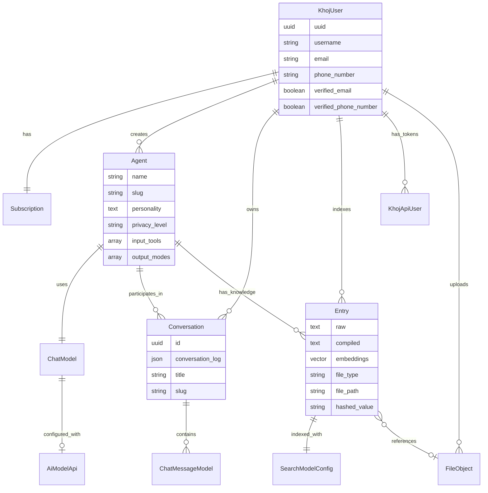
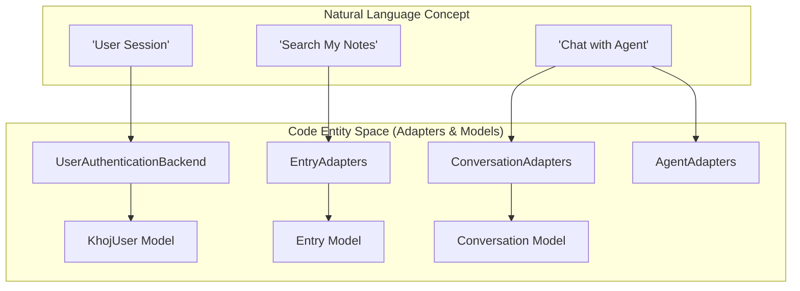
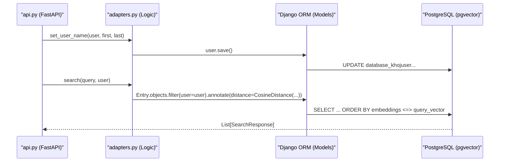

<!-- source: DeepWiki mcp.deepwiki.com · repo khoj-ai/khoj · page 2.3 Database Models and Adapters · fetched 2026-10-29 -->

# Database Models and Adapters

Relevant source files

The following files were used as context for generating this wiki page:

- [src/khoj/configure.py](src/khoj/configure.py)
- [src/khoj/database/adapters/__init__.py](src/khoj/database/adapters/__init__.py)
- [src/khoj/database/admin.py](src/khoj/database/admin.py)
- [src/khoj/database/management/__init__.py](src/khoj/database/management/__init__.py)
- [src/khoj/database/management/commands/__init__.py](src/khoj/database/management/commands/__init__.py)
- [src/khoj/database/management/commands/change_default_model.py](src/khoj/database/management/commands/change_default_model.py)
- [src/khoj/database/management/commands/convert_images_png_to_webp.py](src/khoj/database/management/commands/convert_images_png_to_webp.py)
- [src/khoj/database/management/commands/delete_orphaned_fileobjects.py](src/khoj/database/management/commands/delete_orphaned_fileobjects.py)
- [src/khoj/database/migrations/0073_delete_usersearchmodelconfig.py](src/khoj/database/migrations/0073_delete_usersearchmodelconfig.py)
- [src/khoj/database/migrations/0079_entry_file_object.py](src/khoj/database/migrations/0079_entry_file_object.py)
- [src/khoj/database/migrations/0079_searchmodelconfig_embeddings_inference_endpoint_type.py](src/khoj/database/migrations/0079_searchmodelconfig_embeddings_inference_endpoint_type.py)
- [src/khoj/database/models/__init__.py](src/khoj/database/models/__init__.py)
- [src/khoj/routers/api.py](src/khoj/routers/api.py)
- [src/khoj/routers/web_client.py](src/khoj/routers/web_client.py)

This document covers Khoj's database layer, including Django ORM models that define the database schema and adapter classes that provide a data access layer for the application. The models handle persistent storage of users, conversations, agents, content entries, and system configuration, while adapters encapsulate database operations and business logic.

## Database Models Architecture

Khoj uses Django ORM models to define the database schema. The core models are organized around users, AI agents, conversations, and content indexing.

Title: Entity Relationship of Core Database Models

Sources: [src/khoj/database/models/__init__.py:153-690](), [src/khoj/database/models/__init__.py:507-549]()

### Core User Models
The `KhojUser` model extends Django's `AbstractUser` [src/khoj/database/models/__init__.py:153-164](). It serves as the central entity for multi-tenant isolation. Related models include:
- `GoogleUser`: Stores OAuth data like `sub`, `picture`, and `locale` [src/khoj/database/models/__init__.py:170-182]().
- `KhojApiUser`: Manages API tokens (`kk-...`) for external clients [src/khoj/database/models/__init__.py:185-192]().
- `Subscription`: Tracks `Type` (Trial/Standard) and `renewal_date` [src/khoj/database/models/__init__.py:194-203]().

### AI Agent Models
The `Agent` model defines specialized AI personas [src/khoj/database/models/__init__.py:375-470]().
- **Personality**: A system prompt that dictates behavior.
- **Tools**: Configured via `input_tools` (e.g., online search, code interpreter).
- **Models**: Linked via `ChatModel` which specifies `model_name`, `model_type`, and associated `AiModelApi` [src/khoj/database/models/__init__.py:220-234]().

### Content and Search Models
- `Entry`: Represents a chunk of indexed content. It uses `VectorField` from `pgvector` to store high-dimensional embeddings [src/khoj/database/models/__init__.py:527]().
- `FileObject`: Tracks physical or synced files, linked to `Entry` via a ForeignKey [src/khoj/database/models/__init__.py:507-519](), [src/khoj/database/migrations/0079_entry_file_object.py:58-68]().
- `SearchModelConfig`: Stores configuration for bi-encoders and cross-encoders used in semantic search [src/khoj/database/models/__init__.py:265-296]().

## Database Adapters Layer

Adapters act as a bridge between the high-level application logic (FastAPI) and the low-level ORM models. They are located in `src/khoj/database/adapters/`.

Title: Bridge between Natural Language Space and Code Entity Space

Sources: [src/khoj/configure.py:98-118](), [src/khoj/database/adapters/__init__.py:680-700](), [src/khoj/routers/api.py:14-16]()

### Key Adapter Classes

| Class | Key Functions | File Reference |
|-------|---------------|----------------|
| `AgentAdapters` | `aget_agent_by_slug`, `create_default_agent`, `atomic_update_agent` | [src/khoj/database/adapters/__init__.py:680]() |
| `ConversationAdapters` | `get_speech_to_text_config`, `get_default_chat_model` | [src/khoj/database/adapters/__init__.py:1015]() |
| `EntryAdapters` | Handles search and content retrieval patterns | [src/khoj/database/adapters/__init__.py:38]() |
| `ProcessLockAdapters` | `get_lock`, `release_lock` for background task synchronization | [src/khoj/database/adapters/__init__.py:597]() |

### Data Access Patterns & Isolation
Khoj enforces multi-tenancy primarily through the adapter layer and decorators:
- **Decorators**: `@require_valid_user` and `@arequire_valid_user` ensure that a `KhojUser` object is present in the arguments before executing a database query [src/khoj/database/adapters/__init__.py:106-137]().
- **Filtering**: Most adapter queries include `.filter(user=user)` to prevent cross-tenant data access. For example, `get_khoj_tokens` filters strictly by the provided user object [src/khoj/database/adapters/__init__.py:168-170]().

## Integration with Application Layer

The database layer integrates with Khoj's FastAPI application through dependency injection and authentication middleware.

### Authentication Integration
The `UserAuthenticationBackend` resolves authenticated users from various sources [src/khoj/configure.py:98-167]():
1. **Sessions**: Checks `request.session.get("user")` for web clients [src/khoj/configure.py:124]().
2. **Bearer Tokens**: Parses the `Authorization` header to find a matching `KhojApiUser` [src/khoj/configure.py:145-155]().
3. **Internal Default**: Initializes a `default` user if none exists for single-user local deployments [src/khoj/configure.py:109-117]().

### Process and Task Management
Khoj uses `django-apscheduler` for managing background jobs [src/khoj/database/admin.py:46-77](). The `ProcessLock` model and `ProcessLockAdapters` ensure that tasks like content indexing do not overlap for the same user, which could lead to race conditions [src/khoj/database/adapters/__init__.py:597-605]().

Title: Data Flow from API to Persistent Storage

Sources: [src/khoj/routers/api.py:186-215](), [src/khoj/database/adapters/__init__.py:35](), [src/khoj/database/models/__init__.py:527]()

---

