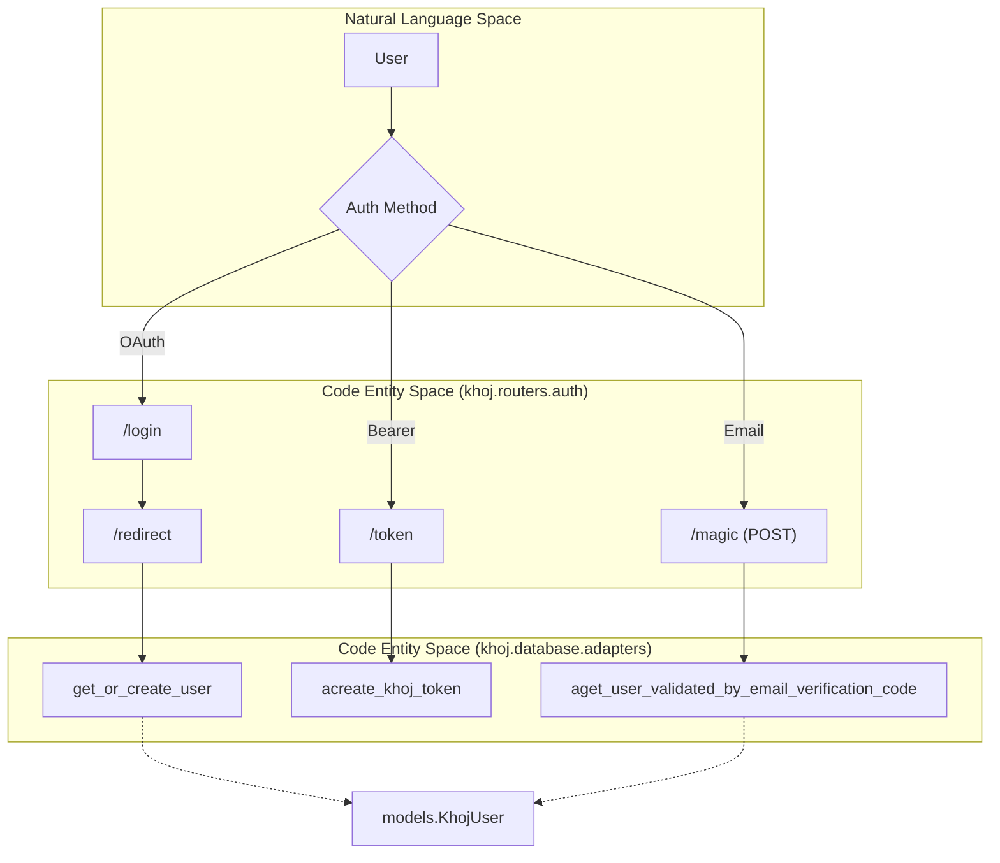
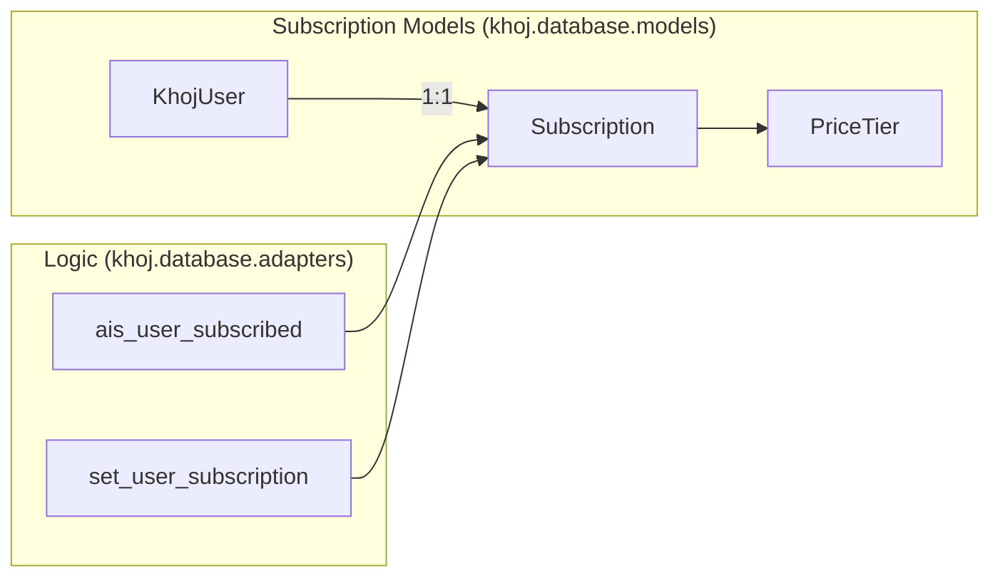

<!-- source: DeepWiki mcp.deepwiki.com · repo khoj-ai/khoj · page 2.4 Authentication and Authorization · fetched 2026-10-29 -->

# Authentication and Authorization

Relevant source files

The following files were used as context for generating this wiki page:

- [documentation/assets/img/admin_get_emali_login.png](documentation/assets/img/admin_get_emali_login.png)
- [documentation/assets/img/admin_successful_login_url.png](documentation/assets/img/admin_successful_login_url.png)
- [documentation/assets/img/magic_link.png](documentation/assets/img/magic_link.png)
- [src/interface/web/app/components/loginPrompt/loginPopup.tsx](src/interface/web/app/components/loginPrompt/loginPopup.tsx)
- [src/interface/web/app/components/loginPrompt/loginPrompt.module.css](src/interface/web/app/components/loginPrompt/loginPrompt.module.css)
- [src/interface/web/app/components/loginPrompt/loginPrompt.tsx](src/interface/web/app/components/loginPrompt/loginPrompt.tsx)
- [src/khoj/configure.py](src/khoj/configure.py)
- [src/khoj/database/adapters/__init__.py](src/khoj/database/adapters/__init__.py)
- [src/khoj/database/admin.py](src/khoj/database/admin.py)
- [src/khoj/database/migrations/0046_khojuser_email_verification_code_and_more.py](src/khoj/database/migrations/0046_khojuser_email_verification_code_and_more.py)
- [src/khoj/database/migrations/0071_subscription_enabled_trial_at_and_more.py](src/khoj/database/migrations/0071_subscription_enabled_trial_at_and_more.py)
- [src/khoj/database/models/__init__.py](src/khoj/database/models/__init__.py)
- [src/khoj/interface/email/magic_link.html](src/khoj/interface/email/magic_link.html)
- [src/khoj/interface/email/task.html](src/khoj/interface/email/task.html)
- [src/khoj/interface/email/welcome.html](src/khoj/interface/email/welcome.html)
- [src/khoj/routers/api.py](src/khoj/routers/api.py)
- [src/khoj/routers/api_subscription.py](src/khoj/routers/api_subscription.py)
- [src/khoj/routers/auth.py](src/khoj/routers/auth.py)
- [src/khoj/routers/email.py](src/khoj/routers/email.py)
- [src/khoj/routers/web_client.py](src/khoj/routers/web_client.py)

## Purpose and Scope

The Authentication and Authorization system provides secure user identity management, session handling, and access control for Khoj. It supports multiple authentication methods including OAuth (Google), magic link email authentication, and API token-based access. Beyond identity, the system implements subscription-based authorization patterns and granular rate limiting to manage resource consumption.

## Authentication Mechanisms

Khoj supports three primary authentication methods, each serving different use cases:

| Method | Use Case | Implementation |
|--------|----------|----------------|
| **Google OAuth** | Primary web login | OAuth 2.0 with Google Identity Platform |
| **Magic Links** | Email-based passwordless login | Time-limited verification codes (OTP) |
| **API Tokens** | Programmatic/Client access | Bearer token authentication |

The system can operate in anonymous mode for development or single-user deployments by setting the `--anonymous-mode` flag [src/khoj/routers/auth.py:41-57]().

### Authentication Flow and Data Mapping

The following diagram maps the high-level authentication flow to specific code entities within the `khoj` namespace.

Sources: [src/khoj/routers/auth.py:66-164](), [src/khoj/database/adapters/__init__.py:179-183]()

## OAuth Integration

### Google OAuth Configuration
The OAuth system uses Google's OpenID Connect. Configuration requires `GOOGLE_CLIENT_ID` and `GOOGLE_CLIENT_SECRET` environment variables [src/khoj/routers/auth.py:47-52](). The backend uses `authlib` to manage the registration and redirect logic [src/khoj/routers/auth.py:60-63]().

### OAuth Endpoints
- `GET /auth/login`: Initiates the OAuth authorization redirect [src/khoj/routers/auth.py:66-69]().
- `POST /auth/redirect`: Processes the Google credential tokens. This endpoint includes CSRF protection by comparing the `g_csrf_token` cookie against the form body [src/khoj/routers/auth.py:178-187]().
- `GET /auth/oauth/metadata`: Provides the frontend with `client_id` and `redirect_uri` for initializing the Google Sign-In button [src/khoj/routers/auth.py:305-314]().

## Magic Link (OTP) Authentication

Magic links provide passwordless authentication using verification codes. 

1.  **Request**: The user submits an email via `POST /auth/magic` [src/khoj/routers/auth.py:78-81]().
2.  **Generation**: The system creates/retrieves a `KhojUser` and generates an `email_verification_code` [src/khoj/routers/auth.py:88-99]().
3.  **Delivery**: An email is sent via the Resend service containing the code and a direct sign-in link [src/khoj/routers/email.py:32-51]().
4.  **Verification**: The user submits the code via `GET /auth/magic`. The function `aget_user_validated_by_email_verification_code` checks for code validity and expiration (5-minute window) [src/khoj/routers/auth.py:113-135](), [src/khoj/interface/email/magic_link.html:23-23]().

Sources: [src/khoj/routers/auth.py:78-135](), [src/khoj/routers/email.py:32-51](), [src/khoj/database/models/__init__.py:158-159]()

## API Token Management

API tokens enable programmatic access for clients like Emacs, Obsidian, and Desktop apps.

- **Creation**: `acreate_khoj_token` generates a token prefixed with `kk-` using `secrets.token_urlsafe(32)` [src/khoj/database/adapters/__init__.py:160-165]().
- **Authentication**: The `UserAuthenticationBackend` in `configure.py` parses the `Authorization: Bearer <token>` header to authenticate requests from non-web clients [src/khoj/configure.py:145-166]().
- **Management Endpoints**:
    - `POST /auth/token`: Generates a new token for the authenticated user [src/khoj/routers/auth.py:138-149]().
    - `GET /auth/token`: Lists all tokens for the user [src/khoj/routers/auth.py:152-157]().
    - `DELETE /auth/token`: Revokes a specific token [src/khoj/routers/auth.py:160-164]().

Sources: [src/khoj/database/adapters/__init__.py:160-177](), [src/khoj/configure.py:145-166]()

## Authorization and Subscription

Khoj uses a scope-based authorization pattern primarily managed through Starlette's `AuthCredentials`.

### Subscription-Based Access
The `UserAuthenticationBackend` checks if a user is subscribed using `ais_user_subscribed(user)` [src/khoj/configure.py:139-142]().
- **Standard Users**: Granted `authenticated` scope.
- **Premium Users**: Granted `authenticated` and `premium` scopes [src/khoj/configure.py:141-142]().

### Subscription Lifecycle
Subscription state is managed via Stripe webhooks in `api_subscription.py` [src/khoj/routers/api_subscription.py:25-26]().
- **invoice.paid**: Updates the `renewal_date` and sets the user as recurring [src/khoj/routers/api_subscription.py:80-87]().
- **customer.subscription.deleted**: Resets the subscription state to `STANDARD` [src/khoj/routers/api_subscription.py:103-108]().

Sources: [src/khoj/database/models/__init__.py:194-205](), [src/khoj/configure.py:139-166](), [src/khoj/routers/api_subscription.py:80-108]()

## Rate Limiting

Khoj implements multi-tier rate limiting using custom dependencies that distinguish between free and subscribed users.

### Implementation Classes
- `ApiUserRateLimiter`: General-purpose limiter for API endpoints (e.g., transcription) [src/khoj/routers/api.py:114-119]().
- `ConversationCommandRateLimiter`: Specifically for chat commands, allowing 2 requests for trials and 100 for subscribed users [src/khoj/routers/api.py:33-35]().
- `EmailAttemptRateLimiter` & `EmailVerificationApiRateLimiter`: Protect auth endpoints from brute force and spam [src/khoj/routers/auth.py:82-120]().

### Data Flow
Rate limits are tracked in the database using the `RateLimitRecord` model [src/khoj/database/models/__init__.py:410-416](). When a request hits a rate-limited endpoint, the `ApiUserRateLimiter` checks the user's `Subscription` status to determine the applicable threshold [src/khoj/routers/api.py:114-119]().

Sources: [src/khoj/routers/api.py:33-35](), [src/khoj/routers/auth.py:82-120](), [src/khoj/database/models/__init__.py:410-416]()

---

