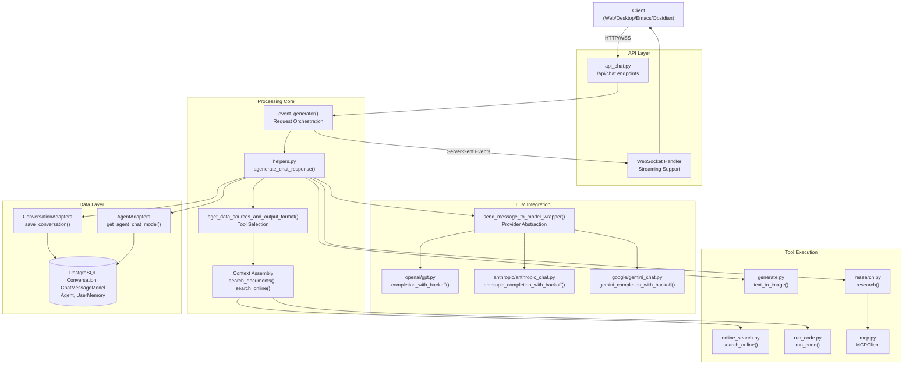
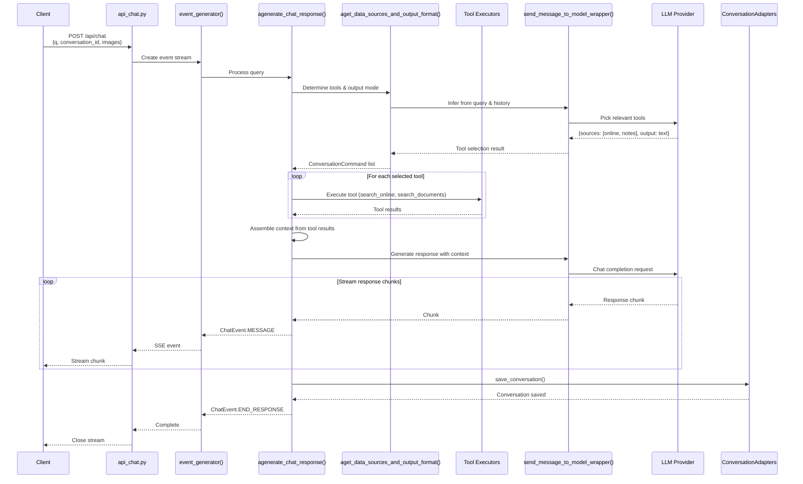
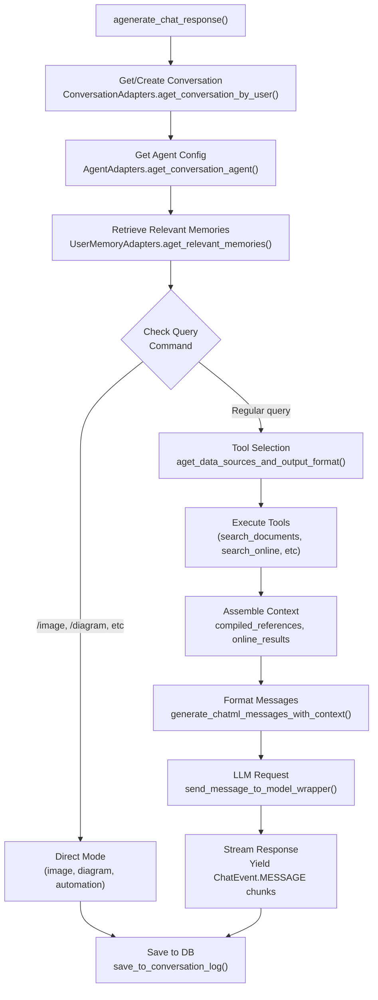
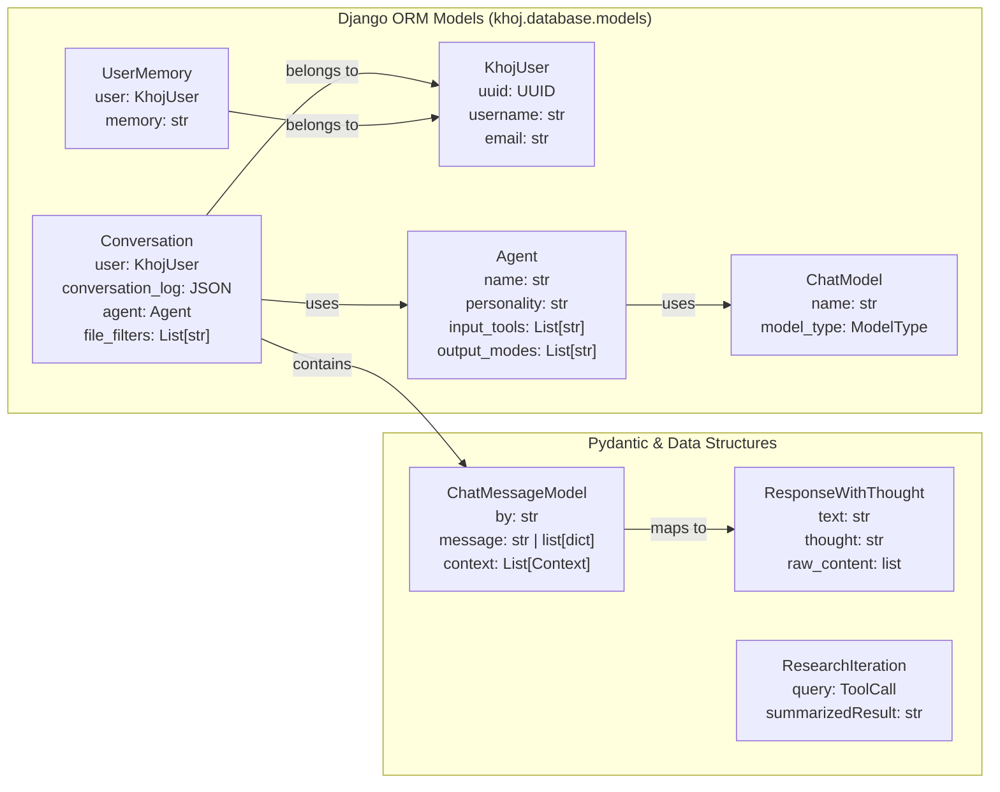
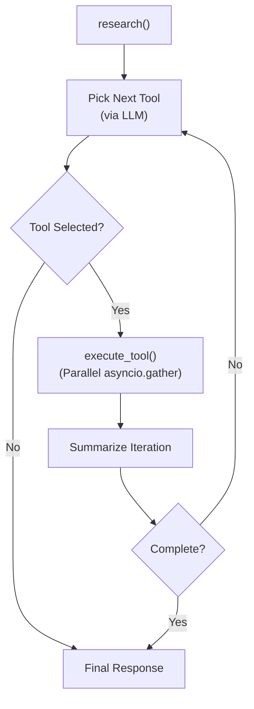

<!-- source: DeepWiki mcp.deepwiki.com · repo khoj-ai/khoj · page 3 Conversation and AI System · fetched 2026-10-29 -->

# Conversation and AI System

Relevant source files

The following files were used as context for generating this wiki page:

- [src/khoj/processor/conversation/anthropic/anthropic_chat.py](src/khoj/processor/conversation/anthropic/anthropic_chat.py)
- [src/khoj/processor/conversation/anthropic/utils.py](src/khoj/processor/conversation/anthropic/utils.py)
- [src/khoj/processor/conversation/google/gemini_chat.py](src/khoj/processor/conversation/google/gemini_chat.py)
- [src/khoj/processor/conversation/google/utils.py](src/khoj/processor/conversation/google/utils.py)
- [src/khoj/processor/conversation/openai/gpt.py](src/khoj/processor/conversation/openai/gpt.py)
- [src/khoj/processor/conversation/openai/utils.py](src/khoj/processor/conversation/openai/utils.py)
- [src/khoj/processor/conversation/prompts.py](src/khoj/processor/conversation/prompts.py)
- [src/khoj/processor/conversation/utils.py](src/khoj/processor/conversation/utils.py)
- [src/khoj/processor/image/generate.py](src/khoj/processor/image/generate.py)
- [src/khoj/processor/tools/online_search.py](src/khoj/processor/tools/online_search.py)
- [src/khoj/processor/tools/run_code.py](src/khoj/processor/tools/run_code.py)
- [src/khoj/routers/api_chat.py](src/khoj/routers/api_chat.py)
- [src/khoj/routers/helpers.py](src/khoj/routers/helpers.py)
- [src/khoj/routers/research.py](src/khoj/routers/research.py)
- [src/khoj/utils/constants.py](src/khoj/utils/constants.py)
- [src/khoj/utils/helpers.py](src/khoj/utils/helpers.py)

## Purpose and Scope

The Conversation and AI System is the core subsystem powering Khoj's chat capabilities. It handles end-to-end processing of user queries, from receiving chat requests through FastAPI endpoints, selecting and executing appropriate tools, integrating with multiple LLM providers (OpenAI, Anthropic, Google Gemini), managing conversation context, and streaming responses back to clients.

This document covers the overall architecture and data flow through the conversation system. For detailed information on specific subsystems, see:
- Chat request processing and response generation: [Chat Processing Pipeline](#3.1)
- Multi-provider LLM integration: [LLM Provider Integration](#3.2)
- Agent configuration and persona management: [Agent System](#3.3)
- Built-in and extensible tool execution: [Tool Integration and Execution](#3.4)
- Autonomous multi-step research: [Research Mode](#3.5)
- Computer automation capabilities: [Computer Operator Agent](#3.6)

## System Architecture

The conversation system follows a layered architecture where FastAPI routers receive requests, delegate to processing helpers that orchestrate tool selection and execution, interact with LLM providers, and save conversation state to PostgreSQL.

### High-Level Component Diagram

**Sources:** [src/khoj/routers/api_chat.py:105-200](), [src/khoj/routers/helpers.py:1520-1550](), [src/khoj/processor/conversation/openai/gpt.py:27-133](), [src/khoj/processor/conversation/google/gemini_chat.py:18-82]()

### Component Responsibilities

| Component | Primary Responsibility | Key Classes/Functions |
|-----------|------------------------|----------------------|
| **API Routers** | HTTP/WebSocket endpoint handling, authentication, telemetry | `api_chat.py`: `chat()`, `event_generator()` |
| **Processing Helpers** | Request orchestration, tool selection, context assembly | `helpers.py`: `agenerate_chat_response()`, `aget_data_sources_and_output_format()` |
| **LLM Wrappers** | Provider-agnostic LLM interaction with retry logic | `send_message_to_model_wrapper()`, `completion_with_backoff()` |
| **Tool Executors** | Execute specific capabilities (search, code, image gen) | `search_online()`, `run_code()`, `text_to_image()` |
| **Research Orchestrator** | Multi-step autonomous tool execution | `research.py`: `research()`, `execute_tool()` |
| **Conversation Adapters** | Database persistence, conversation management | `ConversationAdapters`: `save_conversation()`, `aget_conversation_by_user()` |
| **Agent Adapters** | Agent configuration retrieval | `AgentAdapters`: `aget_user_chat_model()`, `aget_default_chat_model()` |

**Sources:** [src/khoj/routers/api_chat.py:105-180](), [src/khoj/routers/helpers.py:354-468](), [src/khoj/routers/helpers.py:2510-2750](), [src/khoj/database/adapters/__init__.py:1-1000]()

## Request Processing Flow

### Chat Request Lifecycle

The system receives chat requests through the `/api/chat` endpoint, which initializes an `event_generator` to stream typed `ChatEvent` updates back to the client.

**Sources:** [src/khoj/routers/api_chat.py:665-900](), [src/khoj/routers/helpers.py:354-468](), [src/khoj/routers/helpers.py:1520-2200]()

### Event Stream Types

The system uses a typed event stream to communicate different stages of processing via the `ChatEvent` class.

| Event Type | Purpose | Data Format |
|------------|---------|-------------|
| `ChatEvent.STATUS` | Progress updates (e.g., "Searching the web") | String message |
| `ChatEvent.THOUGHT` | LLM reasoning process (for reasoning models) | String (thought text) |
| `ChatEvent.MESSAGE` | Response text chunks | String (response chunk) |
| `ChatEvent.REFERENCES` | Document citations | List of Context objects |
| `ChatEvent.GENERATED_ASSETS` | Images, diagrams | Dict with asset URLs |
| `ChatEvent.END_LLM_RESPONSE` | LLM streaming complete | Empty |
| `ChatEvent.END_RESPONSE` | Full response complete | Empty |

**Sources:** [src/khoj/processor/conversation/utils.py:482-495](), [src/khoj/routers/helpers.py:98-111]()

## Core Processing Components

### Message Processing Pipeline

The `agenerate_chat_response()` function implements the core conversation logic, including memory retrieval, tool selection, and context assembly.

**Sources:** [src/khoj/routers/helpers.py:1520-2200](), [src/khoj/processor/conversation/utils.py:106-109]()

### LLM Integration Layer

Khoj provides a unified integration layer for multiple providers. The `send_message_to_model_wrapper()` function abstracts provider-specific APIs (OpenAI, Anthropic, Gemini) and handles retryable errors via `RetryableModelError`.

#### Provider-Specific Implementations

| Provider | Completion Module | Primary Utility |
|----------|-------------------|-----------------|
| **OpenAI** | `openai/gpt.py` | `completion_with_backoff()` |
| **Anthropic** | `anthropic/anthropic_chat.py` | `anthropic_completion_with_backoff()` |
| **Google** | `google/gemini_chat.py` | `gemini_completion_with_backoff()` |

**Sources:** [src/khoj/processor/conversation/openai/utils.py:83-104](), [src/khoj/processor/conversation/google/utils.py:178-188](), [src/khoj/processor/conversation/utils.py:101-121]()

## Key Data Models

The following diagram maps conversation-related Django models to their Pydantic validation counterparts used in the AI pipeline.

**Sources:** [src/khoj/database/models/__init__.py:1-1000](), [src/khoj/processor/conversation/utils.py:210-236](), [src/khoj/processor/conversation/openai/utils.py:38-42]()

## Tool Execution Framework

Khoj implements a flexible tool system where the LLM can trigger specific actions based on the user's intent.

| Tool | Command | Implementation |
|------|---------|----------------|
| **Document Search** | `SemanticSearchFiles` | `search_documents()` |
| **Web Search** | `SearchWeb` | `search_online()` |
| **Webpage Reader** | `ReadWebpage` | `read_webpages_content()` |
| **Code Execution** | `RunCode` | `run_code()` |
| **Image Generation** | `TextToImage` | `text_to_image()` |
| **Diagram Creation** | `GenerateDiagram` | `generate_mermaidjs_diagram()` |

**Sources:** [src/khoj/routers/api_chat.py:48-53](), [src/khoj/routers/research.py:101-184](), [src/khoj/processor/tools/online_search.py:56-72]()

## Research Mode Orchestration

Research mode allows the system to perform iterative, multi-step tasks. It uses `ResearchIteration` to track the state of an autonomous investigation, executing tools in parallel where possible.

**Sources:** [src/khoj/routers/research.py:64-274](), [src/khoj/processor/conversation/utils.py:210-236]()

---

