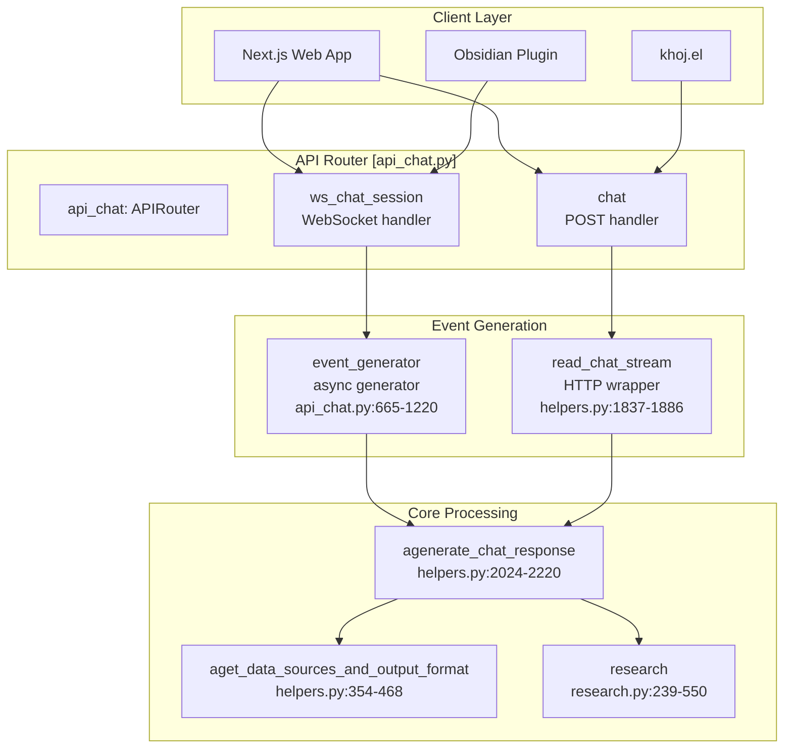
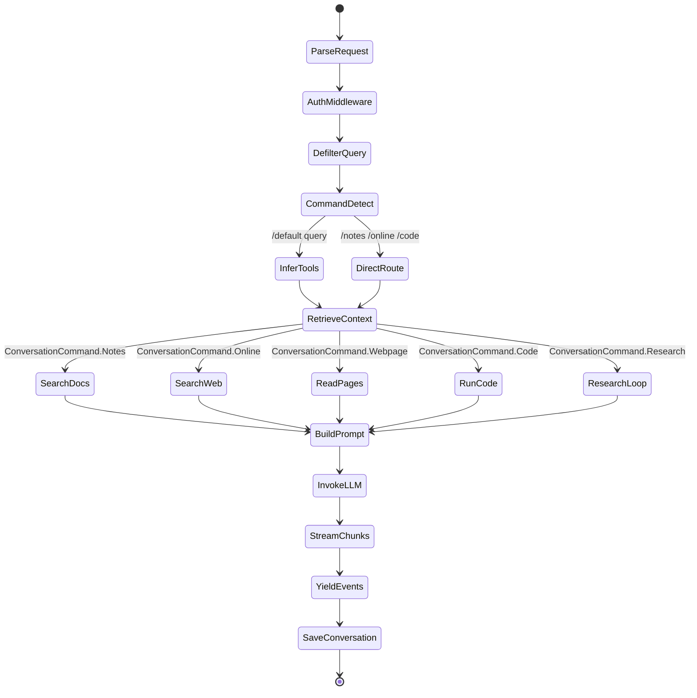
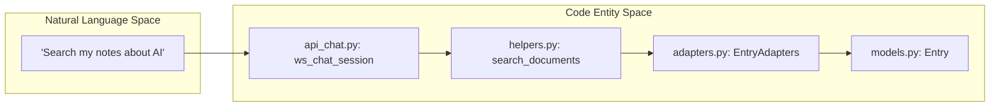

<!-- source: DeepWiki mcp.deepwiki.com · repo khoj-ai/khoj · page 3.1 Chat Processing Pipeline · fetched 2026-10-29 -->

# Chat Processing Pipeline

Relevant source files

The following files were used as context for generating this wiki page:

- [src/khoj/processor/conversation/openai/whisper.py](src/khoj/processor/conversation/openai/whisper.py)
- [src/khoj/processor/conversation/prompts.py](src/khoj/processor/conversation/prompts.py)
- [src/khoj/processor/conversation/utils.py](src/khoj/processor/conversation/utils.py)
- [src/khoj/processor/image/generate.py](src/khoj/processor/image/generate.py)
- [src/khoj/processor/tools/online_search.py](src/khoj/processor/tools/online_search.py)
- [src/khoj/processor/tools/run_code.py](src/khoj/processor/tools/run_code.py)
- [src/khoj/routers/api_chat.py](src/khoj/routers/api_chat.py)
- [src/khoj/routers/helpers.py](src/khoj/routers/helpers.py)
- [src/khoj/routers/research.py](src/khoj/routers/research.py)
- [src/khoj/utils/helpers.py](src/khoj/utils/helpers.py)
- [src/khoj/utils/models.py](src/khoj/utils/models.py)
- [tests/test_conversation_utils.py](tests/test_conversation_utils.py)

## Purpose and Scope

This document details the complete lifecycle of a chat message in Khoj, from initial user input through context retrieval, LLM generation, streaming responses, and conversation persistence. The pipeline handles both REST and WebSocket requests, manages real-time streaming, and coordinates with multiple subsystems including search, tool execution, and research modes.

For information about:
- Agent configuration and capabilities, see [Agent System](#3.3)
- LLM provider integration and model selection, see [LLM Provider Integration](#3.2)
- Tool execution (code, image generation, web search), see [Tool Integration and Execution](#3.4)
- Autonomous research loops, see [Research Mode](#3.5)

---

## Request Entry Points

### API Router Structure

The chat system exposes primary communication channels through the `api_chat` router [src/khoj/routers/api_chat.py:105]():

| Endpoint | Method | Purpose | Connection Type |
|----------|--------|---------|----------------|
| `/api/chat` | POST | Single-turn chat (legacy) | HTTP |
| `/api/chat` | WebSocket | Streaming chat | WebSocket |
| `/api/chat/history` | GET | Retrieve conversation history | HTTP |
| `/api/chat/sessions` | GET/POST | Manage conversation sessions | HTTP |
| `/api/chat/stats` | GET | Get conversation statistics | HTTP |

**Chat Request Flow from Client to Response Generation**

**Sources:** [src/khoj/routers/api_chat.py:105](), [src/khoj/routers/api_chat.py:665-1220](), [src/khoj/routers/helpers.py:1837-1886](), [src/khoj/routers/helpers.py:2024-2220]()

### WebSocket vs REST Flow

The system supports two request patterns with different streaming characteristics:

**WebSocket Flow:**
- Client establishes persistent connection via `/api/chat` WebSocket endpoint [src/khoj/routers/api_chat.py:905]().
- Server streams events as `ChatEvent` objects [src/khoj/processor/conversation/utils.py:270-281]().
- Connection monitored by `monitor_disconnection` task for cancellation handling [src/khoj/routers/api_chat.py:742-772]().

**REST Flow:**
- Client sends POST request to `/api/chat` [src/khoj/routers/api_chat.py:1222]().
- Server returns `StreamingResponse` with chunked transfer encoding [src/khoj/routers/api_chat.py:1243]().
- Uses `read_chat_stream` wrapper to convert async generator to response stream [src/khoj/routers/helpers.py:1837-1886]().

---

## Message Lifecycle

**Chat Message Processing State Flow**

**Sources:** [src/khoj/routers/api_chat.py:665-1220](), [src/khoj/routers/helpers.py:243-270](), [src/khoj/routers/helpers.py:354-468]()

### Stage 1: Input Processing

#### Request Body Parsing
The `ChatRequestBody` model [src/khoj/utils/rawconfig.py]() defines the input structure including query `q`, `conversation_id`, and attachments. 

**Image and File Processing:**
- Images are decoded and converted to WebP format via `convert_image_to_webp` [src/khoj/utils/helpers.py:86-89]().
- Files attached to the query are gathered via `gather_raw_query_files` [src/khoj/routers/helpers.py:268-282]().

#### Query Defiltering
User queries are preprocessed via `defilter_query` [src/khoj/processor/conversation/utils.py:42-43]() to remove command prefixes while preserving intent.

### Stage 2: Tool and Data Source Selection

#### Conversation Command Detection
The `get_conversation_command` function [src/khoj/routers/helpers.py:243-266]() maps query prefixes to `ConversationCommand` enum values:

| Command | Enum Value | Processing Handler |
|---------|-----------|-------------------|
| `/notes` | `ConversationCommand.Notes` | `search_documents` |
| `/online` | `ConversationCommand.Online` | `search_online` |
| `/code` | `ConversationCommand.Code` | `run_code` |
| `/research` | `ConversationCommand.Research` | `research` loop |

#### Intelligent Tool Selection
For queries without explicit commands, `aget_data_sources_and_output_format` [src/khoj/routers/helpers.py:354-468]() uses an LLM to infer appropriate tools based on the `Agent` configuration and `tool_descriptions_for_llm` [src/khoj/utils/helpers.py:135]().

### Stage 3: Context Retrieval

#### Semantic Document Search
The `search_documents` function [src/khoj/routers/helpers.py:1368-1653]() queries indexed entries. It extracts filters via `DateFilter`, `FileFilter`, and `WordFilter` [src/khoj/routers/helpers.py:115-117]().

#### Online Search
The `search_online` function [src/khoj/processor/tools/online_search.py:56-184]() retrieves real-time info using providers like Serper, Exa, or Google [src/khoj/processor/tools/online_search.py:38-48]().

#### Code Execution
The `run_code` function [src/khoj/processor/tools/run_code.py:53-223]() generates Python snippets via LLM and executes them in a sandboxed environment like Terrarium or E2B [src/khoj/processor/tools/run_code.py:43-45]().

### Stage 4: LLM Generation

#### Prompt Construction
`generate_chatml_messages_with_context` [src/khoj/processor/conversation/utils.py:109]() assembles the prompt using `personality` templates [src/khoj/processor/conversation/prompts.py:5-51]() and retrieved references.

#### Model Invocation
`send_message_to_model_wrapper` [src/khoj/routers/helpers.py:31]() routes requests to providers (OpenAI, Anthropic, Google) with logic for `RetryableModelError` [src/khoj/processor/conversation/utils.py:101-120]().

### Stage 5: Response Streaming

The `event_generator` [src/khoj/routers/api_chat.py:665]() coordinates streaming. It yields `ChatEvent` types:
- `STATUS`: Progress updates [src/khoj/processor/conversation/utils.py:270]().
- `MESSAGE`: Text chunks.
- `METADATA`: Usage stats.

**Sources:** [src/khoj/routers/api_chat.py:665-1220](), [src/khoj/routers/helpers.py:2024-2220]()

### Stage 6: Conversation Persistence

`save_to_conversation_log` [src/khoj/processor/conversation/utils.py:541-633]() persists the turn. It uses `ConversationAdapters.save_conversation` [src/khoj/database/adapters/__init__.py]() to update the `Conversation` model [src/khoj/database/models/__init__.py:65]().

---

## Key Components

### Core Processing Functions

| Function | File | Role |
|----------|------|------|
| `event_generator` | `api_chat.py` | Main orchestrator for streaming [src/khoj/routers/api_chat.py:665](). |
| `agenerate_chat_response` | `helpers.py` | LLM invocation and chunk yielding [src/khoj/routers/helpers.py:2024](). |
| `search_documents` | `helpers.py` | Vector search over user entries [src/khoj/routers/helpers.py:1368](). |
| `research` | `research.py` | Orchestrates multi-step research [src/khoj/routers/research.py:239](). |

**Code Entity Space Bridge**

**Sources:** [src/khoj/routers/api_chat.py:905](), [src/khoj/routers/helpers.py:1368](), [src/khoj/database/models/__init__.py:60](), [src/khoj/database/adapters/__init__.py:47]()

---

## Error Handling and Retries

The pipeline handles `RetryableModelError` [src/khoj/processor/conversation/utils.py:101]() which includes:
- Rate limits (429) [src/khoj/processor/conversation/utils.py:147]().
- Server errors (500, 502, 503, 504) [src/khoj/processor/conversation/utils.py:147]().
- Timeouts [src/khoj/processor/conversation/utils.py:133]().

**Sources:** [src/khoj/processor/conversation/utils.py:122-158]()

---

