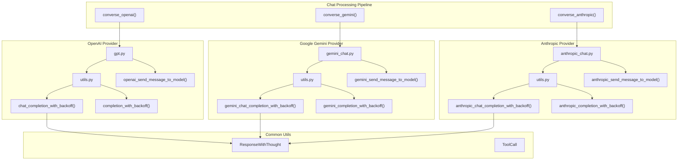
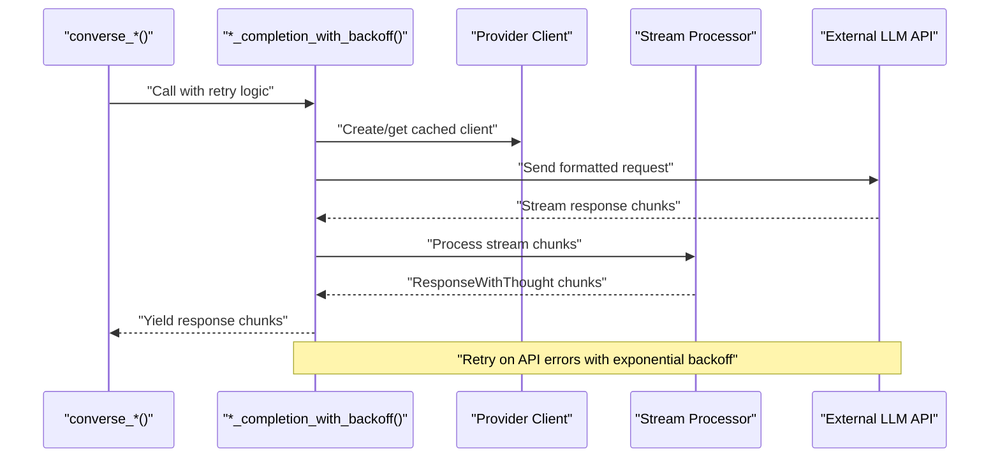
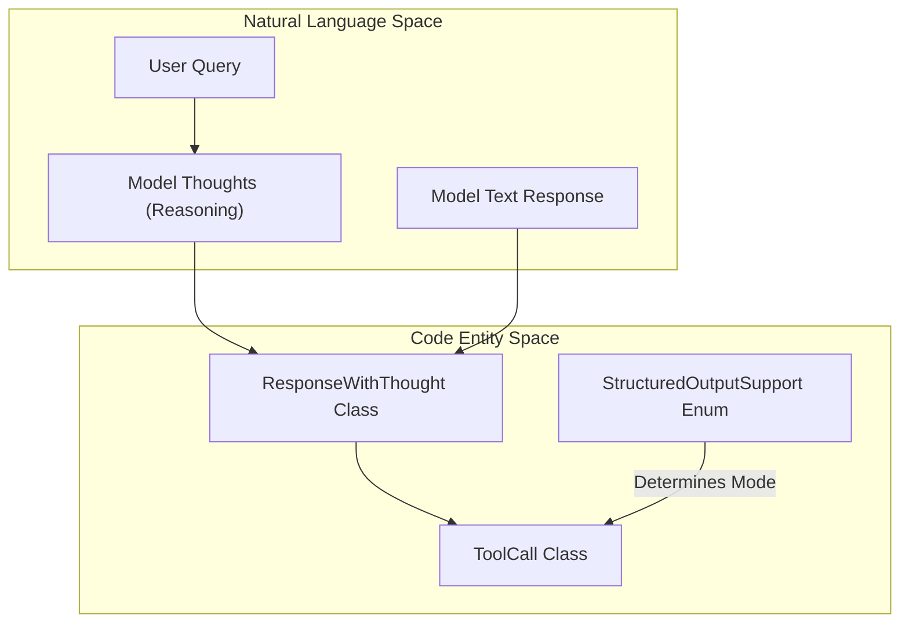

<!-- source: DeepWiki mcp.deepwiki.com · repo khoj-ai/khoj · page 3.2 LLM Provider Integration · fetched 2026-10-29 -->

# LLM Provider Integration

<details>
<summary>Relevant source files</summary>

The following files were used as context for generating this wiki page:

- [documentation/docs/advanced/litellm.md](documentation/docs/advanced/litellm.md)
- [documentation/docs/advanced/lmstudio.md](documentation/docs/advanced/lmstudio.md)
- [documentation/docs/advanced/ollama.mdx](documentation/docs/advanced/ollama.mdx)
- [documentation/docs/advanced/use-openai-proxy.md](documentation/docs/advanced/use-openai-proxy.md)
- [src/khoj/processor/conversation/anthropic/anthropic_chat.py](src/khoj/processor/conversation/anthropic/anthropic_chat.py)
- [src/khoj/processor/conversation/anthropic/utils.py](src/khoj/processor/conversation/anthropic/utils.py)
- [src/khoj/processor/conversation/google/gemini_chat.py](src/khoj/processor/conversation/google/gemini_chat.py)
- [src/khoj/processor/conversation/google/utils.py](src/khoj/processor/conversation/google/utils.py)
- [src/khoj/processor/conversation/openai/gpt.py](src/khoj/processor/conversation/openai/gpt.py)
- [src/khoj/processor/conversation/openai/utils.py](src/khoj/processor/conversation/openai/utils.py)
- [src/khoj/utils/constants.py](src/khoj/utils/constants.py)

</details>


This page documents Khoj's integration with Large Language Model (LLM) providers including OpenAI, Anthropic (Claude), Google (Gemini), and local offline models. The system provides a unified interface for different LLM providers while handling provider-specific requirements for message formatting, streaming responses, retry logic, and advanced reasoning capabilities.

## Architecture Overview

Khoj implements a provider-agnostic approach to LLM integration, allowing it to work with multiple LLM services through a consistent interface. Each LLM provider has its own implementation module that handles the specific requirements of that provider's API.

### Core LLM Provider Integration Architecture



Sources:
- [src/khoj/processor/conversation/openai/gpt.py:27-133]()
- [src/khoj/processor/conversation/openai/utils.py:95-348]()
- [src/khoj/processor/conversation/google/gemini_chat.py:18-82]()
- [src/khoj/processor/conversation/google/utils.py:178-302]()
- [src/khoj/processor/conversation/anthropic/anthropic_chat.py:18-72]()
- [src/khoj/processor/conversation/anthropic/utils.py:51-275]()

### Provider-Specific Message Processing Flow



Sources:
- [src/khoj/processor/conversation/openai/utils.py:95-177]()
- [src/khoj/processor/conversation/google/utils.py:178-200]()
- [src/khoj/processor/conversation/anthropic/utils.py:51-118]()

## Provider Implementations

### OpenAI Integration

The OpenAI integration supports standard models and reasoning models (o1, o3, o4). It also handles OpenAI-compatible proxies like LM Studio, Ollama, and LiteLLM [documentation/docs/advanced/lmstudio.md:14-20](), [documentation/docs/advanced/ollama.mdx:16-20]().

**Key Features:**
- **Structured Output Support:** Automatically detects if a provider supports `TOOL`, `SCHEMA`, or `OBJECT` modes [src/khoj/processor/conversation/openai/utils.py:726-735]().
- **Reasoning Models:** Adjusts parameters for OpenAI reasoning models (e.g., setting `temperature=1` and `reasoning_effort`) [src/khoj/processor/conversation/openai/utils.py:123-129]().
- **Stream Processors:** Uses specialized processors like `in_stream_thought_processor` for models that return reasoning within the stream (Deepseek, Qwen) [src/khoj/processor/conversation/openai/utils.py:138-153]().

**Client Caching:**
Clients are cached using a composite key of the API key and base URL to support multiple providers simultaneously [src/khoj/processor/conversation/openai/utils.py:105-109]().

Sources:
- [src/khoj/processor/conversation/openai/gpt.py:27-133]()
- [src/khoj/processor/conversation/openai/utils.py:95-170]()
- [src/khoj/processor/conversation/openai/utils.py:726-735]()

### Google Gemini Integration

Gemini integration utilizes the `google-genai` SDK and supports multimodal inputs and reasoning configurations [src/khoj/processor/conversation/google/utils.py:11-13]().

**Key Features:**
- **Custom Retry Logic:** A custom wait strategy respects Gemini's `retryDelay` field in error responses, capping the wait at 120 seconds [src/khoj/processor/conversation/google/utils.py:147-167]().
- **Reasoning Support:** Configures `ThinkingConfig` for Gemini 2.5 and 3 models, adjusting the `thinking_budget` or `thinking_level` [src/khoj/processor/conversation/google/utils.py:568-572]().
- **Safety Settings:** Configures standard harm categories to `BLOCK_ONLY_HIGH` to ensure robust responses [src/khoj/processor/conversation/google/utils.py:51-72]().

Sources:
- [src/khoj/processor/conversation/google/gemini_chat.py:18-82]()
- [src/khoj/processor/conversation/google/utils.py:131-167]()
- [src/khoj/processor/conversation/google/utils.py:568-608]()

### Anthropic Claude Integration

Anthropic integration supports Claude 3.5 and 3.7 models with specific handling for extended thinking and prompt caching [src/khoj/processor/conversation/anthropic/utils.py:40-42]().

**Key Features:**
- **Extended Thinking:** Enables the `thinking` parameter with a default budget of 12,000 tokens for reasoning models [src/khoj/processor/conversation/anthropic/utils.py:103-107]().
- **Prompt Caching:** Implements ephemeral caching for system prompts, tools, and message history to reduce latency and cost [src/khoj/processor/conversation/anthropic/utils.py:87-88](), [src/khoj/processor/conversation/anthropic/utils.py:302-310]().
- **JSON Mode Workaround:** For non-reasoning models, it supports prefilling the assistant response with `{` to force valid JSON output [src/khoj/processor/conversation/anthropic/utils.py:94-97]().

Sources:
- [src/khoj/processor/conversation/anthropic/anthropic_chat.py:18-72]()
- [src/khoj/processor/conversation/anthropic/utils.py:103-110]()
- [src/khoj/processor/conversation/anthropic/utils.py:281-389]()

## Common Logic and Utilities

### Retry and Backoff Logic

All providers use the `tenacity` library to handle transient API failures.

| Provider | Max Attempts | Wait Strategy | Retryable Errors |
|----------|--------------|---------------|------------------|
| OpenAI | 2 | `wait_random_exponential` | `APITimeoutError`, `RateLimitError`, `InternalServerError`, `ValueError` [src/khoj/processor/conversation/openai/utils.py:83-91]() |
| Gemini | 2 | `_wait_with_gemini_delay` | `APIError`, `ClientError`, `TimeoutException`, `NetworkError` [src/khoj/processor/conversation/google/utils.py:117-128]() |
| Anthropic| 2 | `wait_random_exponential` | Standard API exceptions [src/khoj/processor/conversation/anthropic/utils.py:45-49]() |

### Token Usage and Cost Tracking

Usage metrics are extracted from model responses and converted into standardized metrics via `get_chat_usage_metrics` [src/khoj/processor/conversation/openai/utils.py:46](), [src/khoj/processor/conversation/google/utils.py:35]().

**Cost Definition Mapping:**
The system maintains a comprehensive map of model pricing for input, output, and cache operations [src/khoj/utils/constants.py:31-92]().

```python
# Example Cost Entry
"claude-3-5-sonnet-latest": {"input": 3.0, "output": 15.0, "cache_read": 0.3, "cache_write": 3.75}
```

Sources:
- [src/khoj/utils/constants.py:31-92]()
- [src/khoj/processor/conversation/openai/utils.py:247-259]()
- [src/khoj/processor/conversation/anthropic/utils.py:155-162]()

### Reasoning and Structured Output

Khoj bridges the gap between raw model outputs and structured application data.



Sources:
- [src/khoj/processor/conversation/utils.py:37-42]()
- [src/khoj/processor/conversation/openai/utils.py:726-735]()
- [src/khoj/processor/conversation/openai/utils.py:177-195]()

### Conversation Tracing

If `is_promptrace_enabled()` is true, the system commits a conversation trace for debugging and monitoring purposes [src/khoj/processor/conversation/openai/utils.py:50](), [src/khoj/processor/conversation/openai/utils.py:266-270]().

Sources:
- [src/khoj/processor/conversation/openai/utils.py:266-270]()
- [src/khoj/processor/conversation/google/utils.py:293-296]()
- [src/khoj/processor/conversation/anthropic/utils.py:171-174]()

---

