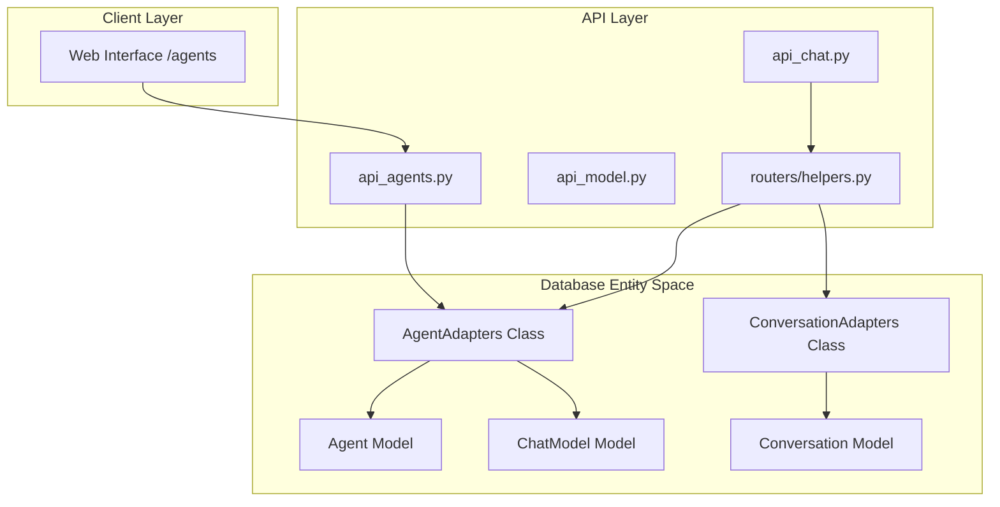
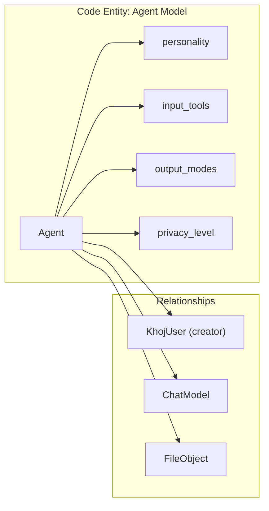
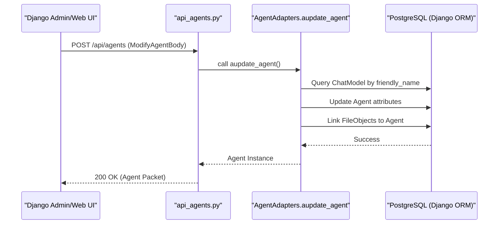

<!-- source: DeepWiki mcp.deepwiki.com · repo khoj-ai/khoj · page 3.3 Agent System · fetched 2026-10-29 -->

# Agent System

Relevant source files

The following files were used as context for generating this wiki page:

- [documentation/docs/clients/web.md](documentation/docs/clients/web.md)
- [documentation/docs/features/agents.md](documentation/docs/features/agents.md)
- [documentation/docs/features/share.md](documentation/docs/features/share.md)
- [documentation/docs/miscellaneous/telemetry.md](documentation/docs/miscellaneous/telemetry.md)
- [src/khoj/configure.py](src/khoj/configure.py)
- [src/khoj/database/adapters/__init__.py](src/khoj/database/adapters/__init__.py)
- [src/khoj/database/admin.py](src/khoj/database/admin.py)
- [src/khoj/database/models/__init__.py](src/khoj/database/models/__init__.py)
- [src/khoj/routers/api.py](src/khoj/routers/api.py)
- [src/khoj/routers/api_agents.py](src/khoj/routers/api_agents.py)
- [src/khoj/routers/api_model.py](src/khoj/routers/api_model.py)
- [src/khoj/routers/web_client.py](src/khoj/routers/web_client.py)
- [tests/test_agents.py](tests/test_agents.py)

The Agent System enables users to create and manage custom AI assistants with specialized knowledge, personalities, and capabilities. Agents serve as personalized AI personas that can access specific sets of tools, data sources, and output modes to provide tailored assistance for different use cases.

## Core Architecture

The Agent System consists of several interconnected components that handle agent creation, configuration, and execution within conversations.

**Agent System Architecture Overview**

Sources: [src/khoj/routers/api_agents.py:27-52](), [src/khoj/database/adapters/__init__.py:38-71](), [src/khoj/routers/helpers.py:18-25]()

## Agent Model and Configuration

Agents are defined by the `Agent` Django model, which stores personality instructions, tool access, and stylistic preferences.

### Core Agent Properties

| Property | Type | Description |
|----------|------|-------------|
| `name` | String | Display name for the agent |
| `personality` | TextField | Custom personality/behavior instructions (system prompt) |
| `privacy_level` | ChoiceField | `PUBLIC`, `ACCESSIBLE`, or `PRIVATE` visibility |
| `input_tools` | JSONField | Available tools (e.g., `online`, `notes`, `code`) |
| `output_modes` | JSONField | Supported output formats (e.g., `image`, `diagram`) |
| `style_color` | String | UI theme color hex code |
| `style_icon` | String | Display icon identifier |
| `chat_model` | ForeignKey | Associated LLM configuration (`ChatModel`) |

**Agent Data Model Structure**

Sources: [src/khoj/database/models/__init__.py:39-71](), [src/khoj/routers/api_agents.py:30-41](), [src/khoj/database/admin.py:199-208]()

### Agent Tool and Mode Options
Agents are constrained by the tools they are allowed to use. These are defined in `Agent.InputToolOptions` and `Agent.OutputModeOptions`.

*   **Input Tools**: `online` (web search), `notes` (knowledge base search), `code` (python execution).
*   **Output Modes**: `image` (text-to-image), `diagram` (Mermaid/Excalidraw).

Sources: [src/khoj/routers/api_agents.py:168-180](), [src/khoj/database/models/__init__.py:221-250]()

## Agent-Conversation Association

Conversations in Khoj are linked to specific agents. When a conversation is initialized, the system associates it with an `Agent` instance to ensure consistent personality and tool availability.

### Data Flow for Agent Retrieval
1.  The client requests agent details for a specific `conversation_id` via `GET /api/agents/conversation`.
2.  `ConversationAdapters.aget_conversation_by_user` retrieves the conversation object.
3.  The system identifies the linked agent or falls back to the default agent via `AgentAdapters.aget_default_agent`.
4.  Agent-specific configurations (like the preferred `ChatModel`) are resolved using `AgentAdapters.aget_agent_chat_model`.

Sources: [src/khoj/routers/api_agents.py:106-160](), [src/khoj/database/adapters/__init__.py:38-71]()

## Privacy and Access Control

The visibility of an agent is determined by its `privacy_level` and the `creator` field.

*   **Public**: Visible to all users on the server.
*   **Private**: Visible only to the user defined in the `creator` field.
*   **Managed by Admin**: System-level agents created by server administrators, often set as defaults.

The `AgentAdapters.aget_all_accessible_agents` function handles the filtering logic to ensure users only see agents they have permission to access.

Sources: [src/khoj/routers/api_agents.py:53-84](), [src/khoj/database/admin.py:206-208](), [src/khoj/database/models/__init__.py:199-208]()

## Management and Creation

Agents can be managed via the Web UI or the Django Admin interface.

### Programmatic Creation
The `AgentAdapters.aupdate_agent` function (and its sync counterpart `create_default_agent`) is used to create or modify agents. It handles:
1.  Validating the associated `ChatModel`.
2.  Updating the agent's metadata (icon, color, personality).
3.  Associating knowledge base files via `FileObject` links.

Sources: [src/khoj/routers/api_agents.py:193-210](), [src/khoj/database/adapters/__init__.py:38-71](), [src/khoj/database/admin.py:199-208]()

## Model and Provider Integration

Agents can be configured to use specific LLMs. If an agent has a `chat_model` assigned, the conversation pipeline will prioritize that model over the user's global default.

*   **Model Selection**: `AgentAdapters.aget_agent_chat_model` checks if the user is subscribed (for premium models) and returns the appropriate `ChatModel` instance.
*   **Global Options**: `api_model.py` provides endpoints like `/api/model/chat/options` to list available models that can be assigned to an agent.

Sources: [src/khoj/routers/api_agents.py:65-79](), [src/khoj/routers/api_model.py:22-40](), [src/khoj/database/models/__init__.py:220-240]()

---

