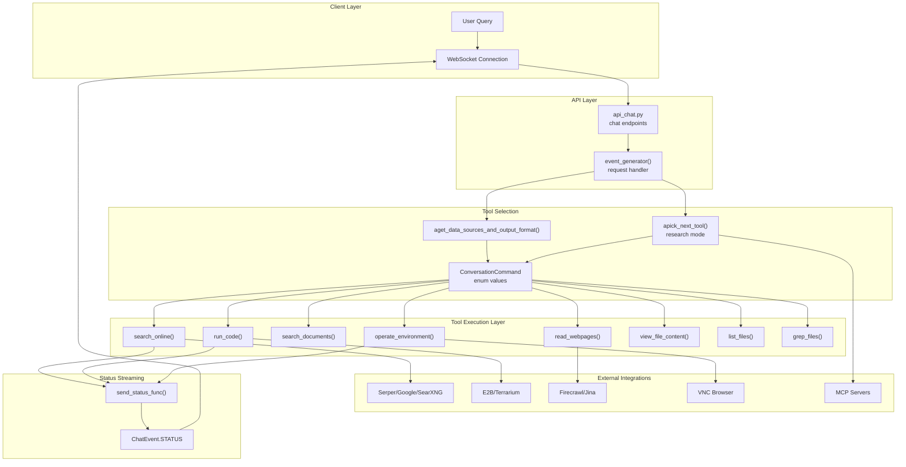
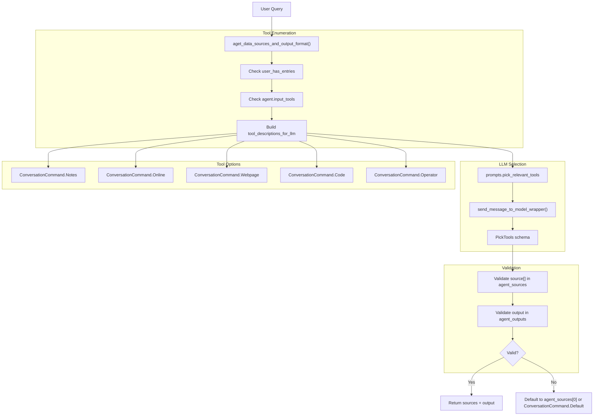
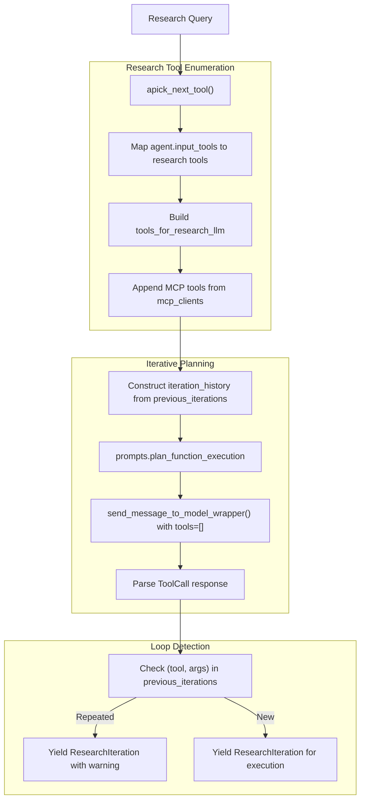
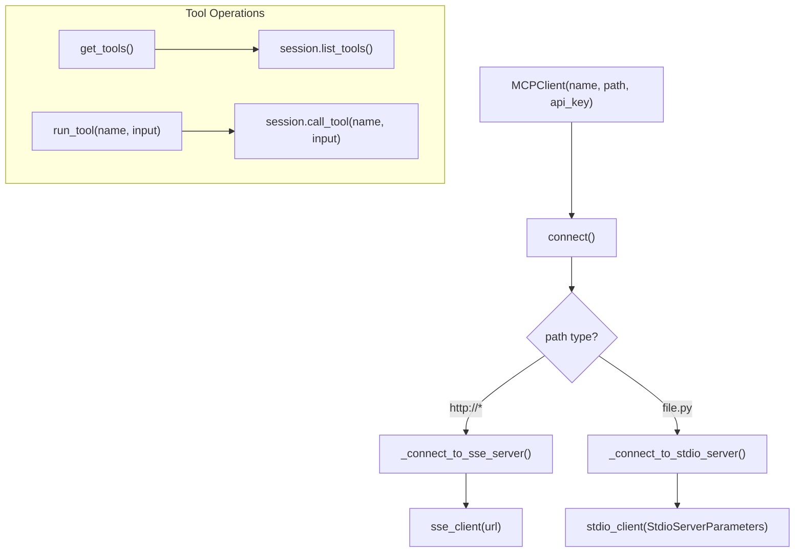

<!-- source: DeepWiki mcp.deepwiki.com · repo khoj-ai/khoj · page 3.4 Tool Integration and Execution · fetched 2026-10-29 -->

# Tool Integration and Execution

Relevant source files

The following files were used as context for generating this wiki page:

- [src/khoj/database/migrations/0048_voicemodeloption_uservoicemodelconfig.py](src/khoj/database/migrations/0048_voicemodeloption_uservoicemodelconfig.py)
- [src/khoj/database/migrations/0096_mcpserver.py](src/khoj/database/migrations/0096_mcpserver.py)
- [src/khoj/processor/conversation/prompts.py](src/khoj/processor/conversation/prompts.py)
- [src/khoj/processor/conversation/utils.py](src/khoj/processor/conversation/utils.py)
- [src/khoj/processor/image/generate.py](src/khoj/processor/image/generate.py)
- [src/khoj/processor/speech/__init__.py](src/khoj/processor/speech/__init__.py)
- [src/khoj/processor/speech/text_to_speech.py](src/khoj/processor/speech/text_to_speech.py)
- [src/khoj/processor/tools/mcp.py](src/khoj/processor/tools/mcp.py)
- [src/khoj/processor/tools/online_search.py](src/khoj/processor/tools/online_search.py)
- [src/khoj/processor/tools/run_code.py](src/khoj/processor/tools/run_code.py)
- [src/khoj/routers/api_chat.py](src/khoj/routers/api_chat.py)
- [src/khoj/routers/helpers.py](src/khoj/routers/helpers.py)
- [src/khoj/routers/research.py](src/khoj/routers/research.py)
- [src/khoj/utils/helpers.py](src/khoj/utils/helpers.py)

This document covers Khoj's tool integration system, which enables the AI assistant to interact with external services and execute specialized tasks beyond conversational responses. The system provides a framework for dynamically selecting and executing tools based on user queries, including web search, code execution, file operations, computer automation, and Model Context Protocol (MCP) servers.

For information about the conversation processing pipeline that orchestrates tool usage, see [Chat Processing Pipeline (3.1)]. For details about the research system that chains multiple tools together, see [Research Mode (3.5)].

## Architecture Overview

Khoj's tool integration system follows a modular architecture where tools are defined as discrete units with standardized interfaces, then dynamically selected and executed based on conversation context.

### System Architecture - Tool Integration Flow

**Architecture Notes:**
- Tool selection uses LLM-powered inference via `aget_data_sources_and_output_format()` for single queries [src/khoj/routers/helpers.py:350-350]().
- Research mode uses iterative planning via `apick_next_tool()` for multi-step queries [src/khoj/routers/research.py:93-93]().
- All tools support asynchronous execution with status streaming using `ChatEvent.STATUS` [src/khoj/processor/conversation/utils.py:27-27]().
- Status updates are sent to clients via WebSocket using `WebSocketConnectionManager` [src/khoj/routers/helpers.py:64-64]().

**Sources:** [src/khoj/routers/api_chat.py:45-53](), [src/khoj/routers/helpers.py:350-463](), [src/khoj/routers/research.py:64-121]().

## Tool Selection Mechanism

The system uses LLM-powered tool selection to determine which tools to invoke based on query analysis and conversation context. Tool selection occurs in two contexts: single-turn chat and multi-turn research mode.

### Tool Selection Flow - Single Turn Chat

**Implementation Details:**

The `aget_data_sources_and_output_format()` function implements tool selection:

1. **Tool Enumeration** [src/khoj/routers/helpers.py:363-391](): 
   - Iterates through `tool_descriptions_for_llm` dictionary.
   - Filters by `agent.input_tools` if agent is specified.
   - Excludes Notes tool if `user_has_entries == False`.
   - Excludes Operator tool if `is_operator_enabled() == False` [src/khoj/utils/helpers.py:129-129]().
   - Excludes Online/Webpage if `is_web_search_enabled() == False` [src/khoj/utils/helpers.py:131-131]().
   - Excludes Code if `is_code_sandbox_enabled() == False` [src/khoj/utils/helpers.py:127-127]().

2. **LLM Selection** [src/khoj/routers/helpers.py:399-424]():
   - Uses `prompts.pick_relevant_tools` template with chat history.
   - Passes to `send_message_to_model_wrapper()` with `response_type="json_object"`.

3. **Validation** [src/khoj/routers/helpers.py:426-462]():
   - Verifies `source[]` values exist in `source_options.keys()`.
   - Verifies `output` value allowed by `agent.output_modes`.
   - Falls back to `ConversationCommand.Default` if invalid [src/khoj/utils/helpers.py:83-83]().

**Sources:** [src/khoj/routers/helpers.py:350-463](), [src/khoj/utils/helpers.py:120-137](), [src/khoj/processor/conversation/prompts.py:459-549]().

### Tool Selection Flow - Research Mode

**Research Mode Tool Selection:**

The `apick_next_tool()` function implements iterative tool selection [src/khoj/routers/research.py:93-93]():

1. **Tool Mapping** [src/khoj/routers/research.py:93-114]():
   - Maps `ConversationCommand.Notes` to semantic search and file viewing tools.
   - Maps `ConversationCommand.Online` to web search.
   - Maps `ConversationCommand.Code` to Python execution.

2. **Tool Building** [src/khoj/routers/research.py:116-163]():
   - Iterates through `tools_for_research_llm` with usage limits.
   - Appends MCP tools from connected `MCPClient` instances [src/khoj/processor/tools/mcp.py:13-13]().

3. **LLM Planning** [src/khoj/routers/research.py:172-208]():
   - Uses `prompts.plan_function_execution` with iteration context.
   - Parses response as `ToolCall(name, args, id)` [src/khoj/processor/conversation/utils.py:203-203]().

**Sources:** [src/khoj/routers/research.py:51-237](), [src/khoj/processor/conversation/utils.py:203-209](), [src/khoj/processor/tools/mcp.py:39-48]().

## Core Tool Categories

### Information Retrieval Tools

#### Online Web Search
**Implementation**: `search_online()` [src/khoj/processor/tools/online_search.py:56-184]().

**Execution Flow**:
1. Generates subqueries via `generate_online_subqueries()` [src/khoj/processor/tools/online_search.py:80-92]().
2. Selects search engine: Serper > Exa > Firecrawl > Google > SearXNG [src/khoj/processor/tools/online_search.py:101-116]().
3. Executes parallel searches with `asyncio.gather()` [src/khoj/processor/tools/online_search.py:129-129]().
4. If `AUTO_READ_WEBPAGE=true`, reads top pages via `extract_from_webpage()` [src/khoj/processor/tools/online_search.py:137-184]().

**Sources:** [src/khoj/processor/tools/online_search.py:1-184]().

### Code Execution Tools

#### Python Sandbox Execution
**Implementation**: `run_code()` [src/khoj/processor/tools/run_code.py:53-118]().

**Execution Flow**:
1. Generates Python code via `generate_python_code()` using LLM [src/khoj/processor/tools/run_code.py:73-84]().
2. Prepares input files from user's indexed data [src/khoj/processor/tools/run_code.py:88-96]().
3. Executes code via sandbox: `execute_sandboxed_python()` or `execute_e2b()` [src/khoj/processor/tools/run_code.py:104-104]().
4. Returns result dictionary containing `code` and `results` [src/khoj/processor/tools/run_code.py:108-108]().

**Sources:** [src/khoj/processor/tools/run_code.py:48-244]().

### Model Context Protocol (MCP) Tools

Khoj supports dynamic tool extension via the Model Context Protocol.

#### MCP Client Implementation
The `MCPClient` class handles connections to MCP servers via `stdio` or `sse` [src/khoj/processor/tools/mcp.py:13-26]().

**Key Functions**:
- `connect()`: Establishes session based on path type (local script vs remote URL) [src/khoj/processor/tools/mcp.py:27-37]().
- `get_tools()`: Lists available tools from the server [src/khoj/processor/tools/mcp.py:39-48]().
- `run_tool()`: Executes a specific tool and processes `TextContent`, `AudioContent`, or `ImageContent` results [src/khoj/processor/tools/mcp.py:50-67]().

**Sources:** [src/khoj/processor/tools/mcp.py:1-125](), [src/khoj/database/migrations/0096_mcpserver.py:12-25]().

## Tool Execution Results

Tools return structured data encapsulated in classes like `ToolExecutionResult` or `ResearchIteration`.

| Entity | Role | Source |
|--------|------|--------|
| `ToolExecutionResult` | Container for results from a single tool call (documents, online, code, mcp) | [src/khoj/routers/research.py:51-62]() |
| `ResearchIteration` | Stores tool call, context, and summarized result for an iteration | [src/khoj/processor/conversation/utils.py:210-238]() |
| `OperatorRun` | Stores computer operator trajectory and screenshots | [src/khoj/processor/conversation/utils.py:166-201]() |

**Sources:** [src/khoj/routers/research.py:51-62](), [src/khoj/processor/conversation/utils.py:166-238]().

---

