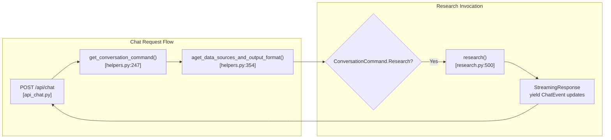
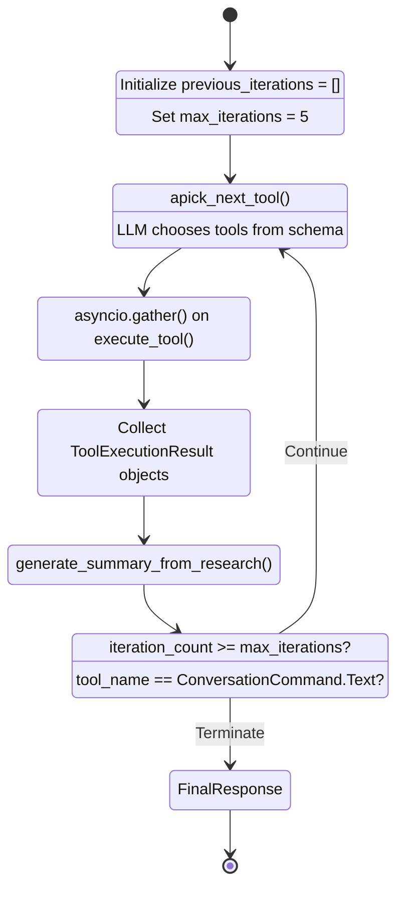
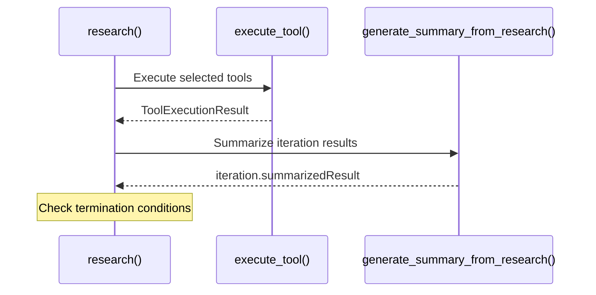

<!-- source: DeepWiki mcp.deepwiki.com · repo khoj-ai/khoj · page 3.5 Research Mode · fetched 2026-10-29 -->

# Research Mode

<details>
<summary>Relevant source files</summary>

The following files were used as context for generating this wiki page:

- [src/khoj/processor/conversation/prompts.py](src/khoj/processor/conversation/prompts.py)
- [src/khoj/processor/conversation/utils.py](src/khoj/processor/conversation/utils.py)
- [src/khoj/processor/image/generate.py](src/khoj/processor/image/generate.py)
- [src/khoj/processor/tools/online_search.py](src/khoj/processor/tools/online_search.py)
- [src/khoj/processor/tools/run_code.py](src/khoj/processor/tools/run_code.py)
- [src/khoj/routers/api_automation.py](src/khoj/routers/api_automation.py)
- [src/khoj/routers/api_chat.py](src/khoj/routers/api_chat.py)
- [src/khoj/routers/helpers.py](src/khoj/routers/helpers.py)
- [src/khoj/routers/research.py](src/khoj/routers/research.py)
- [src/khoj/utils/helpers.py](src/khoj/utils/helpers.py)
- [tests/test_api_automation.py](tests/test_api_automation.py)
- [tests/test_online_chat_actors.py](tests/test_online_chat_actors.py)
- [tests/test_online_chat_director.py](tests/test_online_chat_director.py)

</details>


## Purpose and Scope

Research Mode is an autonomous multi-step reasoning system that orchestrates iterative tool execution to answer complex queries requiring multiple information sources. Unlike single-turn chat responses, Research Mode breaks down complex questions into subtasks, executes appropriate tools (web search, document search, code execution, etc.), and synthesizes results across iterations.

For information about individual tool implementations, see [Tool Integration and Execution](#3.4). For the broader chat processing pipeline that invokes Research Mode, see [Chat Processing Pipeline](#3.1).

This document covers:
- Research orchestration loop and iteration management
- Tool selection and parallel execution architecture
- Result aggregation and synthesis
- Integration with the conversation system

## Architecture Overview

Research Mode operates as a specialized conversation command that transforms a user query into a sequence of tool invocations. The system uses an LLM to dynamically select tools, execute them (potentially in parallel), summarize results, and decide whether to continue or terminate.

```mermaid
graph TB
    ["User Query with /research command"] --> ResearchEntry["research() function<br/>[research.py:500]"]
    
    subgraph "Research Orchestration"
        ResearchEntry --> PickTool["apick_next_tool()<br/>[research.py:277]"]
        PickTool --> ExecuteTools["execute_tool()<br/>[research.py:64]"]
        ExecuteTools --> SummarizeResult["generate_summary_from_research()<br/>[helpers.py:2400]"]
        SummarizeResult --> CheckTermination{"Should<br/>terminate?"}
    end
    
    subgraph "Tool Execution Layer"
        ExecuteTools --> SearchDocs["search_documents()<br/>[helpers.py:2000]"]
        ExecuteTools --> SearchWeb["search_online()<br/>[online_search.py:56]"]
        ExecuteTools --> ReadPage["read_webpages_content()<br/>[online_search.py:172]"]
        ExecuteTools --> RunCode["run_code()<br/>[run_code.py:53]"]
        ExecuteTools --> MCPTools["MCPClient.run_tool()<br/>[mcp.py]"]
    end
    
    subgraph "State Management"
        Iterations["List[ResearchIteration]<br/>previous_iterations"]
        ToolResult["ToolExecutionResult<br/>[research.py:51]"]
    end
    
    CheckTermination -->|Continue| PickTool
    CheckTermination -->|Done| ResearchEntry
```

**Diagram: Research Mode Architecture**

The orchestrator maintains a list of `ResearchIteration` objects representing each step's tool call, results, and summaries. Each iteration can invoke one or more tools in parallel, with results aggregated before the next iteration.

**Sources:** [src/khoj/routers/research.py:51-62](), [src/khoj/routers/research.py:64-274](), [src/khoj/routers/research.py:277-497](), [src/khoj/routers/research.py:500-700](), [src/khoj/processor/conversation/utils.py:210-236]()

## Entry Point and Invocation

Research Mode is triggered through the `/research` conversation command or when the agent determines complex multi-step reasoning is required.



**Diagram: Research Mode Invocation Flow**

The research command can be explicitly requested via `/research` or automatically selected by `aget_data_sources_and_output_format()` when analyzing query complexity and available tools.

**Sources:** [src/khoj/routers/api_chat.py:79-105](), [src/khoj/routers/helpers.py:247-270](), [src/khoj/routers/helpers.py:354-468](), [src/khoj/routers/research.py:500-700]()

## Research Loop Orchestration

The core orchestration logic resides in the `research()` async function, which manages the iterative loop of tool selection, execution, and result synthesis.



**Diagram: Research Loop State Machine**

The loop terminates when:
1. Maximum iterations reached (default 5) [src/khoj/routers/research.py:500]().
2. LLM returns `ConversationCommand.Text` (no more tools needed) [src/khoj/routers/research.py:89-91]().
3. Cancellation event is set (user interruption) [src/khoj/routers/research.py:500-700]().

**Sources:** [src/khoj/routers/research.py:500-700](), [src/khoj/routers/research.py:89-91](), [src/khoj/processor/conversation/utils.py:210-236]()

## Tool Selection with LLM

Tool selection is performed by `apick_next_tool()`, which constructs a prompt with available tools and asks the LLM to choose appropriate next steps.

| Function | Location | Purpose |
|----------|----------|---------|
| `apick_next_tool()` | [src/khoj/routers/research.py:277-497]() | Main tool selection function |
| `tools_for_research_llm` | [src/khoj/utils/helpers.py:415-500]() | Tool schema definitions |
| `send_message_to_model_wrapper()` | [src/khoj/routers/helpers.py:1200-1400]() | LLM communication |

The LLM receives historical context via `construct_iteration_history()` [src/khoj/processor/conversation/utils.py:416-479]() which converts previous `ResearchIteration` objects into a format the model can use to reason about what it has already found.

**Sources:** [src/khoj/routers/research.py:277-497](), [src/khoj/utils/helpers.py:415-500](), [src/khoj/processor/conversation/utils.py:416-479]()

## Parallel Tool Execution

Once tools are selected, they execute in parallel using `asyncio.gather()`. Each tool execution is encapsulated in `execute_tool()`, which handles tool-specific logic and result collection into a `ToolExecutionResult` object.

| Tool | ConversationCommand | Key Logic | Result Storage |
|------|---------------------|-----------|----------------|
| Semantic Search | `SemanticSearchFiles` | Calls `search_documents()` | `iteration.context` |
| Web Search | `SearchWeb` | Calls `search_online()` | `iteration.onlineContext` |
| Webpage Read | `ReadWebpage` | Calls `read_webpages_content()` | `iteration.onlineContext` |
| Code Execution | `PythonCoder` | Calls `run_code()` | `iteration.codeContext` |
| View File | `ViewFile` | Calls `view_file_content()` | `iteration.context` |
| MCP Tools | `server/tool` | Calls `mcp_client.run_tool()` | `iteration.context` |

**Sources:** [src/khoj/routers/research.py:51-62](), [src/khoj/routers/research.py:64-274](), [src/khoj/routers/research.py:100-268]()

## Iteration State Management

The `ResearchIteration` class tracks the state of each research step, including the tool call, results, and any warnings or errors.

```python
class ResearchIteration:
    def __init__(
        self,
        query: ToolCall | dict | str,
        context: list = None,
        onlineContext: dict = None,
        codeContext: dict = None,
        operatorContext: dict | OperatorRun = None,
        summarizedResult: str = None,
        warning: str = None,
        raw_response: list = None,
    )
```

**Class Definition:** [src/khoj/processor/conversation/utils.py:210-236]()

The `construct_iteration_history()` function converts these iterations into a chat history format for LLM context, grouping parallel tool calls from the `raw_response` field to maintain chronological logic [src/khoj/processor/conversation/utils.py:416-479]().

**Sources:** [src/khoj/processor/conversation/utils.py:210-236](), [src/khoj/processor/conversation/utils.py:416-479]()

## Result Synthesis and Summarization

After each iteration's tool execution completes, the system synthesizes results using `generate_summary_from_research()`. This step provides a concise summary of the findings which serves as the "answer" for that step in the research process.



**Diagram: Result Synthesis Sequence**

**Sources:** [src/khoj/routers/research.py:500-700](), [src/khoj/routers/helpers.py:2400-2600]()

## Integration with Chat System

Research Mode integrates with the main chat system through conversation commands and event streaming. Research results are stored in the conversation metadata under `researchContext` [src/khoj/processor/conversation/utils.py:541-633]().

The `research()` function yields `ChatEvent` updates, including status messages like "**Searching the web for...**" or "**Found X Notes...**" to keep the user informed during the multi-step process [src/khoj/routers/research.py:118-137]().

**Sources:** [src/khoj/routers/api_chat.py:79-105](), [src/khoj/processor/conversation/utils.py:541-633](), [src/khoj/routers/research.py:118-137]()

---

