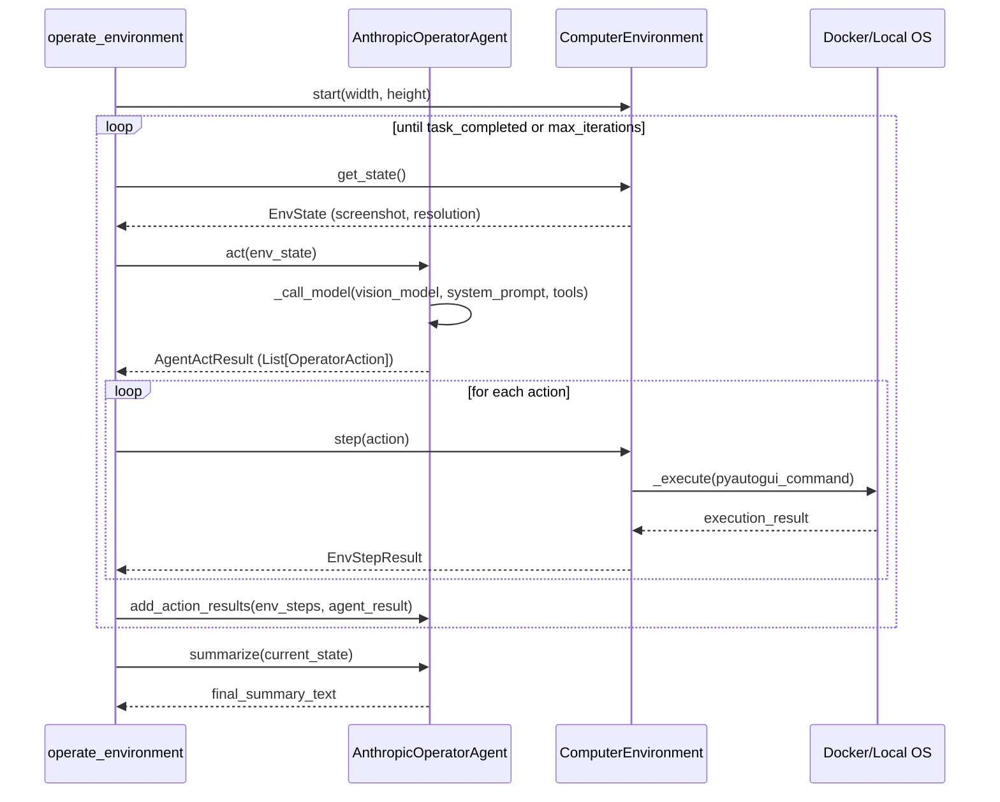
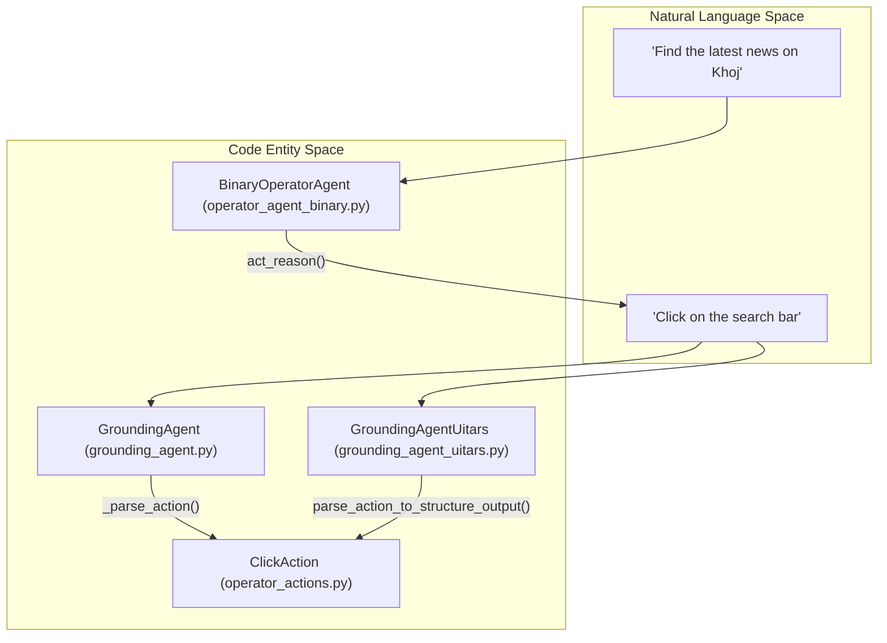
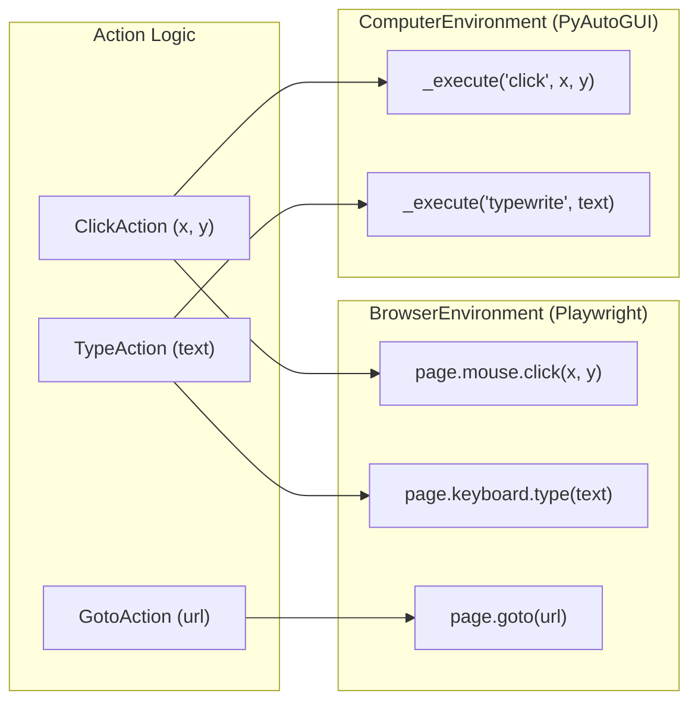

<!-- source: DeepWiki mcp.deepwiki.com · repo khoj-ai/khoj · page 3.6 Computer Operator Agent · fetched 2026-10-29 -->

# Computer Operator Agent

Relevant source files

The following files were used as context for generating this wiki page:

- [computer.Dockerfile](computer.Dockerfile)
- [src/khoj/processor/operator/__init__.py](src/khoj/processor/operator/__init__.py)
- [src/khoj/processor/operator/grounding_agent.py](src/khoj/processor/operator/grounding_agent.py)
- [src/khoj/processor/operator/grounding_agent_uitars.py](src/khoj/processor/operator/grounding_agent_uitars.py)
- [src/khoj/processor/operator/operator_actions.py](src/khoj/processor/operator/operator_actions.py)
- [src/khoj/processor/operator/operator_agent_anthropic.py](src/khoj/processor/operator/operator_agent_anthropic.py)
- [src/khoj/processor/operator/operator_agent_base.py](src/khoj/processor/operator/operator_agent_base.py)
- [src/khoj/processor/operator/operator_agent_binary.py](src/khoj/processor/operator/operator_agent_binary.py)
- [src/khoj/processor/operator/operator_agent_openai.py](src/khoj/processor/operator/operator_agent_openai.py)
- [src/khoj/processor/operator/operator_environment_browser.py](src/khoj/processor/operator/operator_environment_browser.py)
- [src/khoj/processor/operator/operator_environment_computer.py](src/khoj/processor/operator/operator_environment_computer.py)

The Computer Operator Agent is a specialized subsystem in Khoj designed to bridge the gap between high-level natural language instructions and low-level system interactions. It enables autonomous browser and desktop automation by utilizing vision-capable Large Language Models (LLMs) to observe the environment via screenshots and execute precise actions (clicks, typing, navigation) to achieve user objectives.

## Overview and Execution Pipeline

The operator agent functions through a continuous observation-action loop. It perceives the current state of an environment, determines the necessary actions using a provider-specific agent, and executes those actions through an abstraction layer.

### Core Data Flow
1.  **Initialization**: The system selects a `reasoning_model` and an `EnvironmentType` (Browser or Computer) [src/khoj/processor/operator/__init__.py:58-63]().
2.  **State Capture**: The `Environment` captures a screenshot and current metadata (URL, window size) [src/khoj/processor/operator/operator_environment_base.py:11-20]().
3.  **Agent Logic**: The `OperatorAgent` processes the visual state and history to emit a list of `OperatorAction` objects [src/khoj/processor/operator/operator_agent_base.py:66-68]().
4.  **Execution**: The `Environment` executes the actions (e.g., via Playwright or PyAutoGUI) [src/khoj/processor/operator/operator_environment_browser.py:132-133]().
5.  **Feedback**: Results of the actions are fed back into the agent's message history for the next iteration [src/khoj/processor/operator/operator_agent_base.py:71-73]().

### Operator Execution Sequence
The following diagram illustrates the interaction between the main entry point, the agent implementations, and the environment abstractions.

**Title: Operator Loop Orchestration**

Sources: [src/khoj/processor/operator/__init__.py:34-180](), [src/khoj/processor/operator/operator_agent_base.py:30-100](), [src/khoj/processor/operator/operator_environment_computer.py:150-180]()

---

## Operator Agents

Khoj supports multiple operator agent architectures to accommodate different LLM provider capabilities.

### Provider-Specific Agents
*   **AnthropicOperatorAgent**: The primary production agent. It leverages Anthropic's native computer use beta tools [src/khoj/processor/operator/operator_agent_anthropic.py:52-80]().
*   **OpenAIOperatorAgent**: Implements support for OpenAI's vision and tool-calling models [src/khoj/processor/operator/operator_agent_openai.py:41-55]().
*   **BinaryOperatorAgent**: A specialized architecture that splits the task between a **Reasoning LLM** (high-level planning) and a **Grounding LLM** (converting plans to pixel-precise actions) [src/khoj/processor/operator/operator_agent_binary.py:29-34]().

### Grounding Agents
The `BinaryOperatorAgent` uses grounding agents to map natural language thoughts to structured tool calls.
*   **GroundingAgent**: Uses standard tool-calling models [src/khoj/processor/operator/grounding_agent.py:31-45]().
*   **GroundingAgentUitars**: Specifically optimized for the `ui-tars-1.5` model, using specialized action space tokens like `<|box_start|>(x1,y1)<|box_end|>` [src/khoj/processor/operator/grounding_agent_uitars.py:54-66]().

**Title: Binary Agent Entity Mapping**

Sources: [src/khoj/processor/operator/operator_agent_binary.py:81-99](), [src/khoj/processor/operator/grounding_agent.py:93-110](), [src/khoj/processor/operator/grounding_agent_uitars.py:125-140]()

---

## Environments

Environments provide the execution context and state sensing for the agents.

### Browser Environment
The `BrowserEnvironment` uses **Playwright** to automate web interactions. It tracks navigation history and manages a single-page context to prevent the agent from getting lost in multiple tabs [src/khoj/processor/operator/operator_environment_browser.py:27-37]().

### Computer Environment
The `ComputerEnvironment` interacts with the host operating system or a containerized desktop.
*   **Local Provider**: Executes `pyautogui` commands directly on the host [src/khoj/processor/operator/operator_environment_computer.py:53-61]().
*   **Docker Provider**: Executes commands inside a specialized container (defined in `computer.Dockerfile`) containing an X11 server, VNC, and a window manager [src/khoj/processor/operator/operator_environment_computer.py:46-51]().

**Title: Environment Action Mapping**

Sources: [src/khoj/processor/operator/operator_environment_browser.py:142-180](), [src/khoj/processor/operator/operator_environment_computer.py:157-200]()

---

## Action Execution Pipeline

All actions are standardized into a set of Pydantic models in `operator_actions.py`.

| Action Class | Purpose | Implementation Detail |
| :--- | :--- | :--- |
| `ClickAction` | Simulates mouse clicks | Supports `left`, `right`, `middle`, and `wheel` buttons [src/khoj/processor/operator/operator_actions.py:16-21]() |
| `TypeAction` | Enters text | Direct keyboard buffer input [src/khoj/processor/operator/operator_actions.py:51-53]() |
| `DragAction` | Moves mouse while holding | Takes a `List[Point]` for the path [src/khoj/processor/operator/operator_actions.py:71-73]() |
| `TerminalAction` | Executes shell commands | Used in computer environments for CLI tasks [src/khoj/processor/operator/operator_actions.py:163-169]() |
| `TextEditorAction`| File manipulation | Includes `view`, `create`, `str_replace`, and `insert` [src/khoj/processor/operator/operator_actions.py:129-161]() |

### Screenshot and Visual Grounding
To help models "see" where they are clicking, the environments overlay a red circle at the current `mouse_pos` on every screenshot before sending it to the LLM [src/khoj/processor/operator/operator_environment_browser.py:107-118](), [src/khoj/processor/operator/operator_environment_computer.py:125-141]().

Sources: [src/khoj/processor/operator/operator_actions.py:1-197](), [src/khoj/processor/operator/operator_environment_base.py:1-25]()

---

