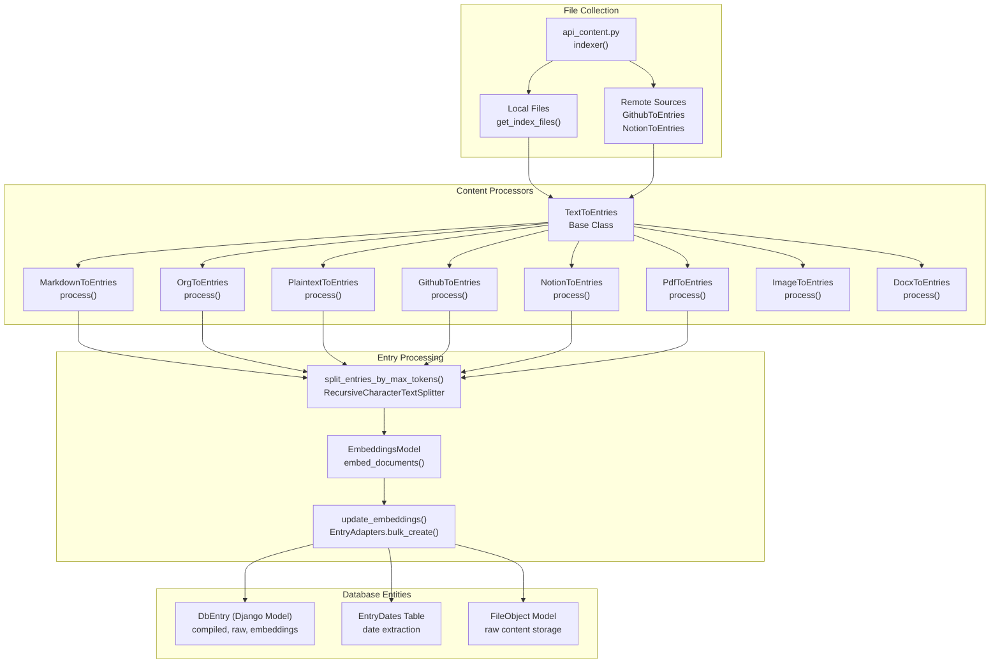
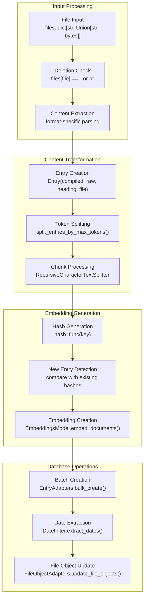
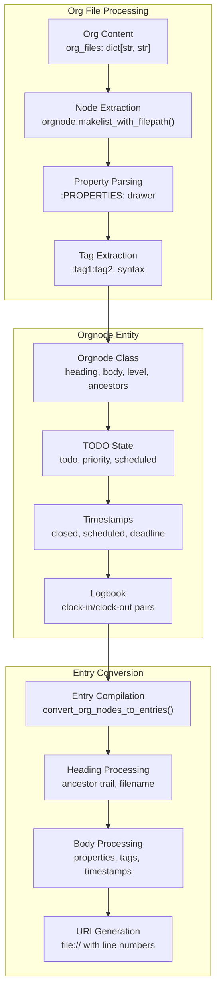
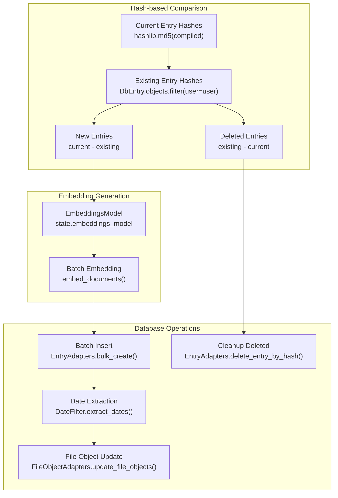

<!-- source: DeepWiki mcp.deepwiki.com · repo khoj-ai/khoj · page 4.1 Content Indexing Pipeline · fetched 2026-10-29 -->

# Content Indexing Pipeline

Relevant source files

The following files were used as context for generating this wiki page:

- [src/khoj/processor/content/docx/docx_to_entries.py](src/khoj/processor/content/docx/docx_to_entries.py)
- [src/khoj/processor/content/github/github_to_entries.py](src/khoj/processor/content/github/github_to_entries.py)
- [src/khoj/processor/content/images/image_to_entries.py](src/khoj/processor/content/images/image_to_entries.py)
- [src/khoj/processor/content/markdown/markdown_to_entries.py](src/khoj/processor/content/markdown/markdown_to_entries.py)
- [src/khoj/processor/content/notion/notion_to_entries.py](src/khoj/processor/content/notion/notion_to_entries.py)
- [src/khoj/processor/content/org_mode/org_to_entries.py](src/khoj/processor/content/org_mode/org_to_entries.py)
- [src/khoj/processor/content/org_mode/orgnode.py](src/khoj/processor/content/org_mode/orgnode.py)
- [src/khoj/processor/content/pdf/pdf_to_entries.py](src/khoj/processor/content/pdf/pdf_to_entries.py)
- [src/khoj/processor/content/plaintext/plaintext_to_entries.py](src/khoj/processor/content/plaintext/plaintext_to_entries.py)
- [src/khoj/processor/content/text_to_entries.py](src/khoj/processor/content/text_to_entries.py)
- [src/khoj/processor/embeddings.py](src/khoj/processor/embeddings.py)
- [src/khoj/routers/api_content.py](src/khoj/routers/api_content.py)
- [src/khoj/routers/notion.py](src/khoj/routers/notion.py)
- [src/khoj/search_type/text_search.py](src/khoj/search_type/text_search.py)
- [tests/conftest.py](tests/conftest.py)
- [tests/helpers.py](tests/helpers.py)
- [tests/test_client.py](tests/test_client.py)
- [tests/test_helpers.py](tests/test_helpers.py)
- [tests/test_markdown_to_entries.py](tests/test_markdown_to_entries.py)
- [tests/test_org_to_entries.py](tests/test_org_to_entries.py)
- [tests/test_orgnode.py](tests/test_orgnode.py)
- [tests/test_pdf_to_entries.py](tests/test_pdf_to_entries.py)
- [tests/test_plaintext_to_entries.py](tests/test_plaintext_to_entries.py)
- [tests/test_text_search.py](tests/test_text_search.py)

## Purpose and Scope

The Content Indexing Pipeline is responsible for processing various types of content (documents, web pages, code files) and converting them into searchable entries that can be queried by Khoj's search engine. This system handles file collection, content parsing, text chunking, embedding generation, and database storage.

This document covers the content ingestion and indexing components. For information about the search and retrieval system, see [4.2 Search Engine](). For details about the conversational AI system that uses indexed content, see [3.1 Chat Processing Pipeline]().

## System Architecture

The content indexing pipeline follows a modular architecture with specialized processors for different content types, unified by a common base class and workflow.

### Content Processing Architecture

Sources: [src/khoj/processor/content/text_to_entries.py:27-33](), [src/khoj/routers/api_content.py:75-116](), [src/khoj/processor/embeddings.py:29-114](), [src/khoj/database/models.py:223-268]()

## Content Processing Workflow

### Core Processing Pipeline

The content indexing pipeline processes content through several standardized stages managed by the `TextToEntries` base class:

Sources: [src/khoj/processor/content/text_to_entries.py:142-265](), [src/khoj/processor/content/pdf/pdf_to_entries.py:24-52](), [src/khoj/processor/content/markdown/markdown_to_entries.py:21-50]()

### Text Chunking and Token Management

The pipeline uses `RecursiveCharacterTextSplitter` to handle large documents while maintaining semantic coherence:

```mermaid
graph LR
    subgraph "Chunking Strategy"
        MaxTokens["max_tokens: int<br/>Default: 256"]
        TextSplitter["RecursiveCharacterTextSplitter<br/>separators: ['\\n\\n', '\\n', '!', '?', '.', ' ', '\\t', '']"]
        TokenCounter["tokenizer()<br/>text.split()"]
    end
    
    subgraph "Chunk Processing"
        CorpusID["corpus_id: UUID<br/>links related chunks"]
        HeadingPrefix["Heading Prefix<br/>preserve context"]
        LineTracking["Line Tracking<br/>URI with #line=N"]
        WordFiltering["Word Filtering<br/>remove_long_words()"]
    end
    
    subgraph "Entry Creation"
        ChunkedEntry["Entry (Pydantic Model)<br/>compiled, raw, heading, file, uri"]
        CleanFields["clean_field()<br/>remove null characters"]
        FinalEntry["Final Entry<br/>ready for embedding"]
    end
    
    MaxTokens --> TextSplitter
    TextSplitter --> TokenCounter
    TokenCounter --> CorpusID
    CorpusID --> HeadingPrefix
    HeadingPrefix --> LineTracking
    LineTracking --> WordFiltering
    WordFiltering --> ChunkedEntry
    ChunkedEntry --> CleanFields
    CleanFields --> FinalEntry
```

Sources: [src/khoj/processor/content/text_to_entries.py:61-140](), [src/khoj/processor/content/text_to_entries.py:40-58]()

## File Format Processors

### Markdown Processing

The `MarkdownToEntries` class processes Markdown files with hierarchical heading awareness:

| Component | Purpose | Implementation |
|-----------|---------|----------------|
| `process_single_markdown_file()` | Recursive heading-based splitting | [src/khoj/processor/content/markdown/markdown_to_entries.py:73-142]() |
| `convert_markdown_entries_to_maps()` | Entry object creation with metadata | [src/khoj/processor/content/markdown/markdown_to_entries.py:145-189]() |
| Heading ancestry | Preserve document structure via `#` level tracking | [src/khoj/processor/content/markdown/markdown_to_entries.py:83-85]() |
| Line number tracking | Accurate source references using `start_line` | [src/khoj/processor/content/markdown/markdown_to_entries.py:112-138]() |

### Org-Mode Processing

The `OrgToEntries` class handles Org-mode files using the `orgnode` parser:

Sources: [src/khoj/processor/content/org_mode/org_to_entries.py:53-242](), [src/khoj/processor/content/org_mode/orgnode.py:61-273](), [tests/test_orgnode.py:54-86]()

### PDF and Document Processing

| Processor | Implementation | Key Features |
|-----------|----------------|--------------|
| `PdfToEntries` | [src/khoj/processor/content/pdf/pdf_to_entries.py:16-52]() | Uses `PyMuPDFLoader` for page-based extraction, removes null bytes. |
| `DocxToEntries` | [src/khoj/processor/content/docx/docx_to_entries.py:15-52]() | Extracts text from Microsoft Word documents. |

### Remote Content Processing

#### GitHub Integration

The `GithubToEntries` class traverses repositories via the GitHub API:

- **Type Detection**: Uses `Magika` to identify file types for non-standard extensions [src/khoj/processor/content/github/github_to_entries.py:18-158]().
- **Rate Limiting**: Implements `wait_for_rate_limit_reset` by checking `X-RateLimit-Remaining` headers [src/khoj/processor/content/github/github_to_entries.py:43-51]().
- **Recursive Tree**: Fetches repository structure recursively [src/khoj/processor/content/github/github_to_entries.py:118-124]().

#### Notion Integration

The `NotionToEntries` class handles page and block hierarchy from the Notion API [src/khoj/processor/content/notion/notion_to_entries.py:18-50]().

## Entry Management and Database Operations

### Entry Structure and Metadata

The `Entry` Pydantic model represents a processed content unit:

| Field | Purpose | Example |
|-------|---------|---------|
| `compiled` | Processed content for embedding | `"# filename.md\n## Heading\nContent..."` |
| `raw` | Original content | `"## Heading\nContent..."` |
| `heading` | Section heading | `"## Heading"` |
| `file` | Source file path | `"/path/to/file.md"` |
| `uri` | Source location with line | `"file:///path/to/file.md#line=15"` |
| `corpus_id` | Chunk group identifier (UUID) | `UUID("...")` |

Sources: [src/khoj/utils/rawconfig.py:14-30](), [src/khoj/processor/content/text_to_entries.py:129-138]()

### Database Storage and Updates

The `update_embeddings()` method handles incremental updates and change detection:

Sources: [src/khoj/processor/content/text_to_entries.py:142-265](), [src/khoj/processor/content/text_to_entries.py:36-38](), [src/khoj/database/adapters.py:223-268]()

## Performance Optimization

### Batch Processing

The pipeline optimizes operations to handle large knowledge bases:
- **Embedding Generation**: `EmbeddingsModel.embed_documents()` processes documents in chunks of 1000 to manage API limits and memory [src/khoj/processor/embeddings.py:109-114]().
- **Database Insertion**: Uses Django's `bulk_create` via `EntryAdapters` for high-throughput storage [src/khoj/processor/content/text_to_entries.py:237]().

### Change Detection

- **MD5 Hashing**: Entries are hashed based on their `compiled` content. If the hash exists in the database for that user and file type, the entry is skipped to avoid redundant embedding computation [src/khoj/processor/content/text_to_entries.py:156-175]().
- **Deletion Handling**: Files marked with empty content (`""` or `b""`) trigger the removal of all associated entries [src/khoj/processor/content/text_to_entries.py:150-153]().

Sources: [src/khoj/processor/content/text_to_entries.py:142-265](), [src/khoj/processor/embeddings.py:109-114]()

---

