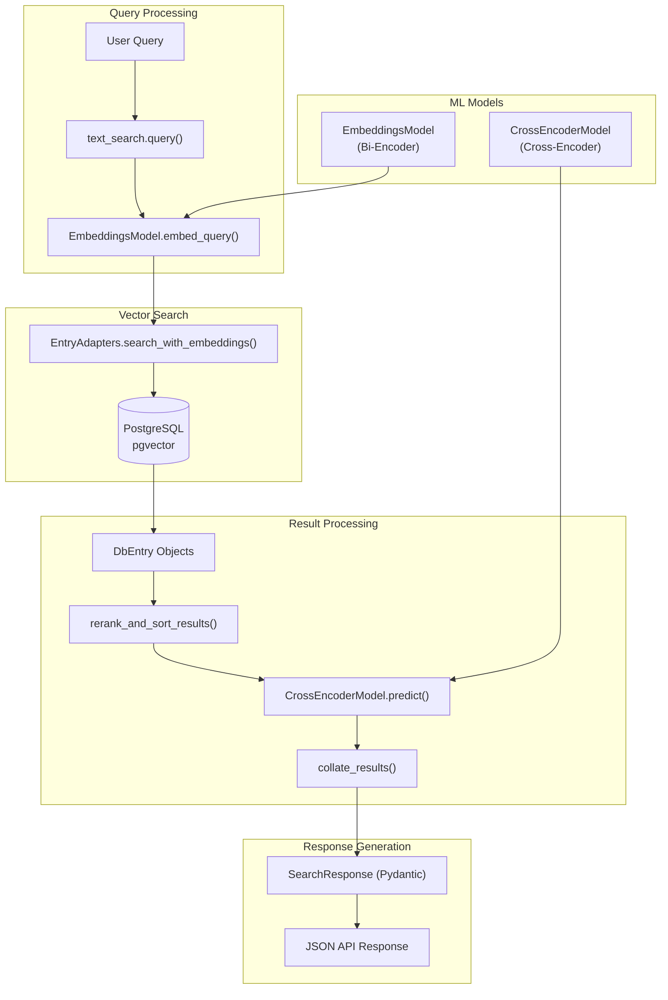
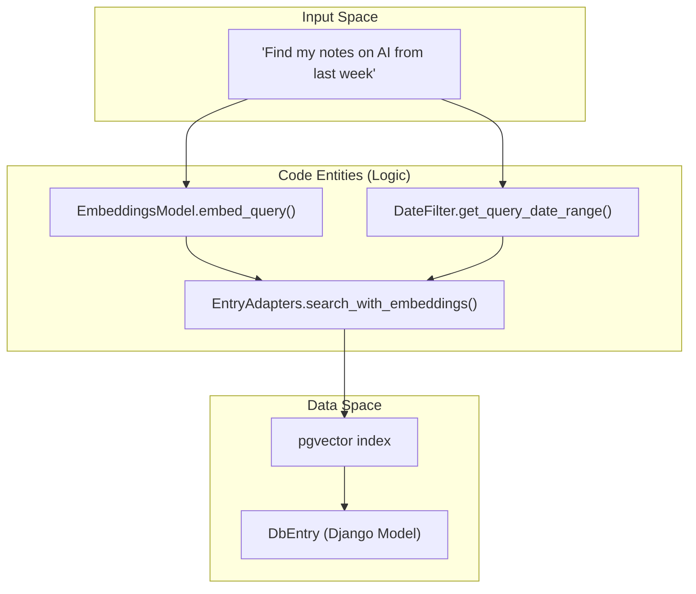

<!-- source: DeepWiki mcp.deepwiki.com · repo khoj-ai/khoj · page 4.2 Search Engine · fetched 2026-10-29 -->

# Search Engine

Relevant source files

The following files were used as context for generating this wiki page:

- [src/khoj/processor/embeddings.py](src/khoj/processor/embeddings.py)
- [src/khoj/search_filter/base_filter.py](src/khoj/search_filter/base_filter.py)
- [src/khoj/search_filter/date_filter.py](src/khoj/search_filter/date_filter.py)
- [src/khoj/search_filter/file_filter.py](src/khoj/search_filter/file_filter.py)
- [src/khoj/search_filter/word_filter.py](src/khoj/search_filter/word_filter.py)
- [src/khoj/search_type/text_search.py](src/khoj/search_type/text_search.py)
- [src/khoj/utils/config.py](src/khoj/utils/config.py)
- [src/khoj/utils/rawconfig.py](src/khoj/utils/rawconfig.py)
- [tests/conftest.py](tests/conftest.py)
- [tests/helpers.py](tests/helpers.py)
- [tests/test_client.py](tests/test_client.py)
- [tests/test_date_filter.py](tests/test_date_filter.py)
- [tests/test_file_filter.py](tests/test_file_filter.py)
- [tests/test_helpers.py](tests/test_helpers.py)
- [tests/test_text_search.py](tests/test_text_search.py)
- [tests/test_word_filter.py](tests/test_word_filter.py)

The Search Engine system provides semantic search capabilities across user content in Khoj. It handles bi-encoder embedding generation, vector similarity search using `pgvector`, cross-encoder reranking, and complex query filtering (date, file, and word) to enable natural language search over indexed documents.

## Architecture Overview

The search engine operates as a multi-stage pipeline that transforms user queries into relevant content matches through vector similarity search and neural reranking.

Title: Search Engine Architecture

The search engine uses a two-stage retrieval approach: initial candidate retrieval via bi-encoder embeddings stored in the database, followed by precise reranking using cross-encoder models if configured.

Sources: [src/khoj/search_type/text_search.py:99-138](), [src/khoj/search_type/text_search.py:192-208](), [src/khoj/processor/embeddings.py:29-58]()

## Embedding Search and Models

Khoj supports multiple inference backends for generating embeddings and performing reranking.

### Bi-Encoder (EmbeddingsModel)
The `EmbeddingsModel` class handles the conversion of text to vector embeddings. It supports:
- **Local Inference**: Using `sentence-transformers` [src/khoj/processor/embeddings.py:49-51]().
- **HuggingFace API**: Remote inference via HuggingFace Inference Endpoints [src/khoj/processor/embeddings.py:66-81]().
- **OpenAI API**: Using OpenAI's embedding models [src/khoj/processor/embeddings.py:89-92]().

### Cross-Encoder (CrossEncoderModel)
The `CrossEncoderModel` reranks the top results from the bi-encoder by looking at the query and document simultaneously. This is more computationally expensive but significantly more accurate [src/khoj/processor/embeddings.py:117-146]().

Sources: [src/khoj/processor/embeddings.py:29-147](), [src/khoj/search_type/text_search.py:120-123]()

## Search Filters

Khoj supports advanced filtering logic that allows users to narrow down search results using specific syntax within the natural language query.

### Date Filtering (`DateFilter`)
The `DateFilter` extracts date ranges from queries using regex like `dt>="yesterday"` or `dt:"2023-01-01"` [src/khoj/search_filter/date_filter.py:24-30](). It uses `dateparser` to handle natural language dates and converts them into timestamps for comparison [src/khoj/search_filter/date_filter.py:118-155]().

### File Filtering (`FileFilter`)
Users can include or exclude specific files or paths using `file:"filename"` or `-file:"filename"` syntax. This filter checks the `file_path` attribute of search entries [tests/test_file_filter.py:37-59]().

### Word Filtering (`WordFilter`)
Word filters allow for mandatory inclusion (`+word`) or exclusion (`-word`) of specific terms in the raw text of the entries [tests/test_word_filter.py:31-55]().

Sources: [src/khoj/search_filter/date_filter.py:18-155](), [tests/test_date_filter.py:11-34](), [tests/test_word_filter.py:70-80]()

## Search Execution Flow

The `query()` function in `text_search.py` orchestrates the retrieval process.

Title: Natural Language to Code Entity Space

1.  **Query Normalization**: The query is processed to extract filters.
2.  **Encoding**: The query string is converted to a vector using `state.embeddings_model` [src/khoj/search_type/text_search.py:122]().
3.  **Vector Search**: `EntryAdapters.search_with_embeddings` is called to perform a similarity search in PostgreSQL [src/khoj/search_type/text_search.py:127-135]().
4.  **Collation**: Results are converted into `SearchResponse` objects, which include metadata like file source, URI, and score [src/khoj/search_type/text_search.py:141-164]().

Sources: [src/khoj/search_type/text_search.py:99-164](), [src/khoj/utils/rawconfig.py:65-71]()

## Search API Endpoints

The search engine is primarily exposed through the `/api/search` endpoint.

| Parameter | Type | Description |
| :--- | :--- | :--- |
| `q` | `string` | The search query (required) |
| `t` | `string` | Content type (e.g., `org`, `markdown`, `pdf`, `all`) |
| `n` | `int` | Number of results to return |
| `max_distance` | `float` | Threshold for vector similarity |

The API requires authentication via a Bearer token. Invalid tokens or content types result in `403` or `422` errors respectively [tests/test_client.py:20-56]().

Sources: [tests/test_client.py:20-67](), [src/khoj/search_type/text_search.py:24-32]()

## Search Type Mapping

Khoj maps search types to specific `EntryType` values defined in the database model.

| SearchType (Enum) | DbEntry.EntryType |
| :--- | :--- |
| `org` | `ORG` |
| `markdown` | `MARKDOWN` |
| `plaintext` | `PLAINTEXT` |
| `pdf` | `PDF` |
| `github` | `GITHUB` |
| `notion` | `NOTION` |
| `all` | `None` (No filter applied) |

Sources: [src/khoj/search_type/text_search.py:24-32](), [src/khoj/utils/config.py:7-17]()

---

