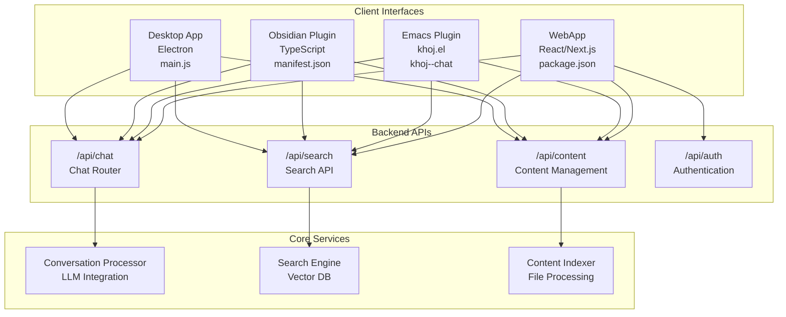

<!-- source: DeepWiki mcp.deepwiki.com · repo khoj-ai/khoj · page 5 User Interfaces · fetched 2026-10-29 -->

# User Interfaces

Relevant source files

The following files were used as context for generating this wiki page:

- [manifest.json](manifest.json)
- [src/interface/desktop/package.json](src/interface/desktop/package.json)
- [src/interface/emacs/khoj.el](src/interface/emacs/khoj.el)
- [src/interface/obsidian/manifest.json](src/interface/obsidian/manifest.json)
- [src/interface/obsidian/package.json](src/interface/obsidian/package.json)
- [src/interface/obsidian/src/api.ts](src/interface/obsidian/src/api.ts)
- [src/interface/obsidian/src/chat_view.ts](src/interface/obsidian/src/chat_view.ts)
- [src/interface/obsidian/src/interact_with_files.ts](src/interface/obsidian/src/interact_with_files.ts)
- [src/interface/obsidian/src/main.ts](src/interface/obsidian/src/main.ts)
- [src/interface/obsidian/src/pane_view.ts](src/interface/obsidian/src/pane_view.ts)
- [src/interface/obsidian/src/search_modal.ts](src/interface/obsidian/src/search_modal.ts)
- [src/interface/obsidian/src/settings.ts](src/interface/obsidian/src/settings.ts)
- [src/interface/obsidian/src/similar_view.ts](src/interface/obsidian/src/similar_view.ts)
- [src/interface/obsidian/src/utils.ts](src/interface/obsidian/src/utils.ts)
- [src/interface/obsidian/styles.css](src/interface/obsidian/styles.css)
- [src/interface/obsidian/versions.json](src/interface/obsidian/versions.json)
- [src/interface/web/package.json](src/interface/web/package.json)
- [versions.json](versions.json)

This document covers the multi-platform client applications and interfaces that users interact with to access Khoj's AI assistant capabilities. These interfaces provide access to chat, search, content indexing, and agent interaction features across different platforms and environments.

For information about the backend API endpoints that these interfaces consume, see [API Routers and Middleware](#2.2). For details about the conversation and AI processing pipeline, see [Core Backend System](#2).

## Interface Architecture Overview

Khoj provides a unified API-driven architecture where multiple client interfaces connect to the same backend services. All interfaces communicate with the core backend through HTTP APIs, enabling consistent functionality across platforms.

Sources: [src/interface/web/package.json:1-50](), [src/interface/emacs/khoj.el:1-100](), [src/interface/obsidian/manifest.json:1-10](), [src/interface/desktop/package.json:1-25]()

## Next.js Web Application

The modern web interface is built with Next.js 15.5.14 and React 18.3.1. It serves as the primary interface for users, offering a feature-rich environment for chat, search, and agent management.

### Web Technology Stack

| Technology | Version | Purpose |
|------------|---------|---------|
| Next.js | 15.5.14 | Core framework [src/interface/web/package.json:65]() |
| React | 18.3.1 | UI library [src/interface/web/package.json:66]() |
| Tailwind CSS | 3.4.17 | Styling [src/interface/web/package.json:96]() |
| Radix UI | Various | Accessible UI primitives [src/interface/web/package.json:25-45]() |
| Mermaid | 11.11.0 | Diagram rendering [src/interface/web/package.json:64]() |
| WebSocket | 4.13.0 | Real-time streaming [src/interface/web/package.json:69]() |

For details, see [Next.js Web Application](#5.1).

## Emacs Integration

The Emacs integration (`khoj.el`) provides a native Lisp-based client for interacting with Khoj. It supports natural language search, chat, and automated content indexing of Org-mode and Markdown files.

### Key Capabilities
- **Server Management**: Handles local server lifecycle via `khoj-server-command` [src/interface/emacs/khoj.el:208-214]().
- **Content Indexing**: Automatically indexes files defined in `khoj-index-files` [src/interface/emacs/khoj.el:164-165]().
- **Interactive Search**: Uses `khoj--incremental-search` for real-time results [src/interface/emacs/khoj.el:183]().

For details, see [Emacs Integration](#5.2).

## Obsidian Plugin

The Obsidian plugin integrates Khoj directly into the user's Markdown-based second brain. It allows for semantic search over the vault and provides a chat interface that can reference and edit local notes.

### Plugin Components
- **Chat View**: Implemented in `KhojChatView`, supporting voice input and file access modes [src/interface/obsidian/src/chat_view.ts:68-110]().
- **Synchronization**: Managed by `updateContentIndex`, which handles batch uploads of Markdown, PDF, and image files [src/interface/obsidian/src/utils.ts:104-135]().
- **Settings**: Configuration for API keys, sync folders, and model selection [src/interface/obsidian/src/settings.ts:29-45]().

For details, see [Obsidian Plugin](#5.3).

## Desktop and Mobile Applications

Khoj provides standalone applications to ensure availability across devices.

### Desktop Application
Built with Electron, the desktop app wraps the core Khoj functionality in a native container.
- **Entry Point**: `main.js` [src/interface/desktop/package.json:10]().
- **Dependencies**: Uses `electron-store` for persistence and `cron` for background tasks [src/interface/desktop/package.json:18-23]().

### Mobile Application
The mobile client (specifically Android) enables on-the-go access to the AI assistant.

For details, see [Desktop and Mobile Applications](#5.4).

## Legacy Web Interface

The legacy interface utilizes Jinja2 templates and a more traditional server-side rendering approach. While the modern Next.js app is the preferred interface, the legacy system remains documented for historical context and maintenance.

For details, see [Legacy Web Interface](#5.5).

## Interface Data Flow: Obsidian Example

This diagram illustrates how the Obsidian interface bridges the user's "Natural Language Space" to the backend's "Code Entity Space" during a content sync.

```mermaid
graph LR
    subgraph "Obsidian UI (Natural Language Space)"
        User["User Workspace<br/>.md / .pdf files"]
        SyncCmd["'Sync new changes'<br/>Command"]
    end

    subgraph "Obsidian Plugin (Bridge)"
        GetFiles["getFilesToSync()<br/>src/interface/obsidian/src/utils.ts"]
        Batcher["updateContentIndex()<br/>src/interface/obsidian/src/utils.ts"]
        Uploader["uploadContentBatch()<br/>src/interface/obsidian/src/api.ts"]
    end

    subgraph "Khoj Backend (Code Entity Space)"
        ContentRouter["PATCH /api/content<br/>src/khoj/main.py"]
        ProcessPipeline["Content Indexing Pipeline<br/>src/khoj/processor/"]
    end

    User --> SyncCmd
    SyncCmd --> GetFiles
    GetFiles --> Batcher
    Batcher --> Uploader
    Uploader --> ContentRouter
    ContentRouter --> ProcessPipeline
```

Sources: [src/interface/obsidian/src/utils.ts:64-111](), [src/interface/obsidian/src/api.ts:1-20]()

## Interface Comparison

| Feature | Next.js Web | Emacs | Obsidian | Desktop |
|---------|-------------|-------|----------|---------|
| **Primary Language** | TypeScript | Emacs Lisp | TypeScript | JavaScript/Electron |
| **Search Type** | Web/Semantic | Incremental | Semantic/Similar | Web/Semantic |
| **Local File Access** | Upload-based | Native FS | Vault-integrated | Native FS |
| **Voice Input** | Supported | Supported | Supported | Supported |

Sources: [src/interface/web/package.json:1-10](), [src/interface/emacs/khoj.el:1-50](), [src/interface/obsidian/src/chat_view.ts:131-138](), [src/interface/desktop/package.json:1-15]()

---

