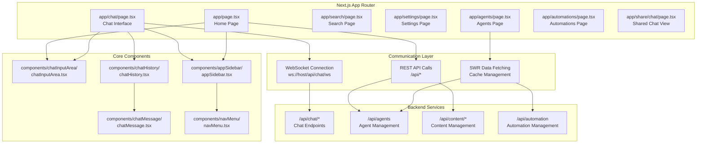
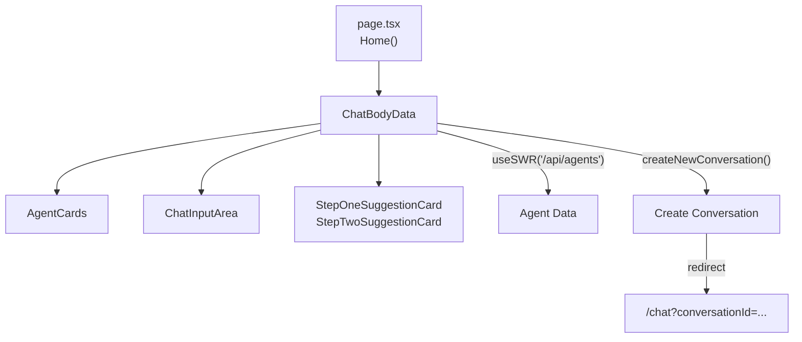
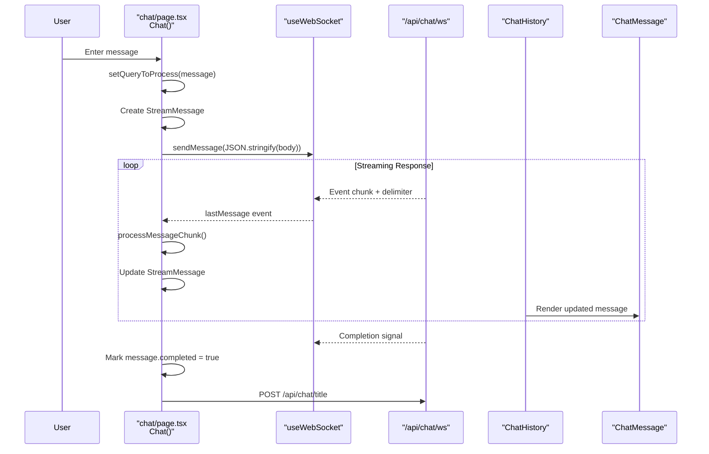
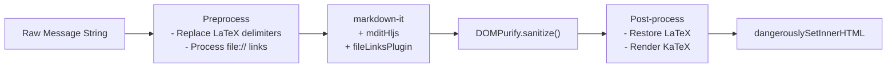
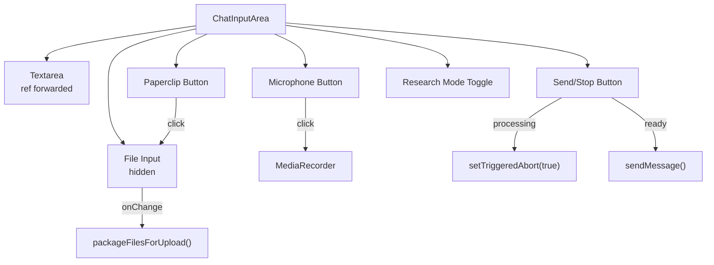
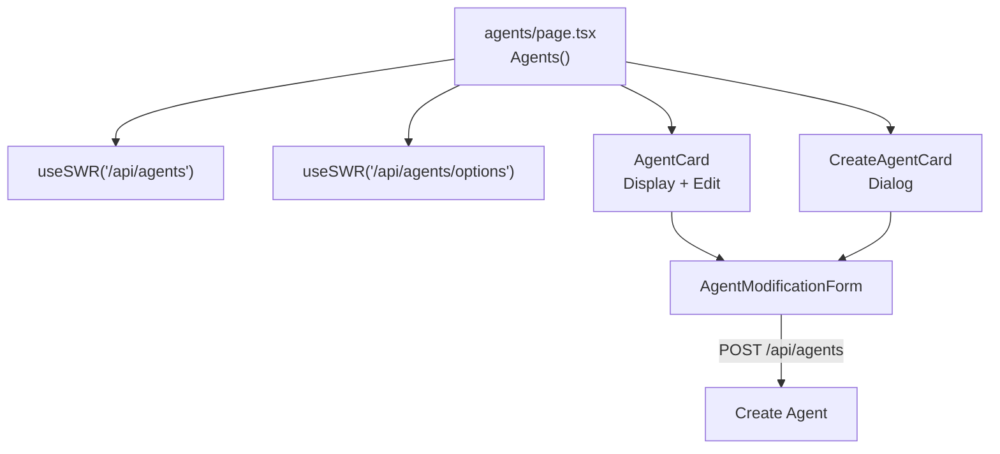
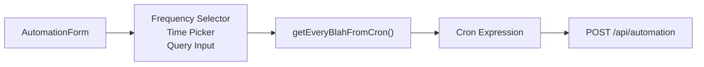

<!-- source: DeepWiki mcp.deepwiki.com · repo khoj-ai/khoj · page 5.1 Next.js Web Application · fetched 2026-10-29 -->

# Next.js Web Application

Relevant source files

The following files were used as context for generating this wiki page:

- [src/interface/web/app/agents/layout.tsx](src/interface/web/app/agents/layout.tsx)
- [src/interface/web/app/agents/page.tsx](src/interface/web/app/agents/page.tsx)
- [src/interface/web/app/automations/layout.tsx](src/interface/web/app/automations/layout.tsx)
- [src/interface/web/app/automations/page.tsx](src/interface/web/app/automations/page.tsx)
- [src/interface/web/app/chat/chat.module.css](src/interface/web/app/chat/chat.module.css)
- [src/interface/web/app/chat/layout.tsx](src/interface/web/app/chat/layout.tsx)
- [src/interface/web/app/chat/page.tsx](src/interface/web/app/chat/page.tsx)
- [src/interface/web/app/common/auth.ts](src/interface/web/app/common/auth.ts)
- [src/interface/web/app/common/chatFunctions.ts](src/interface/web/app/common/chatFunctions.ts)
- [src/interface/web/app/common/colorUtils.ts](src/interface/web/app/common/colorUtils.ts)
- [src/interface/web/app/common/iconUtils.tsx](src/interface/web/app/common/iconUtils.tsx)
- [src/interface/web/app/common/modelSelector.tsx](src/interface/web/app/common/modelSelector.tsx)
- [src/interface/web/app/common/utils.ts](src/interface/web/app/common/utils.ts)
- [src/interface/web/app/components/agentCard/agentCard.tsx](src/interface/web/app/components/agentCard/agentCard.tsx)
- [src/interface/web/app/components/allConversations/allConversations.tsx](src/interface/web/app/components/allConversations/allConversations.tsx)
- [src/interface/web/app/components/appSidebar/appSidebar.tsx](src/interface/web/app/components/appSidebar/appSidebar.tsx)
- [src/interface/web/app/components/chatHistory/chatHistory.module.css](src/interface/web/app/components/chatHistory/chatHistory.module.css)
- [src/interface/web/app/components/chatHistory/chatHistory.tsx](src/interface/web/app/components/chatHistory/chatHistory.tsx)
- [src/interface/web/app/components/chatInputArea/chatInputArea.tsx](src/interface/web/app/components/chatInputArea/chatInputArea.tsx)
- [src/interface/web/app/components/chatMessage/chatMessage.module.css](src/interface/web/app/components/chatMessage/chatMessage.module.css)
- [src/interface/web/app/components/chatMessage/chatMessage.tsx](src/interface/web/app/components/chatMessage/chatMessage.tsx)
- [src/interface/web/app/components/chatSidebar/chatSidebar.tsx](src/interface/web/app/components/chatSidebar/chatSidebar.tsx)
- [src/interface/web/app/components/loading/loading.tsx](src/interface/web/app/components/loading/loading.tsx)
- [src/interface/web/app/components/logo/fileLogo.tsx](src/interface/web/app/components/logo/fileLogo.tsx)
- [src/interface/web/app/components/navMenu/navMenu.tsx](src/interface/web/app/components/navMenu/navMenu.tsx)
- [src/interface/web/app/components/referencePanel/referencePanel.tsx](src/interface/web/app/components/referencePanel/referencePanel.tsx)
- [src/interface/web/app/components/suggestions/suggestionCard.tsx](src/interface/web/app/components/suggestions/suggestionCard.tsx)
- [src/interface/web/app/components/suggestions/suggestionsData.ts](src/interface/web/app/components/suggestions/suggestionsData.ts)
- [src/interface/web/app/globals.css](src/interface/web/app/globals.css)
- [src/interface/web/app/layout.tsx](src/interface/web/app/layout.tsx)
- [src/interface/web/app/page.tsx](src/interface/web/app/page.tsx)
- [src/interface/web/app/search/layout.tsx](src/interface/web/app/search/layout.tsx)
- [src/interface/web/app/search/page.tsx](src/interface/web/app/search/page.tsx)
- [src/interface/web/app/settings/layout.tsx](src/interface/web/app/settings/layout.tsx)
- [src/interface/web/app/settings/page.tsx](src/interface/web/app/settings/page.tsx)
- [src/interface/web/app/share/chat/layout.tsx](src/interface/web/app/share/chat/layout.tsx)
- [src/interface/web/app/share/chat/page.tsx](src/interface/web/app/share/chat/page.tsx)
- [src/interface/web/app/share/chat/sharedChat.module.css](src/interface/web/app/share/chat/sharedChat.module.css)
- [src/interface/web/components/ui/sidebar.tsx](src/interface/web/components/ui/sidebar.tsx)
- [src/interface/web/tailwind.config.ts](src/interface/web/tailwind.config.ts)

## Purpose and Scope

This document describes the Next.js web application that provides the primary user interface for Khoj. The application implements a modern React-based frontend using Next.js 14 with the App Router, TypeScript, and Shadcn UI components. It handles chat interactions, agent management, content search, settings configuration, and automations.

For backend API integration details, see [API Routers and Middleware](2.2). For the legacy server-rendered interface, see [Legacy Web Interface](5.5).

---

## Architecture Overview

The Next.js application follows a modular client-side architecture with server components where appropriate. It uses WebSocket for real-time chat streaming and REST APIs for data fetching and mutations.

### Application Structure

Title: Web Application Component Interaction

Sources: [src/interface/web/app/page.tsx:1-50]() [src/interface/web/app/chat/page.tsx:1-40]() [src/interface/web/app/components/appSidebar/appSidebar.tsx:1-50]()

---

## Page Routes and Components

### Home Page (`/`)

The home page serves as the landing interface with agent selection and quick action suggestions.

**Key Functionality:**
- Agent selection via horizontal scrollable cards [src/interface/web/app/page.tsx:104-171]()
- Step-based suggestion system (`StepOneSuggestionCard`, `StepTwoSuggestionCard`) [src/interface/web/app/page.tsx:12-15]()
- Message input with image/file attachment support [src/interface/web/app/page.tsx:17-22]()
- Direct navigation to chat with selected agent via `createNewConversation` [src/interface/web/app/page.tsx:40-40]()

Title: Home Page Interaction Flow

Sources: [src/interface/web/app/page.tsx:174-250]() [src/interface/web/app/components/suggestions/suggestionCard.tsx:1-50]()

---

### Chat Page (`/chat`)

The main chat interface handles real-time conversations with streaming responses.

Title: WebSocket Streaming Sequence

**Key State Variables:**
- `streamedMessages`: Array of `StreamMessage` objects [src/interface/web/app/chat/page.tsx:46-47]()
- `processingMessage`: Boolean indicating if a query is active [src/interface/web/app/chat/page.tsx:65-65]()
- `agentMetadata`: Current agent configuration [src/interface/web/app/chat/page.tsx:66-66]()

Sources: [src/interface/web/app/chat/page.tsx:60-151]() [src/interface/web/app/common/chatFunctions.ts:83-179]()

---

### Chat Message Rendering

The `ChatMessage` component handles markdown rendering, LaTeX math, code syntax highlighting, and complex context visualization.

Title: Message Rendering Pipeline

**Key Features:**

| Feature | Implementation | File Reference |
|---------|---------------|----------------|
| Markdown | `markdown-it` with `mditHljs` | [src/interface/web/app/components/chatMessage/chatMessage.tsx:67-79]() |
| Math Rendering | KaTeX auto-render | [src/interface/web/app/components/chatMessage/chatMessage.tsx:51-51]() |
| Code Highlighting | `highlight.js` via `mditHljs` | [src/interface/web/app/components/chatMessage/chatMessage.tsx:73-76]() |
| File Links | Custom `fileLinksPlugin` | [src/interface/web/app/components/chatMessage/fileLinksPlugin.ts:1-50]() |
| Image Validation | `imageValidationPlugin` | [src/interface/web/app/components/chatMessage/imageValidationPlugin.ts:1-50]() |
| Mermaid Diagrams | `Mermaid` component | [src/interface/web/app/components/chatMessage/chatMessage.tsx:65-65]() |

Sources: [src/interface/web/app/components/chatMessage/chatMessage.tsx:67-204]()

---

### Chat Input Area

The `ChatInputArea` component provides a rich input interface with file attachments, voice input, and research mode.

Title: Input Area Components

**File Upload Flow:**
1. User selects files via button or drag-and-drop.
2. Images (jpg/png/webp) are converted to base64.
3. Files are processed via `packageFilesForUpload` [src/interface/web/app/common/chatFunctions.ts:45-45]().
4. Extracted content is stored as `AttachedFileText[]` [src/interface/web/app/components/chatInputArea/chatInputArea.tsx:61-66]().

Sources: [src/interface/web/app/components/chatInputArea/chatInputArea.tsx:90-205]()

---

### Agent Management Page

The `/agents` page provides CRUD operations for AI agents via the `AgentCard` and `AgentModificationForm`.

**Agent Data Structure:** [src/interface/web/app/components/agentCard/agentCard.tsx:1-100]()
- `slug`: Unique identifier.
- `persona`: System prompt instructions.
- `chat_model`: Selected LLM.
- `input_tools`: Enabled tools (e.g., search, code).

Title: Agent Configuration Flow

Sources: [src/interface/web/app/agents/page.tsx:166-210]() [src/interface/web/app/components/agentCard/agentCard.tsx:1-150]()

---

### Search Page

The `/search` page provides semantic search over indexed documents and file management.

**Key Features:**
- Semantic search results with score visualization [src/interface/web/app/search/page.tsx:89-95]().
- File management: Preview, download, and delete indexed files [src/interface/web/app/search/page.tsx:113-132]().
- Data indexing: Upload files directly for search processing [src/interface/web/app/search/page.tsx:79-79]().

Sources: [src/interface/web/app/search/page.tsx:1-205]()

---

### Settings Page

The `/settings` page manages user configuration, API keys, and external integrations.

**Settings Sections:**
- **Profile**: Name and email management [src/interface/web/app/settings/page.tsx:118-120]().
- **API Keys**: CRUD operations for authentication tokens [src/interface/web/app/settings/page.tsx:162-214]().
- **Integrations**: Notion and GitHub sync configuration [src/interface/web/app/settings/page.tsx:60-61]().
- **Memory**: Management of long-term user memory entries [src/interface/web/app/settings/page.tsx:90-90]().

Sources: [src/interface/web/app/settings/page.tsx:1-220]()

---

### Automations Page

The `/automations` page manages scheduled agent queries.

**Cron Conversion Logic:**
The UI converts natural language frequency (Day, Week, Month) and time into standard cron format [src/interface/web/app/automations/page.tsx:84-142]().

Title: Automation Scheduling Flow

Sources: [src/interface/web/app/automations/page.tsx:168-215]()

---

## Reference Display System

The `referencePanel.tsx` component handles display of context from multiple sources (Notes, Web, Code).

**Context Components:**
- `NotesContextReferenceCard`: For document-based context [src/interface/web/app/components/referencePanel/referencePanel.tsx:57-110]().
- `WebSearchReferenceCard`: For online search results.
- `CodeContextReferenceCard`: For code execution results and generated files [src/interface/web/app/components/referencePanel/referencePanel.tsx:120-155]().

Sources: [src/interface/web/app/components/referencePanel/referencePanel.tsx:1-155]()

---

## Shared State and Data Fetching

The application uses **SWR** for client-side data fetching and cache management.

| Hook | Purpose | Source |
|------|---------|--------|
| `useAuthenticatedData` | Fetch user profile and subscription status | [src/interface/web/app/common/auth.ts:1-50]() |
| `useUserConfig` | Fetch global user configuration | [src/interface/web/app/common/auth.ts:1-50]() |
| `useIsMobileWidth` | Responsive layout detection | [src/interface/web/app/common/utils.ts:11-11]() |
| `useIsDarkMode` | Theme management | [src/interface/web/app/common/utils.ts:1-10]() |

Sources: [src/interface/web/app/common/auth.ts:1-50]() [src/interface/web/app/common/utils.ts:1-50]()

---

