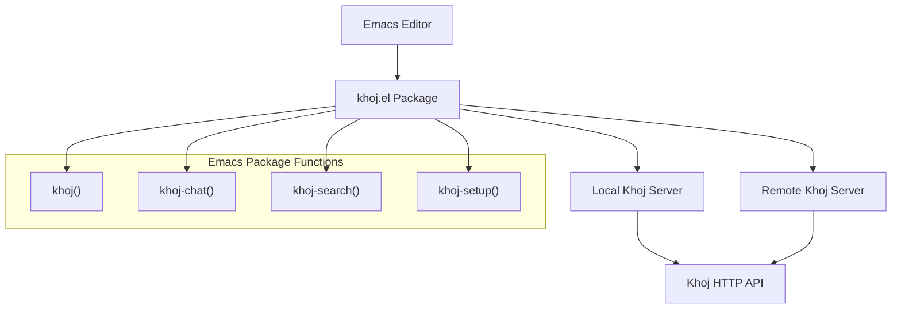
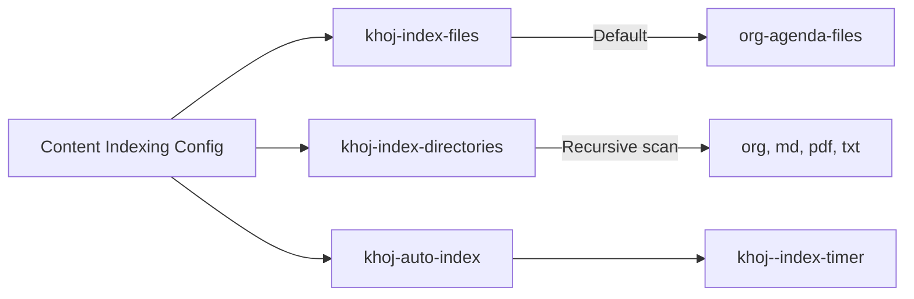
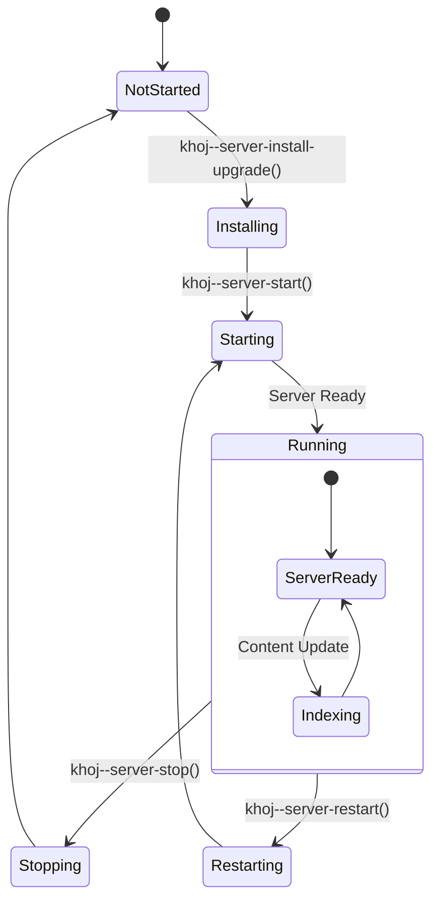
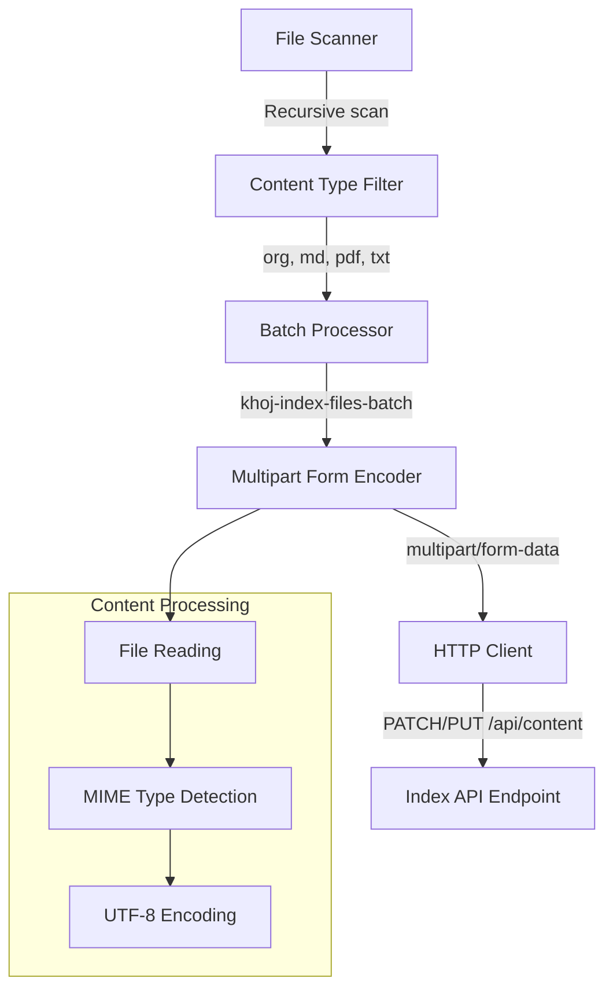
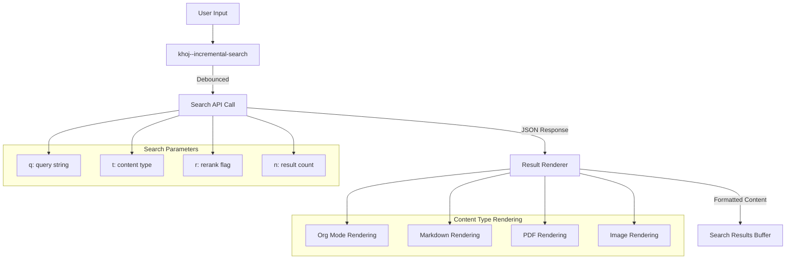
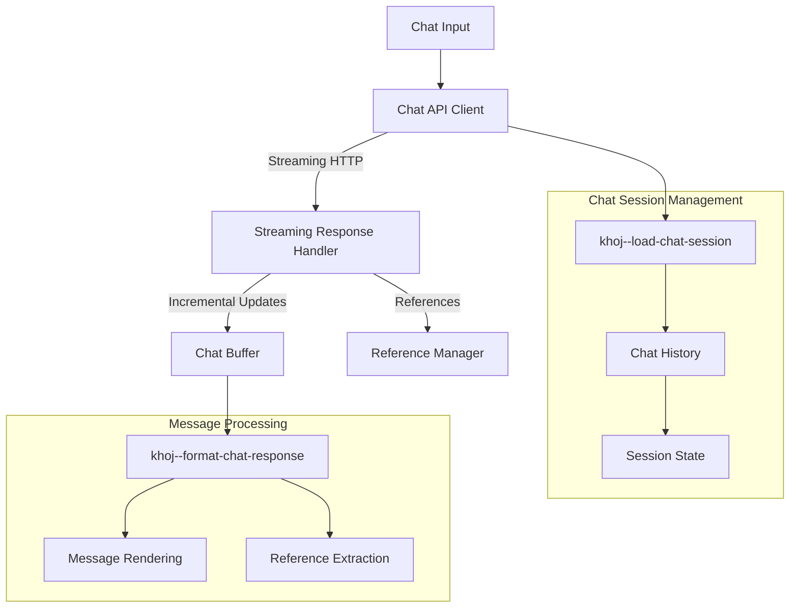
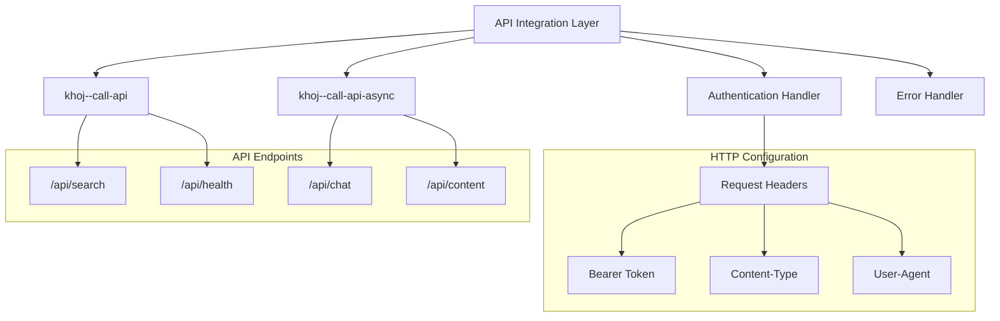
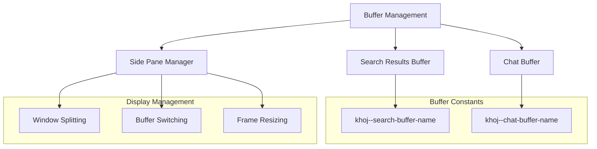
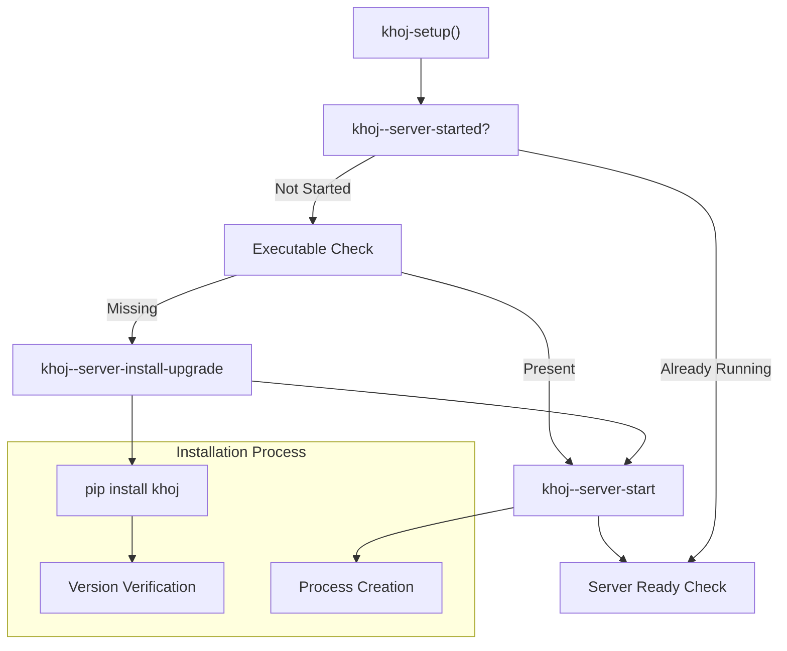

<!-- source: DeepWiki mcp.deepwiki.com · repo khoj-ai/khoj · page 5.2 Emacs Integration · fetched 2026-10-29 -->

# Emacs Integration

Relevant source files

The following files were used as context for generating this wiki page:

- [manifest.json](manifest.json)
- [src/interface/desktop/package.json](src/interface/desktop/package.json)
- [src/interface/emacs/khoj.el](src/interface/emacs/khoj.el)
- [src/interface/obsidian/manifest.json](src/interface/obsidian/manifest.json)
- [src/interface/obsidian/package.json](src/interface/obsidian/package.json)
- [src/interface/obsidian/versions.json](src/interface/obsidian/versions.json)
- [src/interface/web/package.json](src/interface/web/package.json)
- [versions.json](versions.json)

The Emacs integration provides native access to Khoj's search and chat capabilities directly within the Emacs editor through a comprehensive Emacs Lisp package. This integration allows users to search their personal knowledge base, chat with AI agents, and manage content indexing without leaving their Emacs workflow.

For information about other client interfaces, see Web Application ([5.1]()), Obsidian Plugin ([5.3]()), and Desktop Application ([5.4]()).

## Architecture Overview

The Emacs integration follows a client-server architecture where the `khoj.el` package acts as both a client interface and optionally a server manager. The integration communicates with the Khoj backend through HTTP API calls while providing native Emacs UI components.

Title: Emacs Integration System Components

**Architecture Components:**
- **khoj.el Package**: Main Emacs Lisp package providing all functionality [src/interface/emacs/khoj.el:1-11]().
- **Server Management**: Optional local server installation and management [src/interface/emacs/khoj.el:208-220]().
- **HTTP API Client**: Asynchronous API communication layer [src/interface/emacs/khoj.el:688-714]().
- **UI Components**: Native Emacs buffers for search results and chat [src/interface/emacs/khoj.el:146-150]().

Sources: [src/interface/emacs/khoj.el:1-60](), [src/interface/emacs/khoj.el:688-714]()

## Configuration System

The Emacs package uses a comprehensive configuration system based on Emacs' `defcustom` mechanism, allowing users to customize behavior through standard Emacs customization interfaces.

### Core Configuration Variables

| Variable | Default | Purpose |
|----------|---------|---------|
| `khoj-server-url` | `"https://app.khoj.dev"` | Khoj server endpoint [src/interface/emacs/khoj.el:67-70]() |
| `khoj-api-key` | `nil` | API authentication key [src/interface/emacs/khoj.el:102-105]() |
| `khoj-server-is-local` | `t` | Whether server runs locally [src/interface/emacs/khoj.el:72-75]() |
| `khoj-results-count` | `8` | Number of search results to display [src/interface/emacs/khoj.el:87-90]() |
| `khoj-default-content-type` | `"all"` | Default content type for searches [src/interface/emacs/khoj.el:122-128]() |
| `khoj-default-agent` | `"khoj"` | Default AI agent for chat [src/interface/emacs/khoj.el:130-133]() |

### Content Indexing Configuration

Title: Indexing Configuration Logic

The package supports automatic content indexing through configurable file lists and directories, with periodic updates controlled by `khoj-index-interval` [src/interface/emacs/khoj.el:112-115]().

Sources: [src/interface/emacs/khoj.el:67-134](), [src/interface/emacs/khoj.el:245-267]()

## Server Management

The Emacs package includes comprehensive server management capabilities, allowing users to run Khoj locally without external dependencies.

### Server Lifecycle Management

Title: Server State Transitions

### Server Process Management

The server management system tracks server state through several key variables:

- `khoj--server-process`: Process object for local server [src/interface/emacs/khoj.el:274]().
- `khoj--server-ready?`: Boolean indicating server readiness [src/interface/emacs/khoj.el:276]().
- `khoj--server-configured?`: Boolean indicating configuration status [src/interface/emacs/khoj.el:278]().

The `khoj--server-start` function initializes the local process using `make-process` and passes configured arguments [src/interface/emacs/khoj.el:300-342]().

Sources: [src/interface/emacs/khoj.el:274-382](), [src/interface/emacs/khoj.el:300-342]()

## Content Indexing System

The content indexing system handles automatic synchronization of user files with the Khoj server, supporting multiple content types and batch processing.

### Indexing Pipeline

Title: Indexing Pipeline Implementation

### Supported Content Types

The system automatically detects and processes various content types:

- **Org Mode**: `text/org` - Native Emacs org-mode files [src/interface/emacs/khoj.el:494]().
- **Markdown**: `text/markdown` - Markdown files (.md, .markdown) [src/interface/emacs/khoj.el:495]().
- **PDF**: `application/pdf` - PDF documents [src/interface/emacs/khoj.el:497]().
- **Plain Text**: `text/plain` - Generic text files [src/interface/emacs/khoj.el:496]().

Sources: [src/interface/emacs/khoj.el:408-430](), [src/interface/emacs/khoj.el:494-499]()

## Search Interface

The search interface provides incremental search capabilities with real-time results and multiple content type support.

### Search Workflow

Title: Search Logic and Result Rendering

### Search Result Processing

The search system processes JSON responses from the API and renders them in appropriate Emacs modes:

- **Org Results**: Extracted as org-mode entries with standardized headings [src/interface/emacs/khoj.el:530-550]().
- **Markdown Results**: Rendered with markdown-mode syntax highlighting [src/interface/emacs/khoj.el:560-575]().
- **PDF Results**: Displayed as org-mode entries with metadata [src/interface/emacs/khoj.el:580-595]().
- **Image Results**: Rendered as HTML with inline images [src/interface/emacs/khoj.el:600-615]().

Sources: [src/interface/emacs/khoj.el:715-764](), [src/interface/emacs/khoj.el:518-634]()

## Chat Interface

The chat interface provides conversational AI capabilities with streaming responses and reference management.

### Chat System Architecture

Title: Chat Interface Data Flow

### Chat Message Flow

The chat system handles both user messages and AI responses through a structured message processing pipeline:

1. **Input Processing**: User queries are captured and formatted [src/interface/emacs/khoj.el:771-778]().
2. **API Communication**: Messages sent to `/api/chat` endpoint [src/interface/emacs/khoj.el:807-822]().
3. **Streaming Response**: Real-time response handling with incremental updates.
4. **Reference Management**: Extraction and display of source references [src/interface/emacs/khoj.el:182]().
5. **Buffer Management**: Organized display in dedicated chat buffer `khoj--chat-buffer-name` [src/interface/emacs/khoj.el:149]().

Sources: [src/interface/emacs/khoj.el:771-778](), [src/interface/emacs/khoj.el:807-822](), [src/interface/emacs/khoj.el:149-182]()

## API Integration Layer

The API integration layer provides both synchronous and asynchronous communication with the Khoj server through standardized HTTP endpoints.

### API Client Architecture

Title: API Layer and Authentication

### Authentication System

The API layer implements Bearer token authentication by injecting the `khoj-api-key` into the `Authorization` header of `url-request-extra-headers` [src/interface/emacs/khoj.el:688-709]().

Sources: [src/interface/emacs/khoj.el:667-714](), [src/interface/emacs/khoj.el:688-709]()

## User Interface Components

The Emacs integration provides several specialized UI components designed to integrate seamlessly with Emacs workflows.

### Buffer Management System

Title: UI Buffer Hierarchy

### Interactive Commands

The package provides several interactive commands that serve as entry points for different functionalities:

| Command | Function | Purpose |
|---------|----------|---------|
| `khoj` | Main entry point | Transient menu interface [src/interface/emacs/khoj.el:47]() |
| `khoj-chat` | Chat interface | Start chat session [src/interface/emacs/khoj.el:780]() |
| `khoj-search` | Search interface | Perform content search [src/interface/emacs/khoj.el:715]() |
| `khoj-setup` | Setup assistant | Install and configure server [src/interface/emacs/khoj.el:384]() |

Sources: [src/interface/emacs/khoj.el:140-151](), [src/interface/emacs/khoj.el:780-805]()

## Installation and Setup

The Emacs package includes automated installation and setup capabilities for both the package itself and the Khoj server.

### Package Installation

The package is distributed through MELPA and can be installed using standard Emacs package management as noted in the commentary [src/interface/emacs/khoj.el:42-45]().

### Server Setup Process

Title: Automated Server Setup

The setup process automatically handles Python environment detection using `khoj-server-python-command` and manages package installation via pip [src/interface/emacs/khoj.el:222-243]().

Sources: [src/interface/emacs/khoj.el:384-401](), [src/interface/emacs/khoj.el:288-298](), [src/interface/emacs/khoj.el:222-243]()

---

