<!-- source: DeepWiki mcp.deepwiki.com · repo khoj-ai/khoj · page 5.3 Obsidian Plugin · fetched 2026-10-29 -->

# Obsidian Plugin

Relevant source files

The following files were used as context for generating this wiki page:

- [src/interface/obsidian/.editorconfig](src/interface/obsidian/.editorconfig)
- [src/interface/obsidian/.eslintignore](src/interface/obsidian/.eslintignore)
- [src/interface/obsidian/.eslintrc](src/interface/obsidian/.eslintrc)
- [src/interface/obsidian/.gitignore](src/interface/obsidian/.gitignore)
- [src/interface/obsidian/.npmrc](src/interface/obsidian/.npmrc)
- [src/interface/obsidian/LICENSE](src/interface/obsidian/LICENSE)
- [src/interface/obsidian/esbuild.config.mjs](src/interface/obsidian/esbuild.config.mjs)
- [src/interface/obsidian/src/api.ts](src/interface/obsidian/src/api.ts)
- [src/interface/obsidian/src/chat_view.ts](src/interface/obsidian/src/chat_view.ts)
- [src/interface/obsidian/src/interact_with_files.ts](src/interface/obsidian/src/interact_with_files.ts)
- [src/interface/obsidian/src/main.ts](src/interface/obsidian/src/main.ts)
- [src/interface/obsidian/src/pane_view.ts](src/interface/obsidian/src/pane_view.ts)
- [src/interface/obsidian/src/search_modal.ts](src/interface/obsidian/src/search_modal.ts)
- [src/interface/obsidian/src/settings.ts](src/interface/obsidian/src/settings.ts)
- [src/interface/obsidian/src/similar_view.ts](src/interface/obsidian/src/similar_view.ts)
- [src/interface/obsidian/src/utils.ts](src/interface/obsidian/src/utils.ts)
- [src/interface/obsidian/styles.css](src/interface/obsidian/styles.css)
- [src/interface/obsidian/tsconfig.json](src/interface/obsidian/tsconfig.json)

The Obsidian plugin provides a comprehensive interface for accessing Khoj's AI-powered search and chat capabilities directly within Obsidian. It enables users to search their vault content, chat with AI assistants, find similar documents, and synchronize their files with the Khoj backend for indexing and retrieval.

## Architecture Overview

The Obsidian plugin follows a modular architecture with distinct components for different functionality areas. The plugin integrates deeply with Obsidian's workspace system while maintaining communication with the Khoj backend.

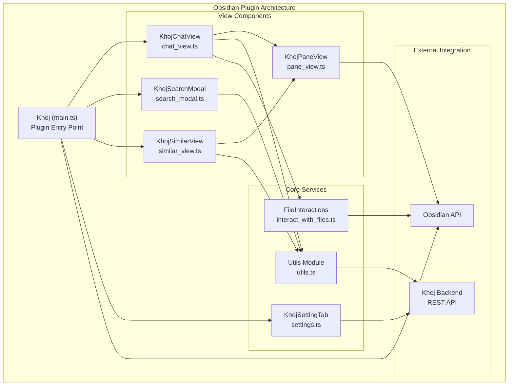

Sources: [src/interface/obsidian/src/main.ts:10-142](), [src/interface/obsidian/src/pane_view.ts:6-68]()

## Plugin Core Structure

### Main Plugin Class

The `Khoj` class serves as the plugin's entry point and orchestrates all functionality through Obsidian's plugin lifecycle.

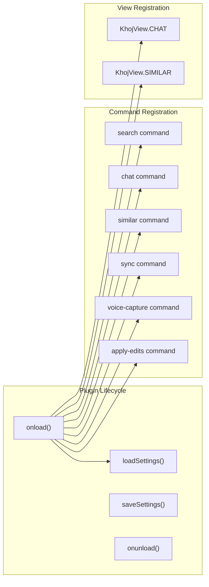

The plugin registers multiple commands with keyboard shortcuts and manages automatic content synchronization through an `indexingTimer` which triggers `updateContentIndex` at configurable intervals.

Sources: [src/interface/obsidian/src/main.ts:14-172](), [src/interface/obsidian/src/main.ts:115-137]()

### Settings Management

The `KhojSettingTab` class provides a configuration interface for connection settings, sync preferences, and model selection.

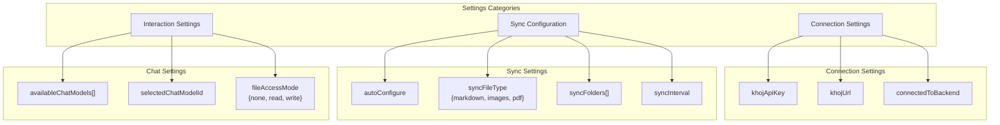

Sources: [src/interface/obsidian/src/settings.ts:29-67](), [src/interface/obsidian/src/settings.ts:120-210]()

## View Components

### Chat Interface

The `KhojChatView` implements a comprehensive chat interface with streaming responses, file access controls, and agent selection.

#### Chat View Architecture

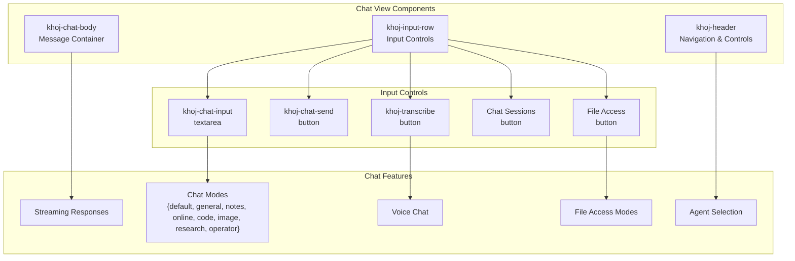

Sources: [src/interface/obsidian/src/chat_view.ts:68-98](), [src/interface/obsidian/src/chat_view.ts:83-92]()

#### Chat Message Processing

The chat system processes messages through several stages with support for different content types and edit blocks.

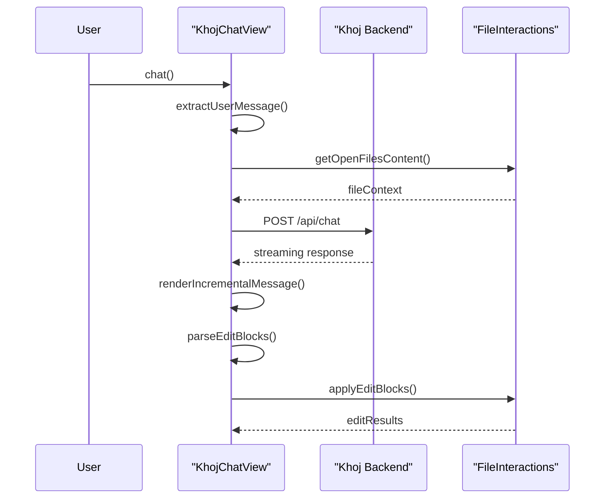

Sources: [src/interface/obsidian/src/chat_view.ts:152-194](), [src/interface/obsidian/src/chat_view.ts:744-829]()

### Search Modal

The `KhojSearchModal` provides semantic search across indexed content with real-time results and file filtering.

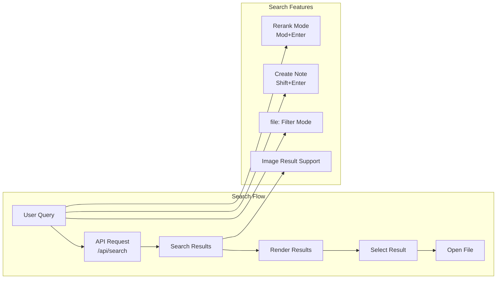

Sources: [src/interface/obsidian/src/search_modal.ts:52-67](), [src/interface/obsidian/src/search_modal.ts:100-111](), [src/interface/obsidian/src/search_modal.ts:145-174]()

### Similar Documents View

The `KhojSimilarView` automatically finds and displays documents similar to the currently active file by using the search API with the current file's content as a query.

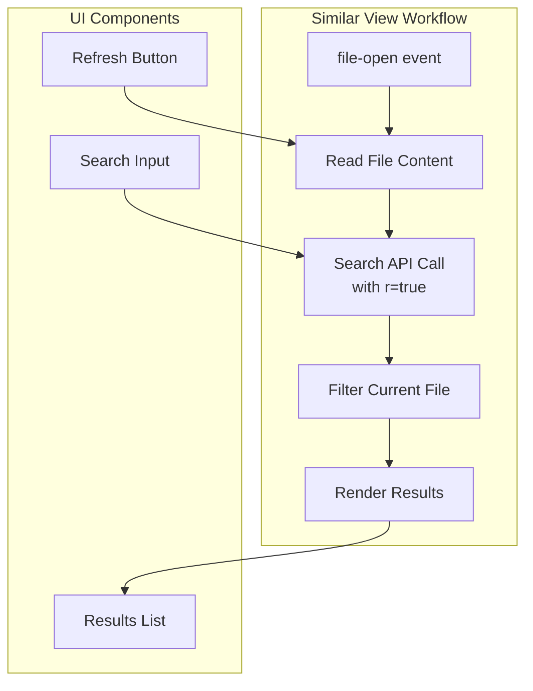

Sources: [src/interface/obsidian/src/similar_view.ts:123-143](), [src/interface/obsidian/src/similar_view.ts:173-212]()

## File Operations and Synchronization

### Content Synchronization

The plugin synchronizes vault content with the Khoj backend through the `updateContentIndex` function, supporting incremental and full synchronization. It uses a batching strategy to respect size and item limits.

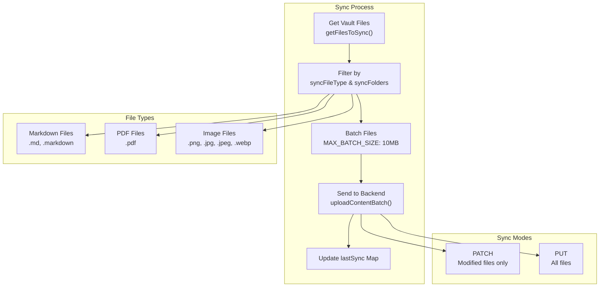

Sources: [src/interface/obsidian/src/utils.ts:64-102](), [src/interface/obsidian/src/utils.ts:133-160](), [src/interface/obsidian/src/api.ts:13-30]()

### File Interaction System

The `FileInteractions` class manages AI-suggested edits to files through structured edit blocks.

#### Edit Block Processing

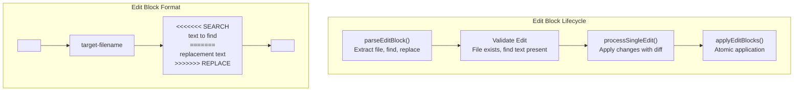

Sources: [src/interface/obsidian/src/interact_with_files.ts:123-134](), [src/interface/obsidian/src/interact_with_files.ts:372-525]()

## Backend Communication

### API Integration

The plugin communicates with the Khoj backend through RESTful APIs with authentication and error handling.

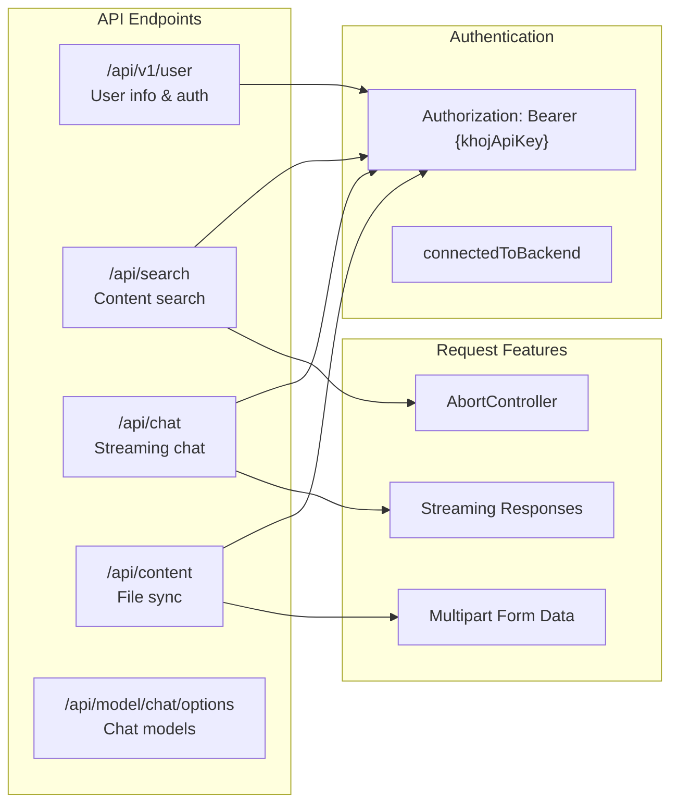

Sources: [src/interface/obsidian/src/api.ts:1-30](), [src/interface/obsidian/src/chat_view.ts:1102-1115]()

## User Interface Components

### Navigation and Layout

The plugin provides a consistent navigation experience across different views with a unified header system populated by `populateHeaderPane`.

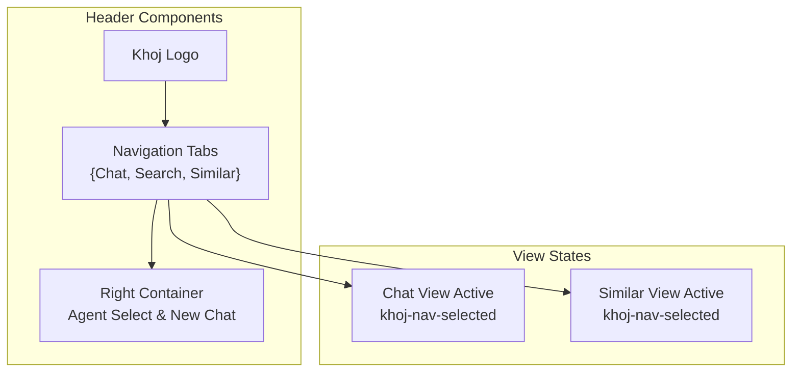

Sources: [src/interface/obsidian/src/pane_view.ts:20-39](), [src/interface/obsidian/src/utils.ts:327-522]()

### Styling System

The plugin uses CSS custom properties for theming and responsive design patterns.

| CSS Class | Purpose | File Location |
|-----------|---------|---------------|
| `khoj-chat` | Main chat container | [styles.css:30-41]() |
| `khoj-chat-message` | Individual message styling | [styles.css:67-75]() |
| `khoj-input-row` | Input control layout | [styles.css:412-426]() |
| `khoj-edit-block` | Edit block display | [styles.css:1225-1235]() |

Sources: [src/interface/obsidian/styles.css:10-1467]()

## Voice and Media Features

The plugin supports voice input for hands-free interaction, using the browser's `MediaRecorder` API to capture audio and send it to the backend for transcription.

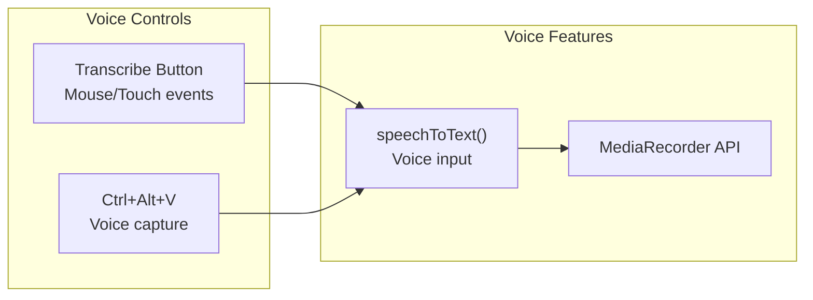

Sources: [src/interface/obsidian/src/chat_view.ts:317-330](), [src/interface/obsidian/src/chat_view.ts:536-585]()

---

