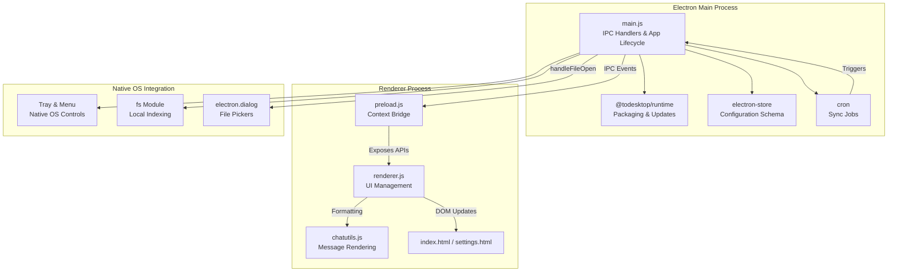
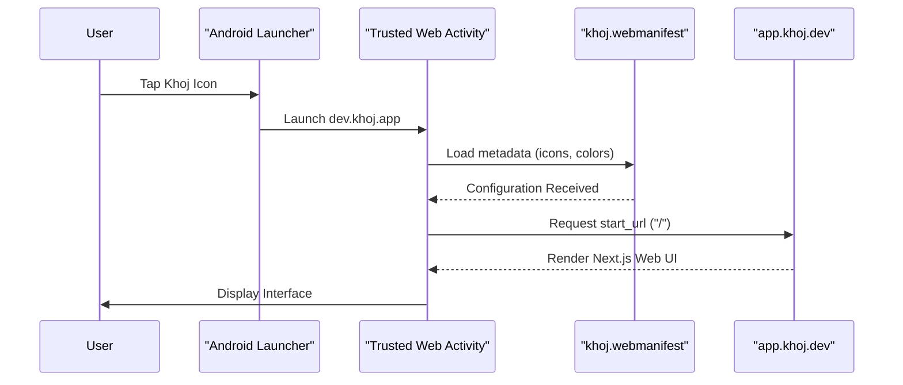

<!-- source: DeepWiki mcp.deepwiki.com · repo khoj-ai/khoj · page 5.4 Desktop and Mobile Applications · fetched 2026-10-29 -->

# Desktop and Mobile Applications

Relevant source files

The following files were used as context for generating this wiki page:

- [documentation/assets/img/favicon-128x128.ico](documentation/assets/img/favicon-128x128.ico)
- [src/interface/android/app/build.gradle](src/interface/android/app/build.gradle)
- [src/interface/android/app/src/main/AndroidManifest.xml](src/interface/android/app/src/main/AndroidManifest.xml)
- [src/interface/android/app/src/main/java/dev/khoj/app/Application.java](src/interface/android/app/src/main/java/dev/khoj/app/Application.java)
- [src/interface/android/app/src/main/java/dev/khoj/app/DelegationService.java](src/interface/android/app/src/main/java/dev/khoj/app/DelegationService.java)
- [src/interface/android/app/src/main/java/dev/khoj/app/LauncherActivity.java](src/interface/android/app/src/main/java/dev/khoj/app/LauncherActivity.java)
- [src/interface/android/app/src/main/res/drawable-anydpi/shortcut_legacy_background.xml](src/interface/android/app/src/main/res/drawable-anydpi/shortcut_legacy_background.xml)
- [src/interface/android/app/src/main/res/drawable-hdpi/splash.png](src/interface/android/app/src/main/res/drawable-hdpi/splash.png)
- [src/interface/android/app/src/main/res/drawable-mdpi/splash.png](src/interface/android/app/src/main/res/drawable-mdpi/splash.png)
- [src/interface/android/app/src/main/res/drawable-xhdpi/splash.png](src/interface/android/app/src/main/res/drawable-xhdpi/splash.png)
- [src/interface/android/app/src/main/res/drawable-xxhdpi/splash.png](src/interface/android/app/src/main/res/drawable-xxhdpi/splash.png)
- [src/interface/android/app/src/main/res/drawable-xxxhdpi/splash.png](src/interface/android/app/src/main/res/drawable-xxxhdpi/splash.png)
- [src/interface/android/manifest-checksum.txt](src/interface/android/manifest-checksum.txt)
- [src/interface/android/twa-manifest.json](src/interface/android/twa-manifest.json)
- [src/interface/desktop/assets/icons/favicon-128x128.ico](src/interface/desktop/assets/icons/favicon-128x128.ico)
- [src/interface/desktop/assets/icons/favicon-128x128.png](src/interface/desktop/assets/icons/favicon-128x128.png)
- [src/interface/desktop/assets/icons/favicon-20x20.png](src/interface/desktop/assets/icons/favicon-20x20.png)
- [src/interface/desktop/assets/icons/favicon-256x256.png](src/interface/desktop/assets/icons/favicon-256x256.png)
- [src/interface/desktop/assets/icons/favicon.icns](src/interface/desktop/assets/icons/favicon.icns)
- [src/interface/desktop/assets/icons/favicon.ico](src/interface/desktop/assets/icons/favicon.ico)
- [src/interface/desktop/chatutils.js](src/interface/desktop/chatutils.js)
- [src/interface/desktop/main.js](src/interface/desktop/main.js)
- [src/interface/desktop/preload.js](src/interface/desktop/preload.js)
- [src/interface/desktop/renderer.js](src/interface/desktop/renderer.js)
- [src/interface/desktop/shortcut.html](src/interface/desktop/shortcut.html)
- [src/interface/desktop/todesktop.json](src/interface/desktop/todesktop.json)
- [src/interface/web/public/khoj.webmanifest](src/interface/web/public/khoj.webmanifest)

## Purpose and Scope

This document covers the native desktop and mobile client applications that provide platform-specific access to Khoj functionality. These applications offer native OS integration, offline capabilities, and platform-specific features beyond what's available in web browsers. For web-based access, see [Next.js Web Application](#5.1). For text editor integrations, see [Emacs Integration](#5.2) and [Obsidian Plugin](#5.3).

---

## Desktop Application

### Overview

The Khoj desktop application is an Electron-based wrapper that provides native OS integration and enhanced local features. It packages the web interface with native capabilities for Windows, macOS, and Linux platforms.

**Architecture Type**: Electron application with ToDesktop runtime  
**Main Entry Point**: `main.js` [src/interface/desktop/main.js:1-5]()

### Technology Stack

| Component | Technology | Role |
|-----------|-----------|---------|
| Framework | Electron | Desktop shell and native API access [src/interface/desktop/main.js:1]() |
| Packaging | ToDesktop Runtime | Auto-updates and distribution [src/interface/desktop/main.js:2-5]() |
| HTTP Client | Axios | Communication with Khoj backend [src/interface/desktop/main.js:11]() |
| Task Scheduling | Cron | Scheduled content synchronization [src/interface/desktop/main.js:10]() |
| Local Storage | electron-store | Persistent configuration and state [src/interface/desktop/main.js:15-76]() |

### Desktop Application Architecture

Sources: [src/interface/desktop/main.js:1-81](), [src/interface/desktop/preload.js:12-92](), [src/interface/desktop/renderer.js:1-122]()

### Key Features

#### Local File Indexing and Synchronization
The desktop application allows users to index local files and folders by syncing them to the Khoj server.

- **Supported Formats**: The application supports text-based files (org, md, txt, html, xml, code files) and binary files (pdf, jpg, png, webp) [src/interface/desktop/main.js:17-23]().
- **Sync Logic**: The `pushDataToKhoj` function collects paths from configured files and folders [src/interface/desktop/main.js:158-191](). It uses `fs.statSync` to detect modifications since the `lastSync` timestamp [src/interface/desktop/main.js:195-202]().
- **Directory Traversal**: The `processDirectory` function recursively walks folders to find indexable content, skipping hidden files [src/interface/desktop/main.js:125-144]().
- **Data Transfer**: Files are converted to Blobs with appropriate MIME types (via `filenameToMimeType`) and sent to the backend [src/interface/desktop/main.js:97-118](), [src/interface/desktop/main.js:205-210]().

#### IPC Architecture
Communication between the privileged Main process and the unprivileged Renderer process is managed via `contextBridge` in `preload.js`.

| API Bridge | Main Process Handler | Purpose |
|------------|----------------------|---------|
| `storeValueAPI` | `handleFileOpen` | Opens native file/folder pickers [src/interface/desktop/preload.js:32-34]() |
| `getFilesAPI` | `getFiles` | Retrieves list of tracked files from store [src/interface/desktop/preload.js:36-38]() |
| `syncDataAPI` | `syncData` | Manually triggers the indexing pipeline [src/interface/desktop/preload.js:65-68]() |
| `updateStateAPI` | `update-state` | Sends sync progress updates to UI [src/interface/desktop/preload.js:44-46]() |
| `openFileAPI` | `openFile` | Opens local files in default OS application [src/interface/desktop/preload.js:89-91]() |

#### User Interface Components
- **Chat Rendering**: `chatutils.js` provides `renderMessage` to build the chat UI, handling references and formatting [src/interface/desktop/chatutils.js:110-146]().
- **Reference Handling**: `generateReference` and `generateOnlineReference` create interactive UI elements for source citations [src/interface/desktop/chatutils.js:32-108]().
- **Settings Management**: `renderer.js` handles adding/removing folders and updating the sync status display [src/interface/desktop/renderer.js:5-105]().

### Configuration Schema
The application uses a structured schema for local storage:
- `files`: Array of objects containing file paths [src/interface/desktop/main.js:26-37]().
- `folders`: Array of objects containing directory paths [src/interface/desktop/main.js:38-49]().
- `khojToken`: User authentication token [src/interface/desktop/main.js:50-53]().
- `hostURL`: The target Khoj server URL (defaults to `app.khoj.dev`) [src/interface/desktop/main.js:54-57]().
- `lastSync`: Tracked modification times for incremental indexing [src/interface/desktop/main.js:58-71]().

---

## Mobile Applications

### Overview

Khoj provides mobile access primarily through a **Trusted Web Activity (TWA)** on Android, which wraps the modern web interface into a native application package.

### Android Application (TWA)

The Android client is built using the Google TWA framework, allowing the web-based Khoj interface to run with native-like performance and integration.

**Package ID**: `dev.khoj.app` [src/interface/android/twa-manifest.json:2]()  
**Host**: `app.khoj.dev` [src/interface/android/twa-manifest.json:3]()

#### Build Configuration
The `build.gradle` file defines the TWA manifest properties:
- **Theme Colors**: Customizable status bar and navigation bar colors [src/interface/android/app/build.gradle:29-34]().
- **Splash Screen**: Configurable background color and fade-out duration (300ms) [src/interface/android/app/build.gradle:35-44]().
- **Fallback**: Uses `customtabs` if TWA is unavailable on the device [src/interface/android/app/build.gradle:48]().

#### Native Integration
- **LauncherActivity**: Extends the Google Android Browser Helper to manage the application entry point and orientation [src/interface/android/app/src/main/java/dev/khoj/app/LauncherActivity.java:24-49]().
- **Web Manifest**: Points to `https://app.khoj.dev/static/khoj.webmanifest` for PWA metadata [src/interface/android/app/build.gradle:77]().
- **Notifications**: Notification delegation is enabled by default [src/interface/android/twa-manifest.json:14]().
- **Location**: Location delegation is supported via features configuration [src/interface/android/twa-manifest.json:29-31]().

### Mobile App Interaction Flow

Sources: [src/interface/android/app/build.gradle:23-51](), [src/interface/web/public/khoj.webmanifest:1-15]()

### PWA Metadata (`khoj.webmanifest`)
The web manifest defines the behavior for both mobile TWA and browser-installed PWAs:
- **Display Mode**: `standalone` [src/interface/web/public/khoj.webmanifest:5]().
- **Launch Handler**: Configured to `navigate-existing` or `auto` [src/interface/web/public/khoj.webmanifest:13-15]().
- **Categories**: Productivity, Utilities, Personalization, Education [src/interface/web/public/khoj.webmanifest:9]().
- **Icons**: Provides multiple sizes up to 1200x1200px for high-density mobile screens [src/interface/web/public/khoj.webmanifest:16-45]().

Sources: [src/interface/web/public/khoj.webmanifest:1-76]()

---

