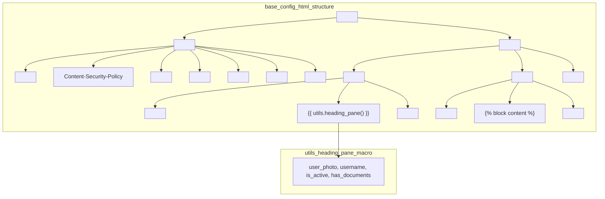
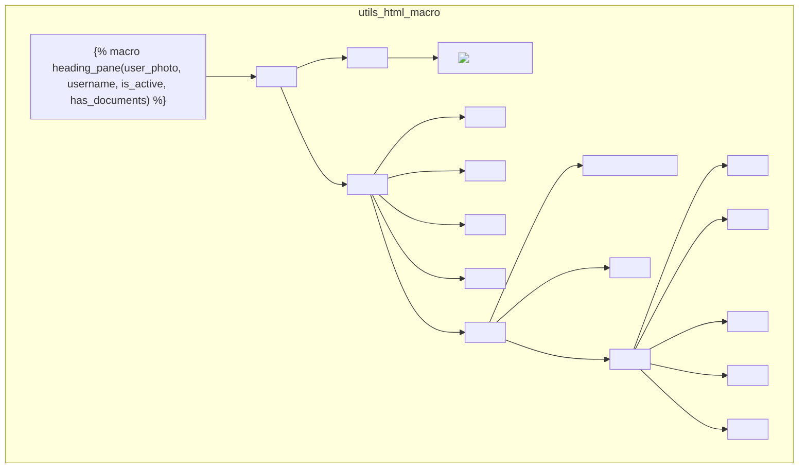

<!-- source: DeepWiki mcp.deepwiki.com · repo khoj-ai/khoj · page 5.5 Legacy Web Interface · fetched 2026-10-29 -->

# Legacy Web Interface

<details>
<summary>Relevant source files</summary>

The following files were used as context for generating this wiki page:

- [src/interface/desktop/about.html](src/interface/desktop/about.html)
- [src/interface/desktop/assets/khoj.css](src/interface/desktop/assets/khoj.css)
- [src/interface/desktop/utils.js](src/interface/desktop/utils.js)
- [src/khoj/interface/web/assets/khoj.css](src/khoj/interface/web/assets/khoj.css)
- [src/khoj/interface/web/base_config.html](src/khoj/interface/web/base_config.html)
- [src/khoj/interface/web/content_source_github_input.html](src/khoj/interface/web/content_source_github_input.html)
- [src/khoj/interface/web/home/css/styles.css](src/khoj/interface/web/home/css/styles.css)
- [src/khoj/interface/web/home/favicon.png](src/khoj/interface/web/home/favicon.png)
- [src/khoj/interface/web/home/index.html](src/khoj/interface/web/home/index.html)
- [src/khoj/interface/web/home/khoj_app_hero_image.avif](src/khoj/interface/web/home/khoj_app_hero_image.avif)
- [src/khoj/interface/web/home/script.js](src/khoj/interface/web/home/script.js)
- [src/khoj/interface/web/utils.html](src/khoj/interface/web/utils.html)

</details>


The legacy web interface is a server-side rendered system using Jinja2 templates, served by FastAPI via the `web_client` APIRouter defined in [src/khoj/routers/web_client.py:16](). It provides traditional HTML pages for chat, search, settings, and authentication using request-response patterns rather than client-side frameworks.

This interface coexists with the modern Next.js application and shares styling patterns with the desktop application. Templates are located in directories defined during application bootstrap.

**Sources:** [src/khoj/routers/web_client.py:1-17]()

## FastAPI Router and Template System

The `web_client` APIRouter serves all server-side rendered pages. The `Jinja2Templates` instance at [src/khoj/routers/web_client.py:17]() loads templates from multiple directories to support legacy pages, Next.js fallbacks, and PyPI distribution.

### web_client Router Architecture

```mermaid
graph TB
    subgraph "web_client_module"
        Router["web_client = APIRouter()"]
        Templates["templates = Jinja2Templates()"]
        
        Router --> index["index(request)"]
        Router --> index_post["index_post(request)"]
        Router --> search_page["search_page(request)"]
        Router --> chat_page["chat_page(request)"]
        Router --> login_page["login_page(request)"]
        Router --> agents_page["agents_page(request)"]
        Router --> config_page["config_page(request)"]
        Router --> github_config_page["github_config_page(request)"]
        Router --> view_public_conversation["view_public_conversation(request)"]
        Router --> automations_config_page["automations_config_page(request)"]
        Router --> server_error_page["server_error_page(request)"]
        Router --> assetlinks["assetlinks(request)"]
        
        Templates --> RenderTemplate["templates.TemplateResponse()"]
    end
    
    subgraph "Route_Decorators"
        requires_auth["@requires(['authenticated'], redirect='login_page')"]
        
        requires_auth --> search_page
        requires_auth --> chat_page
        requires_auth --> config_page
        requires_auth --> github_config_page
        requires_auth --> index_post
    end
    
    subgraph "Helper_Functions"
        get_next_url["get_next_url(request)"]
        get_user_config["get_user_config(user, request)"]
        get_user_github_config["get_user_github_config(user)"]
    end
    
    login_page --> get_next_url
    github_config_page --> get_user_config
    github_config_page --> get_user_github_config
```



**Sources:** [src/khoj/routers/web_client.py:15-147]()

### Route Functions and Template Context

Each route function in `web_client.py` renders a template using `templates.TemplateResponse()` with specific context:

| Route Function | Template File | Authentication | Context Variables |
|----------------|---------------|----------------|-------------------|
| `index()` | `index.html` | Optional | `request` |
| `index_post()` | `index.html` | Required | `request` |
| `search_page()` | `search/index.html` | Required | `request` |
| `chat_page()` | `chat/index.html` | Required | `request` |
| `login_page()` | `login.html` | None | `request`, `google_client_id`, `redirect_uri` |
| `config_page()` | `settings/index.html` | Required | `request` |
| `github_config_page()` | `content_source_github_input.html` | Required | `user_photo`, `username`, `is_active`, `has_documents`, `current_config` |
| `agents_page()` | `agents/index.html` | None | `request` |
| `view_public_conversation()` | `share/chat/index.html` | None | `request` |
| `automations_config_page()` | `automations/index.html` | None | `request` |

The `github_config_page()` function at [src/khoj/routers/web_client.py:89-114]() demonstrates complex context preparation, fetching `GithubContentConfig` from the database via `get_user_github_config()`, extracting `GithubRepoConfig` objects, and serializing to JSON.

**Sources:** [src/khoj/routers/web_client.py:21-136]()

## Base Template System

The `base_config.html` template at [src/khoj/interface/web/base_config.html:1-49]() serves as the parent template for all configuration and settings pages.

### base_config.html Structure



The grid layout at [src/khoj/interface/web/base_config.html:60-63]() uses `grid-template-columns: 1fr min(70vw, 100%) 1fr` to center content with responsive `filler` divs.

**Sources:** [src/khoj/interface/web/base_config.html:1-63]()

### Content Security Policy

The `<meta http-equiv="Content-Security-Policy">` tag at [src/khoj/interface/web/base_config.html:8-16]() enforces strict directives to restrict resource loading to trusted origins, preventing XSS attacks while allowing Google OAuth profile images and external fonts.

**Sources:** [src/khoj/interface/web/base_config.html:8-16]()

## CSS Theme System

The `khoj.css` file at [src/khoj/interface/web/assets/khoj.css:1-238]() defines CSS custom properties for theme management. The base template loads this at [src/khoj/interface/web/base_config.html:18]().

### CSS Custom Properties

Color variables defined in the `:root` selector at [src/khoj/interface/web/assets/khoj.css:5-19]():

```css
[data-theme="light"],
:root:not([data-theme="dark"]) {
    --primary: #f9f5de;
    --primary-hover: #fee285;
    --primary-focus: rgba(255, 179, 0, 0.125);
    --primary-inverse: rgba(0, 0, 0, 0.75);
    --background-color: #f5f4f3;
    --frosted-background-color: rgba(245, 244, 243, 0.75);
    --main-text-color: #475569;
    --summer-sun: #fcc50b;
    --water: #44b9da;
    --leaf: #7b990a;
    --flower: #ffaeae;
    --font-family: "Noto Sans", "Noto Sans Arabic", sans-serif !important;
}
```

The theme respects `prefers-color-scheme: dark` media queries at [src/khoj/interface/web/assets/khoj.css:23-38]() and explicit `data-theme="dark"` attributes at [src/khoj/interface/web/assets/khoj.css:41-54]().

**Sources:** [src/khoj/interface/web/assets/khoj.css:1-62]()

## Navigation and Header Components

The `utils.html` file at [src/khoj/interface/web/utils.html:1-48]() defines the `heading_pane` Jinja2 macro used for navigation across all pages.

### heading_pane Macro Structure



The macro accepts parameters: `user_photo`, `username`, `is_active`, `has_documents`. The `is_active` parameter determines whether to apply the `subscribed` CSS class to the profile picture circle at [src/khoj/interface/web/utils.html:26-34]().

**Sources:** [src/khoj/interface/web/utils.html:1-48]()

## Settings and Configuration Pages

Settings pages use specific route functions to render configuration interfaces.

### GitHub Configuration Interface

The GitHub configuration page [src/khoj/interface/web/content_source_github_input.html:1-47]() allows users to manage repository indexing.

| Feature | Implementation |
|---------|----------------|
| Add Repository | `add_repo_button` listener creates new input fields [src/khoj/interface/web/content_source_github_input.html:66-118]() |
| Remove Repository | `remove_repo(index)` function deletes DOM element [src/khoj/interface/web/content_source_github_input.html:120-122]() |
| Save Configuration | `fetch('/api/content/github', { method: 'POST' })` [src/khoj/interface/web/content_source_github_input.html:160-170]() |
| Trigger Indexing | `fetch('/api/update?t=github')` [src/khoj/interface/web/content_source_github_input.html:185]() |

**Sources:** [src/khoj/interface/web/content_source_github_input.html:1-185]()

### base_config.html Card System CSS

The `<style>` block in `base_config.html` defines layout classes for settings pages:

| CSS Class | Purpose | Grid Properties |
|-----------|---------|-----------------|
| `.page` | Main container | `display: grid; grid-auto-flow: row; gap: 32px` [base_config.html:73-77]() |
| `.section` | Content block | `display: grid; justify-self: normal` [base_config.html:78-82]() |
| `.section-cards`| Multi-column cards | `grid-template-columns: repeat(2, 1fr); gap: 16px` [base_config.html:125-131]() |
| `.card` | Individual card | `grid-template-rows: repeat(3, 1fr); height: 180px` [base_config.html:131-143]() |

**Sources:** [src/khoj/interface/web/base_config.html:73-143]()

## Landing Page and Deprecation

The main landing page at [src/khoj/interface/web/home/index.html:1-66]() serves as the entry point for non-authenticated users. It includes a deprecation banner for Khoj Cloud at [src/khoj/interface/web/home/index.html:17-23]().

### Deprecation Logic
The banner is managed via `localStorage` to allow users to dismiss it. If `khoj-cloud-deprecation-dismissed` is not set, the banner displays and adjusts the navbar position [src/khoj/interface/web/home/index.html:24-40]().

### Landing Page Navigation
The landing page navigation [src/khoj/interface/web/home/index.html:43-56]() links to documentation, pricing, and the GitHub repository, with a primary CTA to "Launch App" at `/?v=app`.

**Sources:** [src/khoj/interface/web/home/index.html:1-66]()

## Desktop "About" Interface

The desktop application includes a dedicated `about.html` page [src/interface/desktop/about.html:1-89]() which displays version information and links to legal documents.

### App Information Retrieval
The `utils.js` script in the desktop interface uses `window.appInfoAPI.getInfo` to populate the version and platform details [src/interface/desktop/utils.js:17-26]().

```javascript
window.appInfoAPI.getInfo((_, info) => {
    let khojVersionElement = document.getElementById("about-page-version");
    if (khojVersionElement) {
        khojVersionElement.innerHTML = `<code>${info.version}</code>`;
    }
});
```

**Sources:** [src/interface/desktop/about.html:1-89](), [src/interface/desktop/utils.js:17-26]()

## Styling and Themes

The legacy interface maintains consistency through:

1. **Color Variables**: Centralized color management using CSS custom properties [src/khoj/interface/web/assets/khoj.css:5-19]().
2. **Font System**: Noto Sans font family for consistent typography across Arabic and Latin scripts [src/khoj/interface/web/assets/khoj.css:3]().
3. **Responsive Design**: Media queries for mobile and desktop adaptations, specifically for the navigation menu [src/khoj/interface/web/assets/khoj.css:218-237]().
4. **Theme Support**: Light/dark mode support with automatic detection through media queries for `prefers-color-scheme` [src/khoj/interface/web/assets/khoj.css:23-38]().

**Sources:** [src/khoj/interface/web/assets/khoj.css:1-238](), [src/interface/desktop/assets/khoj.css:1-242]()

---

