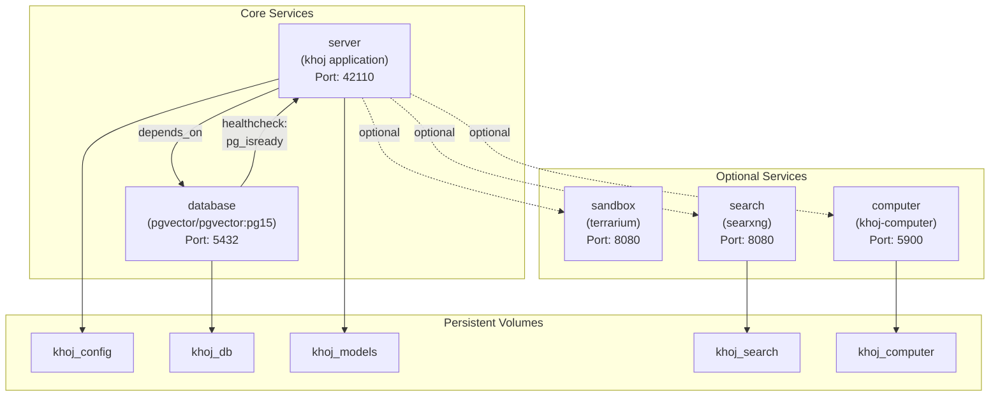
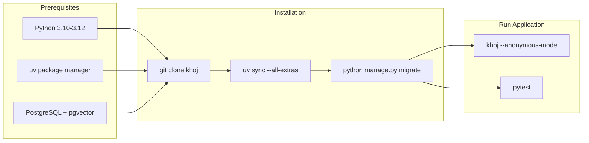
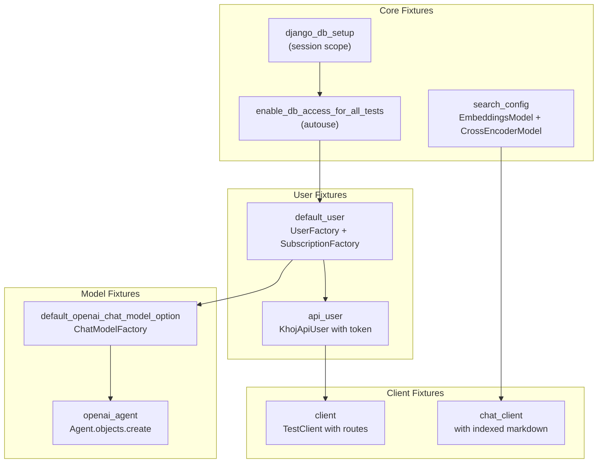
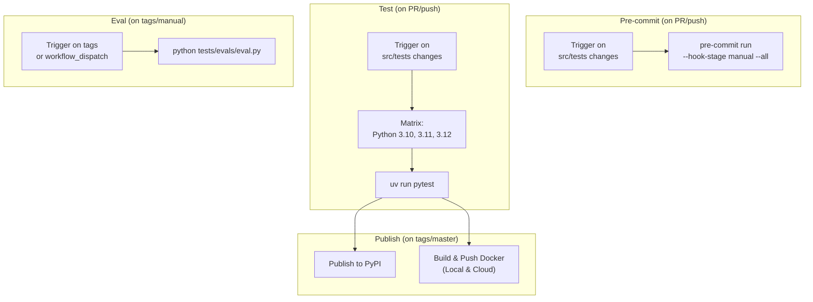

<!-- source: DeepWiki mcp.deepwiki.com · repo khoj-ai/khoj · page 6 Deployment and Operations · fetched 2026-10-29 -->

# Deployment and Operations

Relevant source files

The following files were used as context for generating this wiki page:

- [.dockerignore](.dockerignore)
- [.github/workflows/dockerize.yml](.github/workflows/dockerize.yml)
- [.github/workflows/pre-commit.yml](.github/workflows/pre-commit.yml)
- [.github/workflows/pypi.yml](.github/workflows/pypi.yml)
- [.github/workflows/run_evals.yml](.github/workflows/run_evals.yml)
- [.github/workflows/test.yml](.github/workflows/test.yml)
- [Dockerfile](Dockerfile)
- [docker-compose.yml](docker-compose.yml)
- [gunicorn-config.py](gunicorn-config.py)
- [prod.Dockerfile](prod.Dockerfile)
- [src/interface/web/README.md](src/interface/web/README.md)
- [src/khoj/processor/operator/README.md](src/khoj/processor/operator/README.md)
- [src/khoj/utils/initialization.py](src/khoj/utils/initialization.py)
- [tests/evals/eval.py](tests/evals/eval.py)

This document covers deployment strategies, development workflows, testing infrastructure, and operational concerns for the Khoj application. It includes Docker-based deployment configurations, CI/CD pipelines, testing setup, and production considerations.

For information about the core application bootstrap and configuration, see [Application Bootstrap and Configuration](#2.1). For database setup and migrations, see [Database Models and Adapters](#2.3).

---

## Docker Deployment

Khoj is primarily distributed and deployed using Docker. The repository provides multiple Dockerfiles for different environments and a comprehensive Docker Compose setup for orchestration.

For details, see [Docker Deployment](#6.1).

### Service Architecture

Khoj uses Docker Compose to orchestrate multiple services. The main deployment configuration defines five interconnected services.

**Docker Compose Service Architecture**

Sources: [docker-compose.yml:1-133]()

### Service Definitions

| Service | Image | Purpose | Required |
|---------|-------|---------|----------|
| `database` | `docker.io/pgvector/pgvector:pg15` | Vector-enabled PostgreSQL | Yes |
| `server` | `ghcr.io/khoj-ai/khoj:latest` | Main application server | Yes |
| `sandbox` | `ghcr.io/khoj-ai/terrarium:latest` | Secure code execution | No |
| `search` | `docker.io/searxng/searxng:latest` | Self-hosted web search | No |
| `computer` | `ghcr.io/khoj-ai/khoj-computer:latest` | Computer Operator environment | No |

Sources: [docker-compose.yml:2-45]()

---

## Development Setup and Testing

Khoj uses a modern Python development stack centered around `uv` for dependency management and `pytest` for testing.

For details, see [Development Setup and Testing](#6.2).

### Local Development Flow

**Development Environment Setup Flow**

Sources: [.github/workflows/test.yml:57-83]()

### Testing Infrastructure

The test suite leverages `pytest` and `factory_boy` to create isolated environments for integration and unit tests.

**Test Fixture Architecture**

Sources: [.github/workflows/test.yml:84-93]()

---

## CI/CD and Benchmarking

The project uses GitHub Actions to automate linting, testing, containerization, and publishing. Additionally, a sophisticated benchmarking suite evaluates AI performance.

For details, see [CI/CD and Benchmarking](#6.3).

### Pipeline Overview

**CI/CD Workflow Architecture**

Sources: [.github/workflows/pre-commit.yml:1-59](), [.github/workflows/test.yml:1-94](), [.github/workflows/dockerize.yml:1-180](), [.github/workflows/run_evals.yml:1-153]()

### Benchmark Evaluations

Khoj maintains a rigorous evaluation script in `tests/evals/eval.py` that measures accuracy across several datasets:
- **FRAMES**: Multi-hop retrieval and reasoning.
- **SimpleQA**: Factual question answering.
- **GPQA**: Graduate-level science questions.
- **MATH500**: Mathematical problem solving.

Sources: [tests/evals/eval.py:34-48](), [.github/workflows/run_evals.yml:20-30]()

---

## Application Initialization

On the first run, Khoj performs an automated setup to configure the administrative user and detect available AI models.

### Initialization Sequence

The `initialization()` function in `src/khoj/utils/initialization.py` handles the following:

1.  **Admin User**: Checks for `KHOJ_ADMIN_EMAIL` and `KHOJ_ADMIN_PASSWORD`. If missing and in interactive mode, it prompts the user; otherwise, it creates a superuser using these variables [src/khoj/utils/initialization.py:26-38]().
2.  **Provider Setup**: Detects API keys for OpenAI, Google Gemini, and Anthropic [src/khoj/utils/initialization.py:65-144]().
3.  **Model Discovery**: If `OPENAI_BASE_URL` is set (e.g., for Ollama), it dynamically fetches the list of available models via the API [src/khoj/utils/initialization.py:49-61]().
4.  **Default Assignment**: Sets the default chat model based on `KHOJ_DEFAULT_CHAT_MODEL` if provided [src/khoj/utils/initialization.py:280-293]().

Sources: [src/khoj/utils/initialization.py:25-294]()

---

## Operational Monitoring

### Production Runtime

In production (`prod.Dockerfile`), Khoj runs behind `gunicorn` using the `UvicornWorker` for high-performance ASGI handling.

**Gunicorn Configuration:**
- **Workers**: Defaults to 6, configurable via `GUNICORN_WORKERS` [gunicorn-config.py:6]().
- **Timeout**: 180 seconds to allow for long LLM generations [gunicorn-config.py:10]().
- **Binding**: Listens on `0.0.0.0:42110` [gunicorn-config.py:3]().

Sources: [prod.Dockerfile:64](), [gunicorn-config.py:1-18]()

### Health Checks

The system includes built-in health monitoring:
- **PostgreSQL**: Monitored via `pg_isready` in Docker Compose [docker-compose.yml:11]().
- **Khoj Server**: Exposes an `/api/health` endpoint used by CI and orchestration tools to verify readiness [docker-compose.yml:18](), [.github/workflows/run_evals.yml:187]().

Sources: [docker-compose.yml:10-21](), [.github/workflows/run_evals.yml:185-200]()

---

