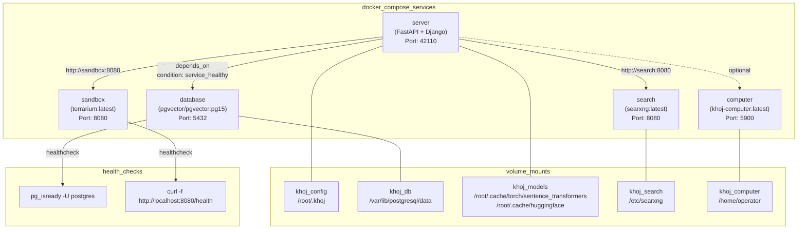
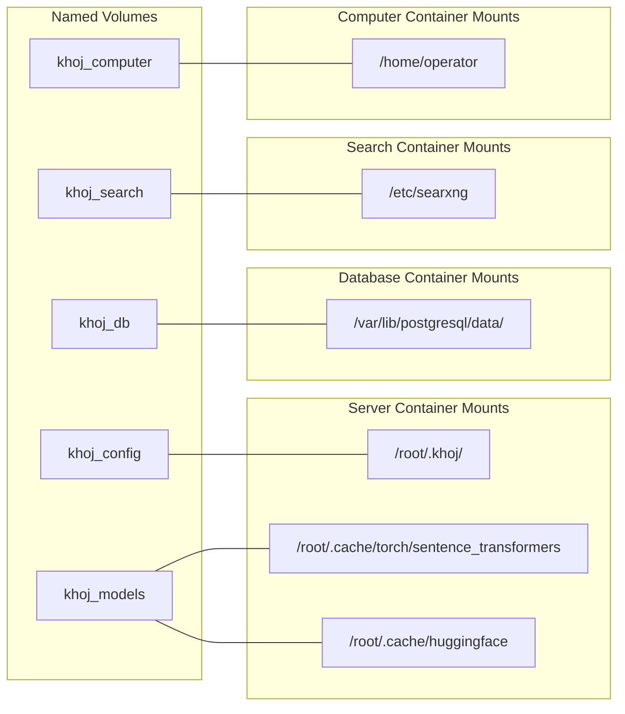
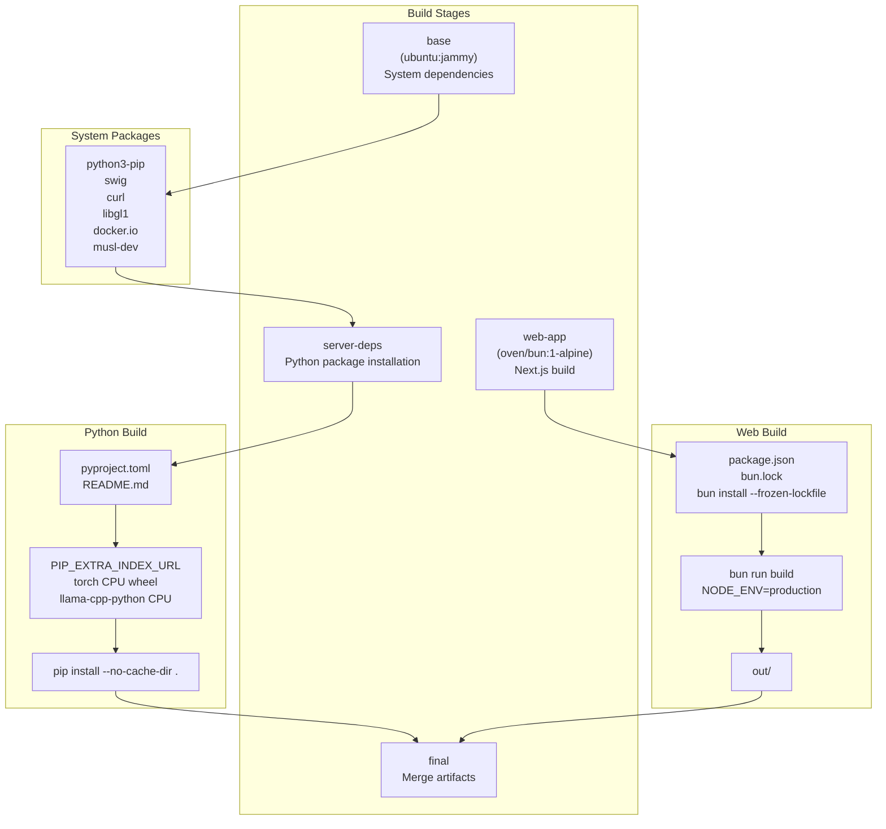
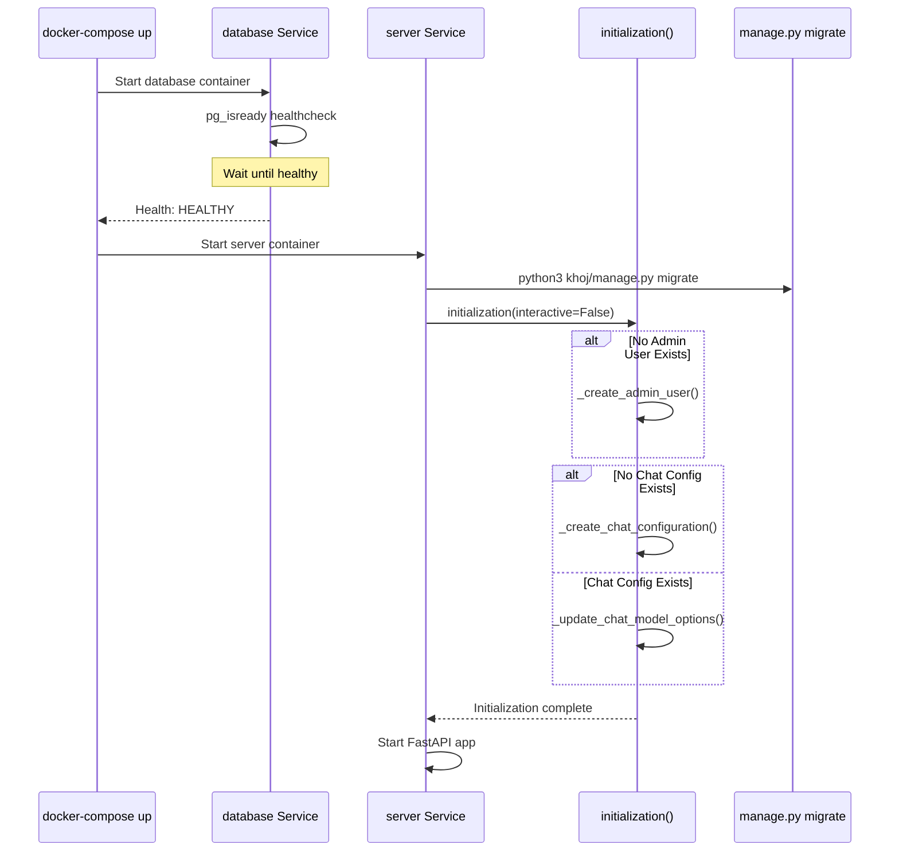
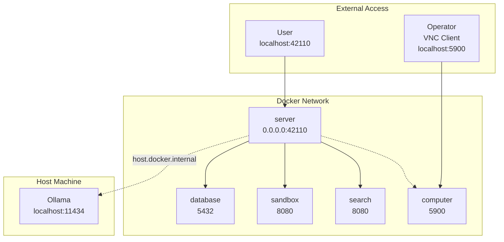

<!-- source: DeepWiki mcp.deepwiki.com · repo khoj-ai/khoj · page 6.1 Docker Deployment · fetched 2026-10-29 -->

# Docker Deployment

<details>
<summary>Relevant source files</summary>

The following files were used as context for generating this wiki page:

- [.dockerignore](.dockerignore)
- [.github/workflows/dockerize_telemetry_server.yml](.github/workflows/dockerize_telemetry_server.yml)
- [Dockerfile](Dockerfile)
- [docker-compose.yml](docker-compose.yml)
- [gunicorn-config.py](gunicorn-config.py)
- [prod.Dockerfile](prod.Dockerfile)
- [src/interface/web/README.md](src/interface/web/README.md)
- [src/khoj/processor/operator/README.md](src/khoj/processor/operator/README.md)
- [src/khoj/utils/initialization.py](src/khoj/utils/initialization.py)
- [src/telemetry/Dockerfile](src/telemetry/Dockerfile)
- [src/telemetry/requirements.txt](src/telemetry/requirements.txt)
- [src/telemetry/telemetry.py](src/telemetry/telemetry.py)

</details>


## Purpose and Scope

This document describes the Docker-based deployment architecture for Khoj, including the multi-container orchestration via Docker Compose, volume persistence strategies, environment configuration, build processes, and initialization workflows. It covers both development (anonymous mode) and production deployment patterns.

For general deployment strategies and operational considerations beyond Docker, see [Deployment and Operations](#6). For development environment setup without Docker, see [Development Setup and Testing](#6.2).

---

## Service Architecture

### Multi-Container Orchestration



**Docker Compose Service Topology**

The deployment consists of five services coordinated through Docker Compose:

| Service | Image | Purpose | Internal Port | External Port |
|---------|-------|---------|---------------|---------------|
| `server` | `ghcr.io/khoj-ai/khoj:latest` | Main FastAPI application | 42110 | 42110 |
| `database` | `docker.io/pgvector/pgvector:pg15` | PostgreSQL with pgvector extension | 5432 | Not exposed |
| `sandbox` | `ghcr.io/khoj-ai/terrarium:latest` | Python code execution sandbox | 8080 | Not exposed |
| `search` | `docker.io/searxng/searxng:latest` | Web search engine | 8080 | Not exposed |
| `computer` | `ghcr.io/khoj-ai/khoj-computer:latest` | VNC desktop for automation | 5900 | 5900 |

The `server` service has a health check dependency on `database`, ensuring PostgreSQL is ready before application startup [docker-compose.yml:41-43](). Services communicate via Docker's internal DNS using service names as hostnames (e.g., `http://sandbox:8080`).

**Sources:** [docker-compose.yml:1-133]()

---

### Volume Persistence Strategy



**Volume Purpose Mapping**

| Volume Name | Container Path | Data Stored |
|-------------|----------------|-------------|
| `khoj_config` | `/root/.khoj/` | Application configuration, user data, embeddings database |
| `khoj_db` | `/var/lib/postgresql/data/` | PostgreSQL database files (users, conversations, entries) |
| `khoj_models` | `/root/.cache/torch/sentence_transformers`<br/>`/root/.cache/huggingface` | Downloaded ML models (BiEncoder, Cross-Encoder, tokenizers) |
| `khoj_search` | `/etc/searxng` | SearXNG search engine configuration |
| `khoj_computer` | `/home/operator` | Computer automation workspace |

All volumes are declared as named volumes in the `volumes:` section, enabling data persistence across container recreation and system reboots [docker-compose.yml:127-132]().

**Sources:** [docker-compose.yml:58-61](), [docker-compose.yml:127-132]()

---

## Environment Configuration

### Core Environment Variables

The `server` service requires extensive environment configuration divided into functional categories:

#### Database Connection

```yaml
POSTGRES_DB=postgres
POSTGRES_USER=postgres
POSTGRES_PASSWORD=postgres
POSTGRES_HOST=database
POSTGRES_PORT=5432
```

These variables configure the PostgreSQL connection [docker-compose.yml:66-70](). `POSTGRES_HOST=database` uses Docker's service name resolution. The `database` service uses matching variables to initialize the database [docker-compose.yml:4-7]().

#### Application Security

```yaml
KHOJ_DJANGO_SECRET_KEY=secret
KHOJ_DEBUG=False
KHOJ_ADMIN_EMAIL=username@example.com
KHOJ_ADMIN_PASSWORD=password
```

- `KHOJ_DJANGO_SECRET_KEY`: Django cryptographic signing key for sessions and CSRF tokens [docker-compose.yml:71]().
- `KHOJ_DEBUG`: Disables debug mode for production (enables error logging without stack traces) [docker-compose.yml:72]().
- `KHOJ_ADMIN_EMAIL`/`KHOJ_ADMIN_PASSWORD`: Admin account credentials created during initialization [docker-compose.yml:73-74]().

#### Tool Service URLs

```yaml
KHOJ_TERRARIUM_URL=http://sandbox:8080
KHOJ_SEARXNG_URL=http://search:8080
```

These environment variables configure internal service URLs for tool execution [docker-compose.yml:76-80]():
- `KHOJ_TERRARIUM_URL`: Python code sandbox endpoint.
- `KHOJ_SEARXNG_URL`: Web search engine endpoint.

#### LLM Provider Configuration

```yaml
# OpenAI / Ollama
OPENAI_API_KEY=your_openai_api_key
OPENAI_BASE_URL=http://host.docker.internal:11434/v1/
KHOJ_DEFAULT_CHAT_MODEL=qwen3

# Google Gemini
GEMINI_API_KEY=your_gemini_api_key

# Anthropic
ANTHROPIC_API_KEY=your_anthropic_api_key
```

Provider-specific API keys and base URLs. Setting `OPENAI_BASE_URL` to Ollama's endpoint (`http://host.docker.internal:11434/v1/`) enables local model usage [docker-compose.yml:81-84]().

**Sources:** [docker-compose.yml:66-123]()

---

## Build Process

### Multi-Stage Dockerfile Architecture



**Dockerfile Build Stages**

The `Dockerfile` uses a multi-stage build to optimize image size and build caching:

**Stage 1: `base`**
- Base image: `ubuntu:jammy` [Dockerfile:2]()
- Installs system dependencies: Python, SWIG, OpenGL libraries, Docker CLI, musl-dev for llama-cpp-python [Dockerfile:9-22]().

**Stage 2: `server-deps`**
- Copies `pyproject.toml` and `README.md` [Dockerfile:27-28]().
- Sets `PIP_EXTRA_INDEX_URL` to use PyTorch CPU and llama-cpp-python CPU wheels [Dockerfile:31]().
- Runs `pip install --no-cache-dir .` to install all Python dependencies [Dockerfile:35]().

**Stage 3: `web-app`**
- Base image: `oven/bun:1-alpine` [Dockerfile:38]()
- Installs dependencies with `bun install --frozen-lockfile` [Dockerfile:45]().
- Builds Next.js app with `bun run build` → outputs to `/app/src/interface/web/out` [Dockerfile:48]().

**Stage 4: Final Image**
- Copies Python packages from `server-deps` stage [Dockerfile:54]().
- Copies built web app from `web-app` stage to `src/khoj/interface/built` [Dockerfile:55]().
- Runs `python3 khoj/manage.py collectstatic --noinput` [Dockerfile:57]().
- Sets entrypoint: `python3 src/khoj/main.py` [Dockerfile:64]().

**Sources:** [Dockerfile:1-65]()

### Production Build Differences

The `prod.Dockerfile` differs in several ways:

| Aspect | Development (`Dockerfile`) | Production (`prod.Dockerfile`) |
|--------|---------------------------|-------------------------------|
| Python install | `pip install .` | `pip install -e .[prod]` [prod.Dockerfile:34]() |
| Entrypoint | `python3 src/khoj/main.py` | `gunicorn -c gunicorn-config.py src.khoj.main:app` [prod.Dockerfile:64]() |

**Sources:** [prod.Dockerfile:1-64](), [gunicorn-config.py:1-18]()

---

## Container Initialization

### Startup Sequence



**Initialization Function Flow**

The `initialization()` function in [src/khoj/utils/initialization.py:25]() runs on server startup:

#### Admin User Creation

If no admin user exists, the system reads `KHOJ_ADMIN_EMAIL` and `KHOJ_ADMIN_PASSWORD` to call `KhojUser.objects.create_superuser` [src/khoj/utils/initialization.py:30-37]().

#### Chat Model Configuration

The `_setup_chat_model_provider` function configures models for OpenAI, Google Gemini, and Anthropic [src/khoj/utils/initialization.py:148-208](). If `OPENAI_BASE_URL` points to an Ollama instance, the system attempts to fetch available models via the OpenAI-compatible API [src/khoj/utils/initialization.py:51-63]().

**Sources:** [src/khoj/utils/initialization.py:25-294]()

---

## Network Configuration

### Service Communication



**Network Resolution**

Services resolve each other by service name [docker-compose.yml:69,76,80](). The `server` container includes `extra_hosts: ["host.docker.internal:host-gateway"]` to reach services like Ollama on the host [docker-compose.yml:55-56]().

**Sources:** [docker-compose.yml:1-133]()

---

## Deployment Modes

### Anonymous Mode (Development)

The default command includes `--anonymous-mode` [docker-compose.yml:125](). This bypasses authentication requirements for local use.

### Production Mode

For production:
1. Use `ghcr.io/khoj-ai/khoj:latest` or `ghcr.io/khoj-ai/khoj-cloud:latest` [docker-compose.yml:44-45]().
2. Ensure `KHOJ_DOMAIN` is set correctly for CSRF protection [docker-compose.yml:111-114]().
3. Use Gunicorn for process management [prod.Dockerfile:64]().

**Sources:** [docker-compose.yml:125](), [prod.Dockerfile:64](), [gunicorn-config.py:1-18]()

---

## Health Checks

### Database Health Check

```yaml
healthcheck:
  test: ["CMD-SHELL", "pg_isready -U postgres"]
  interval: 30s
  timeout: 10s
  retries: 5
```
**Sources:** [docker-compose.yml:10-14]()

### Sandbox Health Check

```yaml
healthcheck:
  test: ["CMD-SHELL", "curl -f http://localhost:8080/health"]
  interval: 30s
  timeout: 10s
  retries: 2
```
**Sources:** [docker-compose.yml:17-21]()

---

