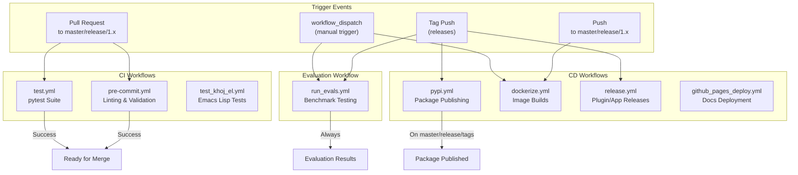
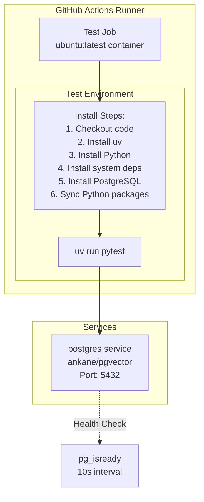
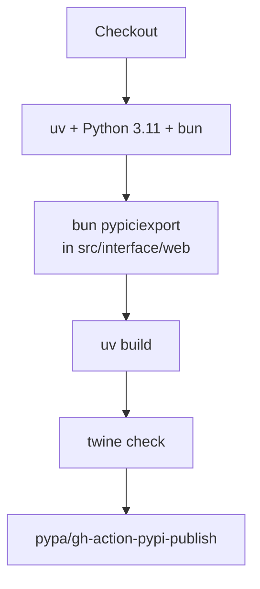
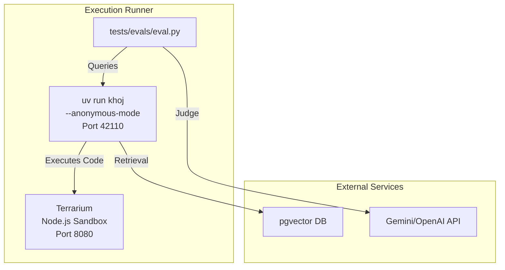

<!-- source: DeepWiki mcp.deepwiki.com · repo khoj-ai/khoj · page 6.3 CI/CD and Benchmarking · fetched 2026-10-29 -->

# CI/CD and Benchmarking

Relevant source files

The following files were used as context for generating this wiki page:

- [.github/workflows/build_khoj_el.yml](.github/workflows/build_khoj_el.yml)
- [.github/workflows/desktop.yml](.github/workflows/desktop.yml)
- [.github/workflows/dockerize.yml](.github/workflows/dockerize.yml)
- [.github/workflows/github_pages_deploy.yml](.github/workflows/github_pages_deploy.yml)
- [.github/workflows/pre-commit.yml](.github/workflows/pre-commit.yml)
- [.github/workflows/pypi.yml](.github/workflows/pypi.yml)
- [.github/workflows/release.yml](.github/workflows/release.yml)
- [.github/workflows/run_evals.yml](.github/workflows/run_evals.yml)
- [.github/workflows/test.yml](.github/workflows/test.yml)
- [.github/workflows/test_khoj_el.yml](.github/workflows/test_khoj_el.yml)
- [documentation/assets/img/example_search_model_admin_settings.png](documentation/assets/img/example_search_model_admin_settings.png)
- [documentation/docs/advanced/admin.md](documentation/docs/advanced/admin.md)
- [documentation/docs/contributing/development.mdx](documentation/docs/contributing/development.mdx)
- [documentation/docs/get-started/setup.mdx](documentation/docs/get-started/setup.mdx)
- [scripts/bump_version.sh](scripts/bump_version.sh)
- [src/interface/emacs/tests/khoj-tests.el](src/interface/emacs/tests/khoj-tests.el)
- [src/khoj/app/README.md](src/khoj/app/README.md)
- [src/khoj/database/migrations/0098_alter_texttoimagemodelconfig_model_type.py](src/khoj/database/migrations/0098_alter_texttoimagemodelconfig_model_type.py)
- [tests/evals/eval.py](tests/evals/eval.py)

This document describes the continuous integration, continuous deployment, and benchmarking infrastructure for the Khoj repository. It covers the GitHub Actions workflows that enforce code quality, run tests, publish packages, and evaluate system performance against standardized benchmarks.

For information about development setup and testing infrastructure, see [Development Setup and Testing](#6.2). For deployment configuration, see [Docker Deployment](#6.1).

---

## GitHub Actions Workflows

Khoj uses GitHub Actions to automate quality assurance, testing, publishing, and performance evaluation. The CI/CD pipeline consists of several primary workflows that run on different triggers.

### Workflow Execution Model

**Sources:** [.github/workflows/pre-commit.yml](), [.github/workflows/test.yml](), [.github/workflows/pypi.yml](), [.github/workflows/run_evals.yml](), [.github/workflows/dockerize.yml](), [.github/workflows/release.yml](), [.github/workflows/github_pages_deploy.yml]()

---

## Pre-commit Checks Workflow

The pre-commit workflow validates code quality before allowing merges. It runs on all pull requests and pushes to master or release branches when relevant files change.

### Configuration

| Aspect | Details |
|--------|---------|
| Workflow File | `.github/workflows/pre-commit.yml` |
| Trigger Paths | `src/**`, `tests/**`, `config/**`, `pyproject.toml`, `.pre-commit-config.yml` |
| Python Version | 3.11 |
| Key Steps | Install dependencies, run pre-commit hooks |

The workflow uses the `uv` package manager for faster dependency resolution and installation. Pre-commit hooks validate code formatting, type hints, and other quality checks defined in `.pre-commit-config.yml`.

**Sources:** [.github/workflows/pre-commit.yml:1-59]()

---

## Test Automation Workflow

The test workflow runs the comprehensive pytest suite across multiple Python versions to ensure compatibility and correctness.

### Configuration

| Aspect | Details |
|--------|---------|
| Workflow File | `.github/workflows/test.yml` |
| Python Versions | 3.10, 3.11, 3.12 (matrix strategy) |
| Container | `ubuntu:latest` |
| Timeout | 10 minutes per job |
| Database Service | `ankane/pgvector` (PostgreSQL with pgvector extension) |

### Service Dependencies

The workflow installs system dependencies including `sqlite3`, `ffmpeg`, and `postgresql-server-dev-16` [.github/workflows/test.yml:69-75](). It uses CPU-only PyTorch by setting `UV_INDEX=https://download.pytorch.org/whl/cpu` to speed up installation [.github/workflows/test.yml:79-82]().

**Sources:** [.github/workflows/test.yml:1-94]()

---

## Publishing and Release Workflows

### PyPI Publishing

The PyPI workflow builds and publishes the Khoj package to the Python Package Index. It ensures reproducibility by setting `PYTHONHASHSEED=42` and `SOURCE_DATE_EPOCH` to the last commit timestamp [.github/workflows/pypi.yml:61-63]().

**Sources:** [.github/workflows/pypi.yml:59-87]()

### Docker Image Builds

The `dockerize.yml` workflow builds and pushes multi-architecture images (amd64, arm64) to the GitHub Container Registry (GHCR) [.github/workflows/dockerize.yml:50-63](). It supports three primary images:
1. **Khoj (Local)**: Standard self-hosted image using `Dockerfile` [.github/workflows/dockerize.yml:93]().
2. **Khoj Cloud**: Production-optimized image using `prod.Dockerfile` [.github/workflows/dockerize.yml:111]().
3. **Khoj Computer**: Environment for the computer operator agent using `computer.Dockerfile` [.github/workflows/dockerize.yml:129]().

**Sources:** [.github/workflows/dockerize.yml:1-185]()

### Interface Releases

The `release.yml` workflow handles the distribution of client plugins.
- **Obsidian Plugin**: Builds the plugin using `yarn` and uploads `main.js`, `manifest.json`, and `styles.css` as GitHub Release artifacts [.github/workflows/release.yml:15-67]().
- **Emacs Package**: Separate workflows (`build_khoj_el.yml`, `test_khoj_el.yml`) manage the Emacs Lisp interface quality.

**Sources:** [.github/workflows/release.yml:15-67](), [src/interface/emacs/tests/khoj-tests.el:1-40]()

---

## Benchmark Evaluation Workflow

The evaluation workflow (`run_evals.yml`) runs comprehensive benchmarks to measure Khoj's performance on standardized datasets.

### Configuration Matrix

The workflow supports multiple datasets and modes, allowing for automated regression testing and manual research evaluation [.github/workflows/run_evals.yml:80-85]().

| Dataset | Metrics | Purpose |
|---------|---------|---------|
| **FRAMES** | Accuracy / IR Metrics | Multi-hop retrieval and reasoning [.github/workflows/run_evals.yml:23]() |
| **SimpleQA** | Factual Accuracy | Moderately hard factual questions [.github/workflows/run_evals.yml:27]() |
| **GPQA** | Multiple Choice | Scientific reasoning [.github/workflows/run_evals.yml:28]() |
| **MATH500** | Mathematical Correctness | High-school level math [.github/workflows/run_evals.yml:29]() |

### Evaluation Execution Environment

The workflow starts a full Khoj environment, including a code sandbox for agentic execution [.github/workflows/run_evals.yml:172-183]().

**Sources:** [.github/workflows/run_evals.yml:1-200](), [tests/evals/eval.py:1-50]()

---

## Benchmark Evaluation System

The evaluation system is implemented in `tests/evals/eval.py` and uses an "LLM-as-a-judge" pattern for complex datasets.

### Knowledge Base Indexing (FRAMES)

For the FRAMES benchmark, the system dynamically indexes Wikipedia articles into Khoj's search engine before running queries [.tests/evals/eval.py:134-182](). It uses batch processing (300 articles per batch) to efficiently populate the `pgvector` database [.tests/evals/eval.py:163-178]().

### Evaluation Methods

1. **LLM Judge**: Uses `gemini-2.5-flash` to compare Khoj's response against a ground truth string, returning a JSON object with a boolean `decision` and an `explanation` [tests/evals/eval.py:466-517]().
2. **MCQ Match**: For GPQA, it uses regex patterns (e.g., `(?i)Answer\s*:\s*([A-D])`) to extract the selected option from the model's response [tests/evals/eval.py:434-464]().
3. **IR Evaluation**: For retrieval tasks, it calculates Precision, Recall, and F1 scores by checking if the specific Wikipedia articles required for a query were present in the retrieved context [tests/evals/eval.py:378-432]().

### Concurrency and Cost Tracking

The evaluation script uses a `ThreadPoolExecutor` to process batches of questions in parallel [tests/evals/eval.py:662-677](). It tracks total cost using a thread-safe `Counter` class, aggregating token usage from both the Khoj agent and the evaluation judge [tests/evals/eval.py:53-73]().

**Sources:** [tests/evals/eval.py:53-73](), [tests/evals/eval.py:378-517](), [tests/evals/eval.py:662-726]()

---

