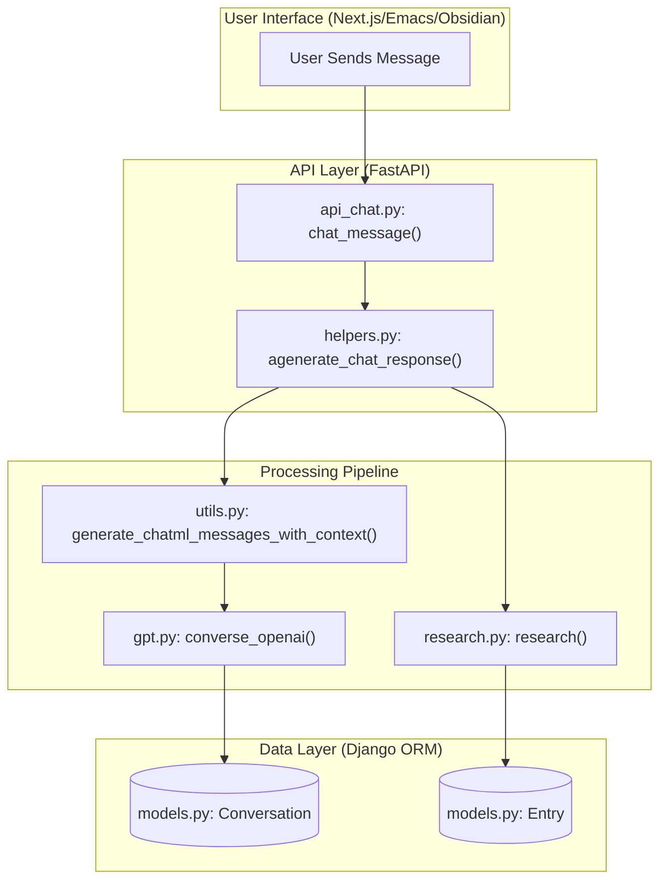
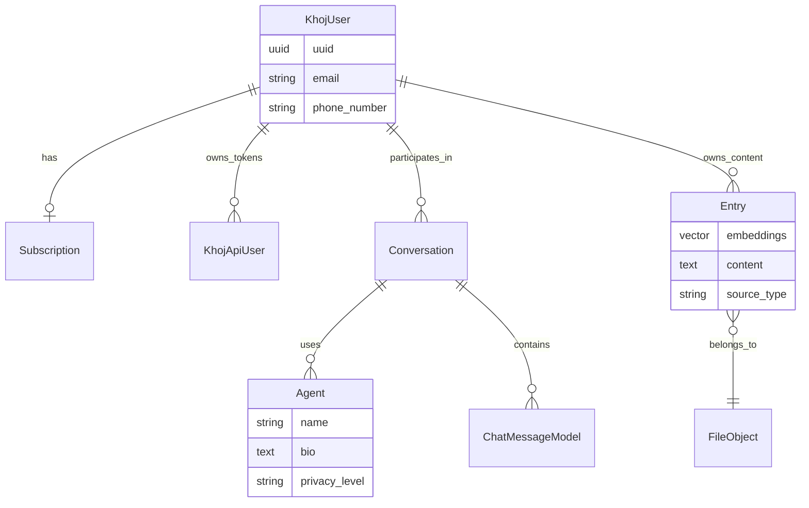

<!-- source: DeepWiki mcp.deepwiki.com · repo khoj-ai/khoj · page 7 Glossary · fetched 2026-10-29 -->

# Glossary

Relevant source files

The following files were used as context for generating this wiki page:

- [documentation/package.json](documentation/package.json)
- [documentation/yarn.lock](documentation/yarn.lock)
- [pyproject.toml](pyproject.toml)
- [src/interface/desktop/yarn.lock](src/interface/desktop/yarn.lock)
- [src/interface/obsidian/src/api.ts](src/interface/obsidian/src/api.ts)
- [src/interface/obsidian/src/chat_view.ts](src/interface/obsidian/src/chat_view.ts)
- [src/interface/obsidian/src/interact_with_files.ts](src/interface/obsidian/src/interact_with_files.ts)
- [src/interface/obsidian/src/main.ts](src/interface/obsidian/src/main.ts)
- [src/interface/obsidian/src/pane_view.ts](src/interface/obsidian/src/pane_view.ts)
- [src/interface/obsidian/src/search_modal.ts](src/interface/obsidian/src/search_modal.ts)
- [src/interface/obsidian/src/settings.ts](src/interface/obsidian/src/settings.ts)
- [src/interface/obsidian/src/similar_view.ts](src/interface/obsidian/src/similar_view.ts)
- [src/interface/obsidian/src/utils.ts](src/interface/obsidian/src/utils.ts)
- [src/interface/obsidian/styles.css](src/interface/obsidian/styles.css)
- [src/interface/obsidian/yarn.lock](src/interface/obsidian/yarn.lock)
- [src/interface/web/bun.lock](src/interface/web/bun.lock)
- [src/interface/web/tsconfig.json](src/interface/web/tsconfig.json)
- [src/khoj/configure.py](src/khoj/configure.py)
- [src/khoj/database/adapters/__init__.py](src/khoj/database/adapters/__init__.py)
- [src/khoj/database/admin.py](src/khoj/database/admin.py)
- [src/khoj/database/models/__init__.py](src/khoj/database/models/__init__.py)
- [src/khoj/processor/conversation/anthropic/anthropic_chat.py](src/khoj/processor/conversation/anthropic/anthropic_chat.py)
- [src/khoj/processor/conversation/anthropic/utils.py](src/khoj/processor/conversation/anthropic/utils.py)
- [src/khoj/processor/conversation/google/gemini_chat.py](src/khoj/processor/conversation/google/gemini_chat.py)
- [src/khoj/processor/conversation/google/utils.py](src/khoj/processor/conversation/google/utils.py)
- [src/khoj/processor/conversation/openai/gpt.py](src/khoj/processor/conversation/openai/gpt.py)
- [src/khoj/processor/conversation/openai/utils.py](src/khoj/processor/conversation/openai/utils.py)
- [src/khoj/processor/conversation/prompts.py](src/khoj/processor/conversation/prompts.py)
- [src/khoj/processor/conversation/utils.py](src/khoj/processor/conversation/utils.py)
- [src/khoj/processor/embeddings.py](src/khoj/processor/embeddings.py)
- [src/khoj/processor/image/generate.py](src/khoj/processor/image/generate.py)
- [src/khoj/processor/tools/online_search.py](src/khoj/processor/tools/online_search.py)
- [src/khoj/processor/tools/run_code.py](src/khoj/processor/tools/run_code.py)
- [src/khoj/routers/api.py](src/khoj/routers/api.py)
- [src/khoj/routers/api_chat.py](src/khoj/routers/api_chat.py)
- [src/khoj/routers/helpers.py](src/khoj/routers/helpers.py)
- [src/khoj/routers/research.py](src/khoj/routers/research.py)
- [src/khoj/routers/web_client.py](src/khoj/routers/web_client.py)
- [src/khoj/search_type/text_search.py](src/khoj/search_type/text_search.py)
- [src/khoj/utils/constants.py](src/khoj/utils/constants.py)
- [src/khoj/utils/helpers.py](src/khoj/utils/helpers.py)
- [tests/conftest.py](tests/conftest.py)
- [tests/helpers.py](tests/helpers.py)
- [tests/test_client.py](tests/test_client.py)
- [tests/test_helpers.py](tests/test_helpers.py)
- [tests/test_text_search.py](tests/test_text_search.py)
- [uv.lock](uv.lock)

This glossary defines technical terms, abstractions, and domain-specific jargon used throughout the Khoj codebase. It serves as a reference for onboarding engineers to map natural language concepts to their implementation in code.

## 1. Core Abstractions

### Agent
A configurable AI entity that can have a specific persona, set of tools, and privacy level. Agents are associated with conversations and determine how the system responds to user queries.
*   **Implementation**: Defined by the `Agent` Django model [src/khoj/database/models/__init__.py:442-475]().
*   **Persona**: Controlled via the `bio` and `persona` fields which are injected into system prompts [src/khoj/processor/conversation/prompts.py:30-51]().

### Entry
The fundamental unit of indexed content. An `Entry` represents a chunk of processed data (from Markdown, PDF, Org-mode, etc.) with its associated embedding for semantic search.
*   **Implementation**: Defined by the `Entry` Django model [src/khoj/database/models/__init__.py:521-550]().
*   **Vector Search**: Uses `pgvector` via the `embeddings` field (a `VectorField`) to perform similarity lookups [src/khoj/database/models/__init__.py:536-536]().

### Conversation
A stateful session between a user and an agent. It tracks message history and configuration like file filters.
*   **Implementation**: Defined by the `Conversation` Django model [src/khoj/database/models/__init__.py:365-385]().
*   **History**: Messages are stored as `ChatMessageModel` structures within the `Conversation` [src/khoj/database/models/__init__.py:117-134]().

### Research Mode
An iterative reasoning loop where the LLM can autonomously select and execute tools (search, code execution) to answer complex queries.
*   **Orchestration**: Managed in `src/khoj/routers/research.py`.
*   **Iteration**: Each step is captured in a `ResearchIteration` object [src/khoj/processor/conversation/utils.py:210-235]().

---

## 2. Technical Concepts Mapping

### Diagram: Natural Language to Code Entity (Core Pipeline)

This diagram bridges user-facing actions to the specific Python classes and functions that handle them.

**Sources:** [src/khoj/routers/api_chat.py:105-105](), [src/khoj/routers/helpers.py:98-111](), [src/khoj/processor/conversation/utils.py:106-110](), [src/khoj/database/models/__init__.py:365-385]().

---

## 3. Tooling and Infrastructure

### MCP (Model Context Protocol)
A protocol used to integrate external tools and data sources dynamically. Khoj can connect to MCP servers to extend the agent's capabilities without changing core code.
*   **Implementation**: Managed via `MCPClient` [src/khoj/processor/tools/mcp.py]().
*   **Usage in Research**: MCP tools are dynamically resolved during the research loop [src/khoj/routers/research.py:22-22]().

### Code Sandbox (E2B)
A secure environment for executing code generated by the LLM.
*   **Integration**: Uses the `e2b-code-interpreter` [pyproject.toml:95-95]().
*   **Execution**: Handled by `run_code` function [src/khoj/processor/tools/run_code.py]().

### Bi-Encoder & Cross-Encoder
*   **Bi-Encoder**: Used for initial fast retrieval of entries based on vector similarity [src/khoj/processor/embeddings.py]().
*   **Cross-Encoder**: Used for re-ranking the top-N results from the bi-encoder to improve precision [src/khoj/processor/embeddings.py]().

---

## 4. Database Schema Relationships

### Diagram: Entity Relationship (Simplified)

**Sources:** [src/khoj/database/models/__init__.py:153-205](), [src/khoj/database/models/__init__.py:365-385](), [src/khoj/database/models/__init__.py:442-475](), [src/khoj/database/models/__init__.py:521-550]().

---

## 5. Terminology Table

| Term | Definition | Code Pointer |
| :--- | :--- | :--- |
| **Telemetry** | System for tracking API usage and user events (anonymized). | `update_telemetry_state` [src/khoj/routers/helpers.py:197-223]() |
| **Context Assembly** | The process of gathering relevant notes, web results, and history into a prompt. | `generate_chatml_messages_with_context` [src/khoj/processor/conversation/utils.py:109-109]() |
| **Rate Limiter** | Mechanism to restrict API calls based on subscription tier. | `ApiUserRateLimiter` [src/khoj/routers/helpers.py:57-57]() |
| **Adapter** | A layer between the database models and the application logic to simplify queries. | `src/khoj/database/adapters/` |
| **Research Iteration** | A single step in the multi-step reasoning process. | `ResearchIteration` [src/khoj/processor/conversation/utils.py:210-235]() |
| **Tool Call** | A structured request from an LLM to execute a specific function (e.g., search). | `ToolCall` [src/khoj/processor/conversation/utils.py:203-208]() |
| **Operator** | A specialized agent capable of interacting with environments like browsers. | `operate_environment` [src/khoj/processor/operator/__init__.py]() |

**Sources:** [src/khoj/routers/helpers.py:1-223](), [src/khoj/processor/conversation/utils.py:1-235](), [src/khoj/database/adapters/__init__.py:1-100]().