# Page: Overview

# Overview

<details>
<summary>Relevant source files</summary>

The following files were used as context for generating this wiki page:

- [README.md](README.md)
- [documentation/docs/advanced/gcp-vertex.md](documentation/docs/advanced/gcp-vertex.md)
- [documentation/package.json](documentation/package.json)
- [documentation/yarn.lock](documentation/yarn.lock)
- [pyproject.toml](pyproject.toml)
- [src/interface/desktop/yarn.lock](src/interface/desktop/yarn.lock)
- [src/interface/obsidian/README.md](src/interface/obsidian/README.md)
- [src/interface/obsidian/yarn.lock](src/interface/obsidian/yarn.lock)
- [src/interface/web/bun.lock](src/interface/web/bun.lock)
- [src/interface/web/tsconfig.json](src/interface/web/tsconfig.json)
- [src/khoj/app/settings.py](src/khoj/app/settings.py)
- [src/khoj/main.py](src/khoj/main.py)
- [src/khoj/utils/cli.py](src/khoj/utils/cli.py)
- [src/khoj/utils/state.py](src/khoj/utils/state.py)
- [uv.lock](uv.lock)

</details>


Khoj is an open-source personal AI assistant system designed as a "second brain" that combines semantic search over personal documents with conversational AI capabilities. The system enables users to chat with their notes, search their knowledge base, generate images and diagrams, execute code, browse the web, and automate tasks through multiple client interfaces (web, desktop, Emacs, Obsidian).

For detailed information about specific subsystems, see:
- Backend infrastructure and API design: [System Architecture](#1.1)
- Chat and AI capabilities: [Feature Overview](#1.2)
- Document indexing and search: [Content Processing and Search](#4)
- Client applications: [User Interfaces](#5)
- Deployment and operations: [Deployment and Operations](#6)

## System Architecture

Khoj implements a client-server architecture with a FastAPI/Django backend, PostgreSQL database with vector search capabilities, and multiple frontend clients. The system integrates with various LLM providers (OpenAI, Anthropic, Google Gemini) and supports extensible tooling through MCP (Model Context Protocol).

### High-Level Component Structure

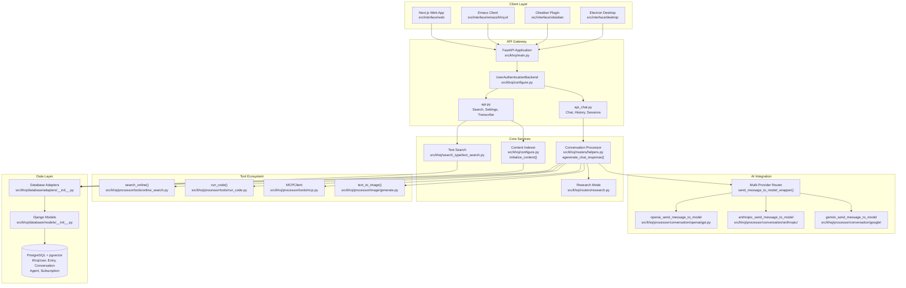

**Sources**: [src/khoj/main.py:61-198](), [src/khoj/app/settings.py:72-83](), [src/khoj/app/settings.py:178-189](), [pyproject.toml:38-98]()

### Request Processing Flow

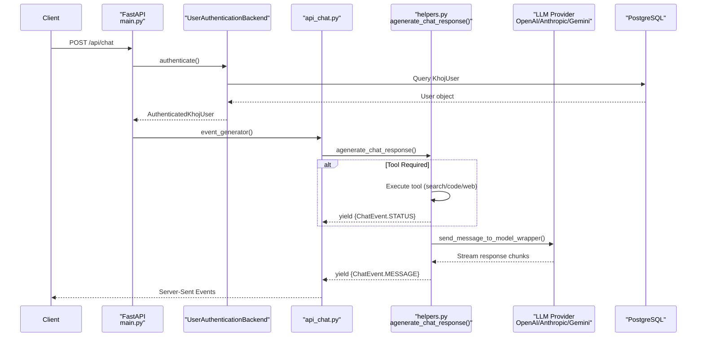

**Sources**: [src/khoj/main.py:61-67](), [src/khoj/main.py:185-195](), [src/khoj/app/settings.py:192-192]()

## Core Components

### Backend Application

The backend is built on **FastAPI** with **Django ORM** for database management. The main application entry point is `src/khoj/main.py`, which initializes the server, configures middleware, and registers API routers. It also handles the initialization of the database via Django management commands [src/khoj/main.py:51-54]().

| Component | File Path | Purpose |
|-----------|-----------|---------|
| Application Bootstrap | `src/khoj/main.py` | FastAPI app initialization, middleware setup, and DB migration |
| Settings | `src/khoj/app/settings.py` | Django configuration, database settings, and app definitions |
| State Management | `src/khoj/utils/state.py` | Global application state (models, clients, schedulers) |
| CLI Interface | `src/khoj/utils/cli.py` | Command-line argument parsing and server configuration |

**Sources**: [src/khoj/main.py:26-67](), [src/khoj/app/settings.py:1-210](), [src/khoj/utils/state.py:1-41](), [src/khoj/utils/cli.py:9-53]()

### Feature Overview

Khoj provides a comprehensive suite of AI-powered features designed to augment human intelligence. For details, see [Feature Overview](#1.2).

*   **Chat & Agents**: Interact with multiple LLMs (OpenAI, Anthropic, Gemini) [pyproject.toml:45-90](). Create custom agents with specific personas and tools [README.md:49-49]().
*   **Semantic Search**: Advanced search over local documents including PDF, Markdown, Org-mode, and Word [README.md:47-47]().
*   **Tool Integrations**: Built-in capabilities for web search, code execution via E2B, and image generation [pyproject.toml:95-96]().
*   **Automations**: Scheduled research tasks and personal newsletters delivered to inbox [README.md:50-50]().
*   **Computer Operator**: Experimental agents capable of browser and computer automation [README.md:37-37]().

**Sources**: [README.md:42-55](), [pyproject.toml:38-98]()

### User Interfaces

Khoj is accessible through a variety of interfaces to fit into any workflow. For details, see [User Interfaces](#5).

*   **Web Interface**: A modern Next.js application [src/interface/web/bun.lock:51-51]().
*   **Desktop App**: Electron-based application for local use [src/interface/desktop/yarn.lock:5-19]().
*   **Obsidian Plugin**: Integrates Khoj directly into your vault [src/interface/obsidian/README.md:1-4]().
*   **Emacs**: Native integration via `khoj.el`.

**Sources**: [README.md:48-48](), [src/interface/obsidian/README.md:1-4](), [src/interface/web/bun.lock:1-61]()

## Deployment and Operations

Khoj is designed to be flexible, supporting both cloud-scale enterprise deployments and private, on-device usage. It utilizes Docker for containerization and includes a comprehensive CI/CD pipeline for testing and benchmarking. For details, see [Deployment and Operations](#6).

**Sources**: [README.md:67-73](), [pyproject.toml:109-133](), [src/khoj/main.py:153-182]()

---

# Page: System Architecture

# System Architecture

<details>
<summary>Relevant source files</summary>

The following files were used as context for generating this wiki page:

- [documentation/package.json](documentation/package.json)
- [documentation/yarn.lock](documentation/yarn.lock)
- [pyproject.toml](pyproject.toml)
- [src/interface/desktop/yarn.lock](src/interface/desktop/yarn.lock)
- [src/interface/obsidian/yarn.lock](src/interface/obsidian/yarn.lock)
- [src/interface/web/bun.lock](src/interface/web/bun.lock)
- [src/interface/web/tsconfig.json](src/interface/web/tsconfig.json)
- [src/khoj/app/settings.py](src/khoj/app/settings.py)
- [src/khoj/configure.py](src/khoj/configure.py)
- [src/khoj/database/adapters/__init__.py](src/khoj/database/adapters/__init__.py)
- [src/khoj/database/admin.py](src/khoj/database/admin.py)
- [src/khoj/database/models/__init__.py](src/khoj/database/models/__init__.py)
- [src/khoj/main.py](src/khoj/main.py)
- [src/khoj/routers/api.py](src/khoj/routers/api.py)
- [src/khoj/routers/web_client.py](src/khoj/routers/web_client.py)
- [src/khoj/utils/cli.py](src/khoj/utils/cli.py)
- [src/khoj/utils/config.py](src/khoj/utils/config.py)
- [src/khoj/utils/rawconfig.py](src/khoj/utils/rawconfig.py)
- [src/khoj/utils/state.py](src/khoj/utils/state.py)
- [uv.lock](uv.lock)

</details>


## Purpose and Scope

This document describes Khoj's layered architecture, explaining how components across the API gateway, business logic, AI integration, tool execution, and data persistence layers interact to provide a unified AI-powered personal assistant. It covers the request flow patterns, component relationships, and architectural decisions that enable Khoj to support multiple clients, AI providers, and data sources.

For information about specific features and capabilities, see [Feature Overview](#1.2). For deployment configuration and operations, see [6. Deployment and Operations]().

---

## Architectural Overview

Khoj implements a seven-layer architecture that separates concerns and enables flexibility:

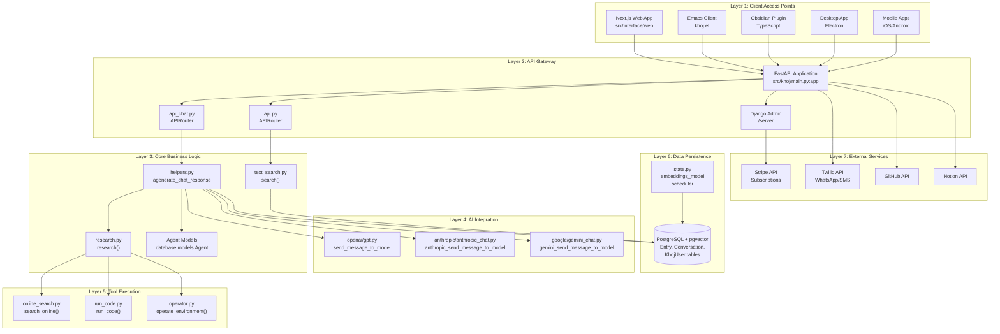

**Sources:** [src/khoj/main.py:1-230](), [src/khoj/database/models/__init__.py:1-500]()

---

## Layer 1: API Gateway

The API Gateway layer consists of two main components: FastAPI for the core application API and Django for administrative functions and database ORM.

### FastAPI Application Structure

The main application is instantiated in [src/khoj/main.py:61-64]() and configured with multiple routers. The routing configuration is handled via `configure_routes(app)` in [src/khoj/main.py:185]().

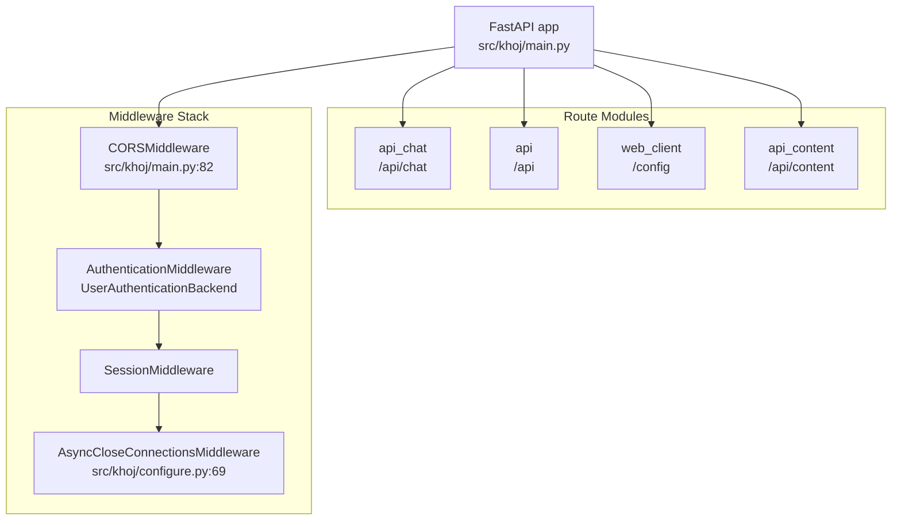

The app mounts several core sub-applications and static files:
- **`/api`**: Core API endpoints like search, transcription, and settings [src/khoj/routers/api.py:31]().
- **`/server`**: The Django ASGI application for administrative tasks [src/khoj/main.py:188]().
- **`/static`**: Static files for the web interface [src/khoj/main.py:192]().

### Authentication Architecture

Authentication is handled by the `UserAuthenticationBackend` in [src/khoj/configure.py:98-167](). It supports several mechanisms:

| Authentication Method | Use Case | Implementation |
|----------------------|----------|-----------------|
| Session Cookie | Web browser clients | `request.session.get("user")` [src/khoj/configure.py:124]() |
| Bearer Token | Desktop/Emacs/Obsidian clients | `Authorization: Bearer <token>` [src/khoj/configure.py:145]() |
| Default User | Local development/Self-hosted | `username="default"` [src/khoj/configure.py:109]() |

The `AuthenticatedKhojUser` class wraps the Django `KhojUser` model for use within FastAPI's request context [src/khoj/configure.py:62-66]().

**Sources:** [src/khoj/main.py:61-192](), [src/khoj/configure.py:62-167](), [src/khoj/routers/api.py:31-183]()

---

## Layer 2: Core Business Logic

### Database Models and ORM

Khoj uses Django ORM for data persistence. The models define the "Code Entity Space" for user data and AI configurations.

| Code Entity | File Path | Purpose |
|-------------|-----------|---------|
| `KhojUser` | [src/khoj/database/models/__init__.py:153]() | Extends `AbstractUser` with UUID and verification fields. |
| `Conversation` | [src/khoj/database/models/__init__.py:476]() | Stores chat history and associated metadata. |
| `Entry` | [src/khoj/database/models/__init__.py:640]() | Represents a single indexed item (note, file chunk) with vector embeddings. |
| `Agent` | [src/khoj/database/models/__init__.py:534]() | Configuration for AI personas, including tools and personality. |
| `AiModelApi` | [src/khoj/database/models/__init__.py:206]() | Stores API keys and base URLs for LLM providers. |

### Data Flow: Search and Transcription

The system bridges natural language queries to database entities through the API.

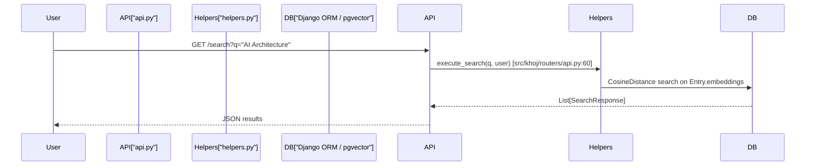

For voice interactions, the `/transcribe` endpoint [src/khoj/routers/api.py:108]() takes an audio file, stores it temporarily, and sends it to the configured `SpeechToTextModelOptions` via `transcribe_audio` [src/khoj/routers/api.py:152]().

**Sources:** [src/khoj/database/models/__init__.py:153-640](), [src/khoj/routers/api.py:46-172](), [src/khoj/database/adapters/__init__.py:1-230]()

---

## Layer 3: AI and Provider Integration

Khoj supports multiple LLM providers (OpenAI, Anthropic, Google) through a unified configuration system.

### Multi-Provider Configuration

Providers are managed via `AiModelApi` [src/khoj/database/models/__init__.py:206](). Specific models for chat, vision, and speech-to-text are configured using:
- `ChatModel` [src/khoj/database/models/__init__.py:220]()
- `SpeechToTextModelOptions` [src/khoj/database/models/__init__.py:414]()

### Implementation of AI Response

The system uses `ChatMessageModel` [src/khoj/database/models/__init__.py:117]() as a standard Pydantic schema to validate and transport messages between the frontend and backend. This model includes:
- `message`: The actual text or multi-modal content.
- `trainOfThought`: Internal reasoning steps.
- `context`: Retrieved documents or web search results.
- `intent`: Classified user intent (e.g., search vs chat).

**Sources:** [src/khoj/database/models/__init__.py:117-414](), [src/khoj/routers/api.py:139-154]()

---

## Layer 4: System Initialization and State

Khoj manages global state and background tasks to ensure high performance and data consistency.

### Server Bootstrap

When `khoj.main:run` is called [src/khoj/main.py:119](), the following occurs:
1. **Django Initialization**: `django.setup()` and database migrations via `call_command("migrate")` [src/khoj/main.py:39-53]().
2. **Task Scheduling**: A `BackgroundScheduler` is started [src/khoj/main.py:156]().
3. **Leader Election**: To prevent duplicate task execution in distributed environments, Khoj uses a `ProcessLock` named `SCHEDULE_LEADER` [src/khoj/main.py:103, 167]().

### State Management

The `state` module (referenced in [src/khoj/configure.py:55]()) tracks:
- `openai_client`: A shared OpenAI client instance.
- `scheduler`: The active background job manager.
- `schedule_leader_process_lock`: The lock held if the current process is the task leader [src/khoj/main.py:109]().

**Sources:** [src/khoj/main.py:38-182](), [src/khoj/configure.py:1-59]()

---

## Layer 5: Deployment and Infrastructure

Khoj is designed to be cross-platform, with deployment options ranging from local pip installation to Dockerized cloud environments.

### Dependency Management

The project uses `pyproject.toml` for dependency management [pyproject.toml:5](). Key dependencies include:
- **FastAPI/Uvicorn**: Web server stack [pyproject.toml:42, 59]().
- **Django**: Database and admin interface [pyproject.toml:66]().
- **PyTorch/Sentence-Transformers**: Local embedding and search capabilities [pyproject.toml:55, 58]().
- **Pgvector**: Vector similarity search in PostgreSQL [pyproject.toml:71]().

### Docker and PostgreSQL

In production, Khoj typically connects to a PostgreSQL database. For local or simplified setups, it supports an embedded database via `pgserver` if `USE_EMBEDDED_DB` is enabled [src/khoj/app/settings.py:127](). This automatically initializes the `vector` extension and creates the necessary database schema [src/khoj/app/settings.py:151-158]().

**Sources:** [pyproject.toml:5-98](), [src/khoj/app/settings.py:121-189]()

---

# Page: Feature Overview

# Feature Overview

<details>
<summary>Relevant source files</summary>

The following files were used as context for generating this wiki page:

- [documentation/assets/img/khoj_automation_email.png](documentation/assets/img/khoj_automation_email.png)
- [documentation/assets/img/khoj_create_automation.png](documentation/assets/img/khoj_create_automation.png)
- [documentation/assets/img/speaker_icon.png](documentation/assets/img/speaker_icon.png)
- [documentation/assets/img/summarize.jpg](documentation/assets/img/summarize.jpg)
- [documentation/docs/advanced/_category_.json](documentation/docs/advanced/_category_.json)
- [documentation/docs/advanced/support-multilingual-docs.md](documentation/docs/advanced/support-multilingual-docs.md)
- [documentation/docs/clients/desktop.md](documentation/docs/clients/desktop.md)
- [documentation/docs/clients/emacs.md](documentation/docs/clients/emacs.md)
- [documentation/docs/clients/obsidian.md](documentation/docs/clients/obsidian.md)
- [documentation/docs/clients/whatsapp.md](documentation/docs/clients/whatsapp.md)
- [documentation/docs/data-sources/_category_.json](documentation/docs/data-sources/_category_.json)
- [documentation/docs/data-sources/github_integration.md](documentation/docs/data-sources/github_integration.md)
- [documentation/docs/data-sources/notion_integration.md](documentation/docs/data-sources/notion_integration.md)
- [documentation/docs/features/automations.md](documentation/docs/features/automations.md)
- [documentation/docs/features/chat.md](documentation/docs/features/chat.md)
- [documentation/docs/features/code_execution.md](documentation/docs/features/code_execution.md)
- [documentation/docs/features/image_generation.md](documentation/docs/features/image_generation.md)
- [documentation/docs/features/online_search.md](documentation/docs/features/online_search.md)
- [documentation/docs/features/search.md](documentation/docs/features/search.md)
- [documentation/docs/features/voice-chat.md](documentation/docs/features/voice-chat.md)
- [documentation/docs/miscellaneous/_category_.json](documentation/docs/miscellaneous/_category_.json)
- [documentation/docs/miscellaneous/credits.md](documentation/docs/miscellaneous/credits.md)
- [documentation/docs/miscellaneous/performance.md](documentation/docs/miscellaneous/performance.md)
- [documentation/docs/miscellaneous/query-filters.md](documentation/docs/miscellaneous/query-filters.md)
- [src/khoj/database/migrations/0095_alter_webscraper_type.py](src/khoj/database/migrations/0095_alter_webscraper_type.py)
- [src/khoj/processor/conversation/prompts.py](src/khoj/processor/conversation/prompts.py)
- [src/khoj/processor/conversation/utils.py](src/khoj/processor/conversation/utils.py)
- [src/khoj/processor/image/generate.py](src/khoj/processor/image/generate.py)
- [src/khoj/processor/tools/online_search.py](src/khoj/processor/tools/online_search.py)
- [src/khoj/processor/tools/run_code.py](src/khoj/processor/tools/run_code.py)
- [src/khoj/routers/api_chat.py](src/khoj/routers/api_chat.py)
- [src/khoj/routers/helpers.py](src/khoj/routers/helpers.py)
- [src/khoj/routers/research.py](src/khoj/routers/research.py)
- [src/khoj/utils/helpers.py](src/khoj/utils/helpers.py)

</details>


This document provides a comprehensive overview of Khoj's core user-facing features and their implementation. It covers the chat system with its various modes, semantic search capabilities, agent framework, automation system, and tool integrations.

For architectural details on how these features are implemented at the system level, see [System Architecture](#1.1). For specific subsystem implementations, see [Core Backend System](#2), [Conversation and AI System](#3), and [Content Processing and Search](#4).

---

## Feature Categories

Khoj provides five primary feature categories that users can access through multiple client interfaces:

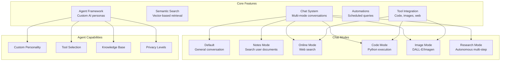

**Sources:** [src/khoj/utils/helpers.py:83-135](), [src/khoj/routers/helpers.py:120-145](), [src/khoj/database/models.py:60-76]()

---

## Chat System

The chat system provides conversational AI capabilities with multiple specialized modes. Users can interact via natural language queries that are processed through the appropriate pipeline based on the conversation command.

### Conversation Commands

| Command | Value | Description | Implementation |
|---------|-------|-------------|----------------|
| `/default` | `ConversationCommand.Default` | General conversation with context awareness | Auto-selects appropriate tools |
| `/general` | `ConversationCommand.General` | General conversation without tool use | Direct LLM response |
| `/notes` | `ConversationCommand.Notes` | Search and answer from user documents | Semantic search + retrieval |
| `/online` | `ConversationCommand.Online` | Web search for real-time information | Search API integration |
| `/code` | `ConversationCommand.Code` | Execute Python code | Sandboxed execution |
| `/image` | `ConversationCommand.Image` | Generate images from descriptions | Text-to-image models |
| `/diagram` | `ConversationCommand.Diagram` | Create diagrams (Excalidraw/Mermaid) | Structured generation |
| `/research` | `ConversationCommand.Research` | Autonomous multi-step research | Iterative tool selection |

**Sources:** [src/khoj/utils/helpers.py:122-137](), [src/khoj/routers/api_chat.py:82-92](), [documentation/docs/features/chat.md:37-48]()

### Chat Message Flow

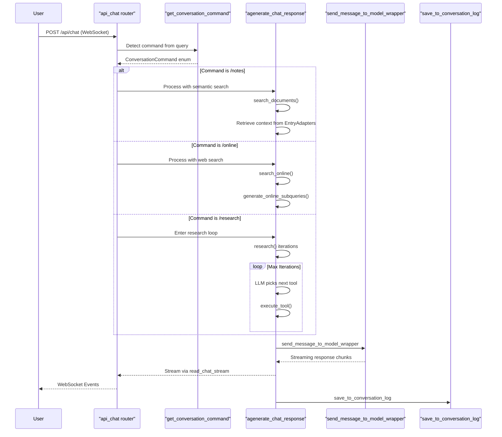

**Sources:** [src/khoj/routers/api_chat.py:55-78](), [src/khoj/routers/helpers.py:55-78](), [src/khoj/processor/conversation/utils.py:43-47]()

### Chat API Endpoints

The chat system exposes several REST and WebSocket endpoints:

| Endpoint | Method | Purpose |
|----------|--------|---------|
| `/api/chat` | `POST/WebSocket` | Main chat interface with streaming |
| `/api/chat/stats` | `GET` | Retrieve conversation statistics |
| `/api/chat/export` | `GET` | Export all conversations for a user |
| `/api/chat/conversation/file-filters` | `POST/DELETE` | Manage per-conversation file filters |
| `/api/chat/feedback` | `POST` | Submit response feedback |

**Sources:** [src/khoj/routers/api_chat.py:108-186]()

### Streaming Response Protocol

Chat responses are streamed using a custom event protocol defined in `ChatEvent`:

**Event Types:**
- `STATUS`: Status message (e.g., "**Searching the web for**...")
- `MESSAGE`: Text response chunks from the LLM.
- `REFERENCES`: Context sources (notes, webpages) used for the response.
- `IMAGE`: Generated image data or URLs.
- `COMPUTED_DATA`: Results from code execution or research iterations.

**Sources:** [src/khoj/processor/conversation/utils.py:161-235](), [src/khoj/routers/api_chat.py:58-60](), [src/khoj/processor/tools/online_search.py:120-121]()

---

## Semantic Search

Khoj provides vector-based semantic search over user-uploaded documents. Unlike keyword search, semantic search understands meaning and returns conceptually relevant results.

### Search Architecture

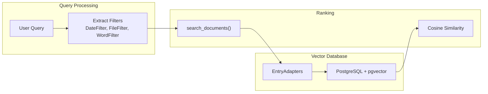

**Sources:** [src/khoj/routers/helpers.py:75-78](), [src/khoj/search_filter/date_filter.py:1-10](), [src/khoj/search_type/text_search.py:1-10]()

### Search Filters

Users can filter search results using natural language or explicit syntax:

| Filter Type | Class | Implementation |
|-------------|-------|----------------|
| **Date Filter** | `DateFilter` | Parses relative dates like "last week" |
| **File Filter** | `FileFilter` | Matches specific filenames or extensions |
| **Word Filter** | `WordFilter` | Includes/Excludes specific keywords |

**Sources:** [src/khoj/search_filter/date_filter.py](), [src/khoj/search_filter/file_filter.py](), [src/khoj/search_filter/word_filter.py]()

---

## Agent System

Agents are customizable AI personas with specific capabilities and personalities.

### Agent Configuration

Agents are defined by the `Agent` model in the database. Key properties include:
- `personality`: A custom system prompt (e.g., `prompts.custom_personality`).
- `input_tools`: List of tools the agent can invoke.
- `privacy_level`: Controls visibility (Private, Public).

**Sources:** [src/khoj/database/models.py:61-62](), [src/khoj/processor/conversation/prompts.py:30-51]()

### Default Personality
The default Khoj personality is defined as a `PromptTemplate` that instructs the model to be a "smart, curious, empathetic and helpful personal assistant" and provides information about Khoj Inc.

**Sources:** [src/khoj/processor/conversation/prompts.py:5-28]()

---

## Tool Integration

Khoj integrates multiple external tools that agents can use to extend their capabilities.

### Web Search
Web search is handled by `search_online`. It supports multiple engines including Serper, Exa, Firecrawl, Google, and SearXNG. It can also read and extract content from specific webpages using `read_webpages_content`.

**Sources:** [src/khoj/processor/tools/online_search.py:56-184](), [src/khoj/routers/research.py:23]()

### Code Execution
The `run_code` tool allows agents to generate and execute Python code in a sandboxed environment.
- **Sandbox**: Supports local `SANDBOX_URL` (Terrarium) or cloud-based E2B.
- **Data Flow**: LLM generates code -> `execute_sandboxed_python` -> returns stdout/stderr/files.

**Sources:** [src/khoj/processor/tools/run_code.py:53-108](), [src/khoj/processor/tools/run_code.py:143-147]()

### Image Generation
The `text_to_image` function orchestrates image creation.
- **Prompt Enhancement**: Uses `generate_better_image_prompt` to turn simple user requests into detailed artistic descriptions.
- **Providers**: Supports OpenAI (DALL-E), Google (Imagen), and Replicate (Flux, Stable Diffusion).

**Sources:** [src/khoj/processor/image/generate.py:41-164](), [src/khoj/processor/conversation/prompts.py:116-149]()

---

## Research Mode

Research mode enables autonomous, multi-step investigation by iteratively selecting and executing tools.

### Research Iteration
Each step in research mode is encapsulated in a `ResearchIteration`. The system uses `apick_next_tool` to decide whether to search the web, query documents, or run code based on the current context and previous results.

**Sources:** [src/khoj/routers/research.py:64-121](), [src/khoj/processor/conversation/utils.py:210-235]()

---

## Automations

Automations allow users to schedule repeated jobs (queries) using cron-like scheduling.

- **Implementation**: Uses `APScheduler` to manage jobs.
- **Data Flow**: User creates `Automation` -> `CronTrigger` is calculated -> `send_task_email` delivers results.
- **Natural Language**: Uses `cron_descriptor` to provide human-readable descriptions of schedules.

**Sources:** [src/khoj/routers/helpers.py:27-32](), [src/khoj/database/models.py:45-46](), [documentation/docs/features/automations.md:1-15]()

---

# Page: Core Backend System

# Core Backend System

<details>
<summary>Relevant source files</summary>

The following files were used as context for generating this wiki page:

- [src/khoj/app/settings.py](src/khoj/app/settings.py)
- [src/khoj/configure.py](src/khoj/configure.py)
- [src/khoj/database/adapters/__init__.py](src/khoj/database/adapters/__init__.py)
- [src/khoj/database/admin.py](src/khoj/database/admin.py)
- [src/khoj/database/models/__init__.py](src/khoj/database/models/__init__.py)
- [src/khoj/main.py](src/khoj/main.py)
- [src/khoj/routers/api.py](src/khoj/routers/api.py)
- [src/khoj/routers/web_client.py](src/khoj/routers/web_client.py)
- [src/khoj/utils/cli.py](src/khoj/utils/cli.py)
- [src/khoj/utils/state.py](src/khoj/utils/state.py)

</details>


## Purpose and Scope

This document covers Khoj's core backend infrastructure, including application initialization, API routing, database management, and authentication systems. The backend serves as the central hub that coordinates between multiple client interfaces and AI processing services.

For information about conversation processing and AI integration, see [Conversation and AI System](#3). For content indexing and search capabilities, see [Content Processing and Search](#4). For client-side applications, see [User Interfaces](#5).

## Application Architecture Overview

Khoj's backend uses a dual-framework architecture combining FastAPI for API endpoints with Django for database management and admin functionality.

### Core Architecture

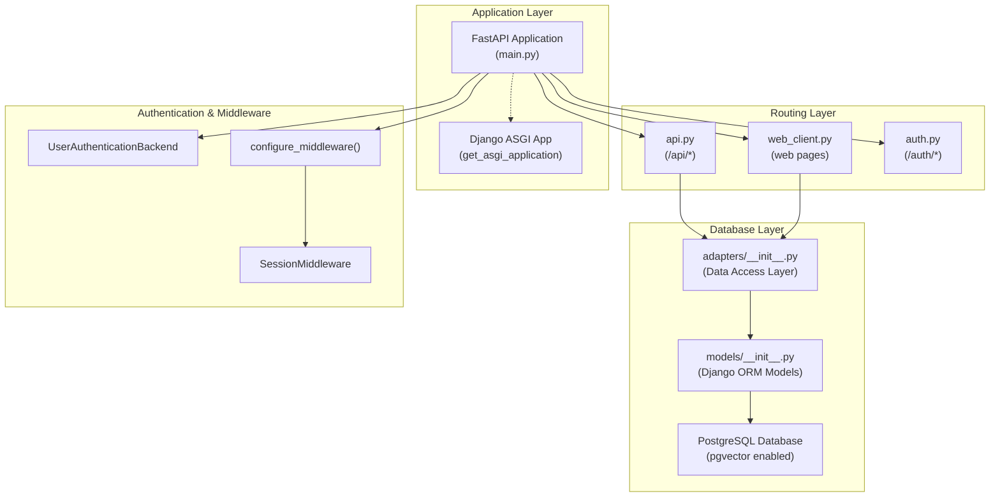

**Sources:** [src/khoj/main.py:61-68](), [src/khoj/configure.py:30-36](), [src/khoj/routers/api.py:31](), [src/khoj/database/models/__init__.py:136-141](), [src/khoj/database/adapters/__init__.py:38-71]()

### Application Bootstrap Process

The application initialization sequence ensures the database is migrated, static files are collected, and background services are started before the web server begins accepting requests.

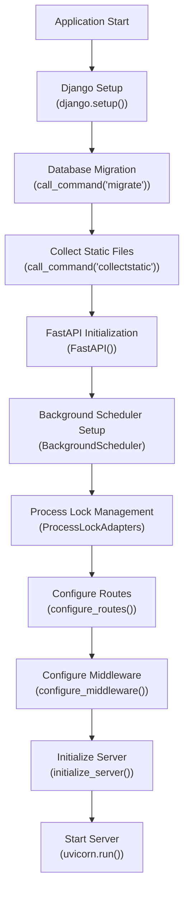

**Sources:** [src/khoj/main.py:38-58](), [src/khoj/main.py:150-185](), [src/khoj/configure.py:195-197]()

For details on initialization logic and environment variables, see [Application Bootstrap and Configuration](#2.1).

## API Router System

The backend exposes functionality through multiple specialized API routers. The primary `api` router handles core system functions, while `web_client` serves the frontend application.

### Router Structure

| Router | Path Prefix | Purpose | Key Endpoints |
|--------|-------------|---------|---------------|
| `api` | `/api` | Core system functions | `/search`, `/update`, `/transcribe`, `/settings` |
| `web_client` | `/` | Web interface and static pages | `/`, `/home`, `/chat`, `/settings` |

**Sources:** [src/khoj/routers/api.py:31-218](), [src/khoj/routers/web_client.py:15-139]()

### Core API Endpoints Flow

Endpoints are protected by authentication scopes and often include rate limiting dependencies to prevent abuse.


**Sources:** [src/khoj/routers/api.py:46-58](), [src/khoj/routers/api.py:108-120]()

For details on routing, middleware, and request handling, see [API Routers and Middleware](#2.2).

## Database Architecture

Khoj uses Django ORM with PostgreSQL as the primary database. It supports an embedded mode using `pgserver` for simplified local deployments. The schema includes support for vector embeddings via the `pgvector` extension.

### Core Model Hierarchy

The data model is centered around the `KhojUser` and their associated content, conversations, and AI agents.

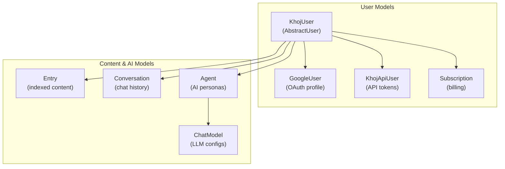

**Sources:** [src/khoj/database/models/__init__.py:153-168](), [src/khoj/database/models/__init__.py:185-193](), [src/khoj/database/models/__init__.py:194-205](), [src/khoj/database/models/__init__.py:220-230]()

### Database Adapter Pattern

The system uses adapter functions (primarily in `src/khoj/database/adapters/`) to provide a clean interface for data operations, abstracting the underlying Django ORM calls.

**Sources:** [src/khoj/database/adapters/__init__.py:141-228]()

For details on models, migrations, and multi-tenant isolation, see [Database Models and Adapters](#2.3).

## Authentication System

Khoj implements a multi-method authentication system supporting session-based auth (for the web app), Bearer tokens (for API clients), and phone-based authentication.

### Authentication Backend Flow

The `UserAuthenticationBackend` handles the logic of identifying users across different request types.

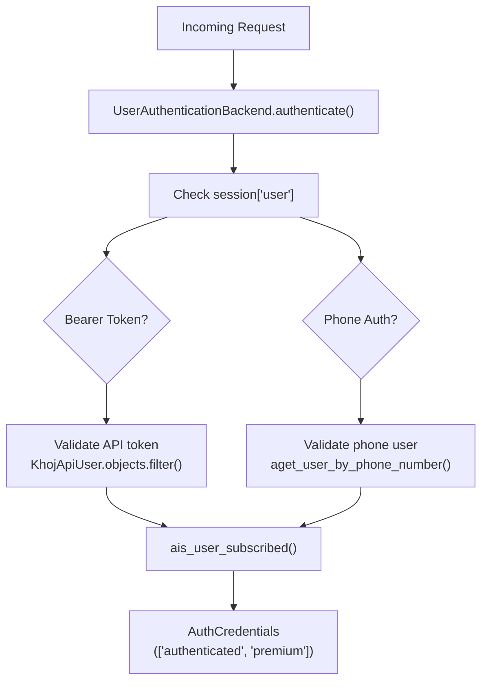

**Sources:** [src/khoj/configure.py:98-166](), [src/khoj/configure.py:168-184]()

For details on OAuth, magic links, and subscription-based access control, see [Authentication and Authorization](#2.4).

## Configuration Management

The system maintains global state through the `state` module, managing shared resources like LLM clients, background schedulers, and model instances.

| State Variable | Type | Purpose |
|---------------|------|---------|
| `openai_client` | `OpenAI` | Shared OpenAI API client instance |
| `scheduler` | `BackgroundScheduler` | Manages scheduled background tasks |
| `embeddings_model` | `Dict[str, EmbeddingsModel]` | Cached embedding models for indexing |
| `anonymous_mode` | `bool` | Flag for single-user mode without login |

**Sources:** [src/khoj/utils/state.py:17-41]()

---

# Page: Application Bootstrap and Configuration

# Application Bootstrap and Configuration

<details>
<summary>Relevant source files</summary>

The following files were used as context for generating this wiki page:

- [documentation/package.json](documentation/package.json)
- [documentation/yarn.lock](documentation/yarn.lock)
- [pyproject.toml](pyproject.toml)
- [src/interface/desktop/yarn.lock](src/interface/desktop/yarn.lock)
- [src/interface/obsidian/yarn.lock](src/interface/obsidian/yarn.lock)
- [src/interface/web/bun.lock](src/interface/web/bun.lock)
- [src/interface/web/tsconfig.json](src/interface/web/tsconfig.json)
- [src/khoj/app/settings.py](src/khoj/app/settings.py)
- [src/khoj/configure.py](src/khoj/configure.py)
- [src/khoj/database/adapters/__init__.py](src/khoj/database/adapters/__init__.py)
- [src/khoj/database/admin.py](src/khoj/database/admin.py)
- [src/khoj/database/models/__init__.py](src/khoj/database/models/__init__.py)
- [src/khoj/main.py](src/khoj/main.py)
- [src/khoj/routers/api.py](src/khoj/routers/api.py)
- [src/khoj/routers/web_client.py](src/khoj/routers/web_client.py)
- [src/khoj/utils/cli.py](src/khoj/utils/cli.py)
- [src/khoj/utils/config.py](src/khoj/utils/config.py)
- [src/khoj/utils/rawconfig.py](src/khoj/utils/rawconfig.py)
- [src/khoj/utils/state.py](src/khoj/utils/state.py)
- [uv.lock](uv.lock)

</details>


This page documents how the Khoj application initializes, including dependency management, configuration systems, environment variables, and the bootstrap process. This covers the foundational setup that occurs before the FastAPI application begins handling requests.

For information about the FastAPI routing structure and middleware, see [API Routers and Middleware](2.2). For database model definitions, see [Database Models and Adapters](2.3).

---

## Overview

Khoj's bootstrap process consists of several phases:

1.  **Dependency Resolution**: Python dependencies defined in `pyproject.toml` are installed.
2.  **Container Build**: Multi-stage build process creates the application container.
3.  **Environment Configuration**: Environment variables are loaded and validated.
4.  **Database Migrations**: Django migrations ensure the database schema is current.
5.  **Application Initialization**: Admin users and AI model configurations are created.
6.  **Server Startup**: Uvicorn or Gunicorn workers begin accepting requests.

---

## Dependency Management

### Project Metadata and Dependencies

The application's dependencies and metadata are defined in `pyproject.toml` using the `hatchling` build system with dynamic versioning from git tags via `hatch-vcs` [pyproject.toml:1-3]().

**Core Dependency Groups:**

| Dependency Group | Purpose | Key Packages |
| :--- | :--- | :--- |
| **Core Runtime** | Essential application dependencies | `fastapi >= 0.110.0`, `django == 5.1.15`, `uvicorn >= 0.31.1`, `pydantic >= 2.0.0` |
| **AI/ML** | Machine learning and LLM integration | `torch == 2.6.0`, `transformers >= 4.53.0`, `sentence-transformers == 3.4.1`, `openai >= 2.0.0`, `anthropic == 0.75.0`, `google-genai == 1.52.0` |
| **Database** | PostgreSQL with vector search | `psycopg2-binary == 2.9.9`, `pgvector == 0.2.4` |
| **Content Processing** | Document parsing and indexing | `pymupdf == 1.24.11`, `beautifulsoup4 ~= 4.12.3`, `langchain-text-splitters == 0.3.11`, `rapidocr-onnxruntime == 1.4.4` |
| **Background Tasks** | Job scheduling | `apscheduler ~= 3.10.0`, `django_apscheduler == 0.7.0` |
| **Authentication** | Auth and security | `authlib == 1.6.9`, `itsdangerous == 2.1.2`, `django-phonenumber-field == 7.3.0` |
| **Production** (`prod`) | Production deployment | `gunicorn == 22.0.0`, `stripe == 7.3.0`, `twilio == 8.11`, `boto3 >= 1.34.57` |
| **Local** (`local`) | Local PostgreSQL server | `pgserver == 0.1.4` |
| **Development** (`dev`) | Testing and linting | `pytest >= 7.1.2`, `mypy >= 1.0.1`, `ruff >= 0.12.0` |

**Build Configuration:**

The project defines a CLI entry point: running `khoj` executes the `run()` function in `src/khoj/main.py` [pyproject.toml:106-107]().

**Python Version Constraint:**

The application requires Python versions `3.10`, `3.11`, or `3.12` [pyproject.toml:10]().

Sources: [pyproject.toml:1-133]()

---

## Application Entry Point

The application bootstrap follows a strict sequence where each phase must complete before the next begins. The `khoj.main:run` entry point orchestrates this sequence.

### Natural Language to Code: Bootstrap Flow

This diagram maps the high-level bootstrap concepts to the specific functions and modules in the codebase.

| High-Level Concept | Code Entity |
| :--- | :--- |
| Entry Point | `khoj.main:run` [src/khoj/main.py:119]() |
| CLI Parsing | `khoj.utils.cli:cli` [src/khoj/main.py:125]() |
| Django Setup | `django.setup()` [src/khoj/main.py:39]() |
| DB Migrations | `call_command("migrate", "--noinput")` [src/khoj/main.py:53]() |
| Static Files | `call_command("collectstatic", "--noinput")` [src/khoj/main.py:58]() |
| Logic Init | `initialization()` [src/khoj/main.py:138]() |
| FastAPI Init | `FastAPI()` [src/khoj/main.py:62]() |

### System Bootstrap Diagram

"Application Bootstrap Flow"
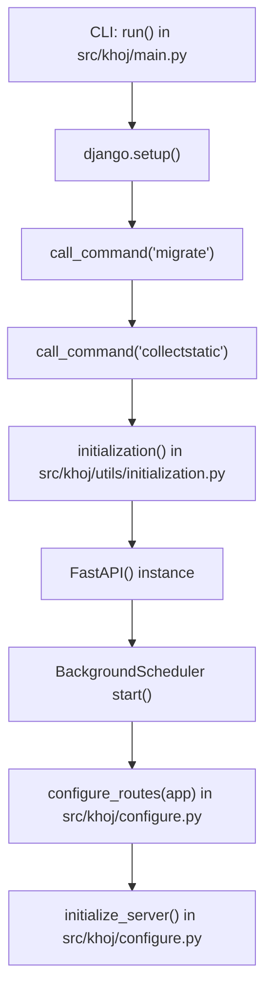

Sources: [src/khoj/main.py:1-198](), [src/khoj/configure.py:94-197]()

---

## Initialization Logic

### Database and Django Integration

Khoj initializes Django settings by setting `DJANGO_SETTINGS_MODULE` to `khoj.app.settings` [src/khoj/main.py:38](). The database configuration supports both standard PostgreSQL and an embedded `pgserver` for local use if `USE_EMBEDDED_DB` is enabled [src/khoj/app/settings.py:127-189]().

### Scheduler and Leader Election

Khoj uses `BackgroundScheduler` with a `DjangoJobStore` to manage scheduled tasks [src/khoj/main.py:156-163](). In distributed environments, it uses a `ProcessLock` mechanism to elect a "Schedule Leader" so only one instance executes jobs [src/khoj/main.py:166-182]().

### Natural Language to Code: Initialization Entities

This diagram associates initialization logic with specific Django models and configuration functions.

| Concept | Code Entity |
| :--- | :--- |
| User Model | `KhojUser` [src/khoj/database/models/__init__.py:153]() |
| Distributed Lock | `ProcessLock` [src/khoj/database/models/__init__.py:28]() |
| Route Setup | `configure_routes` [src/khoj/configure.py:94]() |
| Content Init | `initialize_content` [src/khoj/routers/api.py:13]() |
| App Settings | `src/khoj/app/settings.py` |

"Initialization Logic Map"
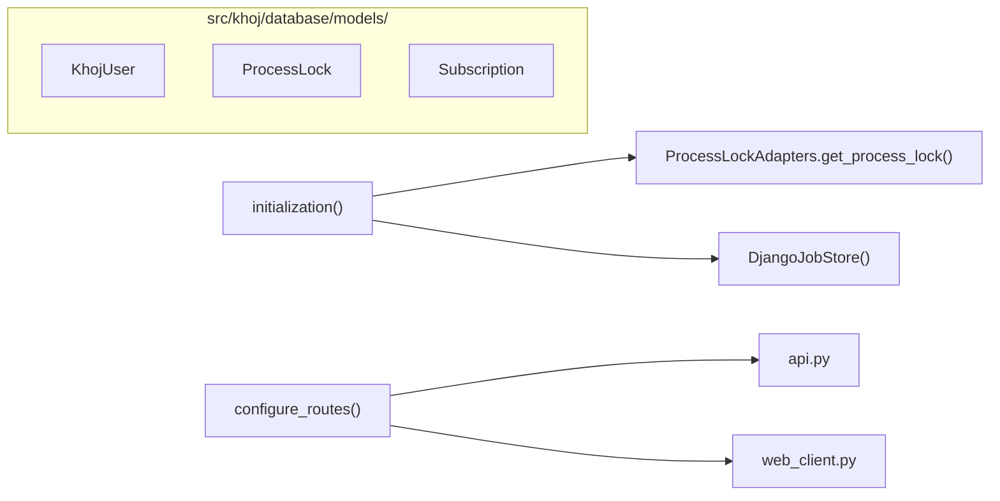

Sources: [src/khoj/main.py:103-182](), [src/khoj/app/settings.py:178-192](), [src/khoj/configure.py:38-51]()

---

## Environment Configuration

Khoj uses environment variables for core application settings, defined primarily in `src/khoj/app/settings.py`.

### Core Settings

| Variable | Code Reference | Purpose |
| :--- | :--- | :--- |
| `KHOJ_DJANGO_SECRET_KEY` | `SECRET_KEY` [src/khoj/app/settings.py:26]() | Django security key |
| `KHOJ_DOMAIN` | `KHOJ_DOMAIN` [src/khoj/app/settings.py:29]() | Primary application domain |
| `KHOJ_NO_HTTPS` | `DISABLE_HTTPS` [src/khoj/app/settings.py:44]() | Toggle for HTTPS enforcement |
| `POSTGRES_DB` | `DB_NAME` [src/khoj/app/settings.py:122]() | Database name |
| `USE_EMBEDDED_DB` | `USE_EMBEDDED_DB` [src/khoj/app/settings.py:127]() | Flag for `pgserver` usage |

### CORS and Trusted Origins

The application dynamically configures CORS based on `KHOJ_DOMAIN` and `KHOJ_NO_HTTPS` [src/khoj/main.py:70-88](). It also includes default origins for desktop and mobile clients like Obsidian and the Khoj Desktop app [src/khoj/main.py:73-80]().

Sources: [src/khoj/app/settings.py:22-115](), [src/khoj/main.py:70-88]()

---

## Middleware Configuration

The bootstrap process configures several FastAPI middlewares via `configure_middleware` in `src/khoj/configure.py`.

### Middleware Stack

| Middleware Class | Purpose |
| :--- | :--- |
| `CORSMiddleware` | Handles cross-origin requests [src/khoj/main.py:82]() |
| `AsyncCloseConnectionsMiddleware` | Ensures Django DB connections are closed after requests [src/khoj/configure.py:69-87]() |
| `SessionMiddleware` | Manages user sessions [src/khoj/configure.py:34]() |
| `AuthenticationMiddleware` | Integrates `UserAuthenticationBackend` [src/khoj/configure.py:31]() |

### Authentication Backend

The `UserAuthenticationBackend` supports multiple authentication methods during initialization:
1.  **Session Auth**: Checks `request.session.get("user")` [src/khoj/configure.py:124]().
2.  **Bearer Token**: Validates `Authorization` headers for API keys (`KhojApiUser`) [src/khoj/configure.py:145-155]().
3.  **Twilio Auth**: Authenticates requests from WhatsApp via phone number [src/khoj/configure.py:169-173]().

Sources: [src/khoj/configure.py:31-173](), [src/khoj/main.py:82-88]()

---

# Page: API Routers and Middleware

# API Routers and Middleware

<details>
<summary>Relevant source files</summary>

The following files were used as context for generating this wiki page:

- [src/khoj/configure.py](src/khoj/configure.py)
- [src/khoj/database/adapters/__init__.py](src/khoj/database/adapters/__init__.py)
- [src/khoj/database/admin.py](src/khoj/database/admin.py)
- [src/khoj/database/models/__init__.py](src/khoj/database/models/__init__.py)
- [src/khoj/processor/content/github/github_to_entries.py](src/khoj/processor/content/github/github_to_entries.py)
- [src/khoj/processor/content/notion/notion_to_entries.py](src/khoj/processor/content/notion/notion_to_entries.py)
- [src/khoj/processor/conversation/prompts.py](src/khoj/processor/conversation/prompts.py)
- [src/khoj/processor/conversation/utils.py](src/khoj/processor/conversation/utils.py)
- [src/khoj/processor/image/generate.py](src/khoj/processor/image/generate.py)
- [src/khoj/processor/tools/online_search.py](src/khoj/processor/tools/online_search.py)
- [src/khoj/processor/tools/run_code.py](src/khoj/processor/tools/run_code.py)
- [src/khoj/routers/api.py](src/khoj/routers/api.py)
- [src/khoj/routers/api_agents.py](src/khoj/routers/api_agents.py)
- [src/khoj/routers/api_automation.py](src/khoj/routers/api_automation.py)
- [src/khoj/routers/api_chat.py](src/khoj/routers/api_chat.py)
- [src/khoj/routers/api_content.py](src/khoj/routers/api_content.py)
- [src/khoj/routers/api_model.py](src/khoj/routers/api_model.py)
- [src/khoj/routers/helpers.py](src/khoj/routers/helpers.py)
- [src/khoj/routers/research.py](src/khoj/routers/research.py)
- [src/khoj/routers/web_client.py](src/khoj/routers/web_client.py)
- [src/khoj/utils/helpers.py](src/khoj/utils/helpers.py)
- [tests/test_api_automation.py](tests/test_api_automation.py)
- [tests/test_online_chat_actors.py](tests/test_online_chat_actors.py)
- [tests/test_online_chat_director.py](tests/test_online_chat_director.py)

</details>


This document describes the FastAPI routing architecture and middleware stack that handles HTTP requests in Khoj. It covers the three main routers (`api.py`, `api_chat.py`, `web_client.py`), authentication mechanisms, rate limiting, and request/response processing pipelines.

For conversation processing logic that occurs after routing, see [Chat Processing Pipeline](). For database models used in authentication, see [Database Models and Adapters]().

## Router Architecture

Khoj organizes its API surface into three FastAPI routers that handle distinct concerns:

### Main API Router (`api`)

The `api` router in [src/khoj/routers/api.py]() handles core platform operations:

| Endpoint | Method | Purpose | Authentication |
|----------|--------|---------|----------------|
| `/search` | GET | Semantic search over user documents | Required |
| `/update` | GET | Trigger content reindexing | Required |
| `/transcribe` | POST | Audio-to-text transcription | Required |
| `/settings` | GET | Retrieve user configuration | Required |
| `/user/name` | PATCH | Update user name | Required |
| `/user/memory` | PATCH | Toggle memory feature | Required |
| `/self` | DELETE | Delete user account | Required |

Sources: [src/khoj/routers/api.py:31-269]()

### Chat API Router (`api_chat`)

The `api_chat` router in [src/khoj/routers/api_chat.py]() manages conversation-related operations:

| Endpoint Group | Key Endpoints | Purpose |
|----------------|---------------|---------|
| **Session Management** | `GET /sessions`, `POST /sessions` | List and create conversations |
| **History** | `GET /history`, `DELETE /history` | Retrieve and clear conversation logs |
| **Sharing** | `POST /share`, `DELETE /share`, `POST /share/fork` | Public conversation management |
| **File Filters** | `POST /conversation/file-filters`, `DELETE /conversation/file-filters` | Scope conversations to specific files |
| **Title Management** | `POST /title`, `PATCH /title` | Generate or set conversation titles |
| **Message Operations** | `DELETE /conversation/message` | Delete individual messages |
| **Utilities** | `GET /stats`, `GET /export` | Metadata and configuration |
| **Feedback** | `POST /feedback` | Submit query feedback |
| **Speech** | `POST /speech` | Text-to-speech synthesis |

Sources: [src/khoj/routers/api_chat.py:105-186]()

### Web Client Router (`web_client`)

The `web_client` router in [src/khoj/routers/web_client.py]() serves HTML pages using Jinja2 templates:

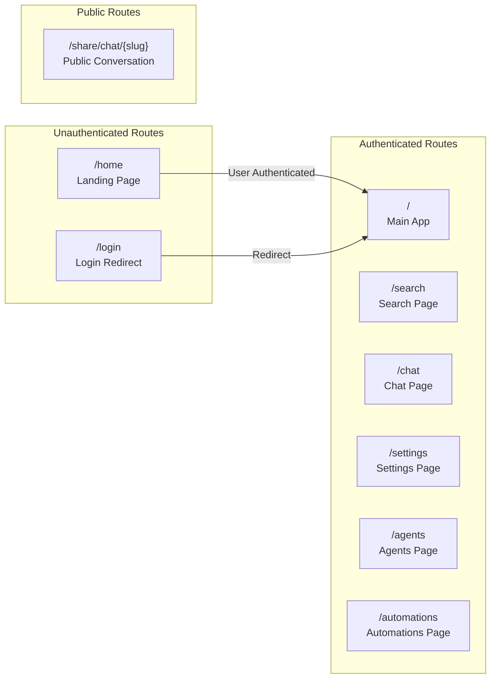

**Diagram: Web Client Route Structure**

Sources: [src/khoj/routers/web_client.py:21-139]()

## Router Initialization Flow

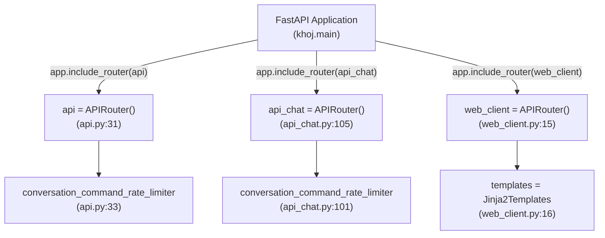

**Diagram: Router Registration and Dependencies**

Sources: [src/khoj/routers/api.py:31-35](), [src/khoj/routers/api_chat.py:101-105](), [src/khoj/routers/web_client.py:15-17]()

## Middleware Stack

Khoj implements a middleware stack for request processing, authentication, and connection management in [src/khoj/configure.py]().

### Middleware Execution Order

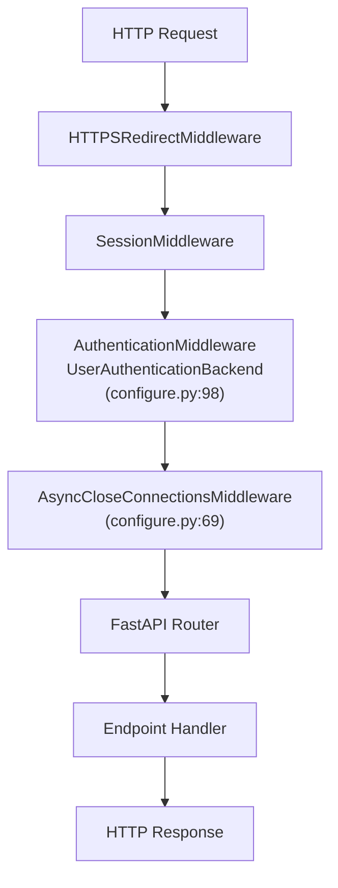

**Diagram: Middleware Stack Processing Order**

The middleware stack is configured in [src/khoj/configure.py]() with the following components:

1. **HTTPSRedirectMiddleware**: Redirects HTTP to HTTPS (if enabled).
2. **SessionMiddleware**: Manages user sessions with encrypted cookies.
3. **AuthenticationMiddleware**: Authenticates requests via `UserAuthenticationBackend`.
4. **AsyncCloseConnectionsMiddleware**: Manages Django database connections in async context.

Sources: [src/khoj/configure.py:30-36](), [src/khoj/configure.py:69-95]()

### AsyncCloseConnectionsMiddleware

This middleware solves Django connection management issues in mixed sync/async contexts:

```python
# From src/khoj/configure.py:69-95
class AsyncCloseConnectionsMiddleware(BaseHTTPMiddleware):
    async def dispatch(self, request, call_next):
        await run_in_threadpool(close_old_connections)
        await sync_to_async(close_old_connections)()
        try:
            response = await call_next(request)
        finally:
            if getattr(settings, "CLOSE_CONNECTIONS_AFTER_REQUEST", False):
                await run_in_threadpool(connections.close_all)
                await sync_to_async(connections.close_all)()
        return response
```

Sources: [src/khoj/configure.py:69-95]()

## Authentication System

### Authentication Backend

The `UserAuthenticationBackend` in [src/khoj/configure.py:98-231]() implements Starlette's `AuthenticationBackend` interface.

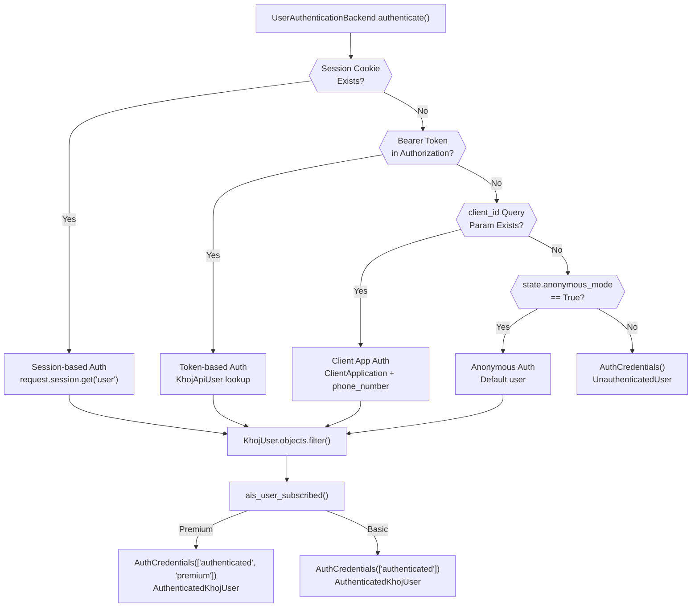

**Diagram: Authentication Flow in UserAuthenticationBackend**

Sources: [src/khoj/configure.py:119-231]()

### Authentication Methods

#### Session Authentication
Used by web clients after login. It checks `request.session.get("user")` and performs a lookup in the `KhojUser` manager [src/khoj/configure.py:124-142]().

#### Bearer Token Authentication
Used by Desktop, Emacs, and Obsidian clients. It extracts the token from the `Authorization` header and looks up the associated `KhojApiUser` [src/khoj/configure.py:144-166]().

#### Client Application Authentication
Used by WhatsApp/Twilio integration. It uses a `client_id` and `client_secret` to authenticate a `ClientApplication` and identifies the user by `phone_number` [src/khoj/configure.py:168-215]().

#### Anonymous Mode
When `state.anonymous_mode` is enabled, the system defaults to a "default" user [src/khoj/configure.py:217-229]().

### AuthenticatedKhojUser

The `AuthenticatedKhojUser` class extends Starlette's `SimpleUser` to hold the Django model instance and optional client app metadata:

```python
# From src/khoj/configure.py:62-66
class AuthenticatedKhojUser(SimpleUser):
    def __init__(self, user, client_app: Optional[ClientApplication] = None):
        self.object = user
        self.client_app = client_app
        super().__init__(user.username)
```

Sources: [src/khoj/configure.py:62-66]()

## Rate Limiting

Khoj implements rate limiting using custom dependency classes in [src/khoj/routers/helpers.py]().

### Rate Limiter Classes

| Class | Purpose | Source |
|-------|---------|--------|
| `ApiUserRateLimiter` | Sliding window rate limiting for specific API slugs | [src/khoj/routers/helpers.py:1755]() |
| `ConversationCommandRateLimiter` | Rate limiting for specialized conversation commands | [src/khoj/routers/helpers.py:1709]() |
| `ApiImageRateLimiter` | Rate limiting for image generation requests | [src/khoj/routers/helpers.py:1876]() |

### Implementation Detail

The `ApiUserRateLimiter` uses `RateLimitRecord` models to track request counts within a specified `window` (in seconds). It distinguishes between trial and subscribed users [src/khoj/routers/helpers.py:1755-1837]().

```python
# Usage example in src/khoj/routers/api.py:114-119
rate_limiter_per_minute=Depends(
    ApiUserRateLimiter(requests=20, subscribed_requests=20, window=60, slug="transcribe_minute")
)
```

Sources: [src/khoj/routers/api.py:108-120](), [src/khoj/routers/helpers.py:1709-1941]()

## Request Processing and Telemetry

### Common Query Parameters
The `CommonQueryParams` dependency captures metadata like `user_agent`, `referer`, and `host` [src/khoj/routers/helpers.py:1696-1706]().

### Telemetry Tracking
The `update_telemetry_state` function is called at the end of API requests to log usage data, including `subscription_type` and `client_id` [src/khoj/routers/helpers.py:197-233]().

```python
# Example call in src/khoj/routers/api.py:70-75
update_telemetry_state(
    request=request,
    telemetry_type="api",
    api="search",
    **common.__dict__,
)
```

Sources: [src/khoj/routers/helpers.py:197-233](), [src/khoj/routers/api.py:70-75]()

## WebSocket Management

The `WebSocketConnectionManager` in [src/khoj/routers/helpers.py:1640]() manages active WebSocket connections, typically keyed by `conversation_id`.

```python
# From src/khoj/routers/helpers.py:1640-1664
class WebSocketConnectionManager:
    def __init__(self):
        self.active_connections: Dict[str, WebSocket] = {}

    async def connect(self, conversation_id: str, websocket: WebSocket):
        await websocket.accept()
        self.active_connections[conversation_id] = websocket
    ...
```

Sources: [src/khoj/routers/helpers.py:1640-1664]()

---

# Page: Database Models and Adapters

# Database Models and Adapters

<details>
<summary>Relevant source files</summary>

The following files were used as context for generating this wiki page:

- [src/khoj/configure.py](src/khoj/configure.py)
- [src/khoj/database/adapters/__init__.py](src/khoj/database/adapters/__init__.py)
- [src/khoj/database/admin.py](src/khoj/database/admin.py)
- [src/khoj/database/management/__init__.py](src/khoj/database/management/__init__.py)
- [src/khoj/database/management/commands/__init__.py](src/khoj/database/management/commands/__init__.py)
- [src/khoj/database/management/commands/change_default_model.py](src/khoj/database/management/commands/change_default_model.py)
- [src/khoj/database/management/commands/convert_images_png_to_webp.py](src/khoj/database/management/commands/convert_images_png_to_webp.py)
- [src/khoj/database/management/commands/delete_orphaned_fileobjects.py](src/khoj/database/management/commands/delete_orphaned_fileobjects.py)
- [src/khoj/database/migrations/0073_delete_usersearchmodelconfig.py](src/khoj/database/migrations/0073_delete_usersearchmodelconfig.py)
- [src/khoj/database/migrations/0079_entry_file_object.py](src/khoj/database/migrations/0079_entry_file_object.py)
- [src/khoj/database/migrations/0079_searchmodelconfig_embeddings_inference_endpoint_type.py](src/khoj/database/migrations/0079_searchmodelconfig_embeddings_inference_endpoint_type.py)
- [src/khoj/database/models/__init__.py](src/khoj/database/models/__init__.py)
- [src/khoj/routers/api.py](src/khoj/routers/api.py)
- [src/khoj/routers/web_client.py](src/khoj/routers/web_client.py)

</details>


This document covers Khoj's database layer, including Django ORM models that define the database schema and adapter classes that provide a data access layer for the application. The models handle persistent storage of users, conversations, agents, content entries, and system configuration, while adapters encapsulate database operations and business logic.

## Database Models Architecture

Khoj uses Django ORM models to define the database schema. The core models are organized around users, AI agents, conversations, and content indexing.

Title: Entity Relationship of Core Database Models
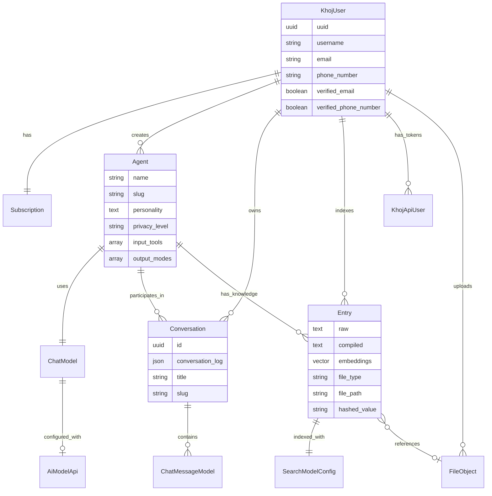
Sources: [src/khoj/database/models/__init__.py:153-690](), [src/khoj/database/models/__init__.py:507-549]()

### Core User Models
The `KhojUser` model extends Django's `AbstractUser` [src/khoj/database/models/__init__.py:153-164](). It serves as the central entity for multi-tenant isolation. Related models include:
- `GoogleUser`: Stores OAuth data like `sub`, `picture`, and `locale` [src/khoj/database/models/__init__.py:170-182]().
- `KhojApiUser`: Manages API tokens (`kk-...`) for external clients [src/khoj/database/models/__init__.py:185-192]().
- `Subscription`: Tracks `Type` (Trial/Standard) and `renewal_date` [src/khoj/database/models/__init__.py:194-203]().

### AI Agent Models
The `Agent` model defines specialized AI personas [src/khoj/database/models/__init__.py:375-470]().
- **Personality**: A system prompt that dictates behavior.
- **Tools**: Configured via `input_tools` (e.g., online search, code interpreter).
- **Models**: Linked via `ChatModel` which specifies `model_name`, `model_type`, and associated `AiModelApi` [src/khoj/database/models/__init__.py:220-234]().

### Content and Search Models
- `Entry`: Represents a chunk of indexed content. It uses `VectorField` from `pgvector` to store high-dimensional embeddings [src/khoj/database/models/__init__.py:527]().
- `FileObject`: Tracks physical or synced files, linked to `Entry` via a ForeignKey [src/khoj/database/models/__init__.py:507-519](), [src/khoj/database/migrations/0079_entry_file_object.py:58-68]().
- `SearchModelConfig`: Stores configuration for bi-encoders and cross-encoders used in semantic search [src/khoj/database/models/__init__.py:265-296]().

## Database Adapters Layer

Adapters act as a bridge between the high-level application logic (FastAPI) and the low-level ORM models. They are located in `src/khoj/database/adapters/`.

Title: Bridge between Natural Language Space and Code Entity Space
```mermaid
graph TD
    subgraph "Natural Language Concept"
        User["'User Session'"]
        Search["'Search My Notes'"]
        Chat["'Chat with Agent'"]
    end

    subgraph "Code Entity Space (Adapters & Models)"
        Auth["UserAuthenticationBackend"]
        EAdapters["EntryAdapters"]
        CAdapters["ConversationAdapters"]
        AAdapters["AgentAdapters"]
        
        KUser["KhojUser Model"]
        Entry["Entry Model"]
        Conv["Conversation Model"]
    end

    User --> Auth
    Auth --> KUser
    
    Search --> EAdapters
    EAdapters --> Entry
    
    Chat --> CAdapters
    Chat --> AAdapters
    CAdapters --> Conv
```
Sources: [src/khoj/configure.py:98-118](), [src/khoj/database/adapters/__init__.py:680-700](), [src/khoj/routers/api.py:14-16]()

### Key Adapter Classes

| Class | Key Functions | File Reference |
|-------|---------------|----------------|
| `AgentAdapters` | `aget_agent_by_slug`, `create_default_agent`, `atomic_update_agent` | [src/khoj/database/adapters/__init__.py:680]() |
| `ConversationAdapters` | `get_speech_to_text_config`, `get_default_chat_model` | [src/khoj/database/adapters/__init__.py:1015]() |
| `EntryAdapters` | Handles search and content retrieval patterns | [src/khoj/database/adapters/__init__.py:38]() |
| `ProcessLockAdapters` | `get_lock`, `release_lock` for background task synchronization | [src/khoj/database/adapters/__init__.py:597]() |

### Data Access Patterns & Isolation
Khoj enforces multi-tenancy primarily through the adapter layer and decorators:
- **Decorators**: `@require_valid_user` and `@arequire_valid_user` ensure that a `KhojUser` object is present in the arguments before executing a database query [src/khoj/database/adapters/__init__.py:106-137]().
- **Filtering**: Most adapter queries include `.filter(user=user)` to prevent cross-tenant data access. For example, `get_khoj_tokens` filters strictly by the provided user object [src/khoj/database/adapters/__init__.py:168-170]().

## Integration with Application Layer

The database layer integrates with Khoj's FastAPI application through dependency injection and authentication middleware.

### Authentication Integration
The `UserAuthenticationBackend` resolves authenticated users from various sources [src/khoj/configure.py:98-167]():
1. **Sessions**: Checks `request.session.get("user")` for web clients [src/khoj/configure.py:124]().
2. **Bearer Tokens**: Parses the `Authorization` header to find a matching `KhojApiUser` [src/khoj/configure.py:145-155]().
3. **Internal Default**: Initializes a `default` user if none exists for single-user local deployments [src/khoj/configure.py:109-117]().

### Process and Task Management
Khoj uses `django-apscheduler` for managing background jobs [src/khoj/database/admin.py:46-77](). The `ProcessLock` model and `ProcessLockAdapters` ensure that tasks like content indexing do not overlap for the same user, which could lead to race conditions [src/khoj/database/adapters/__init__.py:597-605]().

Title: Data Flow from API to Persistent Storage
```mermaid
sequenceDiagram
    participant API as "api.py (FastAPI)"
    participant AD as "adapters.py (Logic)"
    participant DB as "Django ORM (Models)"
    participant PG as "PostgreSQL (pgvector)"

    API->>AD: set_user_name(user, first, last)
    AD->>DB: user.save()
    DB->>PG: UPDATE database_khojuser...

    API->>AD: search(query, user)
    AD->>DB: Entry.objects.filter(user=user).annotate(distance=CosineDistance(...))
    DB->>PG: SELECT ... ORDER BY embeddings <=> query_vector
    PG-->>API: List[SearchResponse]
```
Sources: [src/khoj/routers/api.py:186-215](), [src/khoj/database/adapters/__init__.py:35](), [src/khoj/database/models/__init__.py:527]()

---

# Page: Authentication and Authorization

# Authentication and Authorization

<details>
<summary>Relevant source files</summary>

The following files were used as context for generating this wiki page:

- [documentation/assets/img/admin_get_emali_login.png](documentation/assets/img/admin_get_emali_login.png)
- [documentation/assets/img/admin_successful_login_url.png](documentation/assets/img/admin_successful_login_url.png)
- [documentation/assets/img/magic_link.png](documentation/assets/img/magic_link.png)
- [src/interface/web/app/components/loginPrompt/loginPopup.tsx](src/interface/web/app/components/loginPrompt/loginPopup.tsx)
- [src/interface/web/app/components/loginPrompt/loginPrompt.module.css](src/interface/web/app/components/loginPrompt/loginPrompt.module.css)
- [src/interface/web/app/components/loginPrompt/loginPrompt.tsx](src/interface/web/app/components/loginPrompt/loginPrompt.tsx)
- [src/khoj/configure.py](src/khoj/configure.py)
- [src/khoj/database/adapters/__init__.py](src/khoj/database/adapters/__init__.py)
- [src/khoj/database/admin.py](src/khoj/database/admin.py)
- [src/khoj/database/migrations/0046_khojuser_email_verification_code_and_more.py](src/khoj/database/migrations/0046_khojuser_email_verification_code_and_more.py)
- [src/khoj/database/migrations/0071_subscription_enabled_trial_at_and_more.py](src/khoj/database/migrations/0071_subscription_enabled_trial_at_and_more.py)
- [src/khoj/database/models/__init__.py](src/khoj/database/models/__init__.py)
- [src/khoj/interface/email/magic_link.html](src/khoj/interface/email/magic_link.html)
- [src/khoj/interface/email/task.html](src/khoj/interface/email/task.html)
- [src/khoj/interface/email/welcome.html](src/khoj/interface/email/welcome.html)
- [src/khoj/routers/api.py](src/khoj/routers/api.py)
- [src/khoj/routers/api_subscription.py](src/khoj/routers/api_subscription.py)
- [src/khoj/routers/auth.py](src/khoj/routers/auth.py)
- [src/khoj/routers/email.py](src/khoj/routers/email.py)
- [src/khoj/routers/web_client.py](src/khoj/routers/web_client.py)

</details>


## Purpose and Scope

The Authentication and Authorization system provides secure user identity management, session handling, and access control for Khoj. It supports multiple authentication methods including OAuth (Google), magic link email authentication, and API token-based access. Beyond identity, the system implements subscription-based authorization patterns and granular rate limiting to manage resource consumption.

## Authentication Mechanisms

Khoj supports three primary authentication methods, each serving different use cases:

| Method | Use Case | Implementation |
|--------|----------|----------------|
| **Google OAuth** | Primary web login | OAuth 2.0 with Google Identity Platform |
| **Magic Links** | Email-based passwordless login | Time-limited verification codes (OTP) |
| **API Tokens** | Programmatic/Client access | Bearer token authentication |

The system can operate in anonymous mode for development or single-user deployments by setting the `--anonymous-mode` flag [src/khoj/routers/auth.py:41-57]().

### Authentication Flow and Data Mapping

The following diagram maps the high-level authentication flow to specific code entities within the `khoj` namespace.

```mermaid
graph TB
    subgraph "Natural Language Space"
    User["User"]
    AuthChoice{"Auth Method"}
    end

    subgraph "Code Entity Space (khoj.routers.auth)"
    GoogleAuth["/login"]
    MagicLink["/magic (POST)"]
    TokenAuth["/token"]
    Redirect["/redirect"]
    end

    subgraph "Code Entity Space (khoj.database.adapters)"
    get_user["get_or_create_user"]
    create_token["acreate_khoj_token"]
    validate_code["aget_user_validated_by_email_verification_code"]
    end

    User --> AuthChoice
    AuthChoice -->|OAuth| GoogleAuth
    AuthChoice -->|Email| MagicLink
    AuthChoice -->|Bearer| TokenAuth

    GoogleAuth --> Redirect
    Redirect --> get_user
    MagicLink --> validate_code
    TokenAuth --> create_token

    get_user -.-> KhojUser["models.KhojUser"]
    validate_code -.-> KhojUser
```
Sources: [src/khoj/routers/auth.py:66-164](), [src/khoj/database/adapters/__init__.py:179-183]()

## OAuth Integration

### Google OAuth Configuration
The OAuth system uses Google's OpenID Connect. Configuration requires `GOOGLE_CLIENT_ID` and `GOOGLE_CLIENT_SECRET` environment variables [src/khoj/routers/auth.py:47-52](). The backend uses `authlib` to manage the registration and redirect logic [src/khoj/routers/auth.py:60-63]().

### OAuth Endpoints
- `GET /auth/login`: Initiates the OAuth authorization redirect [src/khoj/routers/auth.py:66-69]().
- `POST /auth/redirect`: Processes the Google credential tokens. This endpoint includes CSRF protection by comparing the `g_csrf_token` cookie against the form body [src/khoj/routers/auth.py:178-187]().
- `GET /auth/oauth/metadata`: Provides the frontend with `client_id` and `redirect_uri` for initializing the Google Sign-In button [src/khoj/routers/auth.py:305-314]().

## Magic Link (OTP) Authentication

Magic links provide passwordless authentication using verification codes. 

1.  **Request**: The user submits an email via `POST /auth/magic` [src/khoj/routers/auth.py:78-81]().
2.  **Generation**: The system creates/retrieves a `KhojUser` and generates an `email_verification_code` [src/khoj/routers/auth.py:88-99]().
3.  **Delivery**: An email is sent via the Resend service containing the code and a direct sign-in link [src/khoj/routers/email.py:32-51]().
4.  **Verification**: The user submits the code via `GET /auth/magic`. The function `aget_user_validated_by_email_verification_code` checks for code validity and expiration (5-minute window) [src/khoj/routers/auth.py:113-135](), [src/khoj/interface/email/magic_link.html:23-23]().

Sources: [src/khoj/routers/auth.py:78-135](), [src/khoj/routers/email.py:32-51](), [src/khoj/database/models/__init__.py:158-159]()

## API Token Management

API tokens enable programmatic access for clients like Emacs, Obsidian, and Desktop apps.

- **Creation**: `acreate_khoj_token` generates a token prefixed with `kk-` using `secrets.token_urlsafe(32)` [src/khoj/database/adapters/__init__.py:160-165]().
- **Authentication**: The `UserAuthenticationBackend` in `configure.py` parses the `Authorization: Bearer <token>` header to authenticate requests from non-web clients [src/khoj/configure.py:145-166]().
- **Management Endpoints**:
    - `POST /auth/token`: Generates a new token for the authenticated user [src/khoj/routers/auth.py:138-149]().
    - `GET /auth/token`: Lists all tokens for the user [src/khoj/routers/auth.py:152-157]().
    - `DELETE /auth/token`: Revokes a specific token [src/khoj/routers/auth.py:160-164]().

Sources: [src/khoj/database/adapters/__init__.py:160-177](), [src/khoj/configure.py:145-166]()

## Authorization and Subscription

Khoj uses a scope-based authorization pattern primarily managed through Starlette's `AuthCredentials`.

### Subscription-Based Access
The `UserAuthenticationBackend` checks if a user is subscribed using `ais_user_subscribed(user)` [src/khoj/configure.py:139-142]().
- **Standard Users**: Granted `authenticated` scope.
- **Premium Users**: Granted `authenticated` and `premium` scopes [src/khoj/configure.py:141-142]().

### Subscription Lifecycle
Subscription state is managed via Stripe webhooks in `api_subscription.py` [src/khoj/routers/api_subscription.py:25-26]().
- **invoice.paid**: Updates the `renewal_date` and sets the user as recurring [src/khoj/routers/api_subscription.py:80-87]().
- **customer.subscription.deleted**: Resets the subscription state to `STANDARD` [src/khoj/routers/api_subscription.py:103-108]().

```mermaid
graph LR
    subgraph "Subscription Models (khoj.database.models)"
    Subscription["Subscription"]
    KhojUser["KhojUser"]
    PriceTier["PriceTier"]
    end

    subgraph "Logic (khoj.database.adapters)"
    is_sub["ais_user_subscribed"]
    set_sub["set_user_subscription"]
    end

    KhojUser --"1:1"--> Subscription
    Subscription --> PriceTier
    is_sub --> Subscription
    set_sub --> Subscription
```
Sources: [src/khoj/database/models/__init__.py:194-205](), [src/khoj/configure.py:139-166](), [src/khoj/routers/api_subscription.py:80-108]()

## Rate Limiting

Khoj implements multi-tier rate limiting using custom dependencies that distinguish between free and subscribed users.

### Implementation Classes
- `ApiUserRateLimiter`: General-purpose limiter for API endpoints (e.g., transcription) [src/khoj/routers/api.py:114-119]().
- `ConversationCommandRateLimiter`: Specifically for chat commands, allowing 2 requests for trials and 100 for subscribed users [src/khoj/routers/api.py:33-35]().
- `EmailAttemptRateLimiter` & `EmailVerificationApiRateLimiter`: Protect auth endpoints from brute force and spam [src/khoj/routers/auth.py:82-120]().

### Data Flow
Rate limits are tracked in the database using the `RateLimitRecord` model [src/khoj/database/models/__init__.py:410-416](). When a request hits a rate-limited endpoint, the `ApiUserRateLimiter` checks the user's `Subscription` status to determine the applicable threshold [src/khoj/routers/api.py:114-119]().

Sources: [src/khoj/routers/api.py:33-35](), [src/khoj/routers/auth.py:82-120](), [src/khoj/database/models/__init__.py:410-416]()

---

# Page: Conversation and AI System

# Conversation and AI System

<details>
<summary>Relevant source files</summary>

The following files were used as context for generating this wiki page:

- [src/khoj/processor/conversation/anthropic/anthropic_chat.py](src/khoj/processor/conversation/anthropic/anthropic_chat.py)
- [src/khoj/processor/conversation/anthropic/utils.py](src/khoj/processor/conversation/anthropic/utils.py)
- [src/khoj/processor/conversation/google/gemini_chat.py](src/khoj/processor/conversation/google/gemini_chat.py)
- [src/khoj/processor/conversation/google/utils.py](src/khoj/processor/conversation/google/utils.py)
- [src/khoj/processor/conversation/openai/gpt.py](src/khoj/processor/conversation/openai/gpt.py)
- [src/khoj/processor/conversation/openai/utils.py](src/khoj/processor/conversation/openai/utils.py)
- [src/khoj/processor/conversation/prompts.py](src/khoj/processor/conversation/prompts.py)
- [src/khoj/processor/conversation/utils.py](src/khoj/processor/conversation/utils.py)
- [src/khoj/processor/image/generate.py](src/khoj/processor/image/generate.py)
- [src/khoj/processor/tools/online_search.py](src/khoj/processor/tools/online_search.py)
- [src/khoj/processor/tools/run_code.py](src/khoj/processor/tools/run_code.py)
- [src/khoj/routers/api_chat.py](src/khoj/routers/api_chat.py)
- [src/khoj/routers/helpers.py](src/khoj/routers/helpers.py)
- [src/khoj/routers/research.py](src/khoj/routers/research.py)
- [src/khoj/utils/constants.py](src/khoj/utils/constants.py)
- [src/khoj/utils/helpers.py](src/khoj/utils/helpers.py)

</details>


## Purpose and Scope

The Conversation and AI System is the core subsystem powering Khoj's chat capabilities. It handles end-to-end processing of user queries, from receiving chat requests through FastAPI endpoints, selecting and executing appropriate tools, integrating with multiple LLM providers (OpenAI, Anthropic, Google Gemini), managing conversation context, and streaming responses back to clients.

This document covers the overall architecture and data flow through the conversation system. For detailed information on specific subsystems, see:
- Chat request processing and response generation: [Chat Processing Pipeline](#3.1)
- Multi-provider LLM integration: [LLM Provider Integration](#3.2)
- Agent configuration and persona management: [Agent System](#3.3)
- Built-in and extensible tool execution: [Tool Integration and Execution](#3.4)
- Autonomous multi-step research: [Research Mode](#3.5)
- Computer automation capabilities: [Computer Operator Agent](#3.6)

## System Architecture

The conversation system follows a layered architecture where FastAPI routers receive requests, delegate to processing helpers that orchestrate tool selection and execution, interact with LLM providers, and save conversation state to PostgreSQL.

### High-Level Component Diagram

```mermaid
graph TB
    Client["Client<br/>(Web/Desktop/Emacs/Obsidian)"]
    
    subgraph "API Layer"
        ChatAPI["api_chat.py<br/>/api/chat endpoints"]
        WebSocket["WebSocket Handler<br/>Streaming Support"]
    end
    
    subgraph "Processing Core"
        EventGen["event_generator()<br/>Request Orchestration"]
        Helpers["helpers.py<br/>agenerate_chat_response()"]
        ToolSelector["aget_data_sources_and_output_format()<br/>Tool Selection"]
        ContextAssembly["Context Assembly<br/>search_documents(), search_online()"]
    end
    
    subgraph "LLM Integration"
        Wrapper["send_message_to_model_wrapper()<br/>Provider Abstraction"]
        OpenAI["openai/gpt.py<br/>completion_with_backoff()"]
        Anthropic["anthropic/anthropic_chat.py<br/>anthropic_completion_with_backoff()"]
        Gemini["google/gemini_chat.py<br/>gemini_completion_with_backoff()"]
    end
    
    subgraph "Tool Execution"
        OnlineSearch["online_search.py<br/>search_online()"]
        RunCode["run_code.py<br/>run_code()"]
        ImageGen["generate.py<br/>text_to_image()"]
        Research["research.py<br/>research()"]
        MCP["mcp.py<br/>MCPClient"]
    end
    
    subgraph "Data Layer"
        ConvAdapters["ConversationAdapters<br/>save_conversation()"]
        AgentAdapters["AgentAdapters<br/>get_agent_chat_model()"]
        DB[("PostgreSQL<br/>Conversation, ChatMessageModel<br/>Agent, UserMemory")]
    end
    
    Client -->|HTTP/WSS| ChatAPI
    ChatAPI --> EventGen
    EventGen --> Helpers
    Helpers --> ToolSelector
    ToolSelector --> ContextAssembly
    ContextAssembly --> OnlineSearch
    ContextAssembly --> RunCode
    Helpers --> Wrapper
    Wrapper --> OpenAI
    Wrapper --> Anthropic
    Wrapper --> Gemini
    Helpers --> Research
    Research --> MCP
    Helpers --> ImageGen
    Helpers --> ConvAdapters
    Helpers --> AgentAdapters
    ConvAdapters --> DB
    AgentAdapters --> DB
    EventGen -->|Server-Sent Events| WebSocket
    WebSocket --> Client
```

**Sources:** [src/khoj/routers/api_chat.py:105-200](), [src/khoj/routers/helpers.py:1520-1550](), [src/khoj/processor/conversation/openai/gpt.py:27-133](), [src/khoj/processor/conversation/google/gemini_chat.py:18-82]()

### Component Responsibilities

| Component | Primary Responsibility | Key Classes/Functions |
|-----------|------------------------|----------------------|
| **API Routers** | HTTP/WebSocket endpoint handling, authentication, telemetry | `api_chat.py`: `chat()`, `event_generator()` |
| **Processing Helpers** | Request orchestration, tool selection, context assembly | `helpers.py`: `agenerate_chat_response()`, `aget_data_sources_and_output_format()` |
| **LLM Wrappers** | Provider-agnostic LLM interaction with retry logic | `send_message_to_model_wrapper()`, `completion_with_backoff()` |
| **Tool Executors** | Execute specific capabilities (search, code, image gen) | `search_online()`, `run_code()`, `text_to_image()` |
| **Research Orchestrator** | Multi-step autonomous tool execution | `research.py`: `research()`, `execute_tool()` |
| **Conversation Adapters** | Database persistence, conversation management | `ConversationAdapters`: `save_conversation()`, `aget_conversation_by_user()` |
| **Agent Adapters** | Agent configuration retrieval | `AgentAdapters`: `aget_user_chat_model()`, `aget_default_chat_model()` |

**Sources:** [src/khoj/routers/api_chat.py:105-180](), [src/khoj/routers/helpers.py:354-468](), [src/khoj/routers/helpers.py:2510-2750](), [src/khoj/database/adapters/__init__.py:1-1000]()

## Request Processing Flow

### Chat Request Lifecycle

The system receives chat requests through the `/api/chat` endpoint, which initializes an `event_generator` to stream typed `ChatEvent` updates back to the client.

```mermaid
sequenceDiagram
    participant Client
    participant api_chat as api_chat.py
    participant event_gen as event_generator()
    participant helpers as agenerate_chat_response()
    participant tool_select as aget_data_sources_and_output_format()
    participant tools as Tool Executors
    participant llm_wrapper as send_message_to_model_wrapper()
    participant provider as LLM Provider
    participant db as ConversationAdapters

    Client->>api_chat: POST /api/chat<br/>{q, conversation_id, images}
    api_chat->>event_gen: Create event stream
    event_gen->>helpers: Process query
    helpers->>tool_select: Determine tools & output mode
    tool_select->>llm_wrapper: Infer from query & history
    llm_wrapper->>provider: Pick relevant tools
    provider-->>llm_wrapper: {sources: [online, notes], output: text}
    llm_wrapper-->>tool_select: Tool selection result
    tool_select-->>helpers: ConversationCommand list
    
    loop For each selected tool
        helpers->>tools: Execute tool (search_online, search_documents)
        tools-->>helpers: Tool results
    end
    
    helpers->>helpers: Assemble context from tool results
    helpers->>llm_wrapper: Generate response with context
    llm_wrapper->>provider: Chat completion request
    
    loop Stream response chunks
        provider-->>llm_wrapper: Response chunk
        llm_wrapper-->>helpers: Chunk
        helpers-->>event_gen: ChatEvent.MESSAGE
        event_gen-->>api_chat: SSE event
        api_chat-->>Client: Stream chunk
    end
    
    helpers->>db: save_conversation()
    db-->>helpers: Conversation saved
    helpers-->>event_gen: ChatEvent.END_RESPONSE
    event_gen-->>api_chat: Complete
    api_chat-->>Client: Close stream
```

**Sources:** [src/khoj/routers/api_chat.py:665-900](), [src/khoj/routers/helpers.py:354-468](), [src/khoj/routers/helpers.py:1520-2200]()

### Event Stream Types

The system uses a typed event stream to communicate different stages of processing via the `ChatEvent` class.

| Event Type | Purpose | Data Format |
|------------|---------|-------------|
| `ChatEvent.STATUS` | Progress updates (e.g., "Searching the web") | String message |
| `ChatEvent.THOUGHT` | LLM reasoning process (for reasoning models) | String (thought text) |
| `ChatEvent.MESSAGE` | Response text chunks | String (response chunk) |
| `ChatEvent.REFERENCES` | Document citations | List of Context objects |
| `ChatEvent.GENERATED_ASSETS` | Images, diagrams | Dict with asset URLs |
| `ChatEvent.END_LLM_RESPONSE` | LLM streaming complete | Empty |
| `ChatEvent.END_RESPONSE` | Full response complete | Empty |

**Sources:** [src/khoj/processor/conversation/utils.py:482-495](), [src/khoj/routers/helpers.py:98-111]()

## Core Processing Components

### Message Processing Pipeline

The `agenerate_chat_response()` function implements the core conversation logic, including memory retrieval, tool selection, and context assembly.

```mermaid
graph TB
    Start["agenerate_chat_response()"]
    
    GetConv["Get/Create Conversation<br/>ConversationAdapters.aget_conversation_by_user()"]
    GetAgent["Get Agent Config<br/>AgentAdapters.aget_conversation_agent()"]
    GetMemories["Retrieve Relevant Memories<br/>UserMemoryAdapters.aget_relevant_memories()"]
    
    CheckCommand{"Check Query<br/>Command"}
    
    DirectMode["Direct Mode<br/>(image, diagram, automation)"]
    
    ToolSelection["Tool Selection<br/>aget_data_sources_and_output_format()"]
    
    ExecuteTools["Execute Tools<br/>(search_documents, search_online, etc)"]
    
    AssembleContext["Assemble Context<br/>compiled_references, online_results"]
    
    FormatMessages["Format Messages<br/>generate_chatml_messages_with_context()"]
    
    LLMCall["LLM Request<br/>send_message_to_model_wrapper()"]
    
    StreamResponse["Stream Response<br/>Yield ChatEvent.MESSAGE chunks"]
    
    SaveConv["Save to DB<br/>save_to_conversation_log()"]
    
    Start --> GetConv
    GetConv --> GetAgent
    GetAgent --> GetMemories
    GetMemories --> CheckCommand
    
    CheckCommand -->|/image, /diagram, etc| DirectMode
    CheckCommand -->|Regular query| ToolSelection
    
    DirectMode --> SaveConv
    
    ToolSelection --> ExecuteTools
    ExecuteTools --> AssembleContext
    AssembleContext --> FormatMessages
    FormatMessages --> LLMCall
    LLMCall --> StreamResponse
    StreamResponse --> SaveConv
```

**Sources:** [src/khoj/routers/helpers.py:1520-2200](), [src/khoj/processor/conversation/utils.py:106-109]()

### LLM Integration Layer

Khoj provides a unified integration layer for multiple providers. The `send_message_to_model_wrapper()` function abstracts provider-specific APIs (OpenAI, Anthropic, Gemini) and handles retryable errors via `RetryableModelError`.

#### Provider-Specific Implementations

| Provider | Completion Module | Primary Utility |
|----------|-------------------|-----------------|
| **OpenAI** | `openai/gpt.py` | `completion_with_backoff()` |
| **Anthropic** | `anthropic/anthropic_chat.py` | `anthropic_completion_with_backoff()` |
| **Google** | `google/gemini_chat.py` | `gemini_completion_with_backoff()` |

**Sources:** [src/khoj/processor/conversation/openai/utils.py:83-104](), [src/khoj/processor/conversation/google/utils.py:178-188](), [src/khoj/processor/conversation/utils.py:101-121]()

## Key Data Models

The following diagram maps conversation-related Django models to their Pydantic validation counterparts used in the AI pipeline.

```mermaid
graph LR
    subgraph "Django ORM Models (khoj.database.models)"
        Conversation["Conversation<br/>user: KhojUser<br/>conversation_log: JSON<br/>agent: Agent<br/>file_filters: List[str]"]
        
        KhojUser["KhojUser<br/>uuid: UUID<br/>username: str<br/>email: str"]
        
        Agent["Agent<br/>name: str<br/>personality: str<br/>input_tools: List[str]<br/>output_modes: List[str]"]
        
        ChatModel["ChatModel<br/>name: str<br/>model_type: ModelType"]
        
        UserMemory["UserMemory<br/>user: KhojUser<br/>memory: str"]
    end
    
    subgraph "Pydantic & Data Structures"
        ChatMessageModel["ChatMessageModel<br/>by: str<br/>message: str | list[dict]<br/>context: List[Context]"]
        
        ResponseWithThought["ResponseWithThought<br/>text: str<br/>thought: str<br/>raw_content: list"]
        
        ResearchIteration["ResearchIteration<br/>query: ToolCall<br/>summarizedResult: str"]
    end
    
    Conversation -->|contains| ChatMessageModel
    Conversation -->|belongs to| KhojUser
    Conversation -->|uses| Agent
    Agent -->|uses| ChatModel
    UserMemory -->|belongs to| KhojUser
    ChatMessageModel -->|maps to| ResponseWithThought
```

**Sources:** [src/khoj/database/models/__init__.py:1-1000](), [src/khoj/processor/conversation/utils.py:210-236](), [src/khoj/processor/conversation/openai/utils.py:38-42]()

## Tool Execution Framework

Khoj implements a flexible tool system where the LLM can trigger specific actions based on the user's intent.

| Tool | Command | Implementation |
|------|---------|----------------|
| **Document Search** | `SemanticSearchFiles` | `search_documents()` |
| **Web Search** | `SearchWeb` | `search_online()` |
| **Webpage Reader** | `ReadWebpage` | `read_webpages_content()` |
| **Code Execution** | `RunCode` | `run_code()` |
| **Image Generation** | `TextToImage` | `text_to_image()` |
| **Diagram Creation** | `GenerateDiagram` | `generate_mermaidjs_diagram()` |

**Sources:** [src/khoj/routers/api_chat.py:48-53](), [src/khoj/routers/research.py:101-184](), [src/khoj/processor/tools/online_search.py:56-72]()

## Research Mode Orchestration

Research mode allows the system to perform iterative, multi-step tasks. It uses `ResearchIteration` to track the state of an autonomous investigation, executing tools in parallel where possible.

```mermaid
graph TB
    Start["research()"]
    PickTool["Pick Next Tool<br/>(via LLM)"]
    
    CheckTool{"Tool Selected?"}
    
    ParallelExec["execute_tool()<br/>(Parallel asyncio.gather)"]
    
    Summarize["Summarize Iteration"]
    
    CheckComplete{"Complete?"}
    
    FinalResponse["Final Response"]
    
    Start --> PickTool
    PickTool --> CheckTool
    
    CheckTool -->|Yes| ParallelExec
    CheckTool -->|No| FinalResponse
    
    ParallelExec --> Summarize
    Summarize --> CheckComplete
    
    CheckComplete -->|No| PickTool
    CheckComplete -->|Yes| FinalResponse
```

**Sources:** [src/khoj/routers/research.py:64-274](), [src/khoj/processor/conversation/utils.py:210-236]()

---

# Page: Chat Processing Pipeline

# Chat Processing Pipeline

<details>
<summary>Relevant source files</summary>

The following files were used as context for generating this wiki page:

- [src/khoj/processor/conversation/openai/whisper.py](src/khoj/processor/conversation/openai/whisper.py)
- [src/khoj/processor/conversation/prompts.py](src/khoj/processor/conversation/prompts.py)
- [src/khoj/processor/conversation/utils.py](src/khoj/processor/conversation/utils.py)
- [src/khoj/processor/image/generate.py](src/khoj/processor/image/generate.py)
- [src/khoj/processor/tools/online_search.py](src/khoj/processor/tools/online_search.py)
- [src/khoj/processor/tools/run_code.py](src/khoj/processor/tools/run_code.py)
- [src/khoj/routers/api_chat.py](src/khoj/routers/api_chat.py)
- [src/khoj/routers/helpers.py](src/khoj/routers/helpers.py)
- [src/khoj/routers/research.py](src/khoj/routers/research.py)
- [src/khoj/utils/helpers.py](src/khoj/utils/helpers.py)
- [src/khoj/utils/models.py](src/khoj/utils/models.py)
- [tests/test_conversation_utils.py](tests/test_conversation_utils.py)

</details>


## Purpose and Scope

This document details the complete lifecycle of a chat message in Khoj, from initial user input through context retrieval, LLM generation, streaming responses, and conversation persistence. The pipeline handles both REST and WebSocket requests, manages real-time streaming, and coordinates with multiple subsystems including search, tool execution, and research modes.

For information about:
- Agent configuration and capabilities, see [Agent System](#3.3)
- LLM provider integration and model selection, see [LLM Provider Integration](#3.2)
- Tool execution (code, image generation, web search), see [Tool Integration and Execution](#3.4)
- Autonomous research loops, see [Research Mode](#3.5)

---

## Request Entry Points

### API Router Structure

The chat system exposes primary communication channels through the `api_chat` router [src/khoj/routers/api_chat.py:105]():

| Endpoint | Method | Purpose | Connection Type |
|----------|--------|---------|----------------|
| `/api/chat` | POST | Single-turn chat (legacy) | HTTP |
| `/api/chat` | WebSocket | Streaming chat | WebSocket |
| `/api/chat/history` | GET | Retrieve conversation history | HTTP |
| `/api/chat/sessions` | GET/POST | Manage conversation sessions | HTTP |
| `/api/chat/stats` | GET | Get conversation statistics | HTTP |

**Chat Request Flow from Client to Response Generation**

```mermaid
graph TB
    subgraph "Client Layer"
        NextJS["Next.js Web App"]
        Emacs["khoj.el"]
        Obsidian["Obsidian Plugin"]
    end
    
    subgraph "API Router [api_chat.py]"
        ChatRouter["api_chat: APIRouter"]
        WSEndpoint["ws_chat_session<br/>WebSocket handler"]
        HTTPEndpoint["chat<br/>POST handler"]
    end
    
    subgraph "Event Generation"
        EventGen["event_generator<br/>async generator<br/>api_chat.py:665-1220"]
        ReadStream["read_chat_stream<br/>HTTP wrapper<br/>helpers.py:1837-1886"]
    end
    
    subgraph "Core Processing"
        GenResponse["agenerate_chat_response<br/>helpers.py:2024-2220"]
        ToolSelect["aget_data_sources_and_output_format<br/>helpers.py:354-468"]
        ResearchMode["research<br/>research.py:239-550"]
    end
    
    NextJS --> WSEndpoint
    NextJS --> HTTPEndpoint
    Emacs --> HTTPEndpoint
    Obsidian --> WSEndpoint
    
    WSEndpoint --> EventGen
    HTTPEndpoint --> ReadStream
    
    EventGen --> GenResponse
    ReadStream --> GenResponse
    
    GenResponse --> ToolSelect
    GenResponse --> ResearchMode
```
**Sources:** [src/khoj/routers/api_chat.py:105](), [src/khoj/routers/api_chat.py:665-1220](), [src/khoj/routers/helpers.py:1837-1886](), [src/khoj/routers/helpers.py:2024-2220]()

### WebSocket vs REST Flow

The system supports two request patterns with different streaming characteristics:

**WebSocket Flow:**
- Client establishes persistent connection via `/api/chat` WebSocket endpoint [src/khoj/routers/api_chat.py:905]().
- Server streams events as `ChatEvent` objects [src/khoj/processor/conversation/utils.py:270-281]().
- Connection monitored by `monitor_disconnection` task for cancellation handling [src/khoj/routers/api_chat.py:742-772]().

**REST Flow:**
- Client sends POST request to `/api/chat` [src/khoj/routers/api_chat.py:1222]().
- Server returns `StreamingResponse` with chunked transfer encoding [src/khoj/routers/api_chat.py:1243]().
- Uses `read_chat_stream` wrapper to convert async generator to response stream [src/khoj/routers/helpers.py:1837-1886]().

---

## Message Lifecycle

**Chat Message Processing State Flow**

```mermaid
stateDiagram-v2
    [*] --> ParseRequest
    ParseRequest --> AuthMiddleware
    AuthMiddleware --> DefilterQuery
    DefilterQuery --> CommandDetect
    
    CommandDetect --> InferTools: /default query
    CommandDetect --> DirectRoute: /notes /online /code
    
    InferTools --> RetrieveContext
    DirectRoute --> RetrieveContext
    
    RetrieveContext --> SearchDocs: ConversationCommand.Notes
    RetrieveContext --> SearchWeb: ConversationCommand.Online
    RetrieveContext --> ReadPages: ConversationCommand.Webpage
    RetrieveContext --> RunCode: ConversationCommand.Code
    RetrieveContext --> ResearchLoop: ConversationCommand.Research
    
    SearchDocs --> BuildPrompt
    SearchWeb --> BuildPrompt
    ReadPages --> BuildPrompt
    RunCode --> BuildPrompt
    ResearchLoop --> BuildPrompt
    
    BuildPrompt --> InvokeLLM
    InvokeLLM --> StreamChunks
    StreamChunks --> YieldEvents
    YieldEvents --> SaveConversation
    SaveConversation --> [*]
```
**Sources:** [src/khoj/routers/api_chat.py:665-1220](), [src/khoj/routers/helpers.py:243-270](), [src/khoj/routers/helpers.py:354-468]()

### Stage 1: Input Processing

#### Request Body Parsing
The `ChatRequestBody` model [src/khoj/utils/rawconfig.py]() defines the input structure including query `q`, `conversation_id`, and attachments. 

**Image and File Processing:**
- Images are decoded and converted to WebP format via `convert_image_to_webp` [src/khoj/utils/helpers.py:86-89]().
- Files attached to the query are gathered via `gather_raw_query_files` [src/khoj/routers/helpers.py:268-282]().

#### Query Defiltering
User queries are preprocessed via `defilter_query` [src/khoj/processor/conversation/utils.py:42-43]() to remove command prefixes while preserving intent.

### Stage 2: Tool and Data Source Selection

#### Conversation Command Detection
The `get_conversation_command` function [src/khoj/routers/helpers.py:243-266]() maps query prefixes to `ConversationCommand` enum values:

| Command | Enum Value | Processing Handler |
|---------|-----------|-------------------|
| `/notes` | `ConversationCommand.Notes` | `search_documents` |
| `/online` | `ConversationCommand.Online` | `search_online` |
| `/code` | `ConversationCommand.Code` | `run_code` |
| `/research` | `ConversationCommand.Research` | `research` loop |

#### Intelligent Tool Selection
For queries without explicit commands, `aget_data_sources_and_output_format` [src/khoj/routers/helpers.py:354-468]() uses an LLM to infer appropriate tools based on the `Agent` configuration and `tool_descriptions_for_llm` [src/khoj/utils/helpers.py:135]().

### Stage 3: Context Retrieval

#### Semantic Document Search
The `search_documents` function [src/khoj/routers/helpers.py:1368-1653]() queries indexed entries. It extracts filters via `DateFilter`, `FileFilter`, and `WordFilter` [src/khoj/routers/helpers.py:115-117]().

#### Online Search
The `search_online` function [src/khoj/processor/tools/online_search.py:56-184]() retrieves real-time info using providers like Serper, Exa, or Google [src/khoj/processor/tools/online_search.py:38-48]().

#### Code Execution
The `run_code` function [src/khoj/processor/tools/run_code.py:53-223]() generates Python snippets via LLM and executes them in a sandboxed environment like Terrarium or E2B [src/khoj/processor/tools/run_code.py:43-45]().

### Stage 4: LLM Generation

#### Prompt Construction
`generate_chatml_messages_with_context` [src/khoj/processor/conversation/utils.py:109]() assembles the prompt using `personality` templates [src/khoj/processor/conversation/prompts.py:5-51]() and retrieved references.

#### Model Invocation
`send_message_to_model_wrapper` [src/khoj/routers/helpers.py:31]() routes requests to providers (OpenAI, Anthropic, Google) with logic for `RetryableModelError` [src/khoj/processor/conversation/utils.py:101-120]().

### Stage 5: Response Streaming

The `event_generator` [src/khoj/routers/api_chat.py:665]() coordinates streaming. It yields `ChatEvent` types:
- `STATUS`: Progress updates [src/khoj/processor/conversation/utils.py:270]().
- `MESSAGE`: Text chunks.
- `METADATA`: Usage stats.

**Sources:** [src/khoj/routers/api_chat.py:665-1220](), [src/khoj/routers/helpers.py:2024-2220]()

### Stage 6: Conversation Persistence

`save_to_conversation_log` [src/khoj/processor/conversation/utils.py:541-633]() persists the turn. It uses `ConversationAdapters.save_conversation` [src/khoj/database/adapters/__init__.py]() to update the `Conversation` model [src/khoj/database/models/__init__.py:65]().

---

## Key Components

### Core Processing Functions

| Function | File | Role |
|----------|------|------|
| `event_generator` | `api_chat.py` | Main orchestrator for streaming [src/khoj/routers/api_chat.py:665](). |
| `agenerate_chat_response` | `helpers.py` | LLM invocation and chunk yielding [src/khoj/routers/helpers.py:2024](). |
| `search_documents` | `helpers.py` | Vector search over user entries [src/khoj/routers/helpers.py:1368](). |
| `research` | `research.py` | Orchestrates multi-step research [src/khoj/routers/research.py:239](). |

**Code Entity Space Bridge**

```mermaid
graph LR
    subgraph "Natural Language Space"
        UserQuery["'Search my notes about AI'"]
    end

    subgraph "Code Entity Space"
        Router["api_chat.py: ws_chat_session"]
        SearchFunc["helpers.py: search_documents"]
        Model["models.py: Entry"]
        Adapter["adapters.py: EntryAdapters"]
    end

    UserQuery --> Router
    Router --> SearchFunc
    SearchFunc --> Adapter
    Adapter --> Model
```
**Sources:** [src/khoj/routers/api_chat.py:905](), [src/khoj/routers/helpers.py:1368](), [src/khoj/database/models/__init__.py:60](), [src/khoj/database/adapters/__init__.py:47]()

---

## Error Handling and Retries

The pipeline handles `RetryableModelError` [src/khoj/processor/conversation/utils.py:101]() which includes:
- Rate limits (429) [src/khoj/processor/conversation/utils.py:147]().
- Server errors (500, 502, 503, 504) [src/khoj/processor/conversation/utils.py:147]().
- Timeouts [src/khoj/processor/conversation/utils.py:133]().

**Sources:** [src/khoj/processor/conversation/utils.py:122-158]()

---

# Page: LLM Provider Integration

# LLM Provider Integration

<details>
<summary>Relevant source files</summary>

The following files were used as context for generating this wiki page:

- [documentation/docs/advanced/litellm.md](documentation/docs/advanced/litellm.md)
- [documentation/docs/advanced/lmstudio.md](documentation/docs/advanced/lmstudio.md)
- [documentation/docs/advanced/ollama.mdx](documentation/docs/advanced/ollama.mdx)
- [documentation/docs/advanced/use-openai-proxy.md](documentation/docs/advanced/use-openai-proxy.md)
- [src/khoj/processor/conversation/anthropic/anthropic_chat.py](src/khoj/processor/conversation/anthropic/anthropic_chat.py)
- [src/khoj/processor/conversation/anthropic/utils.py](src/khoj/processor/conversation/anthropic/utils.py)
- [src/khoj/processor/conversation/google/gemini_chat.py](src/khoj/processor/conversation/google/gemini_chat.py)
- [src/khoj/processor/conversation/google/utils.py](src/khoj/processor/conversation/google/utils.py)
- [src/khoj/processor/conversation/openai/gpt.py](src/khoj/processor/conversation/openai/gpt.py)
- [src/khoj/processor/conversation/openai/utils.py](src/khoj/processor/conversation/openai/utils.py)
- [src/khoj/utils/constants.py](src/khoj/utils/constants.py)

</details>


This page documents Khoj's integration with Large Language Model (LLM) providers including OpenAI, Anthropic (Claude), Google (Gemini), and local offline models. The system provides a unified interface for different LLM providers while handling provider-specific requirements for message formatting, streaming responses, retry logic, and advanced reasoning capabilities.

## Architecture Overview

Khoj implements a provider-agnostic approach to LLM integration, allowing it to work with multiple LLM services through a consistent interface. Each LLM provider has its own implementation module that handles the specific requirements of that provider's API.

### Core LLM Provider Integration Architecture

```mermaid
flowchart TD
    subgraph "Chat Processing Pipeline"
        converse_openai["converse_openai()"]
        converse_gemini["converse_gemini()"]
        converse_anthropic["converse_anthropic()"]
    end

    subgraph "OpenAI Provider"
        gpt_py["gpt.py"]
        openai_utils["utils.py"]
        chat_completion_with_backoff["chat_completion_with_backoff()"]
        completion_with_backoff["completion_with_backoff()"]
        openai_send_message_to_model["openai_send_message_to_model()"]
    end

    subgraph "Google Gemini Provider"
        gemini_chat["gemini_chat.py"]
        gemini_utils["utils.py"]
        gemini_chat_completion_with_backoff["gemini_chat_completion_with_backoff()"]
        gemini_completion_with_backoff["gemini_completion_with_backoff()"]
        gemini_send_message_to_model["gemini_send_message_to_model()"]
    end

    subgraph "Anthropic Provider"
        anthropic_chat["anthropic_chat.py"]
        anthropic_utils["utils.py"]
        anthropic_chat_completion_with_backoff["anthropic_chat_completion_with_backoff()"]
        anthropic_completion_with_backoff["anthropic_completion_with_backoff()"]
        anthropic_send_message_to_model["anthropic_send_message_to_model()"]
    end

    subgraph "Common Utils"
        ResponseWithThought["ResponseWithThought"]
        ToolCall["ToolCall"]
    end

    converse_openai --> gpt_py
    converse_gemini --> gemini_chat
    converse_anthropic --> anthropic_chat

    gpt_py --> openai_utils
    gemini_chat --> gemini_utils
    anthropic_chat --> anthropic_utils

    openai_utils --> chat_completion_with_backoff
    openai_utils --> completion_with_backoff
    gpt_py --> openai_send_message_to_model

    gemini_utils --> gemini_chat_completion_with_backoff
    gemini_utils --> gemini_completion_with_backoff
    gemini_chat --> gemini_send_message_to_model

    anthropic_utils --> anthropic_chat_completion_with_backoff
    anthropic_utils --> anthropic_completion_with_backoff
    anthropic_chat --> anthropic_send_message_to_model

    chat_completion_with_backoff --> ResponseWithThought
    gemini_chat_completion_with_backoff --> ResponseWithThought
    anthropic_chat_completion_with_backoff --> ResponseWithThought
```

Sources:
- [src/khoj/processor/conversation/openai/gpt.py:27-133]()
- [src/khoj/processor/conversation/openai/utils.py:95-348]()
- [src/khoj/processor/conversation/google/gemini_chat.py:18-82]()
- [src/khoj/processor/conversation/google/utils.py:178-302]()
- [src/khoj/processor/conversation/anthropic/anthropic_chat.py:18-72]()
- [src/khoj/processor/conversation/anthropic/utils.py:51-275]()

### Provider-Specific Message Processing Flow

```mermaid
sequenceDiagram
    participant converse_func as "converse_*()"
    participant backoff_func as "*_completion_with_backoff()"
    participant client as "Provider Client"
    participant stream_processor as "Stream Processor"
    participant api as "External LLM API"
    
    converse_func->>backoff_func: "Call with retry logic"
    backoff_func->>client: "Create/get cached client"
    
    backoff_func->>api: "Send formatted request"
    api-->>backoff_func: "Stream response chunks"
    
    backoff_func->>stream_processor: "Process stream chunks"
    stream_processor-->>backoff_func: "ResponseWithThought chunks"
    
    backoff_func-->>converse_func: "Yield response chunks"
    
    Note over backoff_func,api: "Retry on API errors with exponential backoff"
```

Sources:
- [src/khoj/processor/conversation/openai/utils.py:95-177]()
- [src/khoj/processor/conversation/google/utils.py:178-200]()
- [src/khoj/processor/conversation/anthropic/utils.py:51-118]()

## Provider Implementations

### OpenAI Integration

The OpenAI integration supports standard models and reasoning models (o1, o3, o4). It also handles OpenAI-compatible proxies like LM Studio, Ollama, and LiteLLM [documentation/docs/advanced/lmstudio.md:14-20](), [documentation/docs/advanced/ollama.mdx:16-20]().

**Key Features:**
- **Structured Output Support:** Automatically detects if a provider supports `TOOL`, `SCHEMA`, or `OBJECT` modes [src/khoj/processor/conversation/openai/utils.py:726-735]().
- **Reasoning Models:** Adjusts parameters for OpenAI reasoning models (e.g., setting `temperature=1` and `reasoning_effort`) [src/khoj/processor/conversation/openai/utils.py:123-129]().
- **Stream Processors:** Uses specialized processors like `in_stream_thought_processor` for models that return reasoning within the stream (Deepseek, Qwen) [src/khoj/processor/conversation/openai/utils.py:138-153]().

**Client Caching:**
Clients are cached using a composite key of the API key and base URL to support multiple providers simultaneously [src/khoj/processor/conversation/openai/utils.py:105-109]().

Sources:
- [src/khoj/processor/conversation/openai/gpt.py:27-133]()
- [src/khoj/processor/conversation/openai/utils.py:95-170]()
- [src/khoj/processor/conversation/openai/utils.py:726-735]()

### Google Gemini Integration

Gemini integration utilizes the `google-genai` SDK and supports multimodal inputs and reasoning configurations [src/khoj/processor/conversation/google/utils.py:11-13]().

**Key Features:**
- **Custom Retry Logic:** A custom wait strategy respects Gemini's `retryDelay` field in error responses, capping the wait at 120 seconds [src/khoj/processor/conversation/google/utils.py:147-167]().
- **Reasoning Support:** Configures `ThinkingConfig` for Gemini 2.5 and 3 models, adjusting the `thinking_budget` or `thinking_level` [src/khoj/processor/conversation/google/utils.py:568-572]().
- **Safety Settings:** Configures standard harm categories to `BLOCK_ONLY_HIGH` to ensure robust responses [src/khoj/processor/conversation/google/utils.py:51-72]().

Sources:
- [src/khoj/processor/conversation/google/gemini_chat.py:18-82]()
- [src/khoj/processor/conversation/google/utils.py:131-167]()
- [src/khoj/processor/conversation/google/utils.py:568-608]()

### Anthropic Claude Integration

Anthropic integration supports Claude 3.5 and 3.7 models with specific handling for extended thinking and prompt caching [src/khoj/processor/conversation/anthropic/utils.py:40-42]().

**Key Features:**
- **Extended Thinking:** Enables the `thinking` parameter with a default budget of 12,000 tokens for reasoning models [src/khoj/processor/conversation/anthropic/utils.py:103-107]().
- **Prompt Caching:** Implements ephemeral caching for system prompts, tools, and message history to reduce latency and cost [src/khoj/processor/conversation/anthropic/utils.py:87-88](), [src/khoj/processor/conversation/anthropic/utils.py:302-310]().
- **JSON Mode Workaround:** For non-reasoning models, it supports prefilling the assistant response with `{` to force valid JSON output [src/khoj/processor/conversation/anthropic/utils.py:94-97]().

Sources:
- [src/khoj/processor/conversation/anthropic/anthropic_chat.py:18-72]()
- [src/khoj/processor/conversation/anthropic/utils.py:103-110]()
- [src/khoj/processor/conversation/anthropic/utils.py:281-389]()

## Common Logic and Utilities

### Retry and Backoff Logic

All providers use the `tenacity` library to handle transient API failures.

| Provider | Max Attempts | Wait Strategy | Retryable Errors |
|----------|--------------|---------------|------------------|
| OpenAI | 2 | `wait_random_exponential` | `APITimeoutError`, `RateLimitError`, `InternalServerError`, `ValueError` [src/khoj/processor/conversation/openai/utils.py:83-91]() |
| Gemini | 2 | `_wait_with_gemini_delay` | `APIError`, `ClientError`, `TimeoutException`, `NetworkError` [src/khoj/processor/conversation/google/utils.py:117-128]() |
| Anthropic| 2 | `wait_random_exponential` | Standard API exceptions [src/khoj/processor/conversation/anthropic/utils.py:45-49]() |

### Token Usage and Cost Tracking

Usage metrics are extracted from model responses and converted into standardized metrics via `get_chat_usage_metrics` [src/khoj/processor/conversation/openai/utils.py:46](), [src/khoj/processor/conversation/google/utils.py:35]().

**Cost Definition Mapping:**
The system maintains a comprehensive map of model pricing for input, output, and cache operations [src/khoj/utils/constants.py:31-92]().

```python
# Example Cost Entry
"claude-3-5-sonnet-latest": {"input": 3.0, "output": 15.0, "cache_read": 0.3, "cache_write": 3.75}
```

Sources:
- [src/khoj/utils/constants.py:31-92]()
- [src/khoj/processor/conversation/openai/utils.py:247-259]()
- [src/khoj/processor/conversation/anthropic/utils.py:155-162]()

### Reasoning and Structured Output

Khoj bridges the gap between raw model outputs and structured application data.

```mermaid
flowchart TD
    subgraph "Natural Language Space"
        user_query["User Query"]
        model_thoughts["Model Thoughts (Reasoning)"]
        model_text["Model Text Response"]
    end

    subgraph "Code Entity Space"
        ResponseWithThought["ResponseWithThought Class"]
        ToolCall["ToolCall Class"]
        StructuredOutputSupport["StructuredOutputSupport Enum"]
    end

    user_query --> model_thoughts
    model_thoughts --> ResponseWithThought
    model_text --> ResponseWithThought
    
    ResponseWithThought --> ToolCall
    StructuredOutputSupport -->|Determines Mode| ToolCall
```

Sources:
- [src/khoj/processor/conversation/utils.py:37-42]()
- [src/khoj/processor/conversation/openai/utils.py:726-735]()
- [src/khoj/processor/conversation/openai/utils.py:177-195]()

### Conversation Tracing

If `is_promptrace_enabled()` is true, the system commits a conversation trace for debugging and monitoring purposes [src/khoj/processor/conversation/openai/utils.py:50](), [src/khoj/processor/conversation/openai/utils.py:266-270]().

Sources:
- [src/khoj/processor/conversation/openai/utils.py:266-270]()
- [src/khoj/processor/conversation/google/utils.py:293-296]()
- [src/khoj/processor/conversation/anthropic/utils.py:171-174]()

---

# Page: Agent System

# Agent System

<details>
<summary>Relevant source files</summary>

The following files were used as context for generating this wiki page:

- [documentation/docs/clients/web.md](documentation/docs/clients/web.md)
- [documentation/docs/features/agents.md](documentation/docs/features/agents.md)
- [documentation/docs/features/share.md](documentation/docs/features/share.md)
- [documentation/docs/miscellaneous/telemetry.md](documentation/docs/miscellaneous/telemetry.md)
- [src/khoj/configure.py](src/khoj/configure.py)
- [src/khoj/database/adapters/__init__.py](src/khoj/database/adapters/__init__.py)
- [src/khoj/database/admin.py](src/khoj/database/admin.py)
- [src/khoj/database/models/__init__.py](src/khoj/database/models/__init__.py)
- [src/khoj/routers/api.py](src/khoj/routers/api.py)
- [src/khoj/routers/api_agents.py](src/khoj/routers/api_agents.py)
- [src/khoj/routers/api_model.py](src/khoj/routers/api_model.py)
- [src/khoj/routers/web_client.py](src/khoj/routers/web_client.py)
- [tests/test_agents.py](tests/test_agents.py)

</details>


The Agent System enables users to create and manage custom AI assistants with specialized knowledge, personalities, and capabilities. Agents serve as personalized AI personas that can access specific sets of tools, data sources, and output modes to provide tailored assistance for different use cases.

## Core Architecture

The Agent System consists of several interconnected components that handle agent creation, configuration, and execution within conversations.

```mermaid
graph TB
    subgraph "Client Layer"
        WebUI["Web Interface /agents"]
    end
    
    subgraph "API Layer"
        AgentRouter["api_agents.py"]
        ChatRouter["api_chat.py"]
        ModelRouter["api_model.py"]
        Helpers["routers/helpers.py"]
    end
    
    subgraph "Database Entity Space"
        Agent["Agent Model"]
        Conversation["Conversation Model"]
        ChatModel["ChatModel Model"]
        AgentAdapters["AgentAdapters Class"]
        ConversationAdapters["ConversationAdapters Class"]
    end
    
    WebUI --> AgentRouter
    AgentRouter --> AgentAdapters
    ChatRouter --> Helpers
    Helpers --> AgentAdapters
    Helpers --> ConversationAdapters
    
    AgentAdapters --> Agent
    AgentAdapters --> ChatModel
    ConversationAdapters --> Conversation
```

**Agent System Architecture Overview**

Sources: [src/khoj/routers/api_agents.py:27-52](), [src/khoj/database/adapters/__init__.py:38-71](), [src/khoj/routers/helpers.py:18-25]()

## Agent Model and Configuration

Agents are defined by the `Agent` Django model, which stores personality instructions, tool access, and stylistic preferences.

### Core Agent Properties

| Property | Type | Description |
|----------|------|-------------|
| `name` | String | Display name for the agent |
| `personality` | TextField | Custom personality/behavior instructions (system prompt) |
| `privacy_level` | ChoiceField | `PUBLIC`, `ACCESSIBLE`, or `PRIVATE` visibility |
| `input_tools` | JSONField | Available tools (e.g., `online`, `notes`, `code`) |
| `output_modes` | JSONField | Supported output formats (e.g., `image`, `diagram`) |
| `style_color` | String | UI theme color hex code |
| `style_icon` | String | Display icon identifier |
| `chat_model` | ForeignKey | Associated LLM configuration (`ChatModel`) |

```mermaid
graph LR
    subgraph "Code Entity: Agent Model"
        Agent["Agent"]
        Personality["personality"]
        Tools["input_tools"]
        Modes["output_modes"]
        Privacy["privacy_level"]
    end
    
    subgraph "Relationships"
        Creator["KhojUser (creator)"]
        ModelConfig["ChatModel"]
        Files["FileObject"]
    end
    
    Agent --> Personality
    Agent --> Tools
    Agent --> Modes
    Agent --> Privacy
    Agent --> Creator
    Agent --> ModelConfig
    Agent --> Files
```

**Agent Data Model Structure**

Sources: [src/khoj/database/models/__init__.py:39-71](), [src/khoj/routers/api_agents.py:30-41](), [src/khoj/database/admin.py:199-208]()

### Agent Tool and Mode Options
Agents are constrained by the tools they are allowed to use. These are defined in `Agent.InputToolOptions` and `Agent.OutputModeOptions`.

*   **Input Tools**: `online` (web search), `notes` (knowledge base search), `code` (python execution).
*   **Output Modes**: `image` (text-to-image), `diagram` (Mermaid/Excalidraw).

Sources: [src/khoj/routers/api_agents.py:168-180](), [src/khoj/database/models/__init__.py:221-250]()

## Agent-Conversation Association

Conversations in Khoj are linked to specific agents. When a conversation is initialized, the system associates it with an `Agent` instance to ensure consistent personality and tool availability.

### Data Flow for Agent Retrieval
1.  The client requests agent details for a specific `conversation_id` via `GET /api/agents/conversation`.
2.  `ConversationAdapters.aget_conversation_by_user` retrieves the conversation object.
3.  The system identifies the linked agent or falls back to the default agent via `AgentAdapters.aget_default_agent`.
4.  Agent-specific configurations (like the preferred `ChatModel`) are resolved using `AgentAdapters.aget_agent_chat_model`.

Sources: [src/khoj/routers/api_agents.py:106-160](), [src/khoj/database/adapters/__init__.py:38-71]()

## Privacy and Access Control

The visibility of an agent is determined by its `privacy_level` and the `creator` field.

*   **Public**: Visible to all users on the server.
*   **Private**: Visible only to the user defined in the `creator` field.
*   **Managed by Admin**: System-level agents created by server administrators, often set as defaults.

The `AgentAdapters.aget_all_accessible_agents` function handles the filtering logic to ensure users only see agents they have permission to access.

Sources: [src/khoj/routers/api_agents.py:53-84](), [src/khoj/database/admin.py:206-208](), [src/khoj/database/models/__init__.py:199-208]()

## Management and Creation

Agents can be managed via the Web UI or the Django Admin interface.

### Programmatic Creation
The `AgentAdapters.aupdate_agent` function (and its sync counterpart `create_default_agent`) is used to create or modify agents. It handles:
1.  Validating the associated `ChatModel`.
2.  Updating the agent's metadata (icon, color, personality).
3.  Associating knowledge base files via `FileObject` links.

```mermaid
sequenceDiagram
    participant Admin as "Django Admin/Web UI"
    participant Router as "api_agents.py"
    participant Adapter as "AgentAdapters.aupdate_agent"
    participant DB as "PostgreSQL (Django ORM)"

    Admin->>Router: POST /api/agents (ModifyAgentBody)
    Router->>Adapter: call aupdate_agent()
    Adapter->>DB: Query ChatModel by friendly_name
    Adapter->>DB: Update Agent attributes
    Adapter->>DB: Link FileObjects to Agent
    DB-->>Adapter: Success
    Adapter-->>Router: Agent Instance
    Router-->>Admin: 200 OK (Agent Packet)
```

Sources: [src/khoj/routers/api_agents.py:193-210](), [src/khoj/database/adapters/__init__.py:38-71](), [src/khoj/database/admin.py:199-208]()

## Model and Provider Integration

Agents can be configured to use specific LLMs. If an agent has a `chat_model` assigned, the conversation pipeline will prioritize that model over the user's global default.

*   **Model Selection**: `AgentAdapters.aget_agent_chat_model` checks if the user is subscribed (for premium models) and returns the appropriate `ChatModel` instance.
*   **Global Options**: `api_model.py` provides endpoints like `/api/model/chat/options` to list available models that can be assigned to an agent.

Sources: [src/khoj/routers/api_agents.py:65-79](), [src/khoj/routers/api_model.py:22-40](), [src/khoj/database/models/__init__.py:220-240]()

---

# Page: Tool Integration and Execution

# Tool Integration and Execution

<details>
<summary>Relevant source files</summary>

The following files were used as context for generating this wiki page:

- [src/khoj/database/migrations/0048_voicemodeloption_uservoicemodelconfig.py](src/khoj/database/migrations/0048_voicemodeloption_uservoicemodelconfig.py)
- [src/khoj/database/migrations/0096_mcpserver.py](src/khoj/database/migrations/0096_mcpserver.py)
- [src/khoj/processor/conversation/prompts.py](src/khoj/processor/conversation/prompts.py)
- [src/khoj/processor/conversation/utils.py](src/khoj/processor/conversation/utils.py)
- [src/khoj/processor/image/generate.py](src/khoj/processor/image/generate.py)
- [src/khoj/processor/speech/__init__.py](src/khoj/processor/speech/__init__.py)
- [src/khoj/processor/speech/text_to_speech.py](src/khoj/processor/speech/text_to_speech.py)
- [src/khoj/processor/tools/mcp.py](src/khoj/processor/tools/mcp.py)
- [src/khoj/processor/tools/online_search.py](src/khoj/processor/tools/online_search.py)
- [src/khoj/processor/tools/run_code.py](src/khoj/processor/tools/run_code.py)
- [src/khoj/routers/api_chat.py](src/khoj/routers/api_chat.py)
- [src/khoj/routers/helpers.py](src/khoj/routers/helpers.py)
- [src/khoj/routers/research.py](src/khoj/routers/research.py)
- [src/khoj/utils/helpers.py](src/khoj/utils/helpers.py)

</details>


This document covers Khoj's tool integration system, which enables the AI assistant to interact with external services and execute specialized tasks beyond conversational responses. The system provides a framework for dynamically selecting and executing tools based on user queries, including web search, code execution, file operations, computer automation, and Model Context Protocol (MCP) servers.

For information about the conversation processing pipeline that orchestrates tool usage, see [Chat Processing Pipeline (3.1)]. For details about the research system that chains multiple tools together, see [Research Mode (3.5)].

## Architecture Overview

Khoj's tool integration system follows a modular architecture where tools are defined as discrete units with standardized interfaces, then dynamically selected and executed based on conversation context.

### System Architecture - Tool Integration Flow

```mermaid
graph TB
    subgraph "Client Layer"
        UserQuery["User Query"]
        WebSocket["WebSocket Connection"]
    end
    
    subgraph "API Layer"
        api_chat["api_chat.py<br/>chat endpoints"]
        event_generator["event_generator()<br/>request handler"]
    end
    
    subgraph "Tool Selection"
        aget_data_sources["aget_data_sources_and_output_format()"]
        apick_next_tool["apick_next_tool()<br/>research mode"]
        ConversationCommand["ConversationCommand<br/>enum values"]
    end
    
    subgraph "Tool Execution Layer"
        search_online["search_online()"]
        run_code["run_code()"]
        search_documents["search_documents()"]
        read_webpages["read_webpages()"]
        operate_environment["operate_environment()"]
        view_file_content["view_file_content()"]
        list_files["list_files()"]
        grep_files["grep_files()"]
    end
    
    subgraph "External Integrations"
        SearchAPIs["Serper/Google/SearXNG"]
        CodeSandbox["E2B/Terrarium"]
        WebScrapers["Firecrawl/Jina"]
        VNCDesktop["VNC Browser"]
        MCPServers["MCP Servers"]
    end
    
    subgraph "Status Streaming"
        send_status_func["send_status_func()"]
        ChatEvent["ChatEvent.STATUS"]
    end
    
    UserQuery --> WebSocket
    WebSocket --> api_chat
    api_chat --> event_generator
    
    event_generator --> aget_data_sources
    event_generator --> apick_next_tool
    
    aget_data_sources --> ConversationCommand
    apick_next_tool --> ConversationCommand
    
    ConversationCommand --> search_online
    ConversationCommand --> run_code
    ConversationCommand --> search_documents
    ConversationCommand --> read_webpages
    ConversationCommand --> operate_environment
    ConversationCommand --> view_file_content
    ConversationCommand --> list_files
    ConversationCommand --> grep_files
    
    search_online --> SearchAPIs
    run_code --> CodeSandbox
    read_webpages --> WebScrapers
    operate_environment --> VNCDesktop
    apick_next_tool --> MCPServers
    
    search_online --> send_status_func
    run_code --> send_status_func
    operate_environment --> send_status_func
    send_status_func --> ChatEvent
    ChatEvent --> WebSocket
```

**Architecture Notes:**
- Tool selection uses LLM-powered inference via `aget_data_sources_and_output_format()` for single queries [src/khoj/routers/helpers.py:350-350]().
- Research mode uses iterative planning via `apick_next_tool()` for multi-step queries [src/khoj/routers/research.py:93-93]().
- All tools support asynchronous execution with status streaming using `ChatEvent.STATUS` [src/khoj/processor/conversation/utils.py:27-27]().
- Status updates are sent to clients via WebSocket using `WebSocketConnectionManager` [src/khoj/routers/helpers.py:64-64]().

**Sources:** [src/khoj/routers/api_chat.py:45-53](), [src/khoj/routers/helpers.py:350-463](), [src/khoj/routers/research.py:64-121]().

## Tool Selection Mechanism

The system uses LLM-powered tool selection to determine which tools to invoke based on query analysis and conversation context. Tool selection occurs in two contexts: single-turn chat and multi-turn research mode.

### Tool Selection Flow - Single Turn Chat

```mermaid
graph TD
    Query["User Query"] --> aget_data_sources["aget_data_sources_and_output_format()"]
    
    subgraph "Tool Enumeration"
        aget_data_sources --> CheckUserEntries["Check user_has_entries"]
        CheckUserEntries --> CheckAgentTools["Check agent.input_tools"]
        CheckAgentTools --> BuildToolOptions["Build tool_descriptions_for_llm"]
    end
    
    subgraph "LLM Selection"
        BuildToolOptions --> ConstructPrompt["prompts.pick_relevant_tools"]
        ConstructPrompt --> send_message_to_model["send_message_to_model_wrapper()"]
        send_message_to_model --> PickTools["PickTools schema"]
    end
    
    subgraph "Validation"
        PickTools --> ValidateSources["Validate source[] in agent_sources"]
        ValidateSources --> ValidateOutput["Validate output in agent_outputs"]
        ValidateOutput --> FallbackCheck{"Valid?"}
    end
    
    FallbackCheck -->|Yes| ReturnTools["Return sources + output"]
    FallbackCheck -->|No| DefaultTool["Default to agent_sources[0] or ConversationCommand.Default"]
    
    subgraph "Tool Options"
        BuildToolOptions --> Notes["ConversationCommand.Notes"]
        BuildToolOptions --> Online["ConversationCommand.Online"]
        BuildToolOptions --> Webpage["ConversationCommand.Webpage"]
        BuildToolOptions --> Code["ConversationCommand.Code"]
        BuildToolOptions --> Operator["ConversationCommand.Operator"]
    end
```

**Implementation Details:**

The `aget_data_sources_and_output_format()` function implements tool selection:

1. **Tool Enumeration** [src/khoj/routers/helpers.py:363-391](): 
   - Iterates through `tool_descriptions_for_llm` dictionary.
   - Filters by `agent.input_tools` if agent is specified.
   - Excludes Notes tool if `user_has_entries == False`.
   - Excludes Operator tool if `is_operator_enabled() == False` [src/khoj/utils/helpers.py:129-129]().
   - Excludes Online/Webpage if `is_web_search_enabled() == False` [src/khoj/utils/helpers.py:131-131]().
   - Excludes Code if `is_code_sandbox_enabled() == False` [src/khoj/utils/helpers.py:127-127]().

2. **LLM Selection** [src/khoj/routers/helpers.py:399-424]():
   - Uses `prompts.pick_relevant_tools` template with chat history.
   - Passes to `send_message_to_model_wrapper()` with `response_type="json_object"`.

3. **Validation** [src/khoj/routers/helpers.py:426-462]():
   - Verifies `source[]` values exist in `source_options.keys()`.
   - Verifies `output` value allowed by `agent.output_modes`.
   - Falls back to `ConversationCommand.Default` if invalid [src/khoj/utils/helpers.py:83-83]().

**Sources:** [src/khoj/routers/helpers.py:350-463](), [src/khoj/utils/helpers.py:120-137](), [src/khoj/processor/conversation/prompts.py:459-549]().

### Tool Selection Flow - Research Mode

```mermaid
graph TD
    Query["Research Query"] --> apick_next_tool["apick_next_tool()"]
    
    subgraph "Research Tool Enumeration"
        apick_next_tool --> MapAgentTools["Map agent.input_tools to research tools"]
        MapAgentTools --> BuildResearchOptions["Build tools_for_research_llm"]
        BuildResearchOptions --> AddMCPTools["Append MCP tools from mcp_clients"]
    end
    
    subgraph "Iterative Planning"
        AddMCPTools --> ConstructContext["Construct iteration_history from previous_iterations"]
        ConstructContext --> PlanningPrompt["prompts.plan_function_execution"]
        PlanningPrompt --> send_message["send_message_to_model_wrapper() with tools=[]"]
        send_message --> ParseToolCall["Parse ToolCall response"]
    end
    
    subgraph "Loop Detection"
        ParseToolCall --> CheckRepeated["Check (tool, args) in previous_iterations"]
        CheckRepeated -->|Repeated| WarnModel["Yield ResearchIteration with warning"]
        CheckRepeated -->|New| ExecuteIteration["Yield ResearchIteration for execution"]
    end
```

**Research Mode Tool Selection:**

The `apick_next_tool()` function implements iterative tool selection [src/khoj/routers/research.py:93-93]():

1. **Tool Mapping** [src/khoj/routers/research.py:93-114]():
   - Maps `ConversationCommand.Notes` to semantic search and file viewing tools.
   - Maps `ConversationCommand.Online` to web search.
   - Maps `ConversationCommand.Code` to Python execution.

2. **Tool Building** [src/khoj/routers/research.py:116-163]():
   - Iterates through `tools_for_research_llm` with usage limits.
   - Appends MCP tools from connected `MCPClient` instances [src/khoj/processor/tools/mcp.py:13-13]().

3. **LLM Planning** [src/khoj/routers/research.py:172-208]():
   - Uses `prompts.plan_function_execution` with iteration context.
   - Parses response as `ToolCall(name, args, id)` [src/khoj/processor/conversation/utils.py:203-203]().

**Sources:** [src/khoj/routers/research.py:51-237](), [src/khoj/processor/conversation/utils.py:203-209](), [src/khoj/processor/tools/mcp.py:39-48]().

## Core Tool Categories

### Information Retrieval Tools

#### Online Web Search
**Implementation**: `search_online()` [src/khoj/processor/tools/online_search.py:56-184]().

**Execution Flow**:
1. Generates subqueries via `generate_online_subqueries()` [src/khoj/processor/tools/online_search.py:80-92]().
2. Selects search engine: Serper > Exa > Firecrawl > Google > SearXNG [src/khoj/processor/tools/online_search.py:101-116]().
3. Executes parallel searches with `asyncio.gather()` [src/khoj/processor/tools/online_search.py:129-129]().
4. If `AUTO_READ_WEBPAGE=true`, reads top pages via `extract_from_webpage()` [src/khoj/processor/tools/online_search.py:137-184]().

**Sources:** [src/khoj/processor/tools/online_search.py:1-184]().

### Code Execution Tools

#### Python Sandbox Execution
**Implementation**: `run_code()` [src/khoj/processor/tools/run_code.py:53-118]().

**Execution Flow**:
1. Generates Python code via `generate_python_code()` using LLM [src/khoj/processor/tools/run_code.py:73-84]().
2. Prepares input files from user's indexed data [src/khoj/processor/tools/run_code.py:88-96]().
3. Executes code via sandbox: `execute_sandboxed_python()` or `execute_e2b()` [src/khoj/processor/tools/run_code.py:104-104]().
4. Returns result dictionary containing `code` and `results` [src/khoj/processor/tools/run_code.py:108-108]().

**Sources:** [src/khoj/processor/tools/run_code.py:48-244]().

### Model Context Protocol (MCP) Tools

Khoj supports dynamic tool extension via the Model Context Protocol.

#### MCP Client Implementation
The `MCPClient` class handles connections to MCP servers via `stdio` or `sse` [src/khoj/processor/tools/mcp.py:13-26]().

```mermaid
graph TD
    MCPClient["MCPClient(name, path, api_key)"] --> connect["connect()"]
    
    connect --> CheckPath{"path type?"}
    CheckPath -->|"http://*"| SSE["_connect_to_sse_server()"]
    CheckPath -->|"file.py"| StdioFile["_connect_to_stdio_server()"]
    
    SSE --> sse_client["sse_client(url)"]
    StdioFile --> stdio_client["stdio_client(StdioServerParameters)"]
    
    subgraph "Tool Operations"
        get_tools["get_tools()"] --> list_tools["session.list_tools()"]
        run_tool["run_tool(name, input)"] --> call_tool["session.call_tool(name, input)"]
    end
```

**Key Functions**:
- `connect()`: Establishes session based on path type (local script vs remote URL) [src/khoj/processor/tools/mcp.py:27-37]().
- `get_tools()`: Lists available tools from the server [src/khoj/processor/tools/mcp.py:39-48]().
- `run_tool()`: Executes a specific tool and processes `TextContent`, `AudioContent`, or `ImageContent` results [src/khoj/processor/tools/mcp.py:50-67]().

**Sources:** [src/khoj/processor/tools/mcp.py:1-125](), [src/khoj/database/migrations/0096_mcpserver.py:12-25]().

## Tool Execution Results

Tools return structured data encapsulated in classes like `ToolExecutionResult` or `ResearchIteration`.

| Entity | Role | Source |
|--------|------|--------|
| `ToolExecutionResult` | Container for results from a single tool call (documents, online, code, mcp) | [src/khoj/routers/research.py:51-62]() |
| `ResearchIteration` | Stores tool call, context, and summarized result for an iteration | [src/khoj/processor/conversation/utils.py:210-238]() |
| `OperatorRun` | Stores computer operator trajectory and screenshots | [src/khoj/processor/conversation/utils.py:166-201]() |

**Sources:** [src/khoj/routers/research.py:51-62](), [src/khoj/processor/conversation/utils.py:166-238]().

---

# Page: Research Mode

# Research Mode

<details>
<summary>Relevant source files</summary>

The following files were used as context for generating this wiki page:

- [src/khoj/processor/conversation/prompts.py](src/khoj/processor/conversation/prompts.py)
- [src/khoj/processor/conversation/utils.py](src/khoj/processor/conversation/utils.py)
- [src/khoj/processor/image/generate.py](src/khoj/processor/image/generate.py)
- [src/khoj/processor/tools/online_search.py](src/khoj/processor/tools/online_search.py)
- [src/khoj/processor/tools/run_code.py](src/khoj/processor/tools/run_code.py)
- [src/khoj/routers/api_automation.py](src/khoj/routers/api_automation.py)
- [src/khoj/routers/api_chat.py](src/khoj/routers/api_chat.py)
- [src/khoj/routers/helpers.py](src/khoj/routers/helpers.py)
- [src/khoj/routers/research.py](src/khoj/routers/research.py)
- [src/khoj/utils/helpers.py](src/khoj/utils/helpers.py)
- [tests/test_api_automation.py](tests/test_api_automation.py)
- [tests/test_online_chat_actors.py](tests/test_online_chat_actors.py)
- [tests/test_online_chat_director.py](tests/test_online_chat_director.py)

</details>


## Purpose and Scope

Research Mode is an autonomous multi-step reasoning system that orchestrates iterative tool execution to answer complex queries requiring multiple information sources. Unlike single-turn chat responses, Research Mode breaks down complex questions into subtasks, executes appropriate tools (web search, document search, code execution, etc.), and synthesizes results across iterations.

For information about individual tool implementations, see [Tool Integration and Execution](#3.4). For the broader chat processing pipeline that invokes Research Mode, see [Chat Processing Pipeline](#3.1).

This document covers:
- Research orchestration loop and iteration management
- Tool selection and parallel execution architecture
- Result aggregation and synthesis
- Integration with the conversation system

## Architecture Overview

Research Mode operates as a specialized conversation command that transforms a user query into a sequence of tool invocations. The system uses an LLM to dynamically select tools, execute them (potentially in parallel), summarize results, and decide whether to continue or terminate.

```mermaid
graph TB
    ["User Query with /research command"] --> ResearchEntry["research() function<br/>[research.py:500]"]
    
    subgraph "Research Orchestration"
        ResearchEntry --> PickTool["apick_next_tool()<br/>[research.py:277]"]
        PickTool --> ExecuteTools["execute_tool()<br/>[research.py:64]"]
        ExecuteTools --> SummarizeResult["generate_summary_from_research()<br/>[helpers.py:2400]"]
        SummarizeResult --> CheckTermination{"Should<br/>terminate?"}
    end
    
    subgraph "Tool Execution Layer"
        ExecuteTools --> SearchDocs["search_documents()<br/>[helpers.py:2000]"]
        ExecuteTools --> SearchWeb["search_online()<br/>[online_search.py:56]"]
        ExecuteTools --> ReadPage["read_webpages_content()<br/>[online_search.py:172]"]
        ExecuteTools --> RunCode["run_code()<br/>[run_code.py:53]"]
        ExecuteTools --> MCPTools["MCPClient.run_tool()<br/>[mcp.py]"]
    end
    
    subgraph "State Management"
        Iterations["List[ResearchIteration]<br/>previous_iterations"]
        ToolResult["ToolExecutionResult<br/>[research.py:51]"]
    end
    
    CheckTermination -->|Continue| PickTool
    CheckTermination -->|Done| ResearchEntry
```

**Diagram: Research Mode Architecture**

The orchestrator maintains a list of `ResearchIteration` objects representing each step's tool call, results, and summaries. Each iteration can invoke one or more tools in parallel, with results aggregated before the next iteration.

**Sources:** [src/khoj/routers/research.py:51-62](), [src/khoj/routers/research.py:64-274](), [src/khoj/routers/research.py:277-497](), [src/khoj/routers/research.py:500-700](), [src/khoj/processor/conversation/utils.py:210-236]()

## Entry Point and Invocation

Research Mode is triggered through the `/research` conversation command or when the agent determines complex multi-step reasoning is required.

```mermaid
graph LR
    subgraph "Chat Request Flow"
        ChatRequest["POST /api/chat<br/>[api_chat.py]"]
        ParseCommand["get_conversation_command()<br/>[helpers.py:247]"]
        PickTools["aget_data_sources_and_output_format()<br/>[helpers.py:354]"]
    end
    
    subgraph "Research Invocation"
        ResearchCheck{"ConversationCommand.Research?"}
        ResearchFunc["research()<br/>[research.py:500]"]
        EventStream["StreamingResponse<br/>yield ChatEvent updates"]
    end
    
    ChatRequest --> ParseCommand
    ParseCommand --> PickTools
    PickTools --> ResearchCheck
    ResearchCheck -->|Yes| ResearchFunc
    ResearchFunc --> EventStream
    EventStream --> ChatRequest
```

**Diagram: Research Mode Invocation Flow**

The research command can be explicitly requested via `/research` or automatically selected by `aget_data_sources_and_output_format()` when analyzing query complexity and available tools.

**Sources:** [src/khoj/routers/api_chat.py:79-105](), [src/khoj/routers/helpers.py:247-270](), [src/khoj/routers/helpers.py:354-468](), [src/khoj/routers/research.py:500-700]()

## Research Loop Orchestration

The core orchestration logic resides in the `research()` async function, which manages the iterative loop of tool selection, execution, and result synthesis.

```mermaid
stateDiagram-v2
    [*] --> InitializeState
    InitializeState: Initialize previous_iterations = []
    InitializeState: Set max_iterations = 5
    
    InitializeState --> SelectTools
    SelectTools: apick_next_tool()
    SelectTools: LLM chooses tools from schema
    
    SelectTools --> ParallelExecution
    ParallelExecution: asyncio.gather() on execute_tool()
    
    ParallelExecution --> AggregateResults
    AggregateResults: Collect ToolExecutionResult objects
    
    AggregateResults --> SynthesizeResult
    SynthesizeResult: generate_summary_from_research()
    
    SynthesizeResult --> CheckTermination
    CheckTermination: iteration_count >= max_iterations?
    CheckTermination: tool_name == ConversationCommand.Text?
    
    CheckTermination --> SelectTools: Continue
    CheckTermination --> FinalResponse: Terminate
    
    FinalResponse --> [*]
```

**Diagram: Research Loop State Machine**

The loop terminates when:
1. Maximum iterations reached (default 5) [src/khoj/routers/research.py:500]().
2. LLM returns `ConversationCommand.Text` (no more tools needed) [src/khoj/routers/research.py:89-91]().
3. Cancellation event is set (user interruption) [src/khoj/routers/research.py:500-700]().

**Sources:** [src/khoj/routers/research.py:500-700](), [src/khoj/routers/research.py:89-91](), [src/khoj/processor/conversation/utils.py:210-236]()

## Tool Selection with LLM

Tool selection is performed by `apick_next_tool()`, which constructs a prompt with available tools and asks the LLM to choose appropriate next steps.

| Function | Location | Purpose |
|----------|----------|---------|
| `apick_next_tool()` | [src/khoj/routers/research.py:277-497]() | Main tool selection function |
| `tools_for_research_llm` | [src/khoj/utils/helpers.py:415-500]() | Tool schema definitions |
| `send_message_to_model_wrapper()` | [src/khoj/routers/helpers.py:1200-1400]() | LLM communication |

The LLM receives historical context via `construct_iteration_history()` [src/khoj/processor/conversation/utils.py:416-479]() which converts previous `ResearchIteration` objects into a format the model can use to reason about what it has already found.

**Sources:** [src/khoj/routers/research.py:277-497](), [src/khoj/utils/helpers.py:415-500](), [src/khoj/processor/conversation/utils.py:416-479]()

## Parallel Tool Execution

Once tools are selected, they execute in parallel using `asyncio.gather()`. Each tool execution is encapsulated in `execute_tool()`, which handles tool-specific logic and result collection into a `ToolExecutionResult` object.

| Tool | ConversationCommand | Key Logic | Result Storage |
|------|---------------------|-----------|----------------|
| Semantic Search | `SemanticSearchFiles` | Calls `search_documents()` | `iteration.context` |
| Web Search | `SearchWeb` | Calls `search_online()` | `iteration.onlineContext` |
| Webpage Read | `ReadWebpage` | Calls `read_webpages_content()` | `iteration.onlineContext` |
| Code Execution | `PythonCoder` | Calls `run_code()` | `iteration.codeContext` |
| View File | `ViewFile` | Calls `view_file_content()` | `iteration.context` |
| MCP Tools | `server/tool` | Calls `mcp_client.run_tool()` | `iteration.context` |

**Sources:** [src/khoj/routers/research.py:51-62](), [src/khoj/routers/research.py:64-274](), [src/khoj/routers/research.py:100-268]()

## Iteration State Management

The `ResearchIteration` class tracks the state of each research step, including the tool call, results, and any warnings or errors.

```python
class ResearchIteration:
    def __init__(
        self,
        query: ToolCall | dict | str,
        context: list = None,
        onlineContext: dict = None,
        codeContext: dict = None,
        operatorContext: dict | OperatorRun = None,
        summarizedResult: str = None,
        warning: str = None,
        raw_response: list = None,
    )
```

**Class Definition:** [src/khoj/processor/conversation/utils.py:210-236]()

The `construct_iteration_history()` function converts these iterations into a chat history format for LLM context, grouping parallel tool calls from the `raw_response` field to maintain chronological logic [src/khoj/processor/conversation/utils.py:416-479]().

**Sources:** [src/khoj/processor/conversation/utils.py:210-236](), [src/khoj/processor/conversation/utils.py:416-479]()

## Result Synthesis and Summarization

After each iteration's tool execution completes, the system synthesizes results using `generate_summary_from_research()`. This step provides a concise summary of the findings which serves as the "answer" for that step in the research process.

```mermaid
sequenceDiagram
    participant Orchestrator as research()
    participant Tools as execute_tool()
    participant Synthesizer as generate_summary_from_research()
    
    Orchestrator->>Tools: Execute selected tools
    Tools-->>Orchestrator: ToolExecutionResult
    Orchestrator->>Synthesizer: Summarize iteration results
    Synthesizer-->>Orchestrator: iteration.summarizedResult
    Note over Orchestrator: Check termination conditions
```

**Diagram: Result Synthesis Sequence**

**Sources:** [src/khoj/routers/research.py:500-700](), [src/khoj/routers/helpers.py:2400-2600]()

## Integration with Chat System

Research Mode integrates with the main chat system through conversation commands and event streaming. Research results are stored in the conversation metadata under `researchContext` [src/khoj/processor/conversation/utils.py:541-633]().

The `research()` function yields `ChatEvent` updates, including status messages like "**Searching the web for...**" or "**Found X Notes...**" to keep the user informed during the multi-step process [src/khoj/routers/research.py:118-137]().

**Sources:** [src/khoj/routers/api_chat.py:79-105](), [src/khoj/processor/conversation/utils.py:541-633](), [src/khoj/routers/research.py:118-137]()

---

# Page: Computer Operator Agent

# Computer Operator Agent

<details>
<summary>Relevant source files</summary>

The following files were used as context for generating this wiki page:

- [computer.Dockerfile](computer.Dockerfile)
- [src/khoj/processor/operator/__init__.py](src/khoj/processor/operator/__init__.py)
- [src/khoj/processor/operator/grounding_agent.py](src/khoj/processor/operator/grounding_agent.py)
- [src/khoj/processor/operator/grounding_agent_uitars.py](src/khoj/processor/operator/grounding_agent_uitars.py)
- [src/khoj/processor/operator/operator_actions.py](src/khoj/processor/operator/operator_actions.py)
- [src/khoj/processor/operator/operator_agent_anthropic.py](src/khoj/processor/operator/operator_agent_anthropic.py)
- [src/khoj/processor/operator/operator_agent_base.py](src/khoj/processor/operator/operator_agent_base.py)
- [src/khoj/processor/operator/operator_agent_binary.py](src/khoj/processor/operator/operator_agent_binary.py)
- [src/khoj/processor/operator/operator_agent_openai.py](src/khoj/processor/operator/operator_agent_openai.py)
- [src/khoj/processor/operator/operator_environment_browser.py](src/khoj/processor/operator/operator_environment_browser.py)
- [src/khoj/processor/operator/operator_environment_computer.py](src/khoj/processor/operator/operator_environment_computer.py)

</details>


The Computer Operator Agent is a specialized subsystem in Khoj designed to bridge the gap between high-level natural language instructions and low-level system interactions. It enables autonomous browser and desktop automation by utilizing vision-capable Large Language Models (LLMs) to observe the environment via screenshots and execute precise actions (clicks, typing, navigation) to achieve user objectives.

## Overview and Execution Pipeline

The operator agent functions through a continuous observation-action loop. It perceives the current state of an environment, determines the necessary actions using a provider-specific agent, and executes those actions through an abstraction layer.

### Core Data Flow
1.  **Initialization**: The system selects a `reasoning_model` and an `EnvironmentType` (Browser or Computer) [src/khoj/processor/operator/__init__.py:58-63]().
2.  **State Capture**: The `Environment` captures a screenshot and current metadata (URL, window size) [src/khoj/processor/operator/operator_environment_base.py:11-20]().
3.  **Agent Logic**: The `OperatorAgent` processes the visual state and history to emit a list of `OperatorAction` objects [src/khoj/processor/operator/operator_agent_base.py:66-68]().
4.  **Execution**: The `Environment` executes the actions (e.g., via Playwright or PyAutoGUI) [src/khoj/processor/operator/operator_environment_browser.py:132-133]().
5.  **Feedback**: Results of the actions are fed back into the agent's message history for the next iteration [src/khoj/processor/operator/operator_agent_base.py:71-73]().

### Operator Execution Sequence
The following diagram illustrates the interaction between the main entry point, the agent implementations, and the environment abstractions.

**Title: Operator Loop Orchestration**
```mermaid
sequenceDiagram
    participant C as operate_environment
    participant A as AnthropicOperatorAgent
    participant E as ComputerEnvironment
    participant D as Docker/Local OS

    C->>E: start(width, height)
    loop until task_completed or max_iterations
        C->>E: get_state()
        E-->>C: EnvState (screenshot, resolution)
        C->>A: act(env_state)
        A->>A: _call_model(vision_model, system_prompt, tools)
        A-->>C: AgentActResult (List[OperatorAction])
        loop for each action
            C->>E: step(action)
            E->>D: _execute(pyautogui_command)
            D-->>E: execution_result
            E-->>C: EnvStepResult
        end
        C->>A: add_action_results(env_steps, agent_result)
    end
    C->>A: summarize(current_state)
    A-->>C: final_summary_text
```
Sources: [src/khoj/processor/operator/__init__.py:34-180](), [src/khoj/processor/operator/operator_agent_base.py:30-100](), [src/khoj/processor/operator/operator_environment_computer.py:150-180]()

---

## Operator Agents

Khoj supports multiple operator agent architectures to accommodate different LLM provider capabilities.

### Provider-Specific Agents
*   **AnthropicOperatorAgent**: The primary production agent. It leverages Anthropic's native computer use beta tools [src/khoj/processor/operator/operator_agent_anthropic.py:52-80]().
*   **OpenAIOperatorAgent**: Implements support for OpenAI's vision and tool-calling models [src/khoj/processor/operator/operator_agent_openai.py:41-55]().
*   **BinaryOperatorAgent**: A specialized architecture that splits the task between a **Reasoning LLM** (high-level planning) and a **Grounding LLM** (converting plans to pixel-precise actions) [src/khoj/processor/operator/operator_agent_binary.py:29-34]().

### Grounding Agents
The `BinaryOperatorAgent` uses grounding agents to map natural language thoughts to structured tool calls.
*   **GroundingAgent**: Uses standard tool-calling models [src/khoj/processor/operator/grounding_agent.py:31-45]().
*   **GroundingAgentUitars**: Specifically optimized for the `ui-tars-1.5` model, using specialized action space tokens like `<|box_start|>(x1,y1)<|box_end|>` [src/khoj/processor/operator/grounding_agent_uitars.py:54-66]().

**Title: Binary Agent Entity Mapping**
```mermaid
graph TD
    subgraph "Natural Language Space"
        UserQuery["'Find the latest news on Khoj'"]
        HighLevelPlan["'Click on the search bar'"]
    end

    subgraph "Code Entity Space"
        BOA["BinaryOperatorAgent (operator_agent_binary.py)"]
        GA["GroundingAgent (grounding_agent.py)"]
        G_UITARS["GroundingAgentUitars (grounding_agent_uitars.py)"]
        Action["ClickAction (operator_actions.py)"]
    end

    UserQuery --> BOA
    BOA -- "act_reason()" --> HighLevelPlan
    HighLevelPlan --> GA
    HighLevelPlan --> G_UITARS
    GA -- "_parse_action()" --> Action
    G_UITARS -- "parse_action_to_structure_output()" --> Action
```
Sources: [src/khoj/processor/operator/operator_agent_binary.py:81-99](), [src/khoj/processor/operator/grounding_agent.py:93-110](), [src/khoj/processor/operator/grounding_agent_uitars.py:125-140]()

---

## Environments

Environments provide the execution context and state sensing for the agents.

### Browser Environment
The `BrowserEnvironment` uses **Playwright** to automate web interactions. It tracks navigation history and manages a single-page context to prevent the agent from getting lost in multiple tabs [src/khoj/processor/operator/operator_environment_browser.py:27-37]().

### Computer Environment
The `ComputerEnvironment` interacts with the host operating system or a containerized desktop.
*   **Local Provider**: Executes `pyautogui` commands directly on the host [src/khoj/processor/operator/operator_environment_computer.py:53-61]().
*   **Docker Provider**: Executes commands inside a specialized container (defined in `computer.Dockerfile`) containing an X11 server, VNC, and a window manager [src/khoj/processor/operator/operator_environment_computer.py:46-51]().

**Title: Environment Action Mapping**
```mermaid
graph LR
    subgraph "Action Logic"
        Click["ClickAction (x, y)"]
        Type["TypeAction (text)"]
        Goto["GotoAction (url)"]
    end

    subgraph "BrowserEnvironment (Playwright)"
        P_Click["page.mouse.click(x, y)"]
        P_Type["page.keyboard.type(text)"]
        P_Goto["page.goto(url)"]
    end

    subgraph "ComputerEnvironment (PyAutoGUI)"
        D_Click["_execute('click', x, y)"]
        D_Type["_execute('typewrite', text)"]
    end

    Click --> P_Click
    Click --> D_Click
    Type --> P_Type
    Type --> D_Type
    Goto --> P_Goto
```
Sources: [src/khoj/processor/operator/operator_environment_browser.py:142-180](), [src/khoj/processor/operator/operator_environment_computer.py:157-200]()

---

## Action Execution Pipeline

All actions are standardized into a set of Pydantic models in `operator_actions.py`.

| Action Class | Purpose | Implementation Detail |
| :--- | :--- | :--- |
| `ClickAction` | Simulates mouse clicks | Supports `left`, `right`, `middle`, and `wheel` buttons [src/khoj/processor/operator/operator_actions.py:16-21]() |
| `TypeAction` | Enters text | Direct keyboard buffer input [src/khoj/processor/operator/operator_actions.py:51-53]() |
| `DragAction` | Moves mouse while holding | Takes a `List[Point]` for the path [src/khoj/processor/operator/operator_actions.py:71-73]() |
| `TerminalAction` | Executes shell commands | Used in computer environments for CLI tasks [src/khoj/processor/operator/operator_actions.py:163-169]() |
| `TextEditorAction`| File manipulation | Includes `view`, `create`, `str_replace`, and `insert` [src/khoj/processor/operator/operator_actions.py:129-161]() |

### Screenshot and Visual Grounding
To help models "see" where they are clicking, the environments overlay a red circle at the current `mouse_pos` on every screenshot before sending it to the LLM [src/khoj/processor/operator/operator_environment_browser.py:107-118](), [src/khoj/processor/operator/operator_environment_computer.py:125-141]().

Sources: [src/khoj/processor/operator/operator_actions.py:1-197](), [src/khoj/processor/operator/operator_environment_base.py:1-25]()

---

# Page: Content Processing and Search

# Content Processing and Search

<details>
<summary>Relevant source files</summary>

The following files were used as context for generating this wiki page:

- [src/khoj/processor/content/markdown/markdown_to_entries.py](src/khoj/processor/content/markdown/markdown_to_entries.py)
- [src/khoj/processor/content/org_mode/org_to_entries.py](src/khoj/processor/content/org_mode/org_to_entries.py)
- [src/khoj/processor/content/org_mode/orgnode.py](src/khoj/processor/content/org_mode/orgnode.py)
- [src/khoj/processor/content/plaintext/plaintext_to_entries.py](src/khoj/processor/content/plaintext/plaintext_to_entries.py)
- [src/khoj/processor/content/text_to_entries.py](src/khoj/processor/content/text_to_entries.py)
- [src/khoj/processor/embeddings.py](src/khoj/processor/embeddings.py)
- [src/khoj/search_type/text_search.py](src/khoj/search_type/text_search.py)
- [tests/conftest.py](tests/conftest.py)
- [tests/helpers.py](tests/helpers.py)
- [tests/test_client.py](tests/test_client.py)
- [tests/test_helpers.py](tests/test_helpers.py)
- [tests/test_markdown_to_entries.py](tests/test_markdown_to_entries.py)
- [tests/test_org_to_entries.py](tests/test_org_to_entries.py)
- [tests/test_orgnode.py](tests/test_orgnode.py)
- [tests/test_pdf_to_entries.py](tests/test_pdf_to_entries.py)
- [tests/test_plaintext_to_entries.py](tests/test_plaintext_to_entries.py)
- [tests/test_text_search.py](tests/test_text_search.py)

</details>


This document covers Khoj's content processing pipeline and semantic search capabilities. It explains how diverse document types are parsed, indexed, and made searchable through vector embeddings and similarity matching. For information about the chat and conversation system that leverages this search functionality, see [Conversation and AI System](#3).

## Architecture Overview

The content processing and search system follows a multi-stage pipeline that transforms raw documents into searchable vector embeddings, then provides semantic search capabilities across the indexed content.

```mermaid
graph TD
    subgraph "Content Sources"
        [LocalFiles] --> [FSSync]
        [GitHub] --> [GithubToEntries]
        [Notion] --> [NotionToEntries]
    end
    
    subgraph "File Collection"
        [FSSync] -- "collect_files()" --> [ConfigDB]
        [ConfigDB] -- "LocalMarkdownConfig" --> [MarkdownProc]
    end
    
    subgraph "Content Processors"
        [MarkdownProc] -- "MarkdownToEntries.process()" --> [TextToEntries]
        [OrgProc] -- "OrgToEntries.process()" --> [TextToEntries]
        [PlaintextProc] -- "PlaintextToEntries.process()" --> [TextToEntries]
    end
    
    subgraph "Text Processing"
        [TextToEntries] -- "split_entries_by_max_tokens()" --> [Chunking]
        [Chunking] -- "RecursiveCharacterTextSplitter" --> [Embeddings]
    end
    
    subgraph "Search Engine"
        [Embeddings] -- "EmbeddingsModel.embed_documents()" --> [VectorDB]
        [VectorDB] -- "Entry.embeddings (pgvector)" --> [SearchAPI]
        [SearchAPI] -- "text_search.query()" --> [Results]
    end
```

Sources: [src/khoj/processor/content/text_to_entries.py:27-35](), [src/khoj/search_type/text_search.py:99-138](), [src/khoj/processor/content/markdown/markdown_to_entries.py:21-50]()

## Content Processing Pipeline

Each content type has a specialized processor that inherits from `TextToEntries` and implements the document-specific parsing logic. For deep technical details on specific format processors, hash-based change detection, and batch indexing, see [Content Indexing Pipeline](#4.1).

```mermaid
graph TD
    subgraph "Base Class: TextToEntries"
        [TextToEntries] -- "update_embeddings()" --> [EntryAdapters]
    end
    
    subgraph "Subclasses"
        [MarkdownToEntries] -- "inherits" --> [TextToEntries]
        [OrgToEntries] -- "inherits" --> [TextToEntries]
        [PlaintextToEntries] -- "inherits" --> [TextToEntries]
    end

    subgraph "Logic Flow"
        [process] -- "calls" --> [extract_entries]
        [extract_entries] -- "calls" --> [split_entries_by_max_tokens]
        [split_entries_by_max_tokens] -- "calls" --> [update_embeddings]
    end
```

Sources: [src/khoj/processor/content/text_to_entries.py:27-35](), [src/khoj/processor/content/markdown/markdown_to_entries.py:16-18](), [src/khoj/processor/content/org_mode/org_to_entries.py:17-19]()

## Text Processing and Entry Chunking

Raw file content is processed into structured `Entry` objects that are then chunked to fit within model token limits.

### Entry Structure
Each processed document becomes one or more `Entry` objects (defined in `src/khoj/utils/rawconfig.py`) with fields including `raw`, `compiled`, `heading`, `file`, `uri`, and `corpus_id` [src/khoj/processor/content/text_to_entries.py:130-138]().

### Token-Based Chunking
The `split_entries_by_max_tokens()` method uses `RecursiveCharacterTextSplitter` from LangChain to break large entries into smaller chunks [src/khoj/processor/content/text_to_entries.py:61-80]().
- **Chunk Size**: Default is 256 tokens [src/khoj/processor/content/text_to_entries.py:62]().
- **Separators**: Paragraphs, newlines, sentences, and words [src/khoj/processor/content/text_to_entries.py:74]().
- **Context Preservation**: Prepends the heading to chunks (after the first) to maintain search context [src/khoj/processor/content/text_to_entries.py:112-117]().

Sources: [src/khoj/processor/content/text_to_entries.py:61-140]()

## Search Engine

The search engine provides semantic search capabilities using vector embeddings and optional cross-encoder reranking. For details on vector similarity with `pgvector`, search filters, and API endpoints, see [Search Engine](#4.2).

### Search Process Flow
1. **Query Encoding**: The raw string is encoded into a vector using `EmbeddingsModel.embed_query()` [src/khoj/processor/embeddings.py:53-58]().
2. **Vector Retrieval**: `EntryAdapters.search_with_embeddings()` performs a similarity search in the database [src/khoj/search_type/text_search.py:127-135]().
3. **Reranking**: If a cross-encoder is configured, results are reranked using `CrossEncoderModel.predict()` for higher precision [src/khoj/processor/embeddings.py:135-146]().

### Search Types
The system maps search types to database entry types via `search_type_to_embeddings_type` [src/khoj/search_type/text_search.py:24-32]():
- `Org`, `Markdown`, `Plaintext`, `Pdf`, `Github`, `Notion`, and `All`.

Sources: [src/khoj/search_type/text_search.py:99-138](), [src/khoj/processor/embeddings.py:29-147]()

## Entry Management and Database Storage

The `update_embeddings()` method handles the complete lifecycle of entries in the database [src/khoj/processor/content/text_to_entries.py:142-153]().

### Lifecycle Management
- **Change Detection**: Uses MD5 hashes of entry content to identify new or modified entries [src/khoj/processor/content/text_to_entries.py:36-37]().
- **Batch Processing**: Database operations are batched to optimize performance [src/khoj/processor/content/text_to_entries.py:21]().
- **Model Integration**: Uses `EmbeddingsModel` (Bi-Encoder) to generate vectors for storage in the `Entry` model's `embeddings` field [src/khoj/processor/embeddings.py:94-114]().

Sources: [src/khoj/processor/content/text_to_entries.py:142-265](), [src/khoj/processor/embeddings.py:29-114]()

---

# Page: Content Indexing Pipeline

# Content Indexing Pipeline

<details>
<summary>Relevant source files</summary>

The following files were used as context for generating this wiki page:

- [src/khoj/processor/content/docx/docx_to_entries.py](src/khoj/processor/content/docx/docx_to_entries.py)
- [src/khoj/processor/content/github/github_to_entries.py](src/khoj/processor/content/github/github_to_entries.py)
- [src/khoj/processor/content/images/image_to_entries.py](src/khoj/processor/content/images/image_to_entries.py)
- [src/khoj/processor/content/markdown/markdown_to_entries.py](src/khoj/processor/content/markdown/markdown_to_entries.py)
- [src/khoj/processor/content/notion/notion_to_entries.py](src/khoj/processor/content/notion/notion_to_entries.py)
- [src/khoj/processor/content/org_mode/org_to_entries.py](src/khoj/processor/content/org_mode/org_to_entries.py)
- [src/khoj/processor/content/org_mode/orgnode.py](src/khoj/processor/content/org_mode/orgnode.py)
- [src/khoj/processor/content/pdf/pdf_to_entries.py](src/khoj/processor/content/pdf/pdf_to_entries.py)
- [src/khoj/processor/content/plaintext/plaintext_to_entries.py](src/khoj/processor/content/plaintext/plaintext_to_entries.py)
- [src/khoj/processor/content/text_to_entries.py](src/khoj/processor/content/text_to_entries.py)
- [src/khoj/processor/embeddings.py](src/khoj/processor/embeddings.py)
- [src/khoj/routers/api_content.py](src/khoj/routers/api_content.py)
- [src/khoj/routers/notion.py](src/khoj/routers/notion.py)
- [src/khoj/search_type/text_search.py](src/khoj/search_type/text_search.py)
- [tests/conftest.py](tests/conftest.py)
- [tests/helpers.py](tests/helpers.py)
- [tests/test_client.py](tests/test_client.py)
- [tests/test_helpers.py](tests/test_helpers.py)
- [tests/test_markdown_to_entries.py](tests/test_markdown_to_entries.py)
- [tests/test_org_to_entries.py](tests/test_org_to_entries.py)
- [tests/test_orgnode.py](tests/test_orgnode.py)
- [tests/test_pdf_to_entries.py](tests/test_pdf_to_entries.py)
- [tests/test_plaintext_to_entries.py](tests/test_plaintext_to_entries.py)
- [tests/test_text_search.py](tests/test_text_search.py)

</details>


## Purpose and Scope

The Content Indexing Pipeline is responsible for processing various types of content (documents, web pages, code files) and converting them into searchable entries that can be queried by Khoj's search engine. This system handles file collection, content parsing, text chunking, embedding generation, and database storage.

This document covers the content ingestion and indexing components. For information about the search and retrieval system, see [4.2 Search Engine](). For details about the conversational AI system that uses indexed content, see [3.1 Chat Processing Pipeline]().

## System Architecture

The content indexing pipeline follows a modular architecture with specialized processors for different content types, unified by a common base class and workflow.

### Content Processing Architecture

```mermaid
graph TB
    subgraph "File Collection"
        APIContent["api_content.py<br/>indexer()"]
        LocalFiles["Local Files<br/>get_index_files()"]
        RemoteSources["Remote Sources<br/>GithubToEntries<br/>NotionToEntries"]
    end
    
    subgraph "Content Processors"
        TextToEntries["TextToEntries<br/>Base Class"]
        MarkdownProc["MarkdownToEntries<br/>process()"]
        OrgProc["OrgToEntries<br/>process()"]
        PlaintextProc["PlaintextToEntries<br/>process()"]
        GithubProc["GithubToEntries<br/>process()"]
        NotionProc["NotionToEntries<br/>process()"]
        PdfProc["PdfToEntries<br/>process()"]
        ImageProc["ImageToEntries<br/>process()"]
        DocxProc["DocxToEntries<br/>process()"]
    end
    
    subgraph "Entry Processing"
        Chunking["split_entries_by_max_tokens()<br/>RecursiveCharacterTextSplitter"]
        Embeddings["EmbeddingsModel<br/>embed_documents()"]
        DBStorage["update_embeddings()<br/>EntryAdapters.bulk_create()"]
    end
    
    subgraph "Database Entities"
        DbEntry["DbEntry (Django Model)<br/>compiled, raw, embeddings"]
        EntryDates["EntryDates Table<br/>date extraction"]
        FileObject["FileObject Model<br/>raw content storage"]
    end
    
    APIContent --> LocalFiles
    APIContent --> RemoteSources
    LocalFiles --> TextToEntries
    RemoteSources --> TextToEntries
    
    TextToEntries --> MarkdownProc
    TextToEntries --> OrgProc
    TextToEntries --> PlaintextProc
    TextToEntries --> GithubProc
    TextToEntries --> NotionProc
    TextToEntries --> PdfProc
    TextToEntries --> ImageProc
    TextToEntries --> DocxProc
    
    MarkdownProc --> Chunking
    OrgProc --> Chunking
    PlaintextProc --> Chunking
    GithubProc --> Chunking
    NotionProc --> Chunking
    PdfProc --> Chunking
    
    Chunking --> Embeddings
    Embeddings --> DBStorage
    DBStorage --> DbEntry
    DBStorage --> EntryDates
    DBStorage --> FileObject
```

Sources: [src/khoj/processor/content/text_to_entries.py:27-33](), [src/khoj/routers/api_content.py:75-116](), [src/khoj/processor/embeddings.py:29-114](), [src/khoj/database/models.py:223-268]()

## Content Processing Workflow

### Core Processing Pipeline

The content indexing pipeline processes content through several standardized stages managed by the `TextToEntries` base class:

```mermaid
graph TD
    subgraph "Input Processing"
        FileInput["File Input<br/>files: dict[str, Union[str, bytes]]"]
        DeletionCheck["Deletion Check<br/>files[file] == '' or b''"]
        ContentExtraction["Content Extraction<br/>format-specific parsing"]
    end
    
    subgraph "Content Transformation"
        EntryCreation["Entry Creation<br/>Entry(compiled, raw, heading, file)"]
        TokenSplitting["Token Splitting<br/>split_entries_by_max_tokens()"]
        ChunkProcessing["Chunk Processing<br/>RecursiveCharacterTextSplitter"]
    end
    
    subgraph "Embedding Generation"
        HashGeneration["Hash Generation<br/>hash_func(key)"]
        NewEntryDetection["New Entry Detection<br/>compare with existing hashes"]
        EmbeddingCreation["Embedding Creation<br/>EmbeddingsModel.embed_documents()"]
    end
    
    subgraph "Database Operations"
        BatchCreation["Batch Creation<br/>EntryAdapters.bulk_create()"]
        DateExtraction["Date Extraction<br/>DateFilter.extract_dates()"]
        FileObjectUpdate["File Object Update<br/>FileObjectAdapters.update_file_objects()"]
    end
    
    FileInput --> DeletionCheck
    DeletionCheck --> ContentExtraction
    ContentExtraction --> EntryCreation
    EntryCreation --> TokenSplitting
    TokenSplitting --> ChunkProcessing
    ChunkProcessing --> HashGeneration
    HashGeneration --> NewEntryDetection
    NewEntryDetection --> EmbeddingCreation
    EmbeddingCreation --> BatchCreation
    BatchCreation --> DateExtraction
    DateExtraction --> FileObjectUpdate
```

Sources: [src/khoj/processor/content/text_to_entries.py:142-265](), [src/khoj/processor/content/pdf/pdf_to_entries.py:24-52](), [src/khoj/processor/content/markdown/markdown_to_entries.py:21-50]()

### Text Chunking and Token Management

The pipeline uses `RecursiveCharacterTextSplitter` to handle large documents while maintaining semantic coherence:

```mermaid
graph LR
    subgraph "Chunking Strategy"
        MaxTokens["max_tokens: int<br/>Default: 256"]
        TextSplitter["RecursiveCharacterTextSplitter<br/>separators: ['\\n\\n', '\\n', '!', '?', '.', ' ', '\\t', '']"]
        TokenCounter["tokenizer()<br/>text.split()"]
    end
    
    subgraph "Chunk Processing"
        CorpusID["corpus_id: UUID<br/>links related chunks"]
        HeadingPrefix["Heading Prefix<br/>preserve context"]
        LineTracking["Line Tracking<br/>URI with #line=N"]
        WordFiltering["Word Filtering<br/>remove_long_words()"]
    end
    
    subgraph "Entry Creation"
        ChunkedEntry["Entry (Pydantic Model)<br/>compiled, raw, heading, file, uri"]
        CleanFields["clean_field()<br/>remove null characters"]
        FinalEntry["Final Entry<br/>ready for embedding"]
    end
    
    MaxTokens --> TextSplitter
    TextSplitter --> TokenCounter
    TokenCounter --> CorpusID
    CorpusID --> HeadingPrefix
    HeadingPrefix --> LineTracking
    LineTracking --> WordFiltering
    WordFiltering --> ChunkedEntry
    ChunkedEntry --> CleanFields
    CleanFields --> FinalEntry
```

Sources: [src/khoj/processor/content/text_to_entries.py:61-140](), [src/khoj/processor/content/text_to_entries.py:40-58]()

## File Format Processors

### Markdown Processing

The `MarkdownToEntries` class processes Markdown files with hierarchical heading awareness:

| Component | Purpose | Implementation |
|-----------|---------|----------------|
| `process_single_markdown_file()` | Recursive heading-based splitting | [src/khoj/processor/content/markdown/markdown_to_entries.py:73-142]() |
| `convert_markdown_entries_to_maps()` | Entry object creation with metadata | [src/khoj/processor/content/markdown/markdown_to_entries.py:145-189]() |
| Heading ancestry | Preserve document structure via `#` level tracking | [src/khoj/processor/content/markdown/markdown_to_entries.py:83-85]() |
| Line number tracking | Accurate source references using `start_line` | [src/khoj/processor/content/markdown/markdown_to_entries.py:112-138]() |

### Org-Mode Processing

The `OrgToEntries` class handles Org-mode files using the `orgnode` parser:

```mermaid
graph TB
    subgraph "Org File Processing"
        OrgContent["Org Content<br/>org_files: dict[str, str]"]
        NodeExtraction["Node Extraction<br/>orgnode.makelist_with_filepath()"]
        PropertyParsing["Property Parsing<br/>:PROPERTIES: drawer"]
        TagExtraction["Tag Extraction<br/>:tag1:tag2: syntax"]
    end
    
    subgraph "Orgnode Entity"
        Orgnode["Orgnode Class<br/>heading, body, level, ancestors"]
        TodoState["TODO State<br/>todo, priority, scheduled"]
        Timestamps["Timestamps<br/>closed, scheduled, deadline"]
        Logbook["Logbook<br/>clock-in/clock-out pairs"]
    end
    
    subgraph "Entry Conversion"
        EntryCompilation["Entry Compilation<br/>convert_org_nodes_to_entries()"]
        HeadingProcessing["Heading Processing<br/>ancestor trail, filename"]
        BodyProcessing["Body Processing<br/>properties, tags, timestamps"]
        URIGeneration["URI Generation<br/>file:// with line numbers"]
    end
    
    OrgContent --> NodeExtraction
    NodeExtraction --> PropertyParsing
    PropertyParsing --> TagExtraction
    TagExtraction --> Orgnode
    Orgnode --> TodoState
    TodoState --> Timestamps
    Timestamps --> Logbook
    Logbook --> EntryCompilation
    EntryCompilation --> HeadingProcessing
    HeadingProcessing --> BodyProcessing
    BodyProcessing --> URIGeneration
```

Sources: [src/khoj/processor/content/org_mode/org_to_entries.py:53-242](), [src/khoj/processor/content/org_mode/orgnode.py:61-273](), [tests/test_orgnode.py:54-86]()

### PDF and Document Processing

| Processor | Implementation | Key Features |
|-----------|----------------|--------------|
| `PdfToEntries` | [src/khoj/processor/content/pdf/pdf_to_entries.py:16-52]() | Uses `PyMuPDFLoader` for page-based extraction, removes null bytes. |
| `DocxToEntries` | [src/khoj/processor/content/docx/docx_to_entries.py:15-52]() | Extracts text from Microsoft Word documents. |

### Remote Content Processing

#### GitHub Integration

The `GithubToEntries` class traverses repositories via the GitHub API:

- **Type Detection**: Uses `Magika` to identify file types for non-standard extensions [src/khoj/processor/content/github/github_to_entries.py:18-158]().
- **Rate Limiting**: Implements `wait_for_rate_limit_reset` by checking `X-RateLimit-Remaining` headers [src/khoj/processor/content/github/github_to_entries.py:43-51]().
- **Recursive Tree**: Fetches repository structure recursively [src/khoj/processor/content/github/github_to_entries.py:118-124]().

#### Notion Integration

The `NotionToEntries` class handles page and block hierarchy from the Notion API [src/khoj/processor/content/notion/notion_to_entries.py:18-50]().

## Entry Management and Database Operations

### Entry Structure and Metadata

The `Entry` Pydantic model represents a processed content unit:

| Field | Purpose | Example |
|-------|---------|---------|
| `compiled` | Processed content for embedding | `"# filename.md\n## Heading\nContent..."` |
| `raw` | Original content | `"## Heading\nContent..."` |
| `heading` | Section heading | `"## Heading"` |
| `file` | Source file path | `"/path/to/file.md"` |
| `uri` | Source location with line | `"file:///path/to/file.md#line=15"` |
| `corpus_id` | Chunk group identifier (UUID) | `UUID("...")` |

Sources: [src/khoj/utils/rawconfig.py:14-30](), [src/khoj/processor/content/text_to_entries.py:129-138]()

### Database Storage and Updates

The `update_embeddings()` method handles incremental updates and change detection:

```mermaid
graph TD
    subgraph "Hash-based Comparison"
        CurrentHashes["Current Entry Hashes<br/>hashlib.md5(compiled)"]
        ExistingHashes["Existing Entry Hashes<br/>DbEntry.objects.filter(user=user)"]
        NewEntries["New Entries<br/>current - existing"]
        DeletedEntries["Deleted Entries<br/>existing - current"]
    end
    
    subgraph "Embedding Generation"
        EmbeddingsModel["EmbeddingsModel<br/>state.embeddings_model"]
        BatchEmbedding["Batch Embedding<br/>embed_documents()"]
    end
    
    subgraph "Database Operations"
        BatchInsert["Batch Insert<br/>EntryAdapters.bulk_create()"]
        DateExtraction["Date Extraction<br/>DateFilter.extract_dates()"]
        FileObjectUpdate["File Object Update<br/>FileObjectAdapters.update_file_objects()"]
        CleanupDeleted["Cleanup Deleted<br/>EntryAdapters.delete_entry_by_hash()"]
    end
    
    CurrentHashes --> ExistingHashes
    ExistingHashes --> NewEntries
    ExistingHashes --> DeletedEntries
    NewEntries --> EmbeddingsModel
    EmbeddingsModel --> BatchEmbedding
    BatchEmbedding --> BatchInsert
    BatchInsert --> DateExtraction
    DateExtraction --> FileObjectUpdate
    DeletedEntries --> CleanupDeleted
```

Sources: [src/khoj/processor/content/text_to_entries.py:142-265](), [src/khoj/processor/content/text_to_entries.py:36-38](), [src/khoj/database/adapters.py:223-268]()

## Performance Optimization

### Batch Processing

The pipeline optimizes operations to handle large knowledge bases:
- **Embedding Generation**: `EmbeddingsModel.embed_documents()` processes documents in chunks of 1000 to manage API limits and memory [src/khoj/processor/embeddings.py:109-114]().
- **Database Insertion**: Uses Django's `bulk_create` via `EntryAdapters` for high-throughput storage [src/khoj/processor/content/text_to_entries.py:237]().

### Change Detection

- **MD5 Hashing**: Entries are hashed based on their `compiled` content. If the hash exists in the database for that user and file type, the entry is skipped to avoid redundant embedding computation [src/khoj/processor/content/text_to_entries.py:156-175]().
- **Deletion Handling**: Files marked with empty content (`""` or `b""`) trigger the removal of all associated entries [src/khoj/processor/content/text_to_entries.py:150-153]().

Sources: [src/khoj/processor/content/text_to_entries.py:142-265](), [src/khoj/processor/embeddings.py:109-114]()

---

# Page: Search Engine

# Search Engine

<details>
<summary>Relevant source files</summary>

The following files were used as context for generating this wiki page:

- [src/khoj/processor/embeddings.py](src/khoj/processor/embeddings.py)
- [src/khoj/search_filter/base_filter.py](src/khoj/search_filter/base_filter.py)
- [src/khoj/search_filter/date_filter.py](src/khoj/search_filter/date_filter.py)
- [src/khoj/search_filter/file_filter.py](src/khoj/search_filter/file_filter.py)
- [src/khoj/search_filter/word_filter.py](src/khoj/search_filter/word_filter.py)
- [src/khoj/search_type/text_search.py](src/khoj/search_type/text_search.py)
- [src/khoj/utils/config.py](src/khoj/utils/config.py)
- [src/khoj/utils/rawconfig.py](src/khoj/utils/rawconfig.py)
- [tests/conftest.py](tests/conftest.py)
- [tests/helpers.py](tests/helpers.py)
- [tests/test_client.py](tests/test_client.py)
- [tests/test_date_filter.py](tests/test_date_filter.py)
- [tests/test_file_filter.py](tests/test_file_filter.py)
- [tests/test_helpers.py](tests/test_helpers.py)
- [tests/test_text_search.py](tests/test_text_search.py)
- [tests/test_word_filter.py](tests/test_word_filter.py)

</details>


The Search Engine system provides semantic search capabilities across user content in Khoj. It handles bi-encoder embedding generation, vector similarity search using `pgvector`, cross-encoder reranking, and complex query filtering (date, file, and word) to enable natural language search over indexed documents.

## Architecture Overview

The search engine operates as a multi-stage pipeline that transforms user queries into relevant content matches through vector similarity search and neural reranking.

Title: Search Engine Architecture
```mermaid
graph TB
    subgraph "Query Processing"
        UserQuery["User Query"] --> QueryFunc["text_search.query()"]
        QueryFunc --> EmbeddingGen["EmbeddingsModel.embed_query()"]
    end
    
    subgraph "Vector Search"
        EmbeddingGen --> VectorSearch["EntryAdapters.search_with_embeddings()"]
        VectorSearch --> pgvector[("PostgreSQL\npgvector")]
    end
    
    subgraph "Result Processing"
        pgvector --> RawHits["DbEntry Objects"]
        RawHits --> Rerank["rerank_and_sort_results()"]
        Rerank --> CrossEncoder["CrossEncoderModel.predict()"]
        CrossEncoder --> Collate["collate_results()"]
    end
    
    subgraph "Response Generation"
        Collate --> SearchResponse["SearchResponse (Pydantic)"]
        SearchResponse --> APIResponse["JSON API Response"]
    end
    
    subgraph "ML Models"
        BiEncoder["EmbeddingsModel\n(Bi-Encoder)"]
        CEModel["CrossEncoderModel\n(Cross-Encoder)"]
        BiEncoder --> EmbeddingGen
        CEModel --> CrossEncoder
    end
```

The search engine uses a two-stage retrieval approach: initial candidate retrieval via bi-encoder embeddings stored in the database, followed by precise reranking using cross-encoder models if configured.

Sources: [src/khoj/search_type/text_search.py:99-138](), [src/khoj/search_type/text_search.py:192-208](), [src/khoj/processor/embeddings.py:29-58]()

## Embedding Search and Models

Khoj supports multiple inference backends for generating embeddings and performing reranking.

### Bi-Encoder (EmbeddingsModel)
The `EmbeddingsModel` class handles the conversion of text to vector embeddings. It supports:
- **Local Inference**: Using `sentence-transformers` [src/khoj/processor/embeddings.py:49-51]().
- **HuggingFace API**: Remote inference via HuggingFace Inference Endpoints [src/khoj/processor/embeddings.py:66-81]().
- **OpenAI API**: Using OpenAI's embedding models [src/khoj/processor/embeddings.py:89-92]().

### Cross-Encoder (CrossEncoderModel)
The `CrossEncoderModel` reranks the top results from the bi-encoder by looking at the query and document simultaneously. This is more computationally expensive but significantly more accurate [src/khoj/processor/embeddings.py:117-146]().

Sources: [src/khoj/processor/embeddings.py:29-147](), [src/khoj/search_type/text_search.py:120-123]()

## Search Filters

Khoj supports advanced filtering logic that allows users to narrow down search results using specific syntax within the natural language query.

### Date Filtering (`DateFilter`)
The `DateFilter` extracts date ranges from queries using regex like `dt>="yesterday"` or `dt:"2023-01-01"` [src/khoj/search_filter/date_filter.py:24-30](). It uses `dateparser` to handle natural language dates and converts them into timestamps for comparison [src/khoj/search_filter/date_filter.py:118-155]().

### File Filtering (`FileFilter`)
Users can include or exclude specific files or paths using `file:"filename"` or `-file:"filename"` syntax. This filter checks the `file_path` attribute of search entries [tests/test_file_filter.py:37-59]().

### Word Filtering (`WordFilter`)
Word filters allow for mandatory inclusion (`+word`) or exclusion (`-word`) of specific terms in the raw text of the entries [tests/test_word_filter.py:31-55]().

Sources: [src/khoj/search_filter/date_filter.py:18-155](), [tests/test_date_filter.py:11-34](), [tests/test_word_filter.py:70-80]()

## Search Execution Flow

The `query()` function in `text_search.py` orchestrates the retrieval process.

Title: Natural Language to Code Entity Space
```mermaid
graph TD
    subgraph "Input Space"
        NLQ["'Find my notes on AI from last week'"]
    end

    subgraph "Code Entities (Logic)"
        DF["DateFilter.get_query_date_range()"]
        EM["EmbeddingsModel.embed_query()"]
        EA["EntryAdapters.search_with_embeddings()"]
    end

    subgraph "Data Space"
        DBE["DbEntry (Django Model)"]
        PGV["pgvector index"]
    end

    NLQ --> DF
    NLQ --> EM
    EM --> EA
    DF --> EA
    EA --> PGV
    PGV --> DBE
```

1.  **Query Normalization**: The query is processed to extract filters.
2.  **Encoding**: The query string is converted to a vector using `state.embeddings_model` [src/khoj/search_type/text_search.py:122]().
3.  **Vector Search**: `EntryAdapters.search_with_embeddings` is called to perform a similarity search in PostgreSQL [src/khoj/search_type/text_search.py:127-135]().
4.  **Collation**: Results are converted into `SearchResponse` objects, which include metadata like file source, URI, and score [src/khoj/search_type/text_search.py:141-164]().

Sources: [src/khoj/search_type/text_search.py:99-164](), [src/khoj/utils/rawconfig.py:65-71]()

## Search API Endpoints

The search engine is primarily exposed through the `/api/search` endpoint.

| Parameter | Type | Description |
| :--- | :--- | :--- |
| `q` | `string` | The search query (required) |
| `t` | `string` | Content type (e.g., `org`, `markdown`, `pdf`, `all`) |
| `n` | `int` | Number of results to return |
| `max_distance` | `float` | Threshold for vector similarity |

The API requires authentication via a Bearer token. Invalid tokens or content types result in `403` or `422` errors respectively [tests/test_client.py:20-56]().

Sources: [tests/test_client.py:20-67](), [src/khoj/search_type/text_search.py:24-32]()

## Search Type Mapping

Khoj maps search types to specific `EntryType` values defined in the database model.

| SearchType (Enum) | DbEntry.EntryType |
| :--- | :--- |
| `org` | `ORG` |
| `markdown` | `MARKDOWN` |
| `plaintext` | `PLAINTEXT` |
| `pdf` | `PDF` |
| `github` | `GITHUB` |
| `notion` | `NOTION` |
| `all` | `None` (No filter applied) |

Sources: [src/khoj/search_type/text_search.py:24-32](), [src/khoj/utils/config.py:7-17]()

---

# Page: User Interfaces

# User Interfaces

<details>
<summary>Relevant source files</summary>

The following files were used as context for generating this wiki page:

- [manifest.json](manifest.json)
- [src/interface/desktop/package.json](src/interface/desktop/package.json)
- [src/interface/emacs/khoj.el](src/interface/emacs/khoj.el)
- [src/interface/obsidian/manifest.json](src/interface/obsidian/manifest.json)
- [src/interface/obsidian/package.json](src/interface/obsidian/package.json)
- [src/interface/obsidian/src/api.ts](src/interface/obsidian/src/api.ts)
- [src/interface/obsidian/src/chat_view.ts](src/interface/obsidian/src/chat_view.ts)
- [src/interface/obsidian/src/interact_with_files.ts](src/interface/obsidian/src/interact_with_files.ts)
- [src/interface/obsidian/src/main.ts](src/interface/obsidian/src/main.ts)
- [src/interface/obsidian/src/pane_view.ts](src/interface/obsidian/src/pane_view.ts)
- [src/interface/obsidian/src/search_modal.ts](src/interface/obsidian/src/search_modal.ts)
- [src/interface/obsidian/src/settings.ts](src/interface/obsidian/src/settings.ts)
- [src/interface/obsidian/src/similar_view.ts](src/interface/obsidian/src/similar_view.ts)
- [src/interface/obsidian/src/utils.ts](src/interface/obsidian/src/utils.ts)
- [src/interface/obsidian/styles.css](src/interface/obsidian/styles.css)
- [src/interface/obsidian/versions.json](src/interface/obsidian/versions.json)
- [src/interface/web/package.json](src/interface/web/package.json)
- [versions.json](versions.json)

</details>


This document covers the multi-platform client applications and interfaces that users interact with to access Khoj's AI assistant capabilities. These interfaces provide access to chat, search, content indexing, and agent interaction features across different platforms and environments.

For information about the backend API endpoints that these interfaces consume, see [API Routers and Middleware](#2.2). For details about the conversation and AI processing pipeline, see [Core Backend System](#2).

## Interface Architecture Overview

Khoj provides a unified API-driven architecture where multiple client interfaces connect to the same backend services. All interfaces communicate with the core backend through HTTP APIs, enabling consistent functionality across platforms.

```mermaid
graph TB
    subgraph "Client Interfaces"
        WebApp["WebApp<br/>React/Next.js<br/>package.json"]
        Emacs["Emacs Plugin<br/>khoj.el<br/>khoj--chat"]
        Obsidian["Obsidian Plugin<br/>TypeScript<br/>manifest.json"]
        Desktop["Desktop App<br/>Electron<br/>main.js"]
    end
    
    subgraph "Backend APIs"
        ChatAPI["/api/chat<br/>Chat Router"]
        SearchAPI["/api/search<br/>Search API"]
        ContentAPI["/api/content<br/>Content Management"]
        AuthAPI["/api/auth<br/>Authentication"]
    end
    
    subgraph "Core Services"
        ConvProcessor["Conversation Processor<br/>LLM Integration"]
        SearchEngine["Search Engine<br/>Vector DB"]
        ContentIndexer["Content Indexer<br/>File Processing"]
    end
    
    WebApp --> ChatAPI
    WebApp --> SearchAPI
    WebApp --> ContentAPI
    WebApp --> AuthAPI
    
    Emacs --> ChatAPI
    Emacs --> SearchAPI
    Emacs --> ContentAPI
    
    Obsidian --> ChatAPI
    Obsidian --> SearchAPI
    Obsidian --> ContentAPI
    
    Desktop --> ChatAPI
    Desktop --> SearchAPI
    Desktop --> ContentAPI
    
    ChatAPI --> ConvProcessor
    SearchAPI --> SearchEngine
    ContentAPI --> ContentIndexer
```

Sources: [src/interface/web/package.json:1-50](), [src/interface/emacs/khoj.el:1-100](), [src/interface/obsidian/manifest.json:1-10](), [src/interface/desktop/package.json:1-25]()

## Next.js Web Application

The modern web interface is built with Next.js 15.5.14 and React 18.3.1. It serves as the primary interface for users, offering a feature-rich environment for chat, search, and agent management.

### Web Technology Stack

| Technology | Version | Purpose |
|------------|---------|---------|
| Next.js | 15.5.14 | Core framework [src/interface/web/package.json:65]() |
| React | 18.3.1 | UI library [src/interface/web/package.json:66]() |
| Tailwind CSS | 3.4.17 | Styling [src/interface/web/package.json:96]() |
| Radix UI | Various | Accessible UI primitives [src/interface/web/package.json:25-45]() |
| Mermaid | 11.11.0 | Diagram rendering [src/interface/web/package.json:64]() |
| WebSocket | 4.13.0 | Real-time streaming [src/interface/web/package.json:69]() |

For details, see [Next.js Web Application](#5.1).

## Emacs Integration

The Emacs integration (`khoj.el`) provides a native Lisp-based client for interacting with Khoj. It supports natural language search, chat, and automated content indexing of Org-mode and Markdown files.

### Key Capabilities
- **Server Management**: Handles local server lifecycle via `khoj-server-command` [src/interface/emacs/khoj.el:208-214]().
- **Content Indexing**: Automatically indexes files defined in `khoj-index-files` [src/interface/emacs/khoj.el:164-165]().
- **Interactive Search**: Uses `khoj--incremental-search` for real-time results [src/interface/emacs/khoj.el:183]().

For details, see [Emacs Integration](#5.2).

## Obsidian Plugin

The Obsidian plugin integrates Khoj directly into the user's Markdown-based second brain. It allows for semantic search over the vault and provides a chat interface that can reference and edit local notes.

### Plugin Components
- **Chat View**: Implemented in `KhojChatView`, supporting voice input and file access modes [src/interface/obsidian/src/chat_view.ts:68-110]().
- **Synchronization**: Managed by `updateContentIndex`, which handles batch uploads of Markdown, PDF, and image files [src/interface/obsidian/src/utils.ts:104-135]().
- **Settings**: Configuration for API keys, sync folders, and model selection [src/interface/obsidian/src/settings.ts:29-45]().

For details, see [Obsidian Plugin](#5.3).

## Desktop and Mobile Applications

Khoj provides standalone applications to ensure availability across devices.

### Desktop Application
Built with Electron, the desktop app wraps the core Khoj functionality in a native container.
- **Entry Point**: `main.js` [src/interface/desktop/package.json:10]().
- **Dependencies**: Uses `electron-store` for persistence and `cron` for background tasks [src/interface/desktop/package.json:18-23]().

### Mobile Application
The mobile client (specifically Android) enables on-the-go access to the AI assistant.

For details, see [Desktop and Mobile Applications](#5.4).

## Legacy Web Interface

The legacy interface utilizes Jinja2 templates and a more traditional server-side rendering approach. While the modern Next.js app is the preferred interface, the legacy system remains documented for historical context and maintenance.

For details, see [Legacy Web Interface](#5.5).

## Interface Data Flow: Obsidian Example

This diagram illustrates how the Obsidian interface bridges the user's "Natural Language Space" to the backend's "Code Entity Space" during a content sync.

```mermaid
graph LR
    subgraph "Obsidian UI (Natural Language Space)"
        User["User Workspace<br/>.md / .pdf files"]
        SyncCmd["'Sync new changes'<br/>Command"]
    end

    subgraph "Obsidian Plugin (Bridge)"
        GetFiles["getFilesToSync()<br/>src/interface/obsidian/src/utils.ts"]
        Batcher["updateContentIndex()<br/>src/interface/obsidian/src/utils.ts"]
        Uploader["uploadContentBatch()<br/>src/interface/obsidian/src/api.ts"]
    end

    subgraph "Khoj Backend (Code Entity Space)"
        ContentRouter["PATCH /api/content<br/>src/khoj/main.py"]
        ProcessPipeline["Content Indexing Pipeline<br/>src/khoj/processor/"]
    end

    User --> SyncCmd
    SyncCmd --> GetFiles
    GetFiles --> Batcher
    Batcher --> Uploader
    Uploader --> ContentRouter
    ContentRouter --> ProcessPipeline
```

Sources: [src/interface/obsidian/src/utils.ts:64-111](), [src/interface/obsidian/src/api.ts:1-20]()

## Interface Comparison

| Feature | Next.js Web | Emacs | Obsidian | Desktop |
|---------|-------------|-------|----------|---------|
| **Primary Language** | TypeScript | Emacs Lisp | TypeScript | JavaScript/Electron |
| **Search Type** | Web/Semantic | Incremental | Semantic/Similar | Web/Semantic |
| **Local File Access** | Upload-based | Native FS | Vault-integrated | Native FS |
| **Voice Input** | Supported | Supported | Supported | Supported |

Sources: [src/interface/web/package.json:1-10](), [src/interface/emacs/khoj.el:1-50](), [src/interface/obsidian/src/chat_view.ts:131-138](), [src/interface/desktop/package.json:1-15]()

---

# Page: Next.js Web Application

# Next.js Web Application

<details>
<summary>Relevant source files</summary>

The following files were used as context for generating this wiki page:

- [src/interface/web/app/agents/layout.tsx](src/interface/web/app/agents/layout.tsx)
- [src/interface/web/app/agents/page.tsx](src/interface/web/app/agents/page.tsx)
- [src/interface/web/app/automations/layout.tsx](src/interface/web/app/automations/layout.tsx)
- [src/interface/web/app/automations/page.tsx](src/interface/web/app/automations/page.tsx)
- [src/interface/web/app/chat/chat.module.css](src/interface/web/app/chat/chat.module.css)
- [src/interface/web/app/chat/layout.tsx](src/interface/web/app/chat/layout.tsx)
- [src/interface/web/app/chat/page.tsx](src/interface/web/app/chat/page.tsx)
- [src/interface/web/app/common/auth.ts](src/interface/web/app/common/auth.ts)
- [src/interface/web/app/common/chatFunctions.ts](src/interface/web/app/common/chatFunctions.ts)
- [src/interface/web/app/common/colorUtils.ts](src/interface/web/app/common/colorUtils.ts)
- [src/interface/web/app/common/iconUtils.tsx](src/interface/web/app/common/iconUtils.tsx)
- [src/interface/web/app/common/modelSelector.tsx](src/interface/web/app/common/modelSelector.tsx)
- [src/interface/web/app/common/utils.ts](src/interface/web/app/common/utils.ts)
- [src/interface/web/app/components/agentCard/agentCard.tsx](src/interface/web/app/components/agentCard/agentCard.tsx)
- [src/interface/web/app/components/allConversations/allConversations.tsx](src/interface/web/app/components/allConversations/allConversations.tsx)
- [src/interface/web/app/components/appSidebar/appSidebar.tsx](src/interface/web/app/components/appSidebar/appSidebar.tsx)
- [src/interface/web/app/components/chatHistory/chatHistory.module.css](src/interface/web/app/components/chatHistory/chatHistory.module.css)
- [src/interface/web/app/components/chatHistory/chatHistory.tsx](src/interface/web/app/components/chatHistory/chatHistory.tsx)
- [src/interface/web/app/components/chatInputArea/chatInputArea.tsx](src/interface/web/app/components/chatInputArea/chatInputArea.tsx)
- [src/interface/web/app/components/chatMessage/chatMessage.module.css](src/interface/web/app/components/chatMessage/chatMessage.module.css)
- [src/interface/web/app/components/chatMessage/chatMessage.tsx](src/interface/web/app/components/chatMessage/chatMessage.tsx)
- [src/interface/web/app/components/chatSidebar/chatSidebar.tsx](src/interface/web/app/components/chatSidebar/chatSidebar.tsx)
- [src/interface/web/app/components/loading/loading.tsx](src/interface/web/app/components/loading/loading.tsx)
- [src/interface/web/app/components/logo/fileLogo.tsx](src/interface/web/app/components/logo/fileLogo.tsx)
- [src/interface/web/app/components/navMenu/navMenu.tsx](src/interface/web/app/components/navMenu/navMenu.tsx)
- [src/interface/web/app/components/referencePanel/referencePanel.tsx](src/interface/web/app/components/referencePanel/referencePanel.tsx)
- [src/interface/web/app/components/suggestions/suggestionCard.tsx](src/interface/web/app/components/suggestions/suggestionCard.tsx)
- [src/interface/web/app/components/suggestions/suggestionsData.ts](src/interface/web/app/components/suggestions/suggestionsData.ts)
- [src/interface/web/app/globals.css](src/interface/web/app/globals.css)
- [src/interface/web/app/layout.tsx](src/interface/web/app/layout.tsx)
- [src/interface/web/app/page.tsx](src/interface/web/app/page.tsx)
- [src/interface/web/app/search/layout.tsx](src/interface/web/app/search/layout.tsx)
- [src/interface/web/app/search/page.tsx](src/interface/web/app/search/page.tsx)
- [src/interface/web/app/settings/layout.tsx](src/interface/web/app/settings/layout.tsx)
- [src/interface/web/app/settings/page.tsx](src/interface/web/app/settings/page.tsx)
- [src/interface/web/app/share/chat/layout.tsx](src/interface/web/app/share/chat/layout.tsx)
- [src/interface/web/app/share/chat/page.tsx](src/interface/web/app/share/chat/page.tsx)
- [src/interface/web/app/share/chat/sharedChat.module.css](src/interface/web/app/share/chat/sharedChat.module.css)
- [src/interface/web/components/ui/sidebar.tsx](src/interface/web/components/ui/sidebar.tsx)
- [src/interface/web/tailwind.config.ts](src/interface/web/tailwind.config.ts)

</details>


## Purpose and Scope

This document describes the Next.js web application that provides the primary user interface for Khoj. The application implements a modern React-based frontend using Next.js 14 with the App Router, TypeScript, and Shadcn UI components. It handles chat interactions, agent management, content search, settings configuration, and automations.

For backend API integration details, see [API Routers and Middleware](2.2). For the legacy server-rendered interface, see [Legacy Web Interface](5.5).

---

## Architecture Overview

The Next.js application follows a modular client-side architecture with server components where appropriate. It uses WebSocket for real-time chat streaming and REST APIs for data fetching and mutations.

### Application Structure

Title: Web Application Component Interaction
```mermaid
graph TB
    subgraph "Next.js App Router"
        ROOT["app/page.tsx<br/>Home Page"]
        CHAT["app/chat/page.tsx<br/>Chat Interface"]
        SEARCH["app/search/page.tsx<br/>Search Page"]
        SETTINGS["app/settings/page.tsx<br/>Settings Page"]
        AGENTS["app/agents/page.tsx<br/>Agents Page"]
        AUTOMATIONS["app/automations/page.tsx<br/>Automations Page"]
        SHARE["app/share/chat/page.tsx<br/>Shared Chat View"]
    end
    
    subgraph "Core Components"
        CHAT_MSG["components/chatMessage/<br/>chatMessage.tsx"]
        CHAT_INPUT["components/chatInputArea/<br/>chatInputArea.tsx"]
        CHAT_HISTORY["components/chatHistory/<br/>chatHistory.tsx"]
        SIDEBAR["components/appSidebar/<br/>appSidebar.tsx"]
        NAV["components/navMenu/<br/>navMenu.tsx"]
    end
    
    subgraph "Communication Layer"
        WS["WebSocket Connection<br/>ws://host/api/chat/ws"]
        REST["REST API Calls<br/>/api/*"]
        SWR["SWR Data Fetching<br/>Cache Management"]
    end
    
    subgraph "Backend Services"
        API_CHAT["/api/chat/*<br/>Chat Endpoints"]
        API_AGENTS["/api/agents<br/>Agent Management"]
        API_CONTENT["/api/content/*<br/>Content Management"]
        API_AUTOMATION["/api/automation<br/>Automation Management"]
    end
    
    ROOT --> CHAT_INPUT
    CHAT --> CHAT_HISTORY
    CHAT --> CHAT_INPUT
    CHAT_HISTORY --> CHAT_MSG
    
    CHAT --> WS
    ROOT --> REST
    AGENTS --> SWR
    
    WS --> API_CHAT
    REST --> API_AGENTS
    REST --> API_CONTENT
    SWR --> API_AGENTS
    SWR --> API_AUTOMATION
    
    CHAT --> SIDEBAR
    ROOT --> SIDEBAR
    SIDEBAR --> NAV
```

Sources: [src/interface/web/app/page.tsx:1-50]() [src/interface/web/app/chat/page.tsx:1-40]() [src/interface/web/app/components/appSidebar/appSidebar.tsx:1-50]()

---

## Page Routes and Components

### Home Page (`/`)

The home page serves as the landing interface with agent selection and quick action suggestions.

**Key Functionality:**
- Agent selection via horizontal scrollable cards [src/interface/web/app/page.tsx:104-171]()
- Step-based suggestion system (`StepOneSuggestionCard`, `StepTwoSuggestionCard`) [src/interface/web/app/page.tsx:12-15]()
- Message input with image/file attachment support [src/interface/web/app/page.tsx:17-22]()
- Direct navigation to chat with selected agent via `createNewConversation` [src/interface/web/app/page.tsx:40-40]()

Title: Home Page Interaction Flow
```mermaid
graph TB
    HOME["page.tsx<br/>Home()"]
    BODY["ChatBodyData"]
    AGENT_CARDS["AgentCards"]
    INPUT["ChatInputArea"]
    SUGGESTIONS["StepOneSuggestionCard<br/>StepTwoSuggestionCard"]
    
    HOME --> BODY
    BODY --> AGENT_CARDS
    BODY --> INPUT
    BODY --> SUGGESTIONS
    
    BODY -->|"useSWR('/api/agents')"| FETCH_AGENTS["Agent Data"]
    BODY -->|"createNewConversation()"| CREATE_CONV["Create Conversation"]
    CREATE_CONV -->|"redirect"| CHAT_PAGE["/chat?conversationId=..."]
```

Sources: [src/interface/web/app/page.tsx:174-250]() [src/interface/web/app/components/suggestions/suggestionCard.tsx:1-50]()

---

### Chat Page (`/chat`)

The main chat interface handles real-time conversations with streaming responses.

Title: WebSocket Streaming Sequence
```mermaid
sequenceDiagram
    participant User
    participant ChatPage as "chat/page.tsx<br/>Chat()"
    participant WS as "useWebSocket"
    participant Backend as "/api/chat/ws"
    participant ChatHistory as "ChatHistory"
    participant ChatMessage as "ChatMessage"
    
    User->>ChatPage: Enter message
    ChatPage->>ChatPage: setQueryToProcess(message)
    ChatPage->>ChatPage: Create StreamMessage
    ChatPage->>WS: sendMessage(JSON.stringify(body))
    
    loop Streaming Response
        Backend-->>WS: Event chunk + delimiter
        WS-->>ChatPage: lastMessage event
        ChatPage->>ChatPage: processMessageChunk()
        ChatPage->>ChatPage: Update StreamMessage
        ChatHistory->>ChatMessage: Render updated message
    end
    
    Backend-->>WS: Completion signal
    ChatPage->>ChatPage: Mark message.completed = true
    ChatPage->>Backend: POST /api/chat/title
```

**Key State Variables:**
- `streamedMessages`: Array of `StreamMessage` objects [src/interface/web/app/chat/page.tsx:46-47]()
- `processingMessage`: Boolean indicating if a query is active [src/interface/web/app/chat/page.tsx:65-65]()
- `agentMetadata`: Current agent configuration [src/interface/web/app/chat/page.tsx:66-66]()

Sources: [src/interface/web/app/chat/page.tsx:60-151]() [src/interface/web/app/common/chatFunctions.ts:83-179]()

---

### Chat Message Rendering

The `ChatMessage` component handles markdown rendering, LaTeX math, code syntax highlighting, and complex context visualization.

Title: Message Rendering Pipeline
```mermaid
graph LR
    RAW["Raw Message String"]
    PREPROCESS["Preprocess<br/>- Replace LaTeX delimiters<br/>- Process file:// links"]
    MD["markdown-it<br/>+ mditHljs<br/>+ fileLinksPlugin"]
    SANITIZE["DOMPurify.sanitize()"]
    POSTPROCESS["Post-process<br/>- Restore LaTeX<br/>- Render KaTeX"]
    DISPLAY["dangerouslySetInnerHTML"]
    
    RAW --> PREPROCESS
    PREPROCESS --> MD
    MD --> SANITIZE
    SANITIZE --> POSTPROCESS
    POSTPROCESS --> DISPLAY
```

**Key Features:**

| Feature | Implementation | File Reference |
|---------|---------------|----------------|
| Markdown | `markdown-it` with `mditHljs` | [src/interface/web/app/components/chatMessage/chatMessage.tsx:67-79]() |
| Math Rendering | KaTeX auto-render | [src/interface/web/app/components/chatMessage/chatMessage.tsx:51-51]() |
| Code Highlighting | `highlight.js` via `mditHljs` | [src/interface/web/app/components/chatMessage/chatMessage.tsx:73-76]() |
| File Links | Custom `fileLinksPlugin` | [src/interface/web/app/components/chatMessage/fileLinksPlugin.ts:1-50]() |
| Image Validation | `imageValidationPlugin` | [src/interface/web/app/components/chatMessage/imageValidationPlugin.ts:1-50]() |
| Mermaid Diagrams | `Mermaid` component | [src/interface/web/app/components/chatMessage/chatMessage.tsx:65-65]() |

Sources: [src/interface/web/app/components/chatMessage/chatMessage.tsx:67-204]()

---

### Chat Input Area

The `ChatInputArea` component provides a rich input interface with file attachments, voice input, and research mode.

Title: Input Area Components
```mermaid
graph TB
    INPUT["ChatInputArea"]
    TEXTAREA["Textarea<br/>ref forwarded"]
    FILE_INPUT["File Input<br/>hidden"]
    ATTACH_BTN["Paperclip Button"]
    MIC_BTN["Microphone Button"]
    SEND_BTN["Send/Stop Button"]
    RESEARCH_TOGGLE["Research Mode Toggle"]
    
    INPUT --> TEXTAREA
    INPUT --> FILE_INPUT
    INPUT --> ATTACH_BTN
    INPUT --> MIC_BTN
    INPUT --> SEND_BTN
    INPUT --> RESEARCH_TOGGLE
    
    ATTACH_BTN -->|"click"| FILE_INPUT
    FILE_INPUT -->|"onChange"| UPLOAD["packageFilesForUpload()"]
    
    MIC_BTN -->|"click"| RECORD["MediaRecorder"]
    
    SEND_BTN -->|"processing"| ABORT["setTriggeredAbort(true)"]
    SEND_BTN -->|"ready"| SEND["sendMessage()"]
```

**File Upload Flow:**
1. User selects files via button or drag-and-drop.
2. Images (jpg/png/webp) are converted to base64.
3. Files are processed via `packageFilesForUpload` [src/interface/web/app/common/chatFunctions.ts:45-45]().
4. Extracted content is stored as `AttachedFileText[]` [src/interface/web/app/components/chatInputArea/chatInputArea.tsx:61-66]().

Sources: [src/interface/web/app/components/chatInputArea/chatInputArea.tsx:90-205]()

---

### Agent Management Page

The `/agents` page provides CRUD operations for AI agents via the `AgentCard` and `AgentModificationForm`.

**Agent Data Structure:** [src/interface/web/app/components/agentCard/agentCard.tsx:1-100]()
- `slug`: Unique identifier.
- `persona`: System prompt instructions.
- `chat_model`: Selected LLM.
- `input_tools`: Enabled tools (e.g., search, code).

Title: Agent Configuration Flow
```mermaid
graph TB
    AGENTS_PAGE["agents/page.tsx<br/>Agents()"]
    SWR_AGENTS["useSWR('/api/agents')"]
    SWR_OPTIONS["useSWR('/api/agents/options')"]
    
    AGENT_CARD["AgentCard<br/>Display + Edit"]
    CREATE_CARD["CreateAgentCard<br/>Dialog"]
    FORM["AgentModificationForm"]
    
    AGENTS_PAGE --> SWR_AGENTS
    AGENTS_PAGE --> SWR_OPTIONS
    
    AGENTS_PAGE --> AGENT_CARD
    AGENTS_PAGE --> CREATE_CARD
    
    AGENT_CARD --> FORM
    CREATE_CARD --> FORM
    
    FORM -->|"POST /api/agents"| CREATE["Create Agent"]
```

Sources: [src/interface/web/app/agents/page.tsx:166-210]() [src/interface/web/app/components/agentCard/agentCard.tsx:1-150]()

---

### Search Page

The `/search` page provides semantic search over indexed documents and file management.

**Key Features:**
- Semantic search results with score visualization [src/interface/web/app/search/page.tsx:89-95]().
- File management: Preview, download, and delete indexed files [src/interface/web/app/search/page.tsx:113-132]().
- Data indexing: Upload files directly for search processing [src/interface/web/app/search/page.tsx:79-79]().

Sources: [src/interface/web/app/search/page.tsx:1-205]()

---

### Settings Page

The `/settings` page manages user configuration, API keys, and external integrations.

**Settings Sections:**
- **Profile**: Name and email management [src/interface/web/app/settings/page.tsx:118-120]().
- **API Keys**: CRUD operations for authentication tokens [src/interface/web/app/settings/page.tsx:162-214]().
- **Integrations**: Notion and GitHub sync configuration [src/interface/web/app/settings/page.tsx:60-61]().
- **Memory**: Management of long-term user memory entries [src/interface/web/app/settings/page.tsx:90-90]().

Sources: [src/interface/web/app/settings/page.tsx:1-220]()

---

### Automations Page

The `/automations` page manages scheduled agent queries.

**Cron Conversion Logic:**
The UI converts natural language frequency (Day, Week, Month) and time into standard cron format [src/interface/web/app/automations/page.tsx:84-142]().

Title: Automation Scheduling Flow
```mermaid
graph LR
    FORM["AutomationForm"]
    INPUTS["Frequency Selector<br/>Time Picker<br/>Query Input"]
    CONVERT["getEveryBlahFromCron()"]
    CRON["Cron Expression"]
    API["POST /api/automation"]
    
    FORM --> INPUTS
    INPUTS --> CONVERT
    CONVERT --> CRON
    CRON --> API
```

Sources: [src/interface/web/app/automations/page.tsx:168-215]()

---

## Reference Display System

The `referencePanel.tsx` component handles display of context from multiple sources (Notes, Web, Code).

**Context Components:**
- `NotesContextReferenceCard`: For document-based context [src/interface/web/app/components/referencePanel/referencePanel.tsx:57-110]().
- `WebSearchReferenceCard`: For online search results.
- `CodeContextReferenceCard`: For code execution results and generated files [src/interface/web/app/components/referencePanel/referencePanel.tsx:120-155]().

Sources: [src/interface/web/app/components/referencePanel/referencePanel.tsx:1-155]()

---

## Shared State and Data Fetching

The application uses **SWR** for client-side data fetching and cache management.

| Hook | Purpose | Source |
|------|---------|--------|
| `useAuthenticatedData` | Fetch user profile and subscription status | [src/interface/web/app/common/auth.ts:1-50]() |
| `useUserConfig` | Fetch global user configuration | [src/interface/web/app/common/auth.ts:1-50]() |
| `useIsMobileWidth` | Responsive layout detection | [src/interface/web/app/common/utils.ts:11-11]() |
| `useIsDarkMode` | Theme management | [src/interface/web/app/common/utils.ts:1-10]() |

Sources: [src/interface/web/app/common/auth.ts:1-50]() [src/interface/web/app/common/utils.ts:1-50]()

---

# Page: Emacs Integration

# Emacs Integration

<details>
<summary>Relevant source files</summary>

The following files were used as context for generating this wiki page:

- [manifest.json](manifest.json)
- [src/interface/desktop/package.json](src/interface/desktop/package.json)
- [src/interface/emacs/khoj.el](src/interface/emacs/khoj.el)
- [src/interface/obsidian/manifest.json](src/interface/obsidian/manifest.json)
- [src/interface/obsidian/package.json](src/interface/obsidian/package.json)
- [src/interface/obsidian/versions.json](src/interface/obsidian/versions.json)
- [src/interface/web/package.json](src/interface/web/package.json)
- [versions.json](versions.json)

</details>


The Emacs integration provides native access to Khoj's search and chat capabilities directly within the Emacs editor through a comprehensive Emacs Lisp package. This integration allows users to search their personal knowledge base, chat with AI agents, and manage content indexing without leaving their Emacs workflow.

For information about other client interfaces, see Web Application ([5.1]()), Obsidian Plugin ([5.3]()), and Desktop Application ([5.4]()).

## Architecture Overview

The Emacs integration follows a client-server architecture where the `khoj.el` package acts as both a client interface and optionally a server manager. The integration communicates with the Khoj backend through HTTP API calls while providing native Emacs UI components.

Title: Emacs Integration System Components
```mermaid
graph TD
    EmacsEditor["Emacs Editor"]
    KhojPackage["khoj.el Package"]
    LocalServer["Local Khoj Server"]
    RemoteServer["Remote Khoj Server"]
    KhojAPI["Khoj HTTP API"]
    
    EmacsEditor --> KhojPackage
    KhojPackage --> LocalServer
    KhojPackage --> RemoteServer
    LocalServer --> KhojAPI
    RemoteServer --> KhojAPI
    
    subgraph "Emacs Package Functions"
        MainEntry["khoj()"]
        ChatEntry["khoj-chat()"]
        SearchEntry["khoj-search()"]
        SetupEntry["khoj-setup()"]
    end
    
    KhojPackage --> MainEntry
    KhojPackage --> ChatEntry
    KhojPackage --> SearchEntry
    KhojPackage --> SetupEntry
```

**Architecture Components:**
- **khoj.el Package**: Main Emacs Lisp package providing all functionality [src/interface/emacs/khoj.el:1-11]().
- **Server Management**: Optional local server installation and management [src/interface/emacs/khoj.el:208-220]().
- **HTTP API Client**: Asynchronous API communication layer [src/interface/emacs/khoj.el:688-714]().
- **UI Components**: Native Emacs buffers for search results and chat [src/interface/emacs/khoj.el:146-150]().

Sources: [src/interface/emacs/khoj.el:1-60](), [src/interface/emacs/khoj.el:688-714]()

## Configuration System

The Emacs package uses a comprehensive configuration system based on Emacs' `defcustom` mechanism, allowing users to customize behavior through standard Emacs customization interfaces.

### Core Configuration Variables

| Variable | Default | Purpose |
|----------|---------|---------|
| `khoj-server-url` | `"https://app.khoj.dev"` | Khoj server endpoint [src/interface/emacs/khoj.el:67-70]() |
| `khoj-api-key` | `nil` | API authentication key [src/interface/emacs/khoj.el:102-105]() |
| `khoj-server-is-local` | `t` | Whether server runs locally [src/interface/emacs/khoj.el:72-75]() |
| `khoj-results-count` | `8` | Number of search results to display [src/interface/emacs/khoj.el:87-90]() |
| `khoj-default-content-type` | `"all"` | Default content type for searches [src/interface/emacs/khoj.el:122-128]() |
| `khoj-default-agent` | `"khoj"` | Default AI agent for chat [src/interface/emacs/khoj.el:130-133]() |

### Content Indexing Configuration

Title: Indexing Configuration Logic
```mermaid
graph LR
    IndexConfig["Content Indexing Config"]
    IndexFiles["khoj-index-files"]
    IndexDirs["khoj-index-directories"]
    AutoIndex["khoj-auto-index"]
    IndexTimer["khoj--index-timer"]
    
    IndexConfig --> IndexFiles
    IndexConfig --> IndexDirs
    IndexConfig --> AutoIndex
    AutoIndex --> IndexTimer
    
    IndexFiles --> |"Default"| OrgAgenda["org-agenda-files"]
    IndexDirs --> |"Recursive scan"| ContentTypes["org, md, pdf, txt"]
```

The package supports automatic content indexing through configurable file lists and directories, with periodic updates controlled by `khoj-index-interval` [src/interface/emacs/khoj.el:112-115]().

Sources: [src/interface/emacs/khoj.el:67-134](), [src/interface/emacs/khoj.el:245-267]()

## Server Management

The Emacs package includes comprehensive server management capabilities, allowing users to run Khoj locally without external dependencies.

### Server Lifecycle Management

Title: Server State Transitions
```mermaid
stateDiagram-v2
    [*] --> NotStarted
    NotStarted --> Installing: khoj--server-install-upgrade()
    Installing --> Starting: khoj--server-start()
    Starting --> Running: Server Ready
    Running --> Stopping: khoj--server-stop()
    Stopping --> NotStarted
    Running --> Restarting: khoj--server-restart()
    Restarting --> Starting
    
    state Running {
        [*] --> ServerReady
        ServerReady --> Indexing: Content Update
        Indexing --> ServerReady
    }
```

### Server Process Management

The server management system tracks server state through several key variables:

- `khoj--server-process`: Process object for local server [src/interface/emacs/khoj.el:274]().
- `khoj--server-ready?`: Boolean indicating server readiness [src/interface/emacs/khoj.el:276]().
- `khoj--server-configured?`: Boolean indicating configuration status [src/interface/emacs/khoj.el:278]().

The `khoj--server-start` function initializes the local process using `make-process` and passes configured arguments [src/interface/emacs/khoj.el:300-342]().

Sources: [src/interface/emacs/khoj.el:274-382](), [src/interface/emacs/khoj.el:300-342]()

## Content Indexing System

The content indexing system handles automatic synchronization of user files with the Khoj server, supporting multiple content types and batch processing.

### Indexing Pipeline

Title: Indexing Pipeline Implementation
```mermaid
graph TD
    FileScanner["File Scanner"]
    ContentFilter["Content Type Filter"]
    BatchProcessor["Batch Processor"]
    MultipartEncoder["Multipart Form Encoder"]
    HTTPClient["HTTP Client"]
    IndexAPI["Index API Endpoint"]
    
    FileScanner --> |"Recursive scan"| ContentFilter
    ContentFilter --> |"org, md, pdf, txt"| BatchProcessor
    BatchProcessor --> |"khoj-index-files-batch"| MultipartEncoder
    MultipartEncoder --> |"multipart/form-data"| HTTPClient
    HTTPClient --> |"PATCH/PUT /api/content"| IndexAPI
    
    subgraph "Content Processing"
        FileRead["File Reading"]
        MimeType["MIME Type Detection"]
        Encoding["UTF-8 Encoding"]
    end
    
    MultipartEncoder --> FileRead
    FileRead --> MimeType
    MimeType --> Encoding
```

### Supported Content Types

The system automatically detects and processes various content types:

- **Org Mode**: `text/org` - Native Emacs org-mode files [src/interface/emacs/khoj.el:494]().
- **Markdown**: `text/markdown` - Markdown files (.md, .markdown) [src/interface/emacs/khoj.el:495]().
- **PDF**: `application/pdf` - PDF documents [src/interface/emacs/khoj.el:497]().
- **Plain Text**: `text/plain` - Generic text files [src/interface/emacs/khoj.el:496]().

Sources: [src/interface/emacs/khoj.el:408-430](), [src/interface/emacs/khoj.el:494-499]()

## Search Interface

The search interface provides incremental search capabilities with real-time results and multiple content type support.

### Search Workflow

Title: Search Logic and Result Rendering
```mermaid
graph TD
    UserInput["User Input"]
    IncrementalSearch["khoj--incremental-search"]
    SearchAPI["Search API Call"]
    ResultRenderer["Result Renderer"]
    SearchBuffer["Search Results Buffer"]
    
    UserInput --> IncrementalSearch
    IncrementalSearch --> |"Debounced"| SearchAPI
    SearchAPI --> |"JSON Response"| ResultRenderer
    ResultRenderer --> |"Formatted Content"| SearchBuffer
    
    subgraph "Search Parameters"
        QueryParam["q: query string"]
        TypeParam["t: content type"]
        RerankParam["r: rerank flag"]
        CountParam["n: result count"]
    end
    
    SearchAPI --> QueryParam
    SearchAPI --> TypeParam
    SearchAPI --> RerankParam
    SearchAPI --> CountParam
    
    subgraph "Content Type Rendering"
        OrgMode["Org Mode Rendering"]
        MarkdownMode["Markdown Rendering"]
        PDFMode["PDF Rendering"]
        ImageMode["Image Rendering"]
    end
    
    ResultRenderer --> OrgMode
    ResultRenderer --> MarkdownMode
    ResultRenderer --> PDFMode
    ResultRenderer --> ImageMode
```

### Search Result Processing

The search system processes JSON responses from the API and renders them in appropriate Emacs modes:

- **Org Results**: Extracted as org-mode entries with standardized headings [src/interface/emacs/khoj.el:530-550]().
- **Markdown Results**: Rendered with markdown-mode syntax highlighting [src/interface/emacs/khoj.el:560-575]().
- **PDF Results**: Displayed as org-mode entries with metadata [src/interface/emacs/khoj.el:580-595]().
- **Image Results**: Rendered as HTML with inline images [src/interface/emacs/khoj.el:600-615]().

Sources: [src/interface/emacs/khoj.el:715-764](), [src/interface/emacs/khoj.el:518-634]()

## Chat Interface

The chat interface provides conversational AI capabilities with streaming responses and reference management.

### Chat System Architecture

Title: Chat Interface Data Flow
```mermaid
graph TD
    ChatInput["Chat Input"]
    ChatAPI["Chat API Client"]
    StreamingResponse["Streaming Response Handler"]
    ChatBuffer["Chat Buffer"]
    ReferenceManager["Reference Manager"]
    
    ChatInput --> ChatAPI
    ChatAPI --> |"Streaming HTTP"| StreamingResponse
    StreamingResponse --> |"Incremental Updates"| ChatBuffer
    StreamingResponse --> |"References"| ReferenceManager
    
    subgraph "Chat Session Management"
        SessionLoad["khoj--load-chat-session"]
        SessionHistory["Chat History"]
        SessionState["Session State"]
    end
    
    ChatAPI --> SessionLoad
    SessionLoad --> SessionHistory
    SessionHistory --> SessionState
    
    subgraph "Message Processing"
        MessageFormat["khoj--format-chat-response"]
        MessageRender["Message Rendering"]
        ReferenceExtract["Reference Extraction"]
    end
    
    ChatBuffer --> MessageFormat
    MessageFormat --> MessageRender
    MessageFormat --> ReferenceExtract
```

### Chat Message Flow

The chat system handles both user messages and AI responses through a structured message processing pipeline:

1. **Input Processing**: User queries are captured and formatted [src/interface/emacs/khoj.el:771-778]().
2. **API Communication**: Messages sent to `/api/chat` endpoint [src/interface/emacs/khoj.el:807-822]().
3. **Streaming Response**: Real-time response handling with incremental updates.
4. **Reference Management**: Extraction and display of source references [src/interface/emacs/khoj.el:182]().
5. **Buffer Management**: Organized display in dedicated chat buffer `khoj--chat-buffer-name` [src/interface/emacs/khoj.el:149]().

Sources: [src/interface/emacs/khoj.el:771-778](), [src/interface/emacs/khoj.el:807-822](), [src/interface/emacs/khoj.el:149-182]()

## API Integration Layer

The API integration layer provides both synchronous and asynchronous communication with the Khoj server through standardized HTTP endpoints.

### API Client Architecture

Title: API Layer and Authentication
```mermaid
graph TD
    APILayer["API Integration Layer"]
    SyncClient["khoj--call-api"]
    AsyncClient["khoj--call-api-async"]
    AuthHandler["Authentication Handler"]
    ErrorHandler["Error Handler"]
    
    APILayer --> SyncClient
    APILayer --> AsyncClient
    APILayer --> AuthHandler
    APILayer --> ErrorHandler
    
    subgraph "HTTP Configuration"
        Headers["Request Headers"]
        Bearer["Bearer Token"]
        ContentType["Content-Type"]
        UserAgent["User-Agent"]
    end
    
    AuthHandler --> Headers
    Headers --> Bearer
    Headers --> ContentType
    Headers --> UserAgent
    
    subgraph "API Endpoints"
        SearchEndpoint["/api/search"]
        ChatEndpoint["/api/chat"]
        ContentEndpoint["/api/content"]
        HealthEndpoint["/api/health"]
    end
    
    SyncClient --> SearchEndpoint
    AsyncClient --> ChatEndpoint
    AsyncClient --> ContentEndpoint
    SyncClient --> HealthEndpoint
```

### Authentication System

The API layer implements Bearer token authentication by injecting the `khoj-api-key` into the `Authorization` header of `url-request-extra-headers` [src/interface/emacs/khoj.el:688-709]().

Sources: [src/interface/emacs/khoj.el:667-714](), [src/interface/emacs/khoj.el:688-709]()

## User Interface Components

The Emacs integration provides several specialized UI components designed to integrate seamlessly with Emacs workflows.

### Buffer Management System

Title: UI Buffer Hierarchy
```mermaid
graph TD
    BufferManager["Buffer Management"]
    SearchBuffer["Search Results Buffer"]
    ChatBuffer["Chat Buffer"]
    SidePaneManager["Side Pane Manager"]
    
    BufferManager --> SearchBuffer
    BufferManager --> ChatBuffer
    BufferManager --> SidePaneManager
    
    subgraph "Buffer Constants"
        SearchBufferName["khoj--search-buffer-name"]
        ChatBufferName["khoj--chat-buffer-name"]
    end
    
    SearchBuffer --> SearchBufferName
    ChatBuffer --> ChatBufferName
    
    subgraph "Display Management"
        WindowSplit["Window Splitting"]
        BufferSwitch["Buffer Switching"]
        FrameResize["Frame Resizing"]
    end
    
    SidePaneManager --> WindowSplit
    SidePaneManager --> BufferSwitch
    SidePaneManager --> FrameResize
```

### Interactive Commands

The package provides several interactive commands that serve as entry points for different functionalities:

| Command | Function | Purpose |
|---------|----------|---------|
| `khoj` | Main entry point | Transient menu interface [src/interface/emacs/khoj.el:47]() |
| `khoj-chat` | Chat interface | Start chat session [src/interface/emacs/khoj.el:780]() |
| `khoj-search` | Search interface | Perform content search [src/interface/emacs/khoj.el:715]() |
| `khoj-setup` | Setup assistant | Install and configure server [src/interface/emacs/khoj.el:384]() |

Sources: [src/interface/emacs/khoj.el:140-151](), [src/interface/emacs/khoj.el:780-805]()

## Installation and Setup

The Emacs package includes automated installation and setup capabilities for both the package itself and the Khoj server.

### Package Installation

The package is distributed through MELPA and can be installed using standard Emacs package management as noted in the commentary [src/interface/emacs/khoj.el:42-45]().

### Server Setup Process

Title: Automated Server Setup
```mermaid
graph TD
    SetupStart["khoj-setup()"]
    ServerCheck["khoj--server-started?"]
    InstallCheck["Executable Check"]
    ServerInstall["khoj--server-install-upgrade"]
    ServerStart["khoj--server-start"]
    ReadyCheck["Server Ready Check"]
    
    SetupStart --> ServerCheck
    ServerCheck --> |"Not Started"| InstallCheck
    InstallCheck --> |"Missing"| ServerInstall
    InstallCheck --> |"Present"| ServerStart
    ServerInstall --> ServerStart
    ServerStart --> ReadyCheck
    ServerCheck --> |"Already Running"| ReadyCheck
    
    subgraph "Installation Process"
        PipInstall["pip install khoj"]
        VersionCheck["Version Verification"]
        ProcessStart["Process Creation"]
    end
    
    ServerInstall --> PipInstall
    PipInstall --> VersionCheck
    ServerStart --> ProcessStart
```

The setup process automatically handles Python environment detection using `khoj-server-python-command` and manages package installation via pip [src/interface/emacs/khoj.el:222-243]().

Sources: [src/interface/emacs/khoj.el:384-401](), [src/interface/emacs/khoj.el:288-298](), [src/interface/emacs/khoj.el:222-243]()

---

# Page: Obsidian Plugin

# Obsidian Plugin

<details>
<summary>Relevant source files</summary>

The following files were used as context for generating this wiki page:

- [src/interface/obsidian/.editorconfig](src/interface/obsidian/.editorconfig)
- [src/interface/obsidian/.eslintignore](src/interface/obsidian/.eslintignore)
- [src/interface/obsidian/.eslintrc](src/interface/obsidian/.eslintrc)
- [src/interface/obsidian/.gitignore](src/interface/obsidian/.gitignore)
- [src/interface/obsidian/.npmrc](src/interface/obsidian/.npmrc)
- [src/interface/obsidian/LICENSE](src/interface/obsidian/LICENSE)
- [src/interface/obsidian/esbuild.config.mjs](src/interface/obsidian/esbuild.config.mjs)
- [src/interface/obsidian/src/api.ts](src/interface/obsidian/src/api.ts)
- [src/interface/obsidian/src/chat_view.ts](src/interface/obsidian/src/chat_view.ts)
- [src/interface/obsidian/src/interact_with_files.ts](src/interface/obsidian/src/interact_with_files.ts)
- [src/interface/obsidian/src/main.ts](src/interface/obsidian/src/main.ts)
- [src/interface/obsidian/src/pane_view.ts](src/interface/obsidian/src/pane_view.ts)
- [src/interface/obsidian/src/search_modal.ts](src/interface/obsidian/src/search_modal.ts)
- [src/interface/obsidian/src/settings.ts](src/interface/obsidian/src/settings.ts)
- [src/interface/obsidian/src/similar_view.ts](src/interface/obsidian/src/similar_view.ts)
- [src/interface/obsidian/src/utils.ts](src/interface/obsidian/src/utils.ts)
- [src/interface/obsidian/styles.css](src/interface/obsidian/styles.css)
- [src/interface/obsidian/tsconfig.json](src/interface/obsidian/tsconfig.json)

</details>


The Obsidian plugin provides a comprehensive interface for accessing Khoj's AI-powered search and chat capabilities directly within Obsidian. It enables users to search their vault content, chat with AI assistants, find similar documents, and synchronize their files with the Khoj backend for indexing and retrieval.

## Architecture Overview

The Obsidian plugin follows a modular architecture with distinct components for different functionality areas. The plugin integrates deeply with Obsidian's workspace system while maintaining communication with the Khoj backend.

```mermaid
graph TB
    subgraph "Obsidian Plugin Architecture"
        MainPlugin["Khoj (main.ts)<br/>Plugin Entry Point"]
        
        subgraph "View Components"
            ChatView["KhojChatView<br/>chat_view.ts"]
            SearchModal["KhojSearchModal<br/>search_modal.ts"]
            SimilarView["KhojSimilarView<br/>similar_view.ts"]
            PaneView["KhojPaneView<br/>pane_view.ts"]
        end
        
        subgraph "Core Services"
            Settings["KhojSettingTab<br/>settings.ts"]
            Utils["Utils Module<br/>utils.ts"]
            FileInteractions["FileInteractions<br/>interact_with_files.ts"]
        end
        
        subgraph "External Integration"
            ObsidianAPI["Obsidian API"]
            KhojBackend["Khoj Backend<br/>REST API"]
        end
    end
    
    MainPlugin --> ChatView
    MainPlugin --> SearchModal
    MainPlugin --> SimilarView
    MainPlugin --> Settings
    
    ChatView --> PaneView
    SimilarView --> PaneView
    
    ChatView --> Utils
    SearchModal --> Utils
    SimilarView --> Utils
    ChatView --> FileInteractions
    
    Utils --> KhojBackend
    Settings --> KhojBackend
    FileInteractions --> ObsidianAPI
    
    PaneView --> ObsidianAPI
    MainPlugin --> ObsidianAPI
```

Sources: [src/interface/obsidian/src/main.ts:10-142](), [src/interface/obsidian/src/pane_view.ts:6-68]()

## Plugin Core Structure

### Main Plugin Class

The `Khoj` class serves as the plugin's entry point and orchestrates all functionality through Obsidian's plugin lifecycle.

```mermaid
graph LR
    subgraph "Plugin Lifecycle"
        OnLoad["onload()"]
        LoadSettings["loadSettings()"]
        SaveSettings["saveSettings()"]
        OnUnload["onunload()"]
    end
    
    subgraph "Command Registration"
        SearchCmd["search command"]
        ChatCmd["chat command"]
        SimilarCmd["similar command"]
        SyncCmd["sync command"]
        VoiceCmd["voice-capture command"]
        ApplyEditCmd["apply-edits command"]
    end
    
    subgraph "View Registration"
        ChatViewReg["KhojView.CHAT"]
        SimilarViewReg["KhojView.SIMILAR"]
    end
    
    OnLoad --> LoadSettings
    OnLoad --> SearchCmd
    OnLoad --> ChatCmd
    OnLoad --> SimilarCmd
    OnLoad --> SyncCmd
    OnLoad --> VoiceCmd
    OnLoad --> ApplyEditCmd
    OnLoad --> ChatViewReg
    OnLoad --> SimilarViewReg
```

The plugin registers multiple commands with keyboard shortcuts and manages automatic content synchronization through an `indexingTimer` which triggers `updateContentIndex` at configurable intervals.

Sources: [src/interface/obsidian/src/main.ts:14-172](), [src/interface/obsidian/src/main.ts:115-137]()

### Settings Management

The `KhojSettingTab` class provides a configuration interface for connection settings, sync preferences, and model selection.

```mermaid
graph TD
    subgraph "Settings Categories"
        Connect["Connection Settings"]
        Interact["Interaction Settings"] 
        Sync["Sync Configuration"]
    end
    
    subgraph "Connection Settings"
        ApiKey["khojApiKey"]
        Url["khojUrl"]
        Status["connectedToBackend"]
    end
    
    subgraph "Sync Settings"
        AutoSync["autoConfigure"]
        SyncTypes["syncFileType<br/>{markdown, images, pdf}"]
        SyncFolders["syncFolders[]"]
        SyncInterval["syncInterval"]
    end
    
    subgraph "Chat Settings"
        ChatModels["availableChatModels[]"]
        SelectedModel["selectedChatModelId"]
        FileAccess["fileAccessMode<br/>{none, read, write}"]
    end
    
    Connect --> ApiKey
    Connect --> Url
    Connect --> Status
    
    Sync --> AutoSync
    Sync --> SyncTypes
    Sync --> SyncFolders 
    Sync --> SyncInterval
    
    Interact --> ChatModels
    Interact --> SelectedModel
    Interact --> FileAccess
```

Sources: [src/interface/obsidian/src/settings.ts:29-67](), [src/interface/obsidian/src/settings.ts:120-210]()

## View Components

### Chat Interface

The `KhojChatView` implements a comprehensive chat interface with streaming responses, file access controls, and agent selection.

#### Chat View Architecture

```mermaid
graph TB
    subgraph "Chat View Components"
        ChatBody["khoj-chat-body<br/>Message Container"]
        InputRow["khoj-input-row<br/>Input Controls"]
        Header["khoj-header<br/>Navigation & Controls"]
    end
    
    subgraph "Input Controls"
        ChatInput["khoj-chat-input<br/>textarea"]
        SendButton["khoj-chat-send<br/>button"]
        VoiceButton["khoj-transcribe<br/>button"]
        SessionsButton["Chat Sessions<br/>button"]
        FileAccessButton["File Access<br/>button"]
    end
    
    subgraph "Chat Features"
        StreamingResp["Streaming Responses"]
        VoiceChat["Voice Chat"]
        FileAccess["File Access Modes"]
        AgentSelect["Agent Selection"]
        ChatModes["Chat Modes<br/>{default, general, notes, online, code, image, research, operator}"]
    end
    
    ChatBody --> StreamingResp
    InputRow --> ChatInput
    InputRow --> SendButton
    InputRow --> VoiceButton
    InputRow --> SessionsButton
    InputRow --> FileAccessButton
    
    ChatInput --> ChatModes
    VoiceButton --> VoiceChat
    FileAccessButton --> FileAccess
    Header --> AgentSelect
```

Sources: [src/interface/obsidian/src/chat_view.ts:68-98](), [src/interface/obsidian/src/chat_view.ts:83-92]()

#### Chat Message Processing

The chat system processes messages through several stages with support for different content types and edit blocks.

```mermaid
sequenceDiagram
    participant User
    participant ChatView as "KhojChatView"
    participant Backend as "Khoj Backend"
    participant FileSystem as "FileInteractions"
    
    User->>ChatView: chat()
    ChatView->>ChatView: extractUserMessage()
    ChatView->>FileSystem: getOpenFilesContent()
    FileSystem-->>ChatView: fileContext
    ChatView->>Backend: POST /api/chat
    Backend-->>ChatView: streaming response
    ChatView->>ChatView: renderIncrementalMessage()
    ChatView->>ChatView: parseEditBlocks()
    ChatView->>FileSystem: applyEditBlocks()
    FileSystem-->>ChatView: editResults
```

Sources: [src/interface/obsidian/src/chat_view.ts:152-194](), [src/interface/obsidian/src/chat_view.ts:744-829]()

### Search Modal

The `KhojSearchModal` provides semantic search across indexed content with real-time results and file filtering.

```mermaid
graph LR
    subgraph "Search Flow"
        Input["User Query"]
        Request["API Request<br/>/api/search"]
        Results["Search Results"]
        Render["Render Results"]
        Select["Select Result"]
        Open["Open File"]
    end
    
    subgraph "Search Features"
        Rerank["Rerank Mode<br/>Mod+Enter"]
        CreateNote["Create Note<br/>Shift+Enter"]
        FileFilter["file: Filter Mode"]
        ImageSupport["Image Result Support"]
    end
    
    Input --> Request
    Request --> Results
    Results --> Render
    Render --> Select
    Select --> Open
    
    Input --> Rerank
    Input --> CreateNote
    Input --> FileFilter
    Results --> ImageSupport
```

Sources: [src/interface/obsidian/src/search_modal.ts:52-67](), [src/interface/obsidian/src/search_modal.ts:100-111](), [src/interface/obsidian/src/search_modal.ts:145-174]()

### Similar Documents View

The `KhojSimilarView` automatically finds and displays documents similar to the currently active file by using the search API with the current file's content as a query.

```mermaid
graph TD
    subgraph "Similar View Workflow"
        FileOpen["file-open event"]
        ReadContent["Read File Content"]
        SearchAPI["Search API Call<br/>with r=true"]
        FilterResults["Filter Current File"]
        RenderResults["Render Results"]
    end
    
    subgraph "UI Components"
        SearchInput["Search Input"]
        RefreshButton["Refresh Button"]
        ResultsList["Results List"]
    end
    
    FileOpen --> ReadContent
    ReadContent --> SearchAPI
    SearchAPI --> FilterResults
    FilterResults --> RenderResults
    
    SearchInput --> SearchAPI
    RefreshButton --> ReadContent
    RenderResults --> ResultsList
```

Sources: [src/interface/obsidian/src/similar_view.ts:123-143](), [src/interface/obsidian/src/similar_view.ts:173-212]()

## File Operations and Synchronization

### Content Synchronization

The plugin synchronizes vault content with the Khoj backend through the `updateContentIndex` function, supporting incremental and full synchronization. It uses a batching strategy to respect size and item limits.

```mermaid
graph TB
    subgraph "Sync Process"
        GetFiles["Get Vault Files<br/>getFilesToSync()"]
        FilterFiles["Filter by<br/>syncFileType & syncFolders"]
        BatchFiles["Batch Files<br/>MAX_BATCH_SIZE: 10MB"]
        SendBatch["Send to Backend<br/>uploadContentBatch()"]
        UpdateSync["Update lastSync Map"]
    end
    
    subgraph "File Types"
        Markdown["Markdown Files<br/>.md, .markdown"]
        PDFs["PDF Files<br/>.pdf"]
        Images["Image Files<br/>.png, .jpg, .jpeg, .webp"]
    end
    
    subgraph "Sync Modes"
        Incremental["PATCH<br/>Modified files only"]
        Regenerate["PUT<br/>All files"]
    end
    
    GetFiles --> FilterFiles
    FilterFiles --> Markdown
    FilterFiles --> PDFs
    FilterFiles --> Images
    FilterFiles --> BatchFiles
    BatchFiles --> SendBatch
    SendBatch --> Incremental
    SendBatch --> Regenerate
    SendBatch --> UpdateSync
```

Sources: [src/interface/obsidian/src/utils.ts:64-102](), [src/interface/obsidian/src/utils.ts:133-160](), [src/interface/obsidian/src/api.ts:13-30]()

### File Interaction System

The `FileInteractions` class manages AI-suggested edits to files through structured edit blocks.

#### Edit Block Processing

```mermaid
graph TD
    subgraph "Edit Block Lifecycle"
        ParseBlock["parseEditBlock()<br/>Extract file, find, replace"]
        ValidateBlock["Validate Edit<br/>File exists, find text present"]
        ProcessEdit["processSingleEdit()<br/>Apply changes with diff"]
        ApplyChanges["applyEditBlocks()<br/>Atomic application"]
    end
    
    subgraph "Edit Block Format"
        XMLStart["<khoj_edit>"]
        FileName["target-filename"]
        SearchBlock["<<<<<<< SEARCH<br/>text to find<br/>=======<br/>replacement text<br/>>>>>>>> REPLACE"]
        XMLEnd["</khoj_edit>"]
    end
    
    ParseBlock --> ValidateBlock
    ValidateBlock --> ProcessEdit
    ProcessEdit --> ApplyChanges
    
    XMLStart --> FileName
    FileName --> SearchBlock
    SearchBlock --> XMLEnd
```

Sources: [src/interface/obsidian/src/interact_with_files.ts:123-134](), [src/interface/obsidian/src/interact_with_files.ts:372-525]()

## Backend Communication

### API Integration

The plugin communicates with the Khoj backend through RESTful APIs with authentication and error handling.

```mermaid
graph LR
    subgraph "API Endpoints"
        UserAPI["/api/v1/user<br/>User info & auth"]
        SearchAPI["/api/search<br/>Content search"]
        ChatAPI["/api/chat<br/>Streaming chat"]
        ContentAPI["/api/content<br/>File sync"]
        ModelsAPI["/api/model/chat/options<br/>Chat models"]
    end
    
    subgraph "Authentication"
        ApiKey["Authorization: Bearer {khojApiKey}"]
        BackendStatus["connectedToBackend"]
    end
    
    subgraph "Request Features"
        Streaming["Streaming Responses"]
        Multipart["Multipart Form Data"]
        AbortControl["AbortController"]
    end
    
    UserAPI --> ApiKey
    SearchAPI --> ApiKey
    ChatAPI --> ApiKey
    ContentAPI --> ApiKey
    
    ChatAPI --> Streaming
    ContentAPI --> Multipart
    SearchAPI --> AbortControl
```

Sources: [src/interface/obsidian/src/api.ts:1-30](), [src/interface/obsidian/src/chat_view.ts:1102-1115]()

## User Interface Components

### Navigation and Layout

The plugin provides a consistent navigation experience across different views with a unified header system populated by `populateHeaderPane`.

```mermaid
graph TB
    subgraph "Header Components"
        Logo["Khoj Logo"]
        Navigation["Navigation Tabs<br/>{Chat, Search, Similar}"]
        RightContainer["Right Container<br/>Agent Select & New Chat"]
    end
    
    subgraph "View States"
        ChatActive["Chat View Active<br/>khoj-nav-selected"]
        SimilarActive["Similar View Active<br/>khoj-nav-selected"]
    end
    
    Logo --> Navigation
    Navigation --> RightContainer
    Navigation --> ChatActive
    Navigation --> SimilarActive
```

Sources: [src/interface/obsidian/src/pane_view.ts:20-39](), [src/interface/obsidian/src/utils.ts:327-522]()

### Styling System

The plugin uses CSS custom properties for theming and responsive design patterns.

| CSS Class | Purpose | File Location |
|-----------|---------|---------------|
| `khoj-chat` | Main chat container | [styles.css:30-41]() |
| `khoj-chat-message` | Individual message styling | [styles.css:67-75]() |
| `khoj-input-row` | Input control layout | [styles.css:412-426]() |
| `khoj-edit-block` | Edit block display | [styles.css:1225-1235]() |

Sources: [src/interface/obsidian/styles.css:10-1467]()

## Voice and Media Features

The plugin supports voice input for hands-free interaction, using the browser's `MediaRecorder` API to capture audio and send it to the backend for transcription.

```mermaid
graph LR
    subgraph "Voice Features"
        SpeechToText["speechToText()<br/>Voice input"]
        MediaRecorder["MediaRecorder API"]
    end
    
    subgraph "Voice Controls"
        VoiceButton["Transcribe Button<br/>Mouse/Touch events"]
        KeyboardShortcut["Ctrl+Alt+V<br/>Voice capture"]
    end
    
    VoiceButton --> SpeechToText
    KeyboardShortcut --> SpeechToText
    SpeechToText --> MediaRecorder
```

Sources: [src/interface/obsidian/src/chat_view.ts:317-330](), [src/interface/obsidian/src/chat_view.ts:536-585]()

---

# Page: Desktop and Mobile Applications

# Desktop and Mobile Applications

<details>
<summary>Relevant source files</summary>

The following files were used as context for generating this wiki page:

- [documentation/assets/img/favicon-128x128.ico](documentation/assets/img/favicon-128x128.ico)
- [src/interface/android/app/build.gradle](src/interface/android/app/build.gradle)
- [src/interface/android/app/src/main/AndroidManifest.xml](src/interface/android/app/src/main/AndroidManifest.xml)
- [src/interface/android/app/src/main/java/dev/khoj/app/Application.java](src/interface/android/app/src/main/java/dev/khoj/app/Application.java)
- [src/interface/android/app/src/main/java/dev/khoj/app/DelegationService.java](src/interface/android/app/src/main/java/dev/khoj/app/DelegationService.java)
- [src/interface/android/app/src/main/java/dev/khoj/app/LauncherActivity.java](src/interface/android/app/src/main/java/dev/khoj/app/LauncherActivity.java)
- [src/interface/android/app/src/main/res/drawable-anydpi/shortcut_legacy_background.xml](src/interface/android/app/src/main/res/drawable-anydpi/shortcut_legacy_background.xml)
- [src/interface/android/app/src/main/res/drawable-hdpi/splash.png](src/interface/android/app/src/main/res/drawable-hdpi/splash.png)
- [src/interface/android/app/src/main/res/drawable-mdpi/splash.png](src/interface/android/app/src/main/res/drawable-mdpi/splash.png)
- [src/interface/android/app/src/main/res/drawable-xhdpi/splash.png](src/interface/android/app/src/main/res/drawable-xhdpi/splash.png)
- [src/interface/android/app/src/main/res/drawable-xxhdpi/splash.png](src/interface/android/app/src/main/res/drawable-xxhdpi/splash.png)
- [src/interface/android/app/src/main/res/drawable-xxxhdpi/splash.png](src/interface/android/app/src/main/res/drawable-xxxhdpi/splash.png)
- [src/interface/android/manifest-checksum.txt](src/interface/android/manifest-checksum.txt)
- [src/interface/android/twa-manifest.json](src/interface/android/twa-manifest.json)
- [src/interface/desktop/assets/icons/favicon-128x128.ico](src/interface/desktop/assets/icons/favicon-128x128.ico)
- [src/interface/desktop/assets/icons/favicon-128x128.png](src/interface/desktop/assets/icons/favicon-128x128.png)
- [src/interface/desktop/assets/icons/favicon-20x20.png](src/interface/desktop/assets/icons/favicon-20x20.png)
- [src/interface/desktop/assets/icons/favicon-256x256.png](src/interface/desktop/assets/icons/favicon-256x256.png)
- [src/interface/desktop/assets/icons/favicon.icns](src/interface/desktop/assets/icons/favicon.icns)
- [src/interface/desktop/assets/icons/favicon.ico](src/interface/desktop/assets/icons/favicon.ico)
- [src/interface/desktop/chatutils.js](src/interface/desktop/chatutils.js)
- [src/interface/desktop/main.js](src/interface/desktop/main.js)
- [src/interface/desktop/preload.js](src/interface/desktop/preload.js)
- [src/interface/desktop/renderer.js](src/interface/desktop/renderer.js)
- [src/interface/desktop/shortcut.html](src/interface/desktop/shortcut.html)
- [src/interface/desktop/todesktop.json](src/interface/desktop/todesktop.json)
- [src/interface/web/public/khoj.webmanifest](src/interface/web/public/khoj.webmanifest)

</details>


## Purpose and Scope

This document covers the native desktop and mobile client applications that provide platform-specific access to Khoj functionality. These applications offer native OS integration, offline capabilities, and platform-specific features beyond what's available in web browsers. For web-based access, see [Next.js Web Application](#5.1). For text editor integrations, see [Emacs Integration](#5.2) and [Obsidian Plugin](#5.3).

---

## Desktop Application

### Overview

The Khoj desktop application is an Electron-based wrapper that provides native OS integration and enhanced local features. It packages the web interface with native capabilities for Windows, macOS, and Linux platforms.

**Architecture Type**: Electron application with ToDesktop runtime  
**Main Entry Point**: `main.js` [src/interface/desktop/main.js:1-5]()

### Technology Stack

| Component | Technology | Role |
|-----------|-----------|---------|
| Framework | Electron | Desktop shell and native API access [src/interface/desktop/main.js:1]() |
| Packaging | ToDesktop Runtime | Auto-updates and distribution [src/interface/desktop/main.js:2-5]() |
| HTTP Client | Axios | Communication with Khoj backend [src/interface/desktop/main.js:11]() |
| Task Scheduling | Cron | Scheduled content synchronization [src/interface/desktop/main.js:10]() |
| Local Storage | electron-store | Persistent configuration and state [src/interface/desktop/main.js:15-76]() |

### Desktop Application Architecture

```mermaid
graph TB
    subgraph "Electron Main Process"
        MainJS["main.js<br/>IPC Handlers & App Lifecycle"]
        ToDesktop["@todesktop/runtime<br/>Packaging & Updates"]
        ElectronStore["electron-store<br/>Configuration Schema"]
        CronScheduler["cron<br/>Sync Jobs"]
    end
    
    subgraph "Renderer Process"
        RendererJS["renderer.js<br/>UI Management"]
        PreloadJS["preload.js<br/>Context Bridge"]
        ChatUtils["chatutils.js<br/>Message Rendering"]
        HTML["index.html / settings.html"]
    end
    
    subgraph "Native OS Integration"
        TrayMenu["Tray & Menu<br/>Native OS Controls"]
        FileSystem["fs Module<br/>Local Indexing"]
        Dialogs["electron.dialog<br/>File Pickers"]
    end
    
    MainJS --> ToDesktop
    MainJS --> ElectronStore
    MainJS --> CronScheduler
    MainJS --> TrayMenu
    MainJS --> FileSystem
    
    PreloadJS -- "Exposes APIs" --> RendererJS
    MainJS -- "IPC Events" --> PreloadJS
    RendererJS -- "DOM Updates" --> HTML
    RendererJS -- "Formatting" --> ChatUtils
    
    CronScheduler -- "Triggers" --> MainJS
    MainJS -- "handleFileOpen" --> Dialogs
```

Sources: [src/interface/desktop/main.js:1-81](), [src/interface/desktop/preload.js:12-92](), [src/interface/desktop/renderer.js:1-122]()

### Key Features

#### Local File Indexing and Synchronization
The desktop application allows users to index local files and folders by syncing them to the Khoj server.

- **Supported Formats**: The application supports text-based files (org, md, txt, html, xml, code files) and binary files (pdf, jpg, png, webp) [src/interface/desktop/main.js:17-23]().
- **Sync Logic**: The `pushDataToKhoj` function collects paths from configured files and folders [src/interface/desktop/main.js:158-191](). It uses `fs.statSync` to detect modifications since the `lastSync` timestamp [src/interface/desktop/main.js:195-202]().
- **Directory Traversal**: The `processDirectory` function recursively walks folders to find indexable content, skipping hidden files [src/interface/desktop/main.js:125-144]().
- **Data Transfer**: Files are converted to Blobs with appropriate MIME types (via `filenameToMimeType`) and sent to the backend [src/interface/desktop/main.js:97-118](), [src/interface/desktop/main.js:205-210]().

#### IPC Architecture
Communication between the privileged Main process and the unprivileged Renderer process is managed via `contextBridge` in `preload.js`.

| API Bridge | Main Process Handler | Purpose |
|------------|----------------------|---------|
| `storeValueAPI` | `handleFileOpen` | Opens native file/folder pickers [src/interface/desktop/preload.js:32-34]() |
| `getFilesAPI` | `getFiles` | Retrieves list of tracked files from store [src/interface/desktop/preload.js:36-38]() |
| `syncDataAPI` | `syncData` | Manually triggers the indexing pipeline [src/interface/desktop/preload.js:65-68]() |
| `updateStateAPI` | `update-state` | Sends sync progress updates to UI [src/interface/desktop/preload.js:44-46]() |
| `openFileAPI` | `openFile` | Opens local files in default OS application [src/interface/desktop/preload.js:89-91]() |

#### User Interface Components
- **Chat Rendering**: `chatutils.js` provides `renderMessage` to build the chat UI, handling references and formatting [src/interface/desktop/chatutils.js:110-146]().
- **Reference Handling**: `generateReference` and `generateOnlineReference` create interactive UI elements for source citations [src/interface/desktop/chatutils.js:32-108]().
- **Settings Management**: `renderer.js` handles adding/removing folders and updating the sync status display [src/interface/desktop/renderer.js:5-105]().

### Configuration Schema
The application uses a structured schema for local storage:
- `files`: Array of objects containing file paths [src/interface/desktop/main.js:26-37]().
- `folders`: Array of objects containing directory paths [src/interface/desktop/main.js:38-49]().
- `khojToken`: User authentication token [src/interface/desktop/main.js:50-53]().
- `hostURL`: The target Khoj server URL (defaults to `app.khoj.dev`) [src/interface/desktop/main.js:54-57]().
- `lastSync`: Tracked modification times for incremental indexing [src/interface/desktop/main.js:58-71]().

---

## Mobile Applications

### Overview

Khoj provides mobile access primarily through a **Trusted Web Activity (TWA)** on Android, which wraps the modern web interface into a native application package.

### Android Application (TWA)

The Android client is built using the Google TWA framework, allowing the web-based Khoj interface to run with native-like performance and integration.

**Package ID**: `dev.khoj.app` [src/interface/android/twa-manifest.json:2]()  
**Host**: `app.khoj.dev` [src/interface/android/twa-manifest.json:3]()

#### Build Configuration
The `build.gradle` file defines the TWA manifest properties:
- **Theme Colors**: Customizable status bar and navigation bar colors [src/interface/android/app/build.gradle:29-34]().
- **Splash Screen**: Configurable background color and fade-out duration (300ms) [src/interface/android/app/build.gradle:35-44]().
- **Fallback**: Uses `customtabs` if TWA is unavailable on the device [src/interface/android/app/build.gradle:48]().

#### Native Integration
- **LauncherActivity**: Extends the Google Android Browser Helper to manage the application entry point and orientation [src/interface/android/app/src/main/java/dev/khoj/app/LauncherActivity.java:24-49]().
- **Web Manifest**: Points to `https://app.khoj.dev/static/khoj.webmanifest` for PWA metadata [src/interface/android/app/build.gradle:77]().
- **Notifications**: Notification delegation is enabled by default [src/interface/android/twa-manifest.json:14]().
- **Location**: Location delegation is supported via features configuration [src/interface/android/twa-manifest.json:29-31]().

### Mobile App Interaction Flow

```mermaid
sequenceDiagram
    participant User
    participant AndroidApp as "Android Launcher"
    participant TWA as "Trusted Web Activity"
    participant WebManifest as "khoj.webmanifest"
    participant Backend as "app.khoj.dev"

    User->>AndroidApp: Tap Khoj Icon
    AndroidApp->>TWA: Launch dev.khoj.app
    TWA->>WebManifest: Load metadata (icons, colors)
    WebManifest-->>TWA: Configuration Received
    TWA->>Backend: Request start_url ("/")
    Backend-->>TWA: Render Next.js Web UI
    TWA->>User: Display Interface
```

Sources: [src/interface/android/app/build.gradle:23-51](), [src/interface/web/public/khoj.webmanifest:1-15]()

### PWA Metadata (`khoj.webmanifest`)
The web manifest defines the behavior for both mobile TWA and browser-installed PWAs:
- **Display Mode**: `standalone` [src/interface/web/public/khoj.webmanifest:5]().
- **Launch Handler**: Configured to `navigate-existing` or `auto` [src/interface/web/public/khoj.webmanifest:13-15]().
- **Categories**: Productivity, Utilities, Personalization, Education [src/interface/web/public/khoj.webmanifest:9]().
- **Icons**: Provides multiple sizes up to 1200x1200px for high-density mobile screens [src/interface/web/public/khoj.webmanifest:16-45]().

Sources: [src/interface/web/public/khoj.webmanifest:1-76]()

---

# Page: Legacy Web Interface

# Legacy Web Interface

<details>
<summary>Relevant source files</summary>

The following files were used as context for generating this wiki page:

- [src/interface/desktop/about.html](src/interface/desktop/about.html)
- [src/interface/desktop/assets/khoj.css](src/interface/desktop/assets/khoj.css)
- [src/interface/desktop/utils.js](src/interface/desktop/utils.js)
- [src/khoj/interface/web/assets/khoj.css](src/khoj/interface/web/assets/khoj.css)
- [src/khoj/interface/web/base_config.html](src/khoj/interface/web/base_config.html)
- [src/khoj/interface/web/content_source_github_input.html](src/khoj/interface/web/content_source_github_input.html)
- [src/khoj/interface/web/home/css/styles.css](src/khoj/interface/web/home/css/styles.css)
- [src/khoj/interface/web/home/favicon.png](src/khoj/interface/web/home/favicon.png)
- [src/khoj/interface/web/home/index.html](src/khoj/interface/web/home/index.html)
- [src/khoj/interface/web/home/khoj_app_hero_image.avif](src/khoj/interface/web/home/khoj_app_hero_image.avif)
- [src/khoj/interface/web/home/script.js](src/khoj/interface/web/home/script.js)
- [src/khoj/interface/web/utils.html](src/khoj/interface/web/utils.html)

</details>


The legacy web interface is a server-side rendered system using Jinja2 templates, served by FastAPI via the `web_client` APIRouter defined in [src/khoj/routers/web_client.py:16](). It provides traditional HTML pages for chat, search, settings, and authentication using request-response patterns rather than client-side frameworks.

This interface coexists with the modern Next.js application and shares styling patterns with the desktop application. Templates are located in directories defined during application bootstrap.

**Sources:** [src/khoj/routers/web_client.py:1-17]()

## FastAPI Router and Template System

The `web_client` APIRouter serves all server-side rendered pages. The `Jinja2Templates` instance at [src/khoj/routers/web_client.py:17]() loads templates from multiple directories to support legacy pages, Next.js fallbacks, and PyPI distribution.

### web_client Router Architecture

```mermaid
graph TB
    subgraph "web_client_module"
        Router["web_client = APIRouter()"]
        Templates["templates = Jinja2Templates()"]
        
        Router --> index["index(request)"]
        Router --> index_post["index_post(request)"]
        Router --> search_page["search_page(request)"]
        Router --> chat_page["chat_page(request)"]
        Router --> login_page["login_page(request)"]
        Router --> agents_page["agents_page(request)"]
        Router --> config_page["config_page(request)"]
        Router --> github_config_page["github_config_page(request)"]
        Router --> view_public_conversation["view_public_conversation(request)"]
        Router --> automations_config_page["automations_config_page(request)"]
        Router --> server_error_page["server_error_page(request)"]
        Router --> assetlinks["assetlinks(request)"]
        
        Templates --> RenderTemplate["templates.TemplateResponse()"]
    end
    
    subgraph "Route_Decorators"
        requires_auth["@requires(['authenticated'], redirect='login_page')"]
        
        requires_auth --> search_page
        requires_auth --> chat_page
        requires_auth --> config_page
        requires_auth --> github_config_page
        requires_auth --> index_post
    end
    
    subgraph "Helper_Functions"
        get_next_url["get_next_url(request)"]
        get_user_config["get_user_config(user, request)"]
        get_user_github_config["get_user_github_config(user)"]
    end
    
    login_page --> get_next_url
    github_config_page --> get_user_config
    github_config_page --> get_user_github_config
```

**Sources:** [src/khoj/routers/web_client.py:15-147]()

### Route Functions and Template Context

Each route function in `web_client.py` renders a template using `templates.TemplateResponse()` with specific context:

| Route Function | Template File | Authentication | Context Variables |
|----------------|---------------|----------------|-------------------|
| `index()` | `index.html` | Optional | `request` |
| `index_post()` | `index.html` | Required | `request` |
| `search_page()` | `search/index.html` | Required | `request` |
| `chat_page()` | `chat/index.html` | Required | `request` |
| `login_page()` | `login.html` | None | `request`, `google_client_id`, `redirect_uri` |
| `config_page()` | `settings/index.html` | Required | `request` |
| `github_config_page()` | `content_source_github_input.html` | Required | `user_photo`, `username`, `is_active`, `has_documents`, `current_config` |
| `agents_page()` | `agents/index.html` | None | `request` |
| `view_public_conversation()` | `share/chat/index.html` | None | `request` |
| `automations_config_page()` | `automations/index.html` | None | `request` |

The `github_config_page()` function at [src/khoj/routers/web_client.py:89-114]() demonstrates complex context preparation, fetching `GithubContentConfig` from the database via `get_user_github_config()`, extracting `GithubRepoConfig` objects, and serializing to JSON.

**Sources:** [src/khoj/routers/web_client.py:21-136]()

## Base Template System

The `base_config.html` template at [src/khoj/interface/web/base_config.html:1-49]() serves as the parent template for all configuration and settings pages.

### base_config.html Structure

```mermaid
graph TB
    subgraph "base_config_html_structure"
        doctype["<!DOCTYPE html data-theme='light'>"]
        head["<head>"]
        body["<body class='khoj-configure'>"]
        
        doctype --> head
        doctype --> body
        
        head --> meta_tags["<meta charset, viewport>"]
        head --> csp["Content-Security-Policy"]
        head --> favicon["<link rel='icon' href='khoj_lantern_128x128.png'>"]
        head --> pico_css["<link href='/static/assets/pico.min.css'>"]
        head --> khoj_css["<link href='/static/assets/khoj.css'>"]
        head --> utils_js["<script src='/static/assets/utils.js'>"]
        head --> purify_js["<script src='/static/assets/purify.min.js'>"]
        
        body --> header_wrapper["<div class='khoj-header-wrapper'>"]
        body --> content_wrapper["<div class='content khoj-header-wrapper'>"]
        body --> settings_script["<script> highlight settingsNav"]
        
        header_wrapper --> filler1["<div class='filler'>"]
        header_wrapper --> heading_pane["{{ utils.heading_pane() }}"]
        header_wrapper --> filler2["<div class='filler'>"]
        
        content_wrapper --> filler3["<div class='filler'>"]
        content_wrapper --> content_block[""]
        content_wrapper --> filler4["<div class='filler'>"]
    end
    
    subgraph "utils_heading_pane_macro"
        heading_pane --> macro_params["user_photo, username, is_active, has_documents"]
    end
```

The grid layout at [src/khoj/interface/web/base_config.html:60-63]() uses `grid-template-columns: 1fr min(70vw, 100%) 1fr` to center content with responsive `filler` divs.

**Sources:** [src/khoj/interface/web/base_config.html:1-63]()

### Content Security Policy

The `<meta http-equiv="Content-Security-Policy">` tag at [src/khoj/interface/web/base_config.html:8-16]() enforces strict directives to restrict resource loading to trusted origins, preventing XSS attacks while allowing Google OAuth profile images and external fonts.

**Sources:** [src/khoj/interface/web/base_config.html:8-16]()

## CSS Theme System

The `khoj.css` file at [src/khoj/interface/web/assets/khoj.css:1-238]() defines CSS custom properties for theme management. The base template loads this at [src/khoj/interface/web/base_config.html:18]().

### CSS Custom Properties

Color variables defined in the `:root` selector at [src/khoj/interface/web/assets/khoj.css:5-19]():

```css
[data-theme="light"],
:root:not([data-theme="dark"]) {
    --primary: #f9f5de;
    --primary-hover: #fee285;
    --primary-focus: rgba(255, 179, 0, 0.125);
    --primary-inverse: rgba(0, 0, 0, 0.75);
    --background-color: #f5f4f3;
    --frosted-background-color: rgba(245, 244, 243, 0.75);
    --main-text-color: #475569;
    --summer-sun: #fcc50b;
    --water: #44b9da;
    --leaf: #7b990a;
    --flower: #ffaeae;
    --font-family: "Noto Sans", "Noto Sans Arabic", sans-serif !important;
}
```

The theme respects `prefers-color-scheme: dark` media queries at [src/khoj/interface/web/assets/khoj.css:23-38]() and explicit `data-theme="dark"` attributes at [src/khoj/interface/web/assets/khoj.css:41-54]().

**Sources:** [src/khoj/interface/web/assets/khoj.css:1-62]()

## Navigation and Header Components

The `utils.html` file at [src/khoj/interface/web/utils.html:1-48]() defines the `heading_pane` Jinja2 macro used for navigation across all pages.

### heading_pane Macro Structure

```mermaid
graph TB
    subgraph "utils_html_macro"
        macro_def[""]
        
        macro_def --> khoj_header["<div class='khoj-header'>"]
        
        khoj_header --> logo_link["<a class='khoj-logo' href='/'>"]
        khoj_header --> khoj_nav["<nav class='khoj-nav'>"]
        
        logo_link --> logo_img[""]
        
        khoj_nav --> chat_nav["<a id='chat-nav' href='/chat'>"]
        khoj_nav --> agents_nav["<a id='agents-nav' href='/agents'>"]
        khoj_nav --> automations_nav["<a id='automations-nav' href='/automations'>"]
        khoj_nav --> search_nav["<a id='search-nav' href='/search'>"]
        khoj_nav --> menu_container["<div id='khoj-nav-menu-container'>"]
        
        menu_container --> profile_picture[""]
        menu_container --> user_initial["<div id='profile-picture' class='circle user-initial'>"]
        menu_container --> dropdown["<div id='khoj-nav-menu' class='khoj-nav-dropdown-content'>"]
        
        dropdown --> username_display["<div class='khoj-nav-username'>"]
        dropdown --> settings_nav["<a id='settings-nav' href='/settings'>"]
        dropdown --> github_nav["<a id='github-nav' href='https://github.com/khoj-ai/khoj'>"]
        dropdown --> help_nav["<a id='help-nav' href='https://docs.khoj.dev'>"]
        dropdown --> logout_link["<a href='/auth/logout'>"]
    end
```

The macro accepts parameters: `user_photo`, `username`, `is_active`, `has_documents`. The `is_active` parameter determines whether to apply the `subscribed` CSS class to the profile picture circle at [src/khoj/interface/web/utils.html:26-34]().

**Sources:** [src/khoj/interface/web/utils.html:1-48]()

## Settings and Configuration Pages

Settings pages use specific route functions to render configuration interfaces.

### GitHub Configuration Interface

The GitHub configuration page [src/khoj/interface/web/content_source_github_input.html:1-47]() allows users to manage repository indexing.

| Feature | Implementation |
|---------|----------------|
| Add Repository | `add_repo_button` listener creates new input fields [src/khoj/interface/web/content_source_github_input.html:66-118]() |
| Remove Repository | `remove_repo(index)` function deletes DOM element [src/khoj/interface/web/content_source_github_input.html:120-122]() |
| Save Configuration | `fetch('/api/content/github', { method: 'POST' })` [src/khoj/interface/web/content_source_github_input.html:160-170]() |
| Trigger Indexing | `fetch('/api/update?t=github')` [src/khoj/interface/web/content_source_github_input.html:185]() |

**Sources:** [src/khoj/interface/web/content_source_github_input.html:1-185]()

### base_config.html Card System CSS

The `<style>` block in `base_config.html` defines layout classes for settings pages:

| CSS Class | Purpose | Grid Properties |
|-----------|---------|-----------------|
| `.page` | Main container | `display: grid; grid-auto-flow: row; gap: 32px` [base_config.html:73-77]() |
| `.section` | Content block | `display: grid; justify-self: normal` [base_config.html:78-82]() |
| `.section-cards`| Multi-column cards | `grid-template-columns: repeat(2, 1fr); gap: 16px` [base_config.html:125-131]() |
| `.card` | Individual card | `grid-template-rows: repeat(3, 1fr); height: 180px` [base_config.html:131-143]() |

**Sources:** [src/khoj/interface/web/base_config.html:73-143]()

## Landing Page and Deprecation

The main landing page at [src/khoj/interface/web/home/index.html:1-66]() serves as the entry point for non-authenticated users. It includes a deprecation banner for Khoj Cloud at [src/khoj/interface/web/home/index.html:17-23]().

### Deprecation Logic
The banner is managed via `localStorage` to allow users to dismiss it. If `khoj-cloud-deprecation-dismissed` is not set, the banner displays and adjusts the navbar position [src/khoj/interface/web/home/index.html:24-40]().

### Landing Page Navigation
The landing page navigation [src/khoj/interface/web/home/index.html:43-56]() links to documentation, pricing, and the GitHub repository, with a primary CTA to "Launch App" at `/?v=app`.

**Sources:** [src/khoj/interface/web/home/index.html:1-66]()

## Desktop "About" Interface

The desktop application includes a dedicated `about.html` page [src/interface/desktop/about.html:1-89]() which displays version information and links to legal documents.

### App Information Retrieval
The `utils.js` script in the desktop interface uses `window.appInfoAPI.getInfo` to populate the version and platform details [src/interface/desktop/utils.js:17-26]().

```javascript
window.appInfoAPI.getInfo((_, info) => {
    let khojVersionElement = document.getElementById("about-page-version");
    if (khojVersionElement) {
        khojVersionElement.innerHTML = `<code>${info.version}</code>`;
    }
});
```

**Sources:** [src/interface/desktop/about.html:1-89](), [src/interface/desktop/utils.js:17-26]()

## Styling and Themes

The legacy interface maintains consistency through:

1. **Color Variables**: Centralized color management using CSS custom properties [src/khoj/interface/web/assets/khoj.css:5-19]().
2. **Font System**: Noto Sans font family for consistent typography across Arabic and Latin scripts [src/khoj/interface/web/assets/khoj.css:3]().
3. **Responsive Design**: Media queries for mobile and desktop adaptations, specifically for the navigation menu [src/khoj/interface/web/assets/khoj.css:218-237]().
4. **Theme Support**: Light/dark mode support with automatic detection through media queries for `prefers-color-scheme` [src/khoj/interface/web/assets/khoj.css:23-38]().

**Sources:** [src/khoj/interface/web/assets/khoj.css:1-238](), [src/interface/desktop/assets/khoj.css:1-242]()

---

# Page: Deployment and Operations

# Deployment and Operations

<details>
<summary>Relevant source files</summary>

The following files were used as context for generating this wiki page:

- [.dockerignore](.dockerignore)
- [.github/workflows/dockerize.yml](.github/workflows/dockerize.yml)
- [.github/workflows/pre-commit.yml](.github/workflows/pre-commit.yml)
- [.github/workflows/pypi.yml](.github/workflows/pypi.yml)
- [.github/workflows/run_evals.yml](.github/workflows/run_evals.yml)
- [.github/workflows/test.yml](.github/workflows/test.yml)
- [Dockerfile](Dockerfile)
- [docker-compose.yml](docker-compose.yml)
- [gunicorn-config.py](gunicorn-config.py)
- [prod.Dockerfile](prod.Dockerfile)
- [src/interface/web/README.md](src/interface/web/README.md)
- [src/khoj/processor/operator/README.md](src/khoj/processor/operator/README.md)
- [src/khoj/utils/initialization.py](src/khoj/utils/initialization.py)
- [tests/evals/eval.py](tests/evals/eval.py)

</details>


This document covers deployment strategies, development workflows, testing infrastructure, and operational concerns for the Khoj application. It includes Docker-based deployment configurations, CI/CD pipelines, testing setup, and production considerations.

For information about the core application bootstrap and configuration, see [Application Bootstrap and Configuration](#2.1). For database setup and migrations, see [Database Models and Adapters](#2.3).

---

## Docker Deployment

Khoj is primarily distributed and deployed using Docker. The repository provides multiple Dockerfiles for different environments and a comprehensive Docker Compose setup for orchestration.

For details, see [Docker Deployment](#6.1).

### Service Architecture

Khoj uses Docker Compose to orchestrate multiple services. The main deployment configuration defines five interconnected services.

**Docker Compose Service Architecture**

```mermaid
graph TB
    subgraph "Core Services"
        server["server<br/>(khoj application)<br/>Port: 42110"]
        database["database<br/>(pgvector/pgvector:pg15)<br/>Port: 5432"]
    end
    
    subgraph "Optional Services"
        sandbox["sandbox<br/>(terrarium)<br/>Port: 8080"]
        search["search<br/>(searxng)<br/>Port: 8080"]
        computer["computer<br/>(khoj-computer)<br/>Port: 5900"]
    end
    
    subgraph "Persistent Volumes"
        khoj_config["khoj_config"]
        khoj_db["khoj_db"]
        khoj_models["khoj_models"]
        khoj_search["khoj_search"]
        khoj_computer["khoj_computer"]
    end
    
    server -->|"depends_on"| database
    server -.->|"optional"| sandbox
    server -.->|"optional"| search
    server -.->|"optional"| computer
    
    server --> khoj_config
    server --> khoj_models
    database --> khoj_db
    search --> khoj_search
    computer --> khoj_computer
    
    database -->|"healthcheck:<br/>pg_isready"| server
```

Sources: [docker-compose.yml:1-133]()

### Service Definitions

| Service | Image | Purpose | Required |
|---------|-------|---------|----------|
| `database` | `docker.io/pgvector/pgvector:pg15` | Vector-enabled PostgreSQL | Yes |
| `server` | `ghcr.io/khoj-ai/khoj:latest` | Main application server | Yes |
| `sandbox` | `ghcr.io/khoj-ai/terrarium:latest` | Secure code execution | No |
| `search` | `docker.io/searxng/searxng:latest` | Self-hosted web search | No |
| `computer` | `ghcr.io/khoj-ai/khoj-computer:latest` | Computer Operator environment | No |

Sources: [docker-compose.yml:2-45]()

---

## Development Setup and Testing

Khoj uses a modern Python development stack centered around `uv` for dependency management and `pytest` for testing.

For details, see [Development Setup and Testing](#6.2).

### Local Development Flow

**Development Environment Setup Flow**

```mermaid
graph LR
    subgraph "Prerequisites"
        python["Python 3.10-3.12"]
        uv["uv package manager"]
        postgres["PostgreSQL + pgvector"]
    end
    
    subgraph "Installation"
        clone["git clone khoj"]
        sync["uv sync --all-extras"]
        migrate["python manage.py migrate"]
    end
    
    subgraph "Run Application"
        runserver["khoj --anonymous-mode"]
        testserver["pytest"]
    end
    
    python --> clone
    uv --> clone
    postgres --> clone
    clone --> sync
    sync --> migrate
    migrate --> runserver
    migrate --> testserver
```

Sources: [.github/workflows/test.yml:57-83]()

### Testing Infrastructure

The test suite leverages `pytest` and `factory_boy` to create isolated environments for integration and unit tests.

**Test Fixture Architecture**

```mermaid
graph TB
    subgraph "Core Fixtures"
        django_db_setup["django_db_setup<br/>(session scope)"]
        search_config["search_config<br/>EmbeddingsModel + CrossEncoderModel"]
        enable_db["enable_db_access_for_all_tests<br/>(autouse)"]
    end
    
    subgraph "User Fixtures"
        default_user["default_user<br/>UserFactory + SubscriptionFactory"]
        api_user["api_user<br/>KhojApiUser with token"]
    end
    
    subgraph "Model Fixtures"
        chat_model["default_openai_chat_model_option<br/>ChatModelFactory"]
        openai_agent["openai_agent<br/>Agent.objects.create"]
    end
    
    subgraph "Client Fixtures"
        client["client<br/>TestClient with routes"]
        chat_client["chat_client<br/>with indexed markdown"]
    end
    
    django_db_setup --> enable_db
    enable_db --> default_user
    default_user --> api_user
    default_user --> chat_model
    chat_model --> openai_agent
    
    search_config --> chat_client
    api_user --> client
```

Sources: [.github/workflows/test.yml:84-93]()

---

## CI/CD and Benchmarking

The project uses GitHub Actions to automate linting, testing, containerization, and publishing. Additionally, a sophisticated benchmarking suite evaluates AI performance.

For details, see [CI/CD and Benchmarking](#6.3).

### Pipeline Overview

**CI/CD Workflow Architecture**

```mermaid
graph TB
    subgraph "Pre-commit (on PR/push)"
        pre_commit_trigger["Trigger on<br/>src/tests changes"]
        pre_commit_run["pre-commit run<br/>--hook-stage manual --all"]
    end
    
    subgraph "Test (on PR/push)"
        test_trigger["Trigger on<br/>src/tests changes"]
        test_matrix["Matrix:<br/>Python 3.10, 3.11, 3.12"]
        test_run["uv run pytest"]
    end
    
    subgraph "Eval (on tags/manual)"
        eval_trigger["Trigger on tags<br/>or workflow_dispatch"]
        eval_run["python tests/evals/eval.py"]
    end
    
    subgraph "Publish (on tags/master)"
        pypi["Publish to PyPI"]
        docker["Build & Push Docker<br/>(Local & Cloud)"]
    end
    
    pre_commit_trigger --> pre_commit_run
    test_trigger --> test_matrix --> test_run
    eval_trigger --> eval_run
    test_run --> pypi
    test_run --> docker
```

Sources: [.github/workflows/pre-commit.yml:1-59](), [.github/workflows/test.yml:1-94](), [.github/workflows/dockerize.yml:1-180](), [.github/workflows/run_evals.yml:1-153]()

### Benchmark Evaluations

Khoj maintains a rigorous evaluation script in `tests/evals/eval.py` that measures accuracy across several datasets:
- **FRAMES**: Multi-hop retrieval and reasoning.
- **SimpleQA**: Factual question answering.
- **GPQA**: Graduate-level science questions.
- **MATH500**: Mathematical problem solving.

Sources: [tests/evals/eval.py:34-48](), [.github/workflows/run_evals.yml:20-30]()

---

## Application Initialization

On the first run, Khoj performs an automated setup to configure the administrative user and detect available AI models.

### Initialization Sequence

The `initialization()` function in `src/khoj/utils/initialization.py` handles the following:

1.  **Admin User**: Checks for `KHOJ_ADMIN_EMAIL` and `KHOJ_ADMIN_PASSWORD`. If missing and in interactive mode, it prompts the user; otherwise, it creates a superuser using these variables [src/khoj/utils/initialization.py:26-38]().
2.  **Provider Setup**: Detects API keys for OpenAI, Google Gemini, and Anthropic [src/khoj/utils/initialization.py:65-144]().
3.  **Model Discovery**: If `OPENAI_BASE_URL` is set (e.g., for Ollama), it dynamically fetches the list of available models via the API [src/khoj/utils/initialization.py:49-61]().
4.  **Default Assignment**: Sets the default chat model based on `KHOJ_DEFAULT_CHAT_MODEL` if provided [src/khoj/utils/initialization.py:280-293]().

Sources: [src/khoj/utils/initialization.py:25-294]()

---

## Operational Monitoring

### Production Runtime

In production (`prod.Dockerfile`), Khoj runs behind `gunicorn` using the `UvicornWorker` for high-performance ASGI handling.

**Gunicorn Configuration:**
- **Workers**: Defaults to 6, configurable via `GUNICORN_WORKERS` [gunicorn-config.py:6]().
- **Timeout**: 180 seconds to allow for long LLM generations [gunicorn-config.py:10]().
- **Binding**: Listens on `0.0.0.0:42110` [gunicorn-config.py:3]().

Sources: [prod.Dockerfile:64](), [gunicorn-config.py:1-18]()

### Health Checks

The system includes built-in health monitoring:
- **PostgreSQL**: Monitored via `pg_isready` in Docker Compose [docker-compose.yml:11]().
- **Khoj Server**: Exposes an `/api/health` endpoint used by CI and orchestration tools to verify readiness [docker-compose.yml:18](), [.github/workflows/run_evals.yml:187]().

Sources: [docker-compose.yml:10-21](), [.github/workflows/run_evals.yml:185-200]()

---

# Page: Docker Deployment

# Docker Deployment

<details>
<summary>Relevant source files</summary>

The following files were used as context for generating this wiki page:

- [.dockerignore](.dockerignore)
- [.github/workflows/dockerize_telemetry_server.yml](.github/workflows/dockerize_telemetry_server.yml)
- [Dockerfile](Dockerfile)
- [docker-compose.yml](docker-compose.yml)
- [gunicorn-config.py](gunicorn-config.py)
- [prod.Dockerfile](prod.Dockerfile)
- [src/interface/web/README.md](src/interface/web/README.md)
- [src/khoj/processor/operator/README.md](src/khoj/processor/operator/README.md)
- [src/khoj/utils/initialization.py](src/khoj/utils/initialization.py)
- [src/telemetry/Dockerfile](src/telemetry/Dockerfile)
- [src/telemetry/requirements.txt](src/telemetry/requirements.txt)
- [src/telemetry/telemetry.py](src/telemetry/telemetry.py)

</details>


## Purpose and Scope

This document describes the Docker-based deployment architecture for Khoj, including the multi-container orchestration via Docker Compose, volume persistence strategies, environment configuration, build processes, and initialization workflows. It covers both development (anonymous mode) and production deployment patterns.

For general deployment strategies and operational considerations beyond Docker, see [Deployment and Operations](#6). For development environment setup without Docker, see [Development Setup and Testing](#6.2).

---

## Service Architecture

### Multi-Container Orchestration

```mermaid
graph TB
    subgraph "docker_compose_services"
        SERVER["server<br/>(FastAPI + Django)<br/>Port: 42110"]
        DATABASE["database<br/>(pgvector/pgvector:pg15)<br/>Port: 5432"]
        SANDBOX["sandbox<br/>(terrarium:latest)<br/>Port: 8080"]
        SEARCH["search<br/>(searxng:latest)<br/>Port: 8080"]
        COMPUTER["computer<br/>(khoj-computer:latest)<br/>Port: 5900"]
    end
    
    subgraph "volume_mounts"
        V_CONFIG["khoj_config<br/>/root/.khoj"]
        V_DB["khoj_db<br/>/var/lib/postgresql/data"]
        V_MODELS["khoj_models<br/>/root/.cache/torch/sentence_transformers<br/>/root/.cache/huggingface"]
        V_SEARCH["khoj_search<br/>/etc/searxng"]
        V_COMPUTER["khoj_computer<br/>/home/operator"]
    end
    
    subgraph "health_checks"
        DB_HEALTH["pg_isready -U postgres"]
        SANDBOX_HEALTH["curl -f http://localhost:8080/health"]
    end
    
    SERVER -->|"depends_on<br/>condition: service_healthy"| DATABASE
    SERVER -->|"http://sandbox:8080"| SANDBOX
    SERVER -->|"http://search:8080"| SEARCH
    SERVER -.->|"optional"| COMPUTER
    
    DATABASE --- V_DB
    SERVER --- V_CONFIG
    SERVER --- V_MODELS
    SEARCH --- V_SEARCH
    COMPUTER --- V_COMPUTER
    
    DATABASE -->|"healthcheck"| DB_HEALTH
    SANDBOX -->|"healthcheck"| SANDBOX_HEALTH
```

**Docker Compose Service Topology**

The deployment consists of five services coordinated through Docker Compose:

| Service | Image | Purpose | Internal Port | External Port |
|---------|-------|---------|---------------|---------------|
| `server` | `ghcr.io/khoj-ai/khoj:latest` | Main FastAPI application | 42110 | 42110 |
| `database` | `docker.io/pgvector/pgvector:pg15` | PostgreSQL with pgvector extension | 5432 | Not exposed |
| `sandbox` | `ghcr.io/khoj-ai/terrarium:latest` | Python code execution sandbox | 8080 | Not exposed |
| `search` | `docker.io/searxng/searxng:latest` | Web search engine | 8080 | Not exposed |
| `computer` | `ghcr.io/khoj-ai/khoj-computer:latest` | VNC desktop for automation | 5900 | 5900 |

The `server` service has a health check dependency on `database`, ensuring PostgreSQL is ready before application startup [docker-compose.yml:41-43](). Services communicate via Docker's internal DNS using service names as hostnames (e.g., `http://sandbox:8080`).

**Sources:** [docker-compose.yml:1-133]()

---

### Volume Persistence Strategy

```mermaid
graph LR
    subgraph "Named Volumes"
        V_CONFIG["khoj_config"]
        V_DB["khoj_db"]
        V_MODELS["khoj_models"]
        V_SEARCH["khoj_search"]
        V_COMPUTER["khoj_computer"]
    end
    
    subgraph "Server Container Mounts"
        MOUNT_CONFIG["/root/.khoj/"]
        MOUNT_ST["/root/.cache/torch/sentence_transformers"]
        MOUNT_HF["/root/.cache/huggingface"]
    end
    
    subgraph "Database Container Mounts"
        MOUNT_PG["/var/lib/postgresql/data/"]
    end
    
    subgraph "Search Container Mounts"
        MOUNT_SEARX["/etc/searxng"]
    end
    
    subgraph "Computer Container Mounts"
        MOUNT_OPERATOR["/home/operator"]
    end
    
    V_CONFIG --- MOUNT_CONFIG
    V_MODELS --- MOUNT_ST
    V_MODELS --- MOUNT_HF
    V_DB --- MOUNT_PG
    V_SEARCH --- MOUNT_SEARX
    V_COMPUTER --- MOUNT_OPERATOR
```

**Volume Purpose Mapping**

| Volume Name | Container Path | Data Stored |
|-------------|----------------|-------------|
| `khoj_config` | `/root/.khoj/` | Application configuration, user data, embeddings database |
| `khoj_db` | `/var/lib/postgresql/data/` | PostgreSQL database files (users, conversations, entries) |
| `khoj_models` | `/root/.cache/torch/sentence_transformers`<br/>`/root/.cache/huggingface` | Downloaded ML models (BiEncoder, Cross-Encoder, tokenizers) |
| `khoj_search` | `/etc/searxng` | SearXNG search engine configuration |
| `khoj_computer` | `/home/operator` | Computer automation workspace |

All volumes are declared as named volumes in the `volumes:` section, enabling data persistence across container recreation and system reboots [docker-compose.yml:127-132]().

**Sources:** [docker-compose.yml:58-61](), [docker-compose.yml:127-132]()

---

## Environment Configuration

### Core Environment Variables

The `server` service requires extensive environment configuration divided into functional categories:

#### Database Connection

```yaml
POSTGRES_DB=postgres
POSTGRES_USER=postgres
POSTGRES_PASSWORD=postgres
POSTGRES_HOST=database
POSTGRES_PORT=5432
```

These variables configure the PostgreSQL connection [docker-compose.yml:66-70](). `POSTGRES_HOST=database` uses Docker's service name resolution. The `database` service uses matching variables to initialize the database [docker-compose.yml:4-7]().

#### Application Security

```yaml
KHOJ_DJANGO_SECRET_KEY=secret
KHOJ_DEBUG=False
KHOJ_ADMIN_EMAIL=username@example.com
KHOJ_ADMIN_PASSWORD=password
```

- `KHOJ_DJANGO_SECRET_KEY`: Django cryptographic signing key for sessions and CSRF tokens [docker-compose.yml:71]().
- `KHOJ_DEBUG`: Disables debug mode for production (enables error logging without stack traces) [docker-compose.yml:72]().
- `KHOJ_ADMIN_EMAIL`/`KHOJ_ADMIN_PASSWORD`: Admin account credentials created during initialization [docker-compose.yml:73-74]().

#### Tool Service URLs

```yaml
KHOJ_TERRARIUM_URL=http://sandbox:8080
KHOJ_SEARXNG_URL=http://search:8080
```

These environment variables configure internal service URLs for tool execution [docker-compose.yml:76-80]():
- `KHOJ_TERRARIUM_URL`: Python code sandbox endpoint.
- `KHOJ_SEARXNG_URL`: Web search engine endpoint.

#### LLM Provider Configuration

```yaml
# OpenAI / Ollama
OPENAI_API_KEY=your_openai_api_key
OPENAI_BASE_URL=http://host.docker.internal:11434/v1/
KHOJ_DEFAULT_CHAT_MODEL=qwen3

# Google Gemini
GEMINI_API_KEY=your_gemini_api_key

# Anthropic
ANTHROPIC_API_KEY=your_anthropic_api_key
```

Provider-specific API keys and base URLs. Setting `OPENAI_BASE_URL` to Ollama's endpoint (`http://host.docker.internal:11434/v1/`) enables local model usage [docker-compose.yml:81-84]().

**Sources:** [docker-compose.yml:66-123]()

---

## Build Process

### Multi-Stage Dockerfile Architecture

```mermaid
graph TB
    subgraph "Build Stages"
        BASE["base<br/>(ubuntu:jammy)<br/>System dependencies"]
        SERVER_DEPS["server-deps<br/>Python package installation"]
        WEB_APP["web-app<br/>(oven/bun:1-alpine)<br/>Next.js build"]
        FINAL["final<br/>Merge artifacts"]
    end
    
    subgraph "System Packages"
        APT["python3-pip<br/>swig<br/>curl<br/>libgl1<br/>docker.io<br/>musl-dev"]
    end
    
    subgraph "Python Build"
        PYPROJECT["pyproject.toml<br/>README.md"]
        PIP_INSTALL["pip install --no-cache-dir ."]
        ENV_CPU["PIP_EXTRA_INDEX_URL<br/>torch CPU wheel<br/>llama-cpp-python CPU"]
    end
    
    subgraph "Web Build"
        NPM_DEPS["package.json<br/>bun.lock<br/>bun install --frozen-lockfile"]
        NEXT_BUILD["bun run build<br/>NODE_ENV=production"]
        OUT_DIR["out/"]
    end
    
    BASE --> APT
    APT --> SERVER_DEPS
    SERVER_DEPS --> PYPROJECT
    PYPROJECT --> ENV_CPU
    ENV_CPU --> PIP_INSTALL
    
    WEB_APP --> NPM_DEPS
    NPM_DEPS --> NEXT_BUILD
    NEXT_BUILD --> OUT_DIR
    
    PIP_INSTALL --> FINAL
    OUT_DIR --> FINAL
```

**Dockerfile Build Stages**

The `Dockerfile` uses a multi-stage build to optimize image size and build caching:

**Stage 1: `base`**
- Base image: `ubuntu:jammy` [Dockerfile:2]()
- Installs system dependencies: Python, SWIG, OpenGL libraries, Docker CLI, musl-dev for llama-cpp-python [Dockerfile:9-22]().

**Stage 2: `server-deps`**
- Copies `pyproject.toml` and `README.md` [Dockerfile:27-28]().
- Sets `PIP_EXTRA_INDEX_URL` to use PyTorch CPU and llama-cpp-python CPU wheels [Dockerfile:31]().
- Runs `pip install --no-cache-dir .` to install all Python dependencies [Dockerfile:35]().

**Stage 3: `web-app`**
- Base image: `oven/bun:1-alpine` [Dockerfile:38]()
- Installs dependencies with `bun install --frozen-lockfile` [Dockerfile:45]().
- Builds Next.js app with `bun run build` → outputs to `/app/src/interface/web/out` [Dockerfile:48]().

**Stage 4: Final Image**
- Copies Python packages from `server-deps` stage [Dockerfile:54]().
- Copies built web app from `web-app` stage to `src/khoj/interface/built` [Dockerfile:55]().
- Runs `python3 khoj/manage.py collectstatic --noinput` [Dockerfile:57]().
- Sets entrypoint: `python3 src/khoj/main.py` [Dockerfile:64]().

**Sources:** [Dockerfile:1-65]()

### Production Build Differences

The `prod.Dockerfile` differs in several ways:

| Aspect | Development (`Dockerfile`) | Production (`prod.Dockerfile`) |
|--------|---------------------------|-------------------------------|
| Python install | `pip install .` | `pip install -e .[prod]` [prod.Dockerfile:34]() |
| Entrypoint | `python3 src/khoj/main.py` | `gunicorn -c gunicorn-config.py src.khoj.main:app` [prod.Dockerfile:64]() |

**Sources:** [prod.Dockerfile:1-64](), [gunicorn-config.py:1-18]()

---

## Container Initialization

### Startup Sequence

```mermaid
sequenceDiagram
    participant Compose as docker-compose up
    participant DB as database Service
    participant Server as server Service
    participant Init as initialization()
    participant Django as manage.py migrate
    
    Compose->>DB: Start database container
    DB->>DB: pg_isready healthcheck
    Note over DB: Wait until healthy
    
    DB-->>Compose: Health: HEALTHY
    
    Compose->>Server: Start server container
    Server->>Django: python3 khoj/manage.py migrate
    
    Server->>Init: initialization(interactive=False)
    
    alt No Admin User Exists
        Init->>Init: _create_admin_user()
    end
    
    alt No Chat Config Exists
        Init->>Init: _create_chat_configuration()
    else Chat Config Exists
        Init->>Init: _update_chat_model_options()
    end
    
    Init-->>Server: Initialization complete
    Server->>Server: Start FastAPI app
```

**Initialization Function Flow**

The `initialization()` function in [src/khoj/utils/initialization.py:25]() runs on server startup:

#### Admin User Creation

If no admin user exists, the system reads `KHOJ_ADMIN_EMAIL` and `KHOJ_ADMIN_PASSWORD` to call `KhojUser.objects.create_superuser` [src/khoj/utils/initialization.py:30-37]().

#### Chat Model Configuration

The `_setup_chat_model_provider` function configures models for OpenAI, Google Gemini, and Anthropic [src/khoj/utils/initialization.py:148-208](). If `OPENAI_BASE_URL` points to an Ollama instance, the system attempts to fetch available models via the OpenAI-compatible API [src/khoj/utils/initialization.py:51-63]().

**Sources:** [src/khoj/utils/initialization.py:25-294]()

---

## Network Configuration

### Service Communication

```mermaid
graph TB
    subgraph "External Access"
        USER["User<br/>localhost:42110"]
        OPERATOR["Operator<br/>VNC Client<br/>localhost:5900"]
    end
    
    subgraph "Docker Network"
        SERVER["server<br/>0.0.0.0:42110"]
        DATABASE["database<br/>5432"]
        SANDBOX["sandbox<br/>8080"]
        SEARCH["search<br/>8080"]
        COMPUTER["computer<br/>5900"]
    end
    
    subgraph "Host Machine"
        OLLAMA["Ollama<br/>localhost:11434"]
    end
    
    USER --> SERVER
    OPERATOR --> COMPUTER
    
    SERVER --> DATABASE
    SERVER --> SANDBOX
    SERVER --> SEARCH
    SERVER -.-> COMPUTER
    
    SERVER -.->|"host.docker.internal"| OLLAMA
```

**Network Resolution**

Services resolve each other by service name [docker-compose.yml:69,76,80](). The `server` container includes `extra_hosts: ["host.docker.internal:host-gateway"]` to reach services like Ollama on the host [docker-compose.yml:55-56]().

**Sources:** [docker-compose.yml:1-133]()

---

## Deployment Modes

### Anonymous Mode (Development)

The default command includes `--anonymous-mode` [docker-compose.yml:125](). This bypasses authentication requirements for local use.

### Production Mode

For production:
1. Use `ghcr.io/khoj-ai/khoj:latest` or `ghcr.io/khoj-ai/khoj-cloud:latest` [docker-compose.yml:44-45]().
2. Ensure `KHOJ_DOMAIN` is set correctly for CSRF protection [docker-compose.yml:111-114]().
3. Use Gunicorn for process management [prod.Dockerfile:64]().

**Sources:** [docker-compose.yml:125](), [prod.Dockerfile:64](), [gunicorn-config.py:1-18]()

---

## Health Checks

### Database Health Check

```yaml
healthcheck:
  test: ["CMD-SHELL", "pg_isready -U postgres"]
  interval: 30s
  timeout: 10s
  retries: 5
```
**Sources:** [docker-compose.yml:10-14]()

### Sandbox Health Check

```yaml
healthcheck:
  test: ["CMD-SHELL", "curl -f http://localhost:8080/health"]
  interval: 30s
  timeout: 10s
  retries: 2
```
**Sources:** [docker-compose.yml:17-21]()

---

# Page: Development Setup and Testing

# Development Setup and Testing

<details>
<summary>Relevant source files</summary>

The following files were used as context for generating this wiki page:

- [.devcontainer/Dockerfile](.devcontainer/Dockerfile)
- [.devcontainer/devcontainer.json](.devcontainer/devcontainer.json)
- [.devcontainer/launch.json](.devcontainer/launch.json)
- [.pre-commit-config.yaml](.pre-commit-config.yaml)
- [.vscode/launch.json](.vscode/launch.json)
- [.vscode/settings.json](.vscode/settings.json)
- [pytest.ini](pytest.ini)
- [scripts/dev_setup.sh](scripts/dev_setup.sh)
- [src/khoj/processor/embeddings.py](src/khoj/processor/embeddings.py)
- [src/khoj/search_type/text_search.py](src/khoj/search_type/text_search.py)
- [tests/conftest.py](tests/conftest.py)
- [tests/data/config.yml](tests/data/config.yml)
- [tests/data/markdown/main_readme.md](tests/data/markdown/main_readme.md)
- [tests/data/org/interface_emacs_readme.org](tests/data/org/interface_emacs_readme.org)
- [tests/data/org/main_readme.org](tests/data/org/main_readme.org)
- [tests/helpers.py](tests/helpers.py)
- [tests/test_cli.py](tests/test_cli.py)
- [tests/test_client.py](tests/test_client.py)
- [tests/test_db_lock.py](tests/test_db_lock.py)
- [tests/test_helpers.py](tests/test_helpers.py)
- [tests/test_multiple_users.py](tests/test_multiple_users.py)
- [tests/test_text_search.py](tests/test_text_search.py)

</details>


This document covers the local development environment setup for Khoj, including Python dependencies, database configuration, the pytest testing infrastructure, test fixtures, factory patterns, and best practices for writing and running tests.

## Development Environment Setup

Khoj requires Python 3.12 as the standard development version, although it maintains support for 3.10 and 3.11. The project uses `uv` as its primary package manager for faster dependency resolution and installation.

### Automated Setup Script

For a standard development environment, the repository provides a setup script `scripts/dev_setup.sh`. This script handles virtual environment creation, server dependency installation, and web application setup.

```bash
# Standard setup for Server and Web apps
./scripts/dev_setup.sh

# Full setup including Obsidian and Desktop apps
./scripts/dev_setup.sh --full
```

The script performs the following actions:
1.  **Server App**: Creates a virtual environment using `uv venv` and synchronizes dependencies with `uv sync --all-extras` [scripts/dev_setup.sh:42-49]().
2.  **Web App**: Installs frontend dependencies using `bun` (preferred) or `yarn` and exports the static build [scripts/dev_setup.sh:51-60]().
3.  **Pre-commit Hooks**: Installs hooks for code quality checks [scripts/dev_setup.sh:81-84]().

### Dev Container Support

Khoj includes a comprehensive `.devcontainer` configuration for VS Code users. The Dockerfile pre-installs `uv`, `bun`, and `python 3.12` [.devcontainer/Dockerfile:1-9](). It sets up a virtual environment in `/opt/venv` and populates it with dependencies from `pyproject.toml` [.devcontainer/Dockerfile:11-39]().

Sources: [scripts/dev_setup.sh:1-60](), [.devcontainer/Dockerfile:1-51](), [.devcontainer/devcontainer.json:1-59]()

## Testing Infrastructure

Khoj uses `pytest` as its core testing framework, integrated with `pytest-django` for database management and `pytest-asyncio` for asynchronous testing.

### Pytest Configuration

The testing environment is configured via `pytest.ini` and `pyproject.toml`.
- **Database Access**: The `enable_db_access_for_all_tests` fixture in `conftest.py` ensures all tests can interact with the Django ORM [tests/conftest.py:42-44]().
- **Async Support**: The `anyio_backend` fixture defaults to `asyncio` [tests/conftest.py:202-204]().
- **Search Initialization**: The `search_config` fixture initializes the global `state` with default bi-encoder (`thenlper/gte-small`) and cross-encoder models to avoid repeated loading during test runs [tests/conftest.py:54-64]().

### Core Test Fixtures

```mermaid
graph TD
    subgraph "Authentication Fixtures"
        "default_user"["default_user (KhojUser)"]
        "api_user"["api_user (KhojApiUser)"]
        "default_user" --> "api_user"
    end

    subgraph "Application Clients"
        "chat_client"["chat_client (TestClient)"]
        "chat_client_with_auth"["chat_client_with_auth"]
        "chat_client_no_background"["chat_client_no_background"]
    end

    subgraph "Search & AI"
        "search_config"["search_config (Embeddings)"]
        "openai_agent"["openai_agent (Agent)"]
    end

    "search_config" --> "chat_client"
    "default_user" --> "chat_client"
    "api_user" --> "chat_client_with_auth"
```

| Fixture | Description | Source |
| :--- | :--- | :--- |
| `default_user` | A standard `KhojUser` created via `UserFactory` with an active subscription. | [tests/conftest.py:69-72]() |
| `api_user` | A `KhojApiUser` associated with `default_user`, providing a static token `kk-secret`. | [tests/conftest.py:126-136]() |
| `chat_client` | A FastAPI `TestClient` initialized with indexed sample data (markdown) and pre-configured search types. | [tests/conftest.py:207-209]() |
| `openai_agent` | An `Agent` model configured with a specific "Accountant" personality for testing persona-driven responses. | [tests/conftest.py:185-193]() |

Sources: [tests/conftest.py:42-230]()

## Factory Patterns

Khoj uses `factory-boy` to generate consistent test data. These factories are defined in `tests/helpers.py`.

- **UserFactory**: Generates `KhojUser` objects with faked names, emails, and UUIDs [tests/helpers.py:208-216]().
- **ChatModelFactory**: Creates AI model configurations. It dynamically selects the model type (OpenAI, Google, Anthropic) based on available environment variables via `get_chat_provider()` [tests/helpers.py:234-242](), [tests/helpers.py:32-43]().
- **SubscriptionFactory**: Attaches subscription metadata to users, crucial for testing rate limits and feature access [tests/helpers.py:223-231]().

Sources: [tests/helpers.py:32-242]()

## Testing Practices

### API and Client Testing

Tests in `tests/test_client.py` verify the FastAPI routes. They use the `client` fixture (a `TestClient`) to perform HTTP requests and assert status codes and JSON responses.

**Example: Authentication Enforcement**
Tests verify that `403 Forbidden` is returned when a search is attempted without a valid `Authorization` header [tests/test_client.py:20-29]().

```python
@pytest.mark.django_db(transaction=True)
def test_search_with_no_auth_key(client):
    user_query = quote("How to call Khoj from Emacs?")
    response = client.get(f"/api/search?q={user_query}")
    assert response.status_code == 403
```

### Search and Indexing Tests

Tests in `tests/test_text_search.py` validate the core semantic search logic.

**Data Flow: Indexing to Query**
1.  **Setup**: `text_search.setup()` is called with a processor (e.g., `OrgToEntries`) and sample data [tests/test_text_search.py:28]().
2.  **Processing**: The system converts raw text to `DbEntry` objects and computes embeddings using the `EmbeddingsModel` [src/khoj/search_type/text_search.py:40-84]().
3.  **Query**: `text_search.query()` encodes the user string and uses `EntryAdapters.search_with_embeddings` to find matches in the database [src/khoj/search_type/text_search.py:99-138]().

**Memory Leak Testing**
A specialized test `test_encode_docs_memory_leak` monitors RSS memory usage across iterations of document encoding to ensure the embedding models do not leak memory on CPU/GPU devices [tests/test_helpers.py:63-88]().

Sources: [tests/test_client.py:20-29](), [tests/test_text_search.py:22-129](), [src/khoj/search_type/text_search.py:40-138](), [tests/test_helpers.py:63-88]()

## Code Quality and Linting

Khoj enforces strict code quality via `pre-commit` hooks defined in `.pre-commit-config.yaml`.

- **Ruff**: Handles both linting (`ruff-check`) and formatting (`ruff-format`) for Python files [ .pre-commit-config.yaml:2-9]().
- **MyPy**: Performs static type checking, using the configuration in `pyproject.toml` [ .pre-commit-config.yaml:23-31]().
- **Standard Hooks**: Includes end-of-file fixers, trailing whitespace removal, and JSON/TOML/YAML validation [ .pre-commit-config.yaml:11-21]().

The `scripts/dev_setup.sh` script automatically injects a custom `prettier` check for the web interface into the git hooks to ensure frontend code consistency [scripts/dev_setup.sh:86-168]().

Sources: [.pre-commit-config.yaml:1-31](), [scripts/dev_setup.sh:81-168]()

## Summary of Key Commands

| Task | Command |
| :--- | :--- |
| Run all tests | `pytest` |
| Run specific test file | `pytest tests/test_client.py` |
| Run with verbose output | `pytest -vvv` |
| Run linting | `pre-commit run --all-files` |
| Update dependencies | `uv sync` |

Sources: [tests/test_cli.py:9-16](), [scripts/dev_setup.sh:40-50]()

---

# Page: CI/CD and Benchmarking

# CI/CD and Benchmarking

<details>
<summary>Relevant source files</summary>

The following files were used as context for generating this wiki page:

- [.github/workflows/build_khoj_el.yml](.github/workflows/build_khoj_el.yml)
- [.github/workflows/desktop.yml](.github/workflows/desktop.yml)
- [.github/workflows/dockerize.yml](.github/workflows/dockerize.yml)
- [.github/workflows/github_pages_deploy.yml](.github/workflows/github_pages_deploy.yml)
- [.github/workflows/pre-commit.yml](.github/workflows/pre-commit.yml)
- [.github/workflows/pypi.yml](.github/workflows/pypi.yml)
- [.github/workflows/release.yml](.github/workflows/release.yml)
- [.github/workflows/run_evals.yml](.github/workflows/run_evals.yml)
- [.github/workflows/test.yml](.github/workflows/test.yml)
- [.github/workflows/test_khoj_el.yml](.github/workflows/test_khoj_el.yml)
- [documentation/assets/img/example_search_model_admin_settings.png](documentation/assets/img/example_search_model_admin_settings.png)
- [documentation/docs/advanced/admin.md](documentation/docs/advanced/admin.md)
- [documentation/docs/contributing/development.mdx](documentation/docs/contributing/development.mdx)
- [documentation/docs/get-started/setup.mdx](documentation/docs/get-started/setup.mdx)
- [scripts/bump_version.sh](scripts/bump_version.sh)
- [src/interface/emacs/tests/khoj-tests.el](src/interface/emacs/tests/khoj-tests.el)
- [src/khoj/app/README.md](src/khoj/app/README.md)
- [src/khoj/database/migrations/0098_alter_texttoimagemodelconfig_model_type.py](src/khoj/database/migrations/0098_alter_texttoimagemodelconfig_model_type.py)
- [tests/evals/eval.py](tests/evals/eval.py)

</details>


This document describes the continuous integration, continuous deployment, and benchmarking infrastructure for the Khoj repository. It covers the GitHub Actions workflows that enforce code quality, run tests, publish packages, and evaluate system performance against standardized benchmarks.

For information about development setup and testing infrastructure, see [Development Setup and Testing](#6.2). For deployment configuration, see [Docker Deployment](#6.1).

---

## GitHub Actions Workflows

Khoj uses GitHub Actions to automate quality assurance, testing, publishing, and performance evaluation. The CI/CD pipeline consists of several primary workflows that run on different triggers.

### Workflow Execution Model

```mermaid
graph TB
    subgraph "Trigger Events"
        PR["Pull Request<br/>to master/release/1.x"]
        Push["Push<br/>to master/release/1.x"]
        Tag["Tag Push<br/>(releases)"]
        Manual["workflow_dispatch<br/>(manual trigger)"]
    end
    
    subgraph "CI Workflows"
        PreCommit["pre-commit.yml<br/>Linting & Validation"]
        Test["test.yml<br/>pytest Suite"]
        TestEmacs["test_khoj_el.yml<br/>Emacs Lisp Tests"]
    end
    
    subgraph "CD Workflows"
        PyPI["pypi.yml<br/>Package Publishing"]
        Docker["dockerize.yml<br/>Image Builds"]
        Release["release.yml<br/>Plugin/App Releases"]
        Pages["github_pages_deploy.yml<br/>Docs Deployment"]
    end
    
    subgraph "Evaluation Workflow"
        Eval["run_evals.yml<br/>Benchmark Testing"]
    end
    
    PR --> PreCommit
    PR --> Test
    Push --> Docker
    Tag --> Eval
    Tag --> PyPI
    Tag --> Release
    Manual --> Eval
    Manual --> Docker
    
    PreCommit -->|Success| Merge["Ready for Merge"]
    Test -->|Success| Merge
    PyPI -->|On master/release/tags| Published["Package Published"]
    Eval -->|Always| Artifacts["Evaluation Results"]
```

**Sources:** [.github/workflows/pre-commit.yml](), [.github/workflows/test.yml](), [.github/workflows/pypi.yml](), [.github/workflows/run_evals.yml](), [.github/workflows/dockerize.yml](), [.github/workflows/release.yml](), [.github/workflows/github_pages_deploy.yml]()

---

## Pre-commit Checks Workflow

The pre-commit workflow validates code quality before allowing merges. It runs on all pull requests and pushes to master or release branches when relevant files change.

### Configuration

| Aspect | Details |
|--------|---------|
| Workflow File | `.github/workflows/pre-commit.yml` |
| Trigger Paths | `src/**`, `tests/**`, `config/**`, `pyproject.toml`, `.pre-commit-config.yml` |
| Python Version | 3.11 |
| Key Steps | Install dependencies, run pre-commit hooks |

The workflow uses the `uv` package manager for faster dependency resolution and installation. Pre-commit hooks validate code formatting, type hints, and other quality checks defined in `.pre-commit-config.yml`.

**Sources:** [.github/workflows/pre-commit.yml:1-59]()

---

## Test Automation Workflow

The test workflow runs the comprehensive pytest suite across multiple Python versions to ensure compatibility and correctness.

### Configuration

| Aspect | Details |
|--------|---------|
| Workflow File | `.github/workflows/test.yml` |
| Python Versions | 3.10, 3.11, 3.12 (matrix strategy) |
| Container | `ubuntu:latest` |
| Timeout | 10 minutes per job |
| Database Service | `ankane/pgvector` (PostgreSQL with pgvector extension) |

### Service Dependencies

```mermaid
graph TB
    subgraph "GitHub Actions Runner"
        TestJob["Test Job<br/>ubuntu:latest container"]
        
        subgraph "Test Environment"
            InstallSteps["Install Steps:<br/>1. Checkout code<br/>2. Install uv<br/>3. Install Python<br/>4. Install system deps<br/>5. Install PostgreSQL<br/>6. Sync Python packages"]
            RunTests["uv run pytest"]
        end
    end
    
    subgraph "Services"
        Postgres["postgres service<br/>ankane/pgvector<br/>Port: 5432"]
    end
    
    TestJob --> InstallSteps
    InstallSteps --> RunTests
    RunTests --> Postgres
    
    Postgres -.->|Health Check| PGReady["pg_isready<br/>10s interval"]
```

The workflow installs system dependencies including `sqlite3`, `ffmpeg`, and `postgresql-server-dev-16` [.github/workflows/test.yml:69-75](). It uses CPU-only PyTorch by setting `UV_INDEX=https://download.pytorch.org/whl/cpu` to speed up installation [.github/workflows/test.yml:79-82]().

**Sources:** [.github/workflows/test.yml:1-94]()

---

## Publishing and Release Workflows

### PyPI Publishing

The PyPI workflow builds and publishes the Khoj package to the Python Package Index. It ensures reproducibility by setting `PYTHONHASHSEED=42` and `SOURCE_DATE_EPOCH` to the last commit timestamp [.github/workflows/pypi.yml:61-63]().

```mermaid
graph TB
    Checkout["Checkout"] --> InstallTools["uv + Python 3.11 + bun"]
    InstallTools --> InstallWeb["bun pypiciexport<br/>in src/interface/web"]
    InstallWeb --> BuildPackage["uv build"]
    BuildPackage --> Validate["twine check"]
    Validate --> Publish["pypa/gh-action-pypi-publish"]
```

**Sources:** [.github/workflows/pypi.yml:59-87]()

### Docker Image Builds

The `dockerize.yml` workflow builds and pushes multi-architecture images (amd64, arm64) to the GitHub Container Registry (GHCR) [.github/workflows/dockerize.yml:50-63](). It supports three primary images:
1. **Khoj (Local)**: Standard self-hosted image using `Dockerfile` [.github/workflows/dockerize.yml:93]().
2. **Khoj Cloud**: Production-optimized image using `prod.Dockerfile` [.github/workflows/dockerize.yml:111]().
3. **Khoj Computer**: Environment for the computer operator agent using `computer.Dockerfile` [.github/workflows/dockerize.yml:129]().

**Sources:** [.github/workflows/dockerize.yml:1-185]()

### Interface Releases

The `release.yml` workflow handles the distribution of client plugins.
- **Obsidian Plugin**: Builds the plugin using `yarn` and uploads `main.js`, `manifest.json`, and `styles.css` as GitHub Release artifacts [.github/workflows/release.yml:15-67]().
- **Emacs Package**: Separate workflows (`build_khoj_el.yml`, `test_khoj_el.yml`) manage the Emacs Lisp interface quality.

**Sources:** [.github/workflows/release.yml:15-67](), [src/interface/emacs/tests/khoj-tests.el:1-40]()

---

## Benchmark Evaluation Workflow

The evaluation workflow (`run_evals.yml`) runs comprehensive benchmarks to measure Khoj's performance on standardized datasets.

### Configuration Matrix

The workflow supports multiple datasets and modes, allowing for automated regression testing and manual research evaluation [.github/workflows/run_evals.yml:80-85]().

| Dataset | Metrics | Purpose |
|---------|---------|---------|
| **FRAMES** | Accuracy / IR Metrics | Multi-hop retrieval and reasoning [.github/workflows/run_evals.yml:23]() |
| **SimpleQA** | Factual Accuracy | Moderately hard factual questions [.github/workflows/run_evals.yml:27]() |
| **GPQA** | Multiple Choice | Scientific reasoning [.github/workflows/run_evals.yml:28]() |
| **MATH500** | Mathematical Correctness | High-school level math [.github/workflows/run_evals.yml:29]() |

### Evaluation Execution Environment

The workflow starts a full Khoj environment, including a code sandbox for agentic execution [.github/workflows/run_evals.yml:172-183]().

```mermaid
graph TB
    subgraph "Execution Runner"
        KhojServer["uv run khoj<br/>--anonymous-mode<br/>Port 42110"]
        Sandbox["Terrarium<br/>Node.js Sandbox<br/>Port 8080"]
        EvalScript["tests/evals/eval.py"]
    end
    
    subgraph "External Services"
        Postgres["pgvector DB"]
        LLM["Gemini/OpenAI API"]
    end
    
    EvalScript -- "Queries" --> KhojServer
    KhojServer -- "Executes Code" --> Sandbox
    KhojServer -- "Retrieval" --> Postgres
    EvalScript -- "Judge" --> LLM
```

**Sources:** [.github/workflows/run_evals.yml:1-200](), [tests/evals/eval.py:1-50]()

---

## Benchmark Evaluation System

The evaluation system is implemented in `tests/evals/eval.py` and uses an "LLM-as-a-judge" pattern for complex datasets.

### Knowledge Base Indexing (FRAMES)

For the FRAMES benchmark, the system dynamically indexes Wikipedia articles into Khoj's search engine before running queries [.tests/evals/eval.py:134-182](). It uses batch processing (300 articles per batch) to efficiently populate the `pgvector` database [.tests/evals/eval.py:163-178]().

### Evaluation Methods

1. **LLM Judge**: Uses `gemini-2.5-flash` to compare Khoj's response against a ground truth string, returning a JSON object with a boolean `decision` and an `explanation` [tests/evals/eval.py:466-517]().
2. **MCQ Match**: For GPQA, it uses regex patterns (e.g., `(?i)Answer\s*:\s*([A-D])`) to extract the selected option from the model's response [tests/evals/eval.py:434-464]().
3. **IR Evaluation**: For retrieval tasks, it calculates Precision, Recall, and F1 scores by checking if the specific Wikipedia articles required for a query were present in the retrieved context [tests/evals/eval.py:378-432]().

### Concurrency and Cost Tracking

The evaluation script uses a `ThreadPoolExecutor` to process batches of questions in parallel [tests/evals/eval.py:662-677](). It tracks total cost using a thread-safe `Counter` class, aggregating token usage from both the Khoj agent and the evaluation judge [tests/evals/eval.py:53-73]().

**Sources:** [tests/evals/eval.py:53-73](), [tests/evals/eval.py:378-517](), [tests/evals/eval.py:662-726]()

---

# Page: Glossary

# Glossary

<details>
<summary>Relevant source files</summary>

The following files were used as context for generating this wiki page:

- [documentation/package.json](documentation/package.json)
- [documentation/yarn.lock](documentation/yarn.lock)
- [pyproject.toml](pyproject.toml)
- [src/interface/desktop/yarn.lock](src/interface/desktop/yarn.lock)
- [src/interface/obsidian/src/api.ts](src/interface/obsidian/src/api.ts)
- [src/interface/obsidian/src/chat_view.ts](src/interface/obsidian/src/chat_view.ts)
- [src/interface/obsidian/src/interact_with_files.ts](src/interface/obsidian/src/interact_with_files.ts)
- [src/interface/obsidian/src/main.ts](src/interface/obsidian/src/main.ts)
- [src/interface/obsidian/src/pane_view.ts](src/interface/obsidian/src/pane_view.ts)
- [src/interface/obsidian/src/search_modal.ts](src/interface/obsidian/src/search_modal.ts)
- [src/interface/obsidian/src/settings.ts](src/interface/obsidian/src/settings.ts)
- [src/interface/obsidian/src/similar_view.ts](src/interface/obsidian/src/similar_view.ts)
- [src/interface/obsidian/src/utils.ts](src/interface/obsidian/src/utils.ts)
- [src/interface/obsidian/styles.css](src/interface/obsidian/styles.css)
- [src/interface/obsidian/yarn.lock](src/interface/obsidian/yarn.lock)
- [src/interface/web/bun.lock](src/interface/web/bun.lock)
- [src/interface/web/tsconfig.json](src/interface/web/tsconfig.json)
- [src/khoj/configure.py](src/khoj/configure.py)
- [src/khoj/database/adapters/__init__.py](src/khoj/database/adapters/__init__.py)
- [src/khoj/database/admin.py](src/khoj/database/admin.py)
- [src/khoj/database/models/__init__.py](src/khoj/database/models/__init__.py)
- [src/khoj/processor/conversation/anthropic/anthropic_chat.py](src/khoj/processor/conversation/anthropic/anthropic_chat.py)
- [src/khoj/processor/conversation/anthropic/utils.py](src/khoj/processor/conversation/anthropic/utils.py)
- [src/khoj/processor/conversation/google/gemini_chat.py](src/khoj/processor/conversation/google/gemini_chat.py)
- [src/khoj/processor/conversation/google/utils.py](src/khoj/processor/conversation/google/utils.py)
- [src/khoj/processor/conversation/openai/gpt.py](src/khoj/processor/conversation/openai/gpt.py)
- [src/khoj/processor/conversation/openai/utils.py](src/khoj/processor/conversation/openai/utils.py)
- [src/khoj/processor/conversation/prompts.py](src/khoj/processor/conversation/prompts.py)
- [src/khoj/processor/conversation/utils.py](src/khoj/processor/conversation/utils.py)
- [src/khoj/processor/embeddings.py](src/khoj/processor/embeddings.py)
- [src/khoj/processor/image/generate.py](src/khoj/processor/image/generate.py)
- [src/khoj/processor/tools/online_search.py](src/khoj/processor/tools/online_search.py)
- [src/khoj/processor/tools/run_code.py](src/khoj/processor/tools/run_code.py)
- [src/khoj/routers/api.py](src/khoj/routers/api.py)
- [src/khoj/routers/api_chat.py](src/khoj/routers/api_chat.py)
- [src/khoj/routers/helpers.py](src/khoj/routers/helpers.py)
- [src/khoj/routers/research.py](src/khoj/routers/research.py)
- [src/khoj/routers/web_client.py](src/khoj/routers/web_client.py)
- [src/khoj/search_type/text_search.py](src/khoj/search_type/text_search.py)
- [src/khoj/utils/constants.py](src/khoj/utils/constants.py)
- [src/khoj/utils/helpers.py](src/khoj/utils/helpers.py)
- [tests/conftest.py](tests/conftest.py)
- [tests/helpers.py](tests/helpers.py)
- [tests/test_client.py](tests/test_client.py)
- [tests/test_helpers.py](tests/test_helpers.py)
- [tests/test_text_search.py](tests/test_text_search.py)
- [uv.lock](uv.lock)

</details>


This glossary defines technical terms, abstractions, and domain-specific jargon used throughout the Khoj codebase. It serves as a reference for onboarding engineers to map natural language concepts to their implementation in code.

## 1. Core Abstractions

### Agent
A configurable AI entity that can have a specific persona, set of tools, and privacy level. Agents are associated with conversations and determine how the system responds to user queries.
*   **Implementation**: Defined by the `Agent` Django model [src/khoj/database/models/__init__.py:442-475]().
*   **Persona**: Controlled via the `bio` and `persona` fields which are injected into system prompts [src/khoj/processor/conversation/prompts.py:30-51]().

### Entry
The fundamental unit of indexed content. An `Entry` represents a chunk of processed data (from Markdown, PDF, Org-mode, etc.) with its associated embedding for semantic search.
*   **Implementation**: Defined by the `Entry` Django model [src/khoj/database/models/__init__.py:521-550]().
*   **Vector Search**: Uses `pgvector` via the `embeddings` field (a `VectorField`) to perform similarity lookups [src/khoj/database/models/__init__.py:536-536]().

### Conversation
A stateful session between a user and an agent. It tracks message history and configuration like file filters.
*   **Implementation**: Defined by the `Conversation` Django model [src/khoj/database/models/__init__.py:365-385]().
*   **History**: Messages are stored as `ChatMessageModel` structures within the `Conversation` [src/khoj/database/models/__init__.py:117-134]().

### Research Mode
An iterative reasoning loop where the LLM can autonomously select and execute tools (search, code execution) to answer complex queries.
*   **Orchestration**: Managed in `src/khoj/routers/research.py`.
*   **Iteration**: Each step is captured in a `ResearchIteration` object [src/khoj/processor/conversation/utils.py:210-235]().

---

## 2. Technical Concepts Mapping

### Diagram: Natural Language to Code Entity (Core Pipeline)

This diagram bridges user-facing actions to the specific Python classes and functions that handle them.

```mermaid
graph TD
    subgraph "User Interface (Next.js/Emacs/Obsidian)"
        A["User Sends Message"]
    end

    subgraph "API Layer (FastAPI)"
        B["api_chat.py: chat_message()"]
        C["helpers.py: agenerate_chat_response()"]
    end

    subgraph "Processing Pipeline"
        D["utils.py: generate_chatml_messages_with_context()"]
        E["research.py: research()"]
        F["gpt.py: converse_openai()"]
    end

    subgraph "Data Layer (Django ORM)"
        G[("models.py: Conversation")]
        H[("models.py: Entry")]
    end

    A --> B
    B --> C
    C --> D
    C --> E
    D --> F
    F --> G
    E --> H
```
**Sources:** [src/khoj/routers/api_chat.py:105-105](), [src/khoj/routers/helpers.py:98-111](), [src/khoj/processor/conversation/utils.py:106-110](), [src/khoj/database/models/__init__.py:365-385]().

---

## 3. Tooling and Infrastructure

### MCP (Model Context Protocol)
A protocol used to integrate external tools and data sources dynamically. Khoj can connect to MCP servers to extend the agent's capabilities without changing core code.
*   **Implementation**: Managed via `MCPClient` [src/khoj/processor/tools/mcp.py]().
*   **Usage in Research**: MCP tools are dynamically resolved during the research loop [src/khoj/routers/research.py:22-22]().

### Code Sandbox (E2B)
A secure environment for executing code generated by the LLM.
*   **Integration**: Uses the `e2b-code-interpreter` [pyproject.toml:95-95]().
*   **Execution**: Handled by `run_code` function [src/khoj/processor/tools/run_code.py]().

### Bi-Encoder & Cross-Encoder
*   **Bi-Encoder**: Used for initial fast retrieval of entries based on vector similarity [src/khoj/processor/embeddings.py]().
*   **Cross-Encoder**: Used for re-ranking the top-N results from the bi-encoder to improve precision [src/khoj/processor/embeddings.py]().

---

## 4. Database Schema Relationships

### Diagram: Entity Relationship (Simplified)

```mermaid
erDiagram
    "KhojUser" ||--o| "Subscription" : "has"
    "KhojUser" ||--o{ "KhojApiUser" : "owns_tokens"
    "KhojUser" ||--o{ "Conversation" : "participates_in"
    "Conversation" ||--o{ "Agent" : "uses"
    "KhojUser" ||--o{ "Entry" : "owns_content"
    "Entry" }o--|| "FileObject" : "belongs_to"
    "Conversation" ||--o{ "ChatMessageModel" : "contains"

    "KhojUser" {
        uuid uuid
        string email
        string phone_number
    }
    "Entry" {
        vector embeddings
        text content
        string source_type
    }
    "Agent" {
        string name
        text bio
        string privacy_level
    }
```
**Sources:** [src/khoj/database/models/__init__.py:153-205](), [src/khoj/database/models/__init__.py:365-385](), [src/khoj/database/models/__init__.py:442-475](), [src/khoj/database/models/__init__.py:521-550]().

---

## 5. Terminology Table

| Term | Definition | Code Pointer |
| :--- | :--- | :--- |
| **Telemetry** | System for tracking API usage and user events (anonymized). | `update_telemetry_state` [src/khoj/routers/helpers.py:197-223]() |
| **Context Assembly** | The process of gathering relevant notes, web results, and history into a prompt. | `generate_chatml_messages_with_context` [src/khoj/processor/conversation/utils.py:109-109]() |
| **Rate Limiter** | Mechanism to restrict API calls based on subscription tier. | `ApiUserRateLimiter` [src/khoj/routers/helpers.py:57-57]() |
| **Adapter** | A layer between the database models and the application logic to simplify queries. | `src/khoj/database/adapters/` |
| **Research Iteration** | A single step in the multi-step reasoning process. | `ResearchIteration` [src/khoj/processor/conversation/utils.py:210-235]() |
| **Tool Call** | A structured request from an LLM to execute a specific function (e.g., search). | `ToolCall` [src/khoj/processor/conversation/utils.py:203-208]() |
| **Operator** | A specialized agent capable of interacting with environments like browsers. | `operate_environment` [src/khoj/processor/operator/__init__.py]() |

**Sources:** [src/khoj/routers/helpers.py:1-223](), [src/khoj/processor/conversation/utils.py:1-235](), [src/khoj/database/adapters/__init__.py:1-100]().