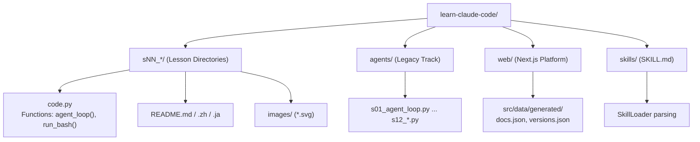
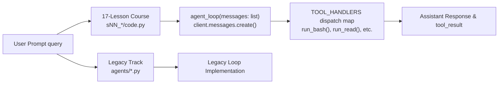

<!-- source: DeepWiki mcp.deepwiki.com · repo shareAI-lab/learn-claude-code · page 1 Overview · fetched 2026-10-29 -->

# Overview

Relevant source files

The following files were used as context for generating this wiki page:

- [README-ja.md](README-ja.md)
- [README-zh.md](README-zh.md)
- [README.md](README.md)
- [s01_agent_loop/README.ja.md](s01_agent_loop/README.ja.md)
- [s01_agent_loop/README.md](s01_agent_loop/README.md)
- [web/src/data/generated/docs.json](web/src/data/generated/docs.json)
- [web/src/data/generated/versions.json](web/src/data/generated/versions.json)

`learn-claude-code` is a pedagogical harness-engineering project exploring the core philosophy that **the model is the agent**, while everything else—tools, knowledge, observation mechanisms, action interfaces, and permissions—forms the harness [README.md:7-11](). This wiki page provides a high-level overview of the 17-lesson progressive course (`s01`–`s17`), the legacy `agents/` reference track, the web learning platform, and repository organization.

For detailed information, please refer to the child pages:
- [Repository Structure](#1.1) — Organization of lesson directories, `agents/`, `docs/`, `skills/`, `tests/`, and `web/`.
- [Lesson Tracks: 17-Lesson Course vs Legacy 12-Lesson agents/](#1.2) — Comparison and mapping between the current 17-lesson progressive course and the legacy track.

Sources: [README.md:7-11](), [README.md:162-187]()

---

## 1.1. Repository Structure

The repository is organized to support both standalone Python lesson scripts and an interactive web learning platform. Each lesson under `sNN_*/` contains an executable script (`code.py`), multilingual documentation (`README.md`, `README.zh.md`, `README.ja.md`), and generated architecture diagrams under `images/` [web/src/data/generated/versions.json:1-38](). 

The supporting directories include `agents/` for reference script implementations, `docs/` for historical essays, `skills/` for on-demand knowledge injection (`SKILL.md`), `tests/` for the `pytest` test suite, and `web/` for the Next.js learning platform [README.md:289-297](). For detailed breakdowns of how these directories interrelate, see [Repository Structure](#1.1).

**Diagram: Repository Directory and Code Entity Bridge**

Sources: [web/src/data/generated/versions.json:1-38](), [README.md:289-297]()

---

## 1.2. Lesson Tracks: 17-Lesson Course vs Legacy 12-Lesson agents/

The repository features two distinct historical tracks reflecting the evolution of the codebase. The current progressive course consists of 17 lessons (`s01` through `s17`) structured around standalone directories (`s01_agent_loop/code.py`, `s02_tool_use/code.py`, etc.), focusing on modular harness components like tool dispatch, permission gates, context compaction, and multi-agent teams [README.md:162-187](). 

The legacy track (`agents/` and `docs/`) contains earlier reference implementations and essays detailing the mental models of coding agent loops [README.md:289-297](). For a comprehensive mapping table translating between the legacy scripts and the current 17-lesson structure, see [Lesson Tracks: 17-Lesson Course vs Legacy 12-Lesson agents/](#1.2).

**Diagram: Lesson Track Architecture and Execution Flow**

Sources: [web/src/data/generated/versions.json:1-38](), [README.md:162-187]()

---

