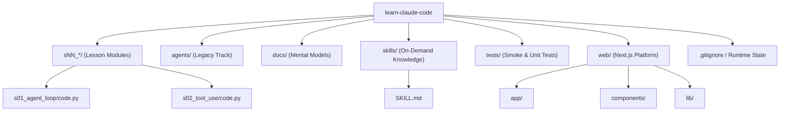
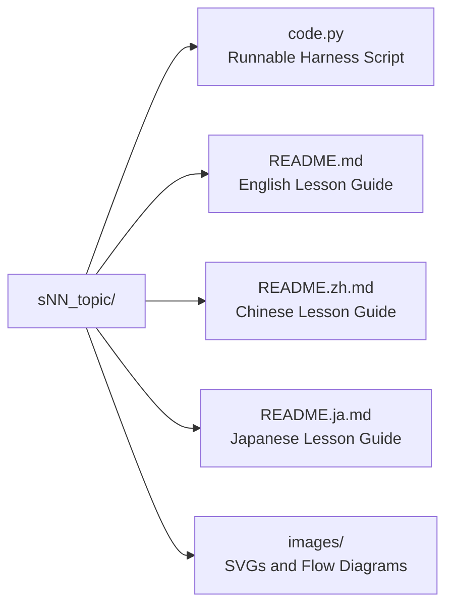
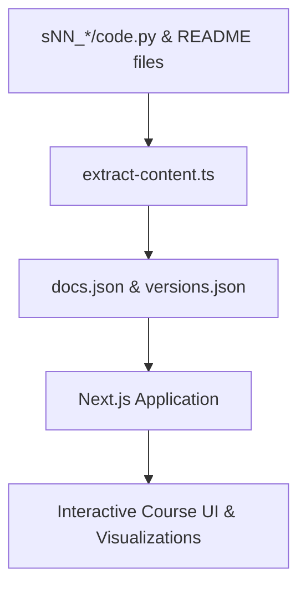

<!-- source: DeepWiki mcp.deepwiki.com · repo shareAI-lab/learn-claude-code · page 1.1 Repository Structure · fetched 2026-10-29 -->

# Repository Structure

Relevant source files

The following files were used as context for generating this wiki page:

- [CONTRIBUTING.md](CONTRIBUTING.md)
- [README-ja.md](README-ja.md)
- [README-zh.md](README-zh.md)
- [README.md](README.md)
- [s01_agent_loop/README.ja.md](s01_agent_loop/README.ja.md)
- [s01_agent_loop/README.md](s01_agent_loop/README.md)

This page documents the physical organization of the `learn-claude-code` repository, mapping top-level directories, lesson modules, runtime states, and tooling platforms to their pedagogical and functional purposes.

---

## Purpose and Scope

The repository serves as a pedagogical harness-engineering project designed to teach how to build production-grade agent harnesses around large language models. The file structure is partitioned into self-contained lesson directories (`sNN_*/`), legacy reference scripts (`agents/`), multi-lingual documentation (`docs/`), skill definitions (`skills/`), automated test suites (`tests/`), and an interactive web learning platform (`web/`). 

Sources: [README.md:5-12](), [CONTRIBUTING.md:1-4]()

---

## Top-Level Directory Overview

The repository root orchestrates both runtime educational content and the interactive Next.js web application.

### Title: Repository Physical Architecture

| Directory Path | Functional Purpose | Key Artifacts |
|----------------|--------------------|---------------|
| `sNN_*/` | Progressive course chapters (s01 to s17) | `code.py`, `README.md`, `README.zh.md`, `README.ja.md`, `images/` |
| `agents/` | Legacy reference implementation track | Single-file session scripts (`s01_agent_loop.py`, etc.) |
| `docs/` | Mental-model essays and architectural deep dives | Language subdirectories (`en/`, `zh/`, `ja/`) |
| `skills/` | On-demand knowledge catalogs | Subdirectories containing `SKILL.md` frontmatter and guides |
| `tests/` | Automated test infrastructure | Smoke tests and workflow verification scripts |
| `web/` | Interactive Next.js learning platform | Course visualizer, i18n message catalogs, content generators |

Sources: [README.md:1-11](), [CONTRIBUTING.md:1-5]()

---

## Lesson Modules (`sNN_*/`)

The core pedagogical engine of the repository resides in the `sNN_*` lesson directories (such as `s01_agent_loop/`, `s02_tool_use/`, etc.). Each lesson directory is fully self-contained.

### Title: Lesson Directory Anatomy

- **`code.py`**: The canonical, minimalist executable implementation of the lesson's core harness concept (e.g., event loops, permission gates, or skill injectors).
- **`README.md`, `README.zh.md`, `README.ja.md`**: Trilingual pedagogical guides explaining the problem, solution, and step-by-step code mechanics [CONTRIBUTING.md:9-10]().
- **`images/`**: Architectural SVGs and sequence charts (such as `agent-loop.en.svg`) embedded in the markdown documentation [s01_agent_loop/README.md:26-26]().

Sources: [CONTRIBUTING.md:3-10](), [s01_agent_loop/README.md:26-28]()

---

## Reference and Support Directories

Beyond the progressive lessons, several functional subsystems support development, testing, and multi-agent operations.

### Agents Track (`agents/`)
Contains historical or flattened reference scripts mirroring the progressive chapters, allowing quick execution without traversing nested chapter folders.

### Skills System (`skills/`)
Houses modular capability packages. Each subdirectory contains a `SKILL.md` file featuring YAML frontmatter and instructional markdown loaded dynamically into the agent's context pool during execution [README.md:73-75]().

### Testing Infrastructure (`tests/`)
Contains automated verification scripts, such as smoke tests that compile all agent implementations via Python's `py_compile` module to guarantee zero syntax regressions [tests/test_agents_smoke.py:10-19]().

### Runtime State Directories (Git-Ignored)
During agent execution, several local state folders are generated to manage tasks, memory, and parallel worktrees. These directories are strictly excluded via `.gitignore`:
- `.tasks/`: File-backed task graphs with dependency tracking.
- `.memory/`: Durable cross-session memory storage and index files.
- `.team/`: JSONL mailboxes and inter-agent communication logs.
- `.worktrees/`: Git worktree bindings for parallel agent execution lanes.

Sources: [CONTRIBUTING.md:1-11](), [tests/test_agents_smoke.py:10-19]()

---

## Web Learning Platform (`web/`)

The `web/` directory hosts the Next.js application powering the interactive documentation and course visualizer. 

### Title: Web Platform Data Flow

- **Content Pipeline**: Scripts like `extract-content.ts` parse lesson source code and markdown documents into structured assets (`docs.json`, `versions.json`) consumed by the Next.js frontend.
- **Components & Layouts**: Organized under `web/src/components/`, providing code viewers, execution flow visualizers, and multi-language routing catalogs (`en`, `zh`, `ja`).

Sources: [README.md:1-5]()

---

