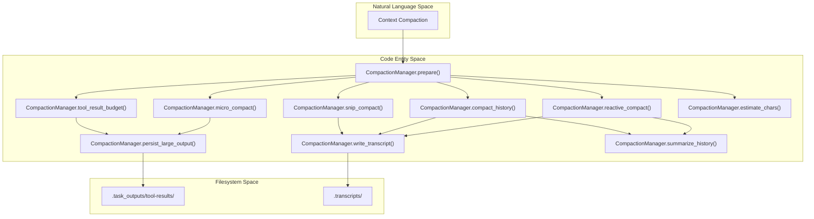
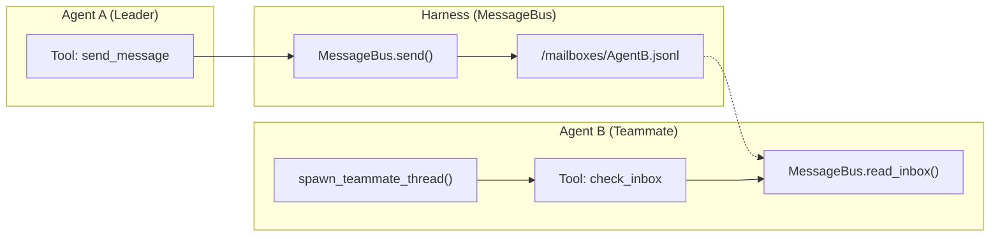

<!-- source: DeepWiki mcp.deepwiki.com · repo shareAI-lab/learn-claude-code · page 10 Glossary · fetched 2026-10-29 -->

# Glossary

Relevant source files

The following files were used as context for generating this wiki page:

- [README-ja.md](README-ja.md)
- [README-zh.md](README-zh.md)
- [README.md](README.md)
- [agents/s08_background_tasks.py](agents/s08_background_tasks.py)
- [agents/s_full.py](agents/s_full.py)
- [s01_agent_loop/README.ja.md](s01_agent_loop/README.ja.md)
- [s01_agent_loop/README.md](s01_agent_loop/README.md)
- [s08_context_compact/README.ja.md](s08_context_compact/README.ja.md)
- [s08_context_compact/README.md](s08_context_compact/README.md)
- [s08_context_compact/README.zh.md](s08_context_compact/README.zh.md)
- [tests/test_compaction_tool_pairs.py](tests/test_compaction_tool_pairs.py)
- [tests/test_s_full_background.py](tests/test_s_full_background.py)

This page defines codebase-specific terms, jargon, and architectural concepts used throughout the `learn-claude-code` repository. It provides technical detail on how these concepts are implemented in the harness and how they relate to the underlying model's agency.

## Core Definitions

### Agent vs. Harness
The fundamental philosophy of this repository is that **the model is the agent** [README.md:8-13](). The "Agent" is the trained neural network capable of reasoning and decision-making. The "Harness" is the surrounding Python infrastructure that provides the model with an environment to operate in [README.md:50-60]().

| Term | Responsibility | Code Entities |
| :--- | :--- | :--- |
| **Agent** | Decision making, reasoning, tool selection | `Anthropic` client, `MODEL_ID` |
| **Harness** | Tool execution, file I/O, context management, safety | `TOOL_HANDLERS`, `TaskManager`, `safe_path` |

**Sources:** [README.md:1-78](), [README-zh.md:1-79](), [README-ja.md:1-79]()

### The Agent Loop
The fundamental while-loop pattern that powers all sessions. It continues as long as the model's `stop_reason` is `tool_use` [s01_agent_loop/README.md:30-33](). In each iteration, the harness sends the current `messages` to the LLM, parses the requested tool calls, executes them via `TOOL_HANDLERS`, and appends the `tool_result` back to the history [s01_agent_loop/README.md:91-114]().

**Sources:** [s01_agent_loop/README.md:24-114](), [s01_agent_loop/README.zh.md:24-114](), [s01_agent_loop/README.ja.md:24-114]()

### tool_use / tool_result
These are specific message block types used in the Anthropic Messages API to enable tool interaction.
*   `tool_use`: A block within an assistant's response indicating the model wants to call a tool. It contains the tool's `name` and `input` parameters [s01_agent_loop/README.md:60-62]().
*   `tool_result`: A block within a user's message containing the output of a tool execution. It includes the `tool_use_id` to link back to the original tool call and the `content` of the result [s01_agent_loop/README.md:76-79]().

**Sources:** [s01_agent_loop/README.md:59-80](), [s01_agent_loop/README.zh.md:59-80](), [s01_agent_loop/README.ja.md:59-80]()

## Architectural Components

### Tool Dispatch Architecture
The mechanism for mapping LLM tool requests to Python functions. It consists of two parts:
1.  **Tool Definitions (`TOOLS`)**: JSON schemas that describe the tool's name, description, and input parameters to the model [agents/s08_background_tasks.py:178-182]().
2.  **Tool Handlers (`TOOL_HANDLERS`)**: A dictionary mapping tool names to executable Python functions [agents/s08_background_tasks.py:169-176]().

**Sources:** [agents/s08_background_tasks.py:169-182]()

### Hooks
A system for registering and executing custom functions at specific points in the agent's lifecycle. This allows for extending agent behavior without modifying the core agent loop. Examples include `UserPromptSubmit`, `PreToolUse`, `PostToolUse`, and `Stop` hooks.

### Deny List
A security mechanism, primarily implemented in `run_bash`, that explicitly blocks dangerous shell commands (e.g., `rm -rf /`, `sudo`, `shutdown`) to prevent the agent from executing destructive operations [agents/s_full.py:87-89]().

**Sources:** [agents/s_full.py:87-89]()

### Context Compression Pipeline
A multi-layer strategy to manage the finite context window of the LLM, enabling "infinite" sessions [s08_context_compact/README.md:6-8]().

1.  **snip_compact**: Trims the middle of the conversation history while preserving the first few messages (initial context) and the most recent turns. It archives the removed messages to `.transcripts/` [s08_context_compact/README.md:90-111]().
2.  **micro_compact**: Replaces the content of older `tool_result` blocks with a one-line placeholder to save tokens. Before replacement, the full content is saved to disk, and the placeholder includes a recovery path [s08_context_compact/README.md:119-138]().
3.  **tool_result_budget**: Persists large tool outputs (e.g., big file reads) to disk in `.task_outputs/tool-results/`, leaving only a preview and a marker in the context [s08_context_compact/README.md:48-84]().
4.  **compact_history**: A full LLM-generated summary that replaces the entire message history when token thresholds are exceeded. This involves an additional model call to summarize the conversation [s08_context_compact/README.md:145-172]().
5.  **Reactive Compact**: An emergency trim triggered if the API returns a `prompt_too_long` error. It saves the transcript, summarizes older history, and retains only the most recent messages [s08_context_compact/README.md:203-220]().

**Sources:** [s08_context_compact/README.md:34-220](), [s08_context_compact/README.zh.md:32-220](), [s08_context_compact/README.ja.md:32-220]()

### active_request
The current user prompt or goal that the agent is working on. This is explicitly passed to the agent loop and compaction functions to ensure it is preserved and highlighted, especially during `compact_history` [s08_context_compact/README.md:166-172]().

**Sources:** [s08_context_compact/README.md:166-172](), [s08_context_compact/README.zh.md:166-172](), [s08_context_compact/README.ja.md:166-172]()

### Orphaned Tool Result
A `tool_result` message that does not have a preceding `tool_use` message from the assistant. This can happen if compaction logic incorrectly separates a `tool_use`/`tool_result` pair, leading to an invalid API request [s08_context_compact/README.md:112-113](). The `snip_compact` and `reactive_compact` functions are designed to prevent this by protecting these pairs [s08_context_compact/README.md:101-105]().

**Sources:** [s08_context_compact/README.md:101-113](), [s08_context_compact/README.zh.md:101-113](), [s08_context_compact/README.ja.md:101-113](), [tests/test_compaction_tool_pairs.py:119-128]()

### MEMORY.md
A special Markdown file within the `.memory/` directory that serves as an index or summary of the agent's long-term memories. It often contains YAML frontmatter for metadata and links to more detailed memory files.

### blockedBy
A field in a task's metadata (e.g., in a `.tasks/*.json` file) that specifies dependencies on other tasks. A task cannot be started or completed if it is `blockedBy` another incomplete task.

### Worktree Binding
The practice of associating a Git worktree with a specific task. This allows agents to work on multiple tasks in parallel, each in its isolated environment, preventing conflicts and ensuring task-specific context.

### MessageBus
A component responsible for handling inter-agent communication, primarily through a file-based inbox system. It manages sending, receiving, and broadcasting messages between teammates [agents/s_full.py:147-151]().

**Sources:** [agents/s_full.py:147-151](), [tests/test_s_full_background.py:147-151]()

### ProtocolState
The current state of a multi-agent communication protocol, often used in team coordination to manage complex interactions like plan approvals or shutdown handshakes. It ensures agents follow a predefined sequence of communication.

### GoalController
A component responsible for evaluating the agent's progress towards a defined goal. It determines if a goal has been `achieved`, needs to be `deferred`, has `failed`, or if a `limit` has been reached, influencing the agent loop's termination.

### MCP Tool Pool
Refers to the collection of tools discovered and made available through the Model Context Protocol (MCP). MCP allows agents to dynamically discover and integrate tools from external services, forming a unified tool pool.

### Skill Catalog
A list of available skills (specialized knowledge or capabilities) that the agent can load on demand. This catalog is typically injected into the system prompt, allowing the model to know what skills are available without loading their full content into context [README-zh.md:98]().

**Sources:** [README-zh.md:98](), [README-ja.md:98]()

### Drain
The process of retrieving all pending notifications or messages from a queue or inbox. For example, `drain_notifications` in `BackgroundManager` retrieves all completed background task results [agents/s08_background_tasks.py:109-114](). Similarly, `MessageBus.read_inbox` drains messages from an agent's inbox.

**Sources:** [agents/s08_background_tasks.py:109-114](), [tests/test_s_full_background.py:91-92]()

### Plan Gate
A mechanism in multi-agent systems where a proposed plan from one agent requires approval (e.g., from a user or another agent) before execution. This acts as a control point to prevent unintended actions.

## Diagrams

### Natural Language to Code Entity Mapping: Context Compaction
This diagram illustrates how the natural language concept of "Context Compaction" maps to the specific functions and files within the codebase.

**Sources:** [s08_context_compact/README.md:184-193](), [s08_context_compact/README.zh.md:184-193](), [s08_context_compact/README.ja.md:184-193]()

### Data Flow: Multi-Agent Coordination
This diagram bridges the concept of "Team Communication" to the `MessageBus` implementation and teammate thread spawning.

"Team Coordination Flow"

**Sources:** [agents/s_full.py:75-76](), [agents/s_full.py:75-76]()

## Technical Terms Table

| Term | Implementation | Description |
| :--- | :--- | :--- |
| **Safe Path** | `safe_path(p)` | Validates that a file path is within the `WORKDIR` to prevent directory traversal attacks [agents/s_full.py:80-84](). |
| **Dangerous Command** | `run_bash` check | A blacklist of commands (e.g., `rm -rf /`, `sudo`) blocked by the harness [agents/s_full.py:87-89](). |
| **Stop Reason** | `response.stop_reason` | The API field indicating why the model stopped (e.g., `tool_use` or `end_turn`) [s01_agent_loop/README.md:30-33](). |
| **Task Board** | `.tasks/` directory | Persistent JSON files representing the state of the project, surviving context compression. |
| **Dream** | `consolidate_memories` | The background process of merging, deduplicating, and pruning persistent memory files. |
| **Todo Nag** | `TodoManager.render()` | A mechanism to append the current todo list to every prompt, ensuring the agent stays on task [agents/s_full.py:148-158](). |

**Sources:** [agents/s_full.py:80-158](), [s01_agent_loop/README.md:30-33]()