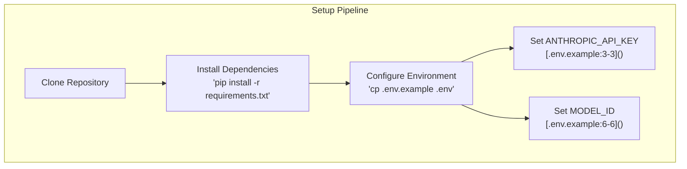
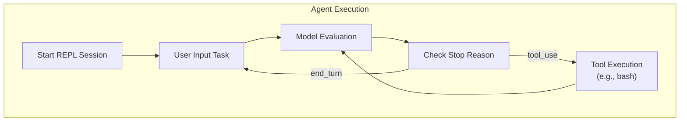

<!-- source: DeepWiki mcp.deepwiki.com · repo shareAI-lab/learn-claude-code · page 2 Getting Started · fetched 2026-10-29 -->

# Getting Started

Relevant source files

The following files were used as context for generating this wiki page:

- [.env.example](.env.example)
- [requirements.txt](requirements.txt)

This section guides you through setting up your development environment and running your first AI agent. By the end of this setup, you will understand how to configure your API credentials and execute the foundational agent loop.

For detailed setup instructions, see [Prerequisites and Installation](#2.1). For a walkthrough of your first execution, see [Running Your First Agent](#2.2).

---

## 2.1. Prerequisites and Installation

Setting up the repository requires configuring Python dependencies and environment variables for the Anthropic API (or an Anthropic-compatible provider). The environment template [.env.example:1-77]() defines the required `ANTHROPIC_API_KEY` and `MODEL_ID` settings, along with optional base URLs for alternative providers. Python dependencies are specified in [requirements.txt:1-3](), including `anthropic`, `python-dotenv`, and `pyyaml`.

For details, see [Prerequisites and Installation](#2.1).

### Setup Pipeline Overview

**Sources:** [.env.example:1-77](), [requirements.txt:1-3]()

---

## 2.2. Running Your First Agent

Once the environment is configured, you can execute the foundational agent loop to interact with the model via a command-line REPL. The course implementations demonstrate the minimal harness—connecting model tool use directly to local system execution.

For details, see [Running Your First Agent](#2.2).

### Execution Flow Overview

**Sources:** [.env.example:1-77](), [requirements.txt:1-3]()

---

