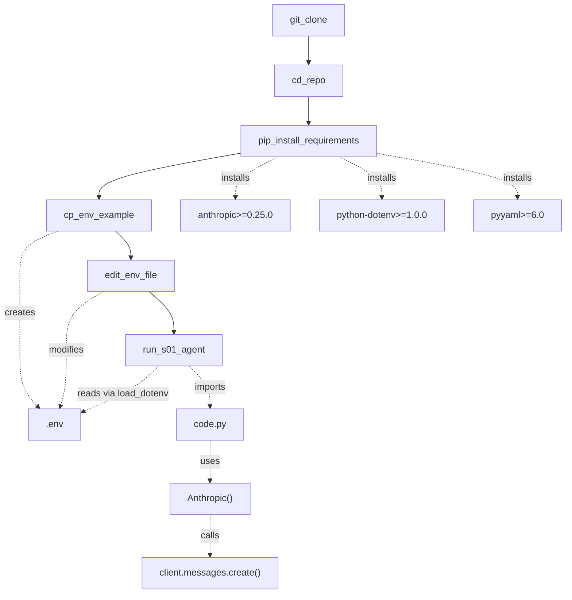
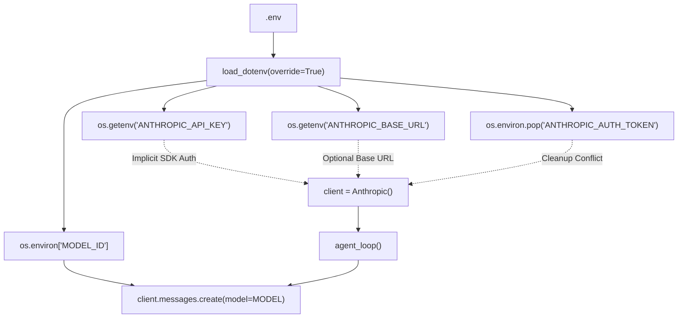

<!-- source: DeepWiki mcp.deepwiki.com · repo shareAI-lab/learn-claude-code · page 2.1 Prerequisites and Installation · fetched 2026-10-29 -->

# Prerequisites and Installation

<details>
<summary>Relevant source files</summary>

The following files were used as context for generating this wiki page:

- [.env.example](.env.example)
- [.gitignore](.gitignore)
- [requirements.txt](requirements.txt)

</details>


This page covers environment setup, dependency installation, API configuration, and verification steps for running the `learn-claude-code` repository. The setup process enables the progressive learning sessions, reference agent implementations, and the optional web learning platform.

---

## Prerequisites

### System Requirements

| Component | Minimum Version | Purpose | Notes |
|-----------|----------------|---------|-------|
| Python | 3.11+ | Agent runtime | Version 3.11+ required for modern type hinting and async constructs. |
| pip | Latest | Package installation | Bundled with Python |
| Git | Any recent version | Repository cloning | Required for cloning and worktree features |
| API Key | N/A | Model access | Anthropic API key or compatible provider key |
| Node.js | 20+ | Web platform | Required for building and running the web UI. |
| npm | Latest | Web dependencies | Bundled with Node.js |

### Python Dependencies

The repository requires exactly three primary Python packages, specified in `requirements.txt`:

- **`anthropic`** (>=0.25.0): Official SDK for model interaction and tool use (`anthropic.Anthropic`). [requirements.txt:1-1]()
- **`python-dotenv`** (>=1.0.0): Environment variable management via `dotenv.load_dotenv()`. [requirements.txt:2-2]()
- **`pyyaml`** (>=6.0): YAML parsing for skill frontmatter and configurations (`yaml.safe_load`). [requirements.txt:3-3]()

Sources: [requirements.txt:1-3]()

---

## Installation Process

### Diagram: Installation and Configuration Flow



Sources: [requirements.txt:1-3](), [.env.example:1-3]()

### Step 1: Clone Repository

```bash
git clone https://github.com/shareAI-lab/learn-claude-code
cd learn-claude-code
```

This creates a local copy containing the agent implementations, documentation, tests, and the `skills/` directory which holds `SKILL.md` files used by the skill loading system.

### Step 2: Install Python Dependencies

```bash
pip install -r requirements.txt
```

This ensures the `anthropic` SDK, `python-dotenv`, and `pyyaml` are available in your active Python environment. [requirements.txt:1-3]()

### Step 3: Configure Environment Variables

```bash
cp .env.example .env
# Edit .env with your API key and model selection
```

The `.env` file is git-ignored (`[.gitignore:138-138]()`) and contains sensitive credentials. At minimum, you must set `ANTHROPIC_API_KEY` and `MODEL_ID`. [.env.example:1-6]()

Sources: [.env.example:1-6](), [.gitignore:138-138](), [requirements.txt:1-3]()

---

## Environment Configuration

### Diagram: Configuration Loading and Client Initialization



Sources: [.env.example:1-10]()

### Environment Variables

The system relies on configuration keys defined in `.env.example`:

| Variable | Required | Default | Usage |
|----------|----------|---------|-------|
| `ANTHROPIC_API_KEY` | **Yes** | None | Authenticates requests against the Anthropic API or compatible gateway. [.env.example:3-3]() |
| `MODEL_ID` | **Yes** | `claude-sonnet-4-6` | Specifies the model identifier passed to `client.messages.create()`. [.env.example:6-6]() |
| `ANTHROPIC_BASE_URL` | No | Anthropic default | Overrides the target endpoint for alternative providers (e.g., MiniMax, GLM, Kimi, DeepSeek). [.env.example:8-9]() |

#### Anthropic-Compatible Providers

The `.env.example` file provides configuration templates for alternative providers such as MiniMax, Zhipu GLM, Moonshot Kimi, and DeepSeek. When configuring an alternative provider, set both `ANTHROPIC_BASE_URL` and the corresponding `MODEL_ID`. [.env.example:11-77]()

Sources: [.env.example:1-77]()

---

## Verification

### Testing Your Installation

Verify your setup by executing the foundational agent session or running the test suite:

```bash
python s01_agent_loop/code.py
```

To run the test suite via `pytest`:

```bash
python -m pytest tests -q
```

### Common Configuration Errors

| Error Message | Root Cause | Solution |
|---------------|------------|----------|
| `ModuleNotFoundError: No module named 'anthropic'` | Missing python dependencies | Run `pip install -r requirements.txt` [requirements.txt:1-3]() |
| `KeyError: 'MODEL_ID'` | `MODEL_ID` not defined in environment | Add `MODEL_ID=claude-sonnet-4-6` to `.env` [.env.example:6-6]() |
| `AuthenticationError: 401` | Invalid or missing API key | Verify `ANTHROPIC_API_KEY` in `.env` [.env.example:3-3]() |

Sources: [requirements.txt:1-3](), [.env.example:3-6]()

---

## Web Learning Platform (Optional)

The repository includes an interactive Next.js web platform located under the `web/` directory for visualizing agent workflows and course materials.

### Local Web Platform Setup

```bash
cd web
npm install
npm run build
npm run dev
```

The web build pipeline is validated via continuous integration checks as defined in workflow configurations.

Sources: [.gitignore:226-229]()

---

