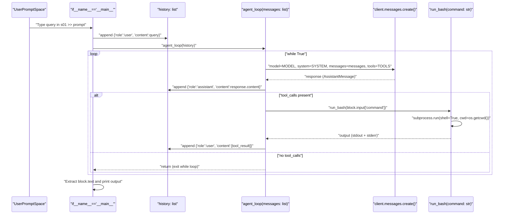
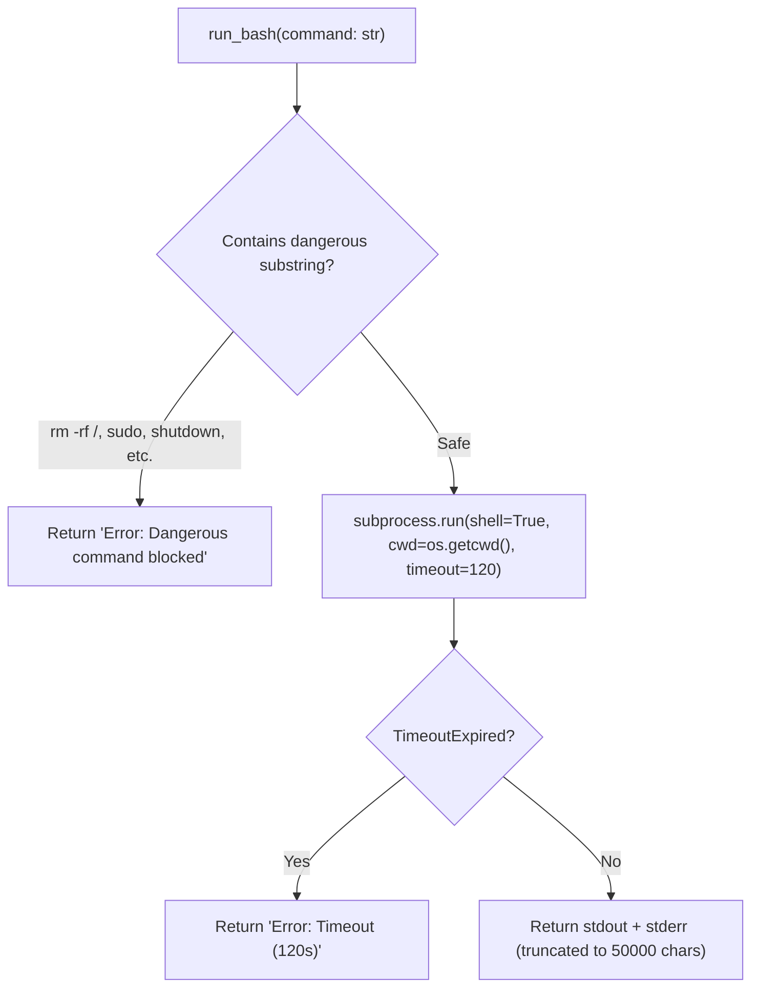
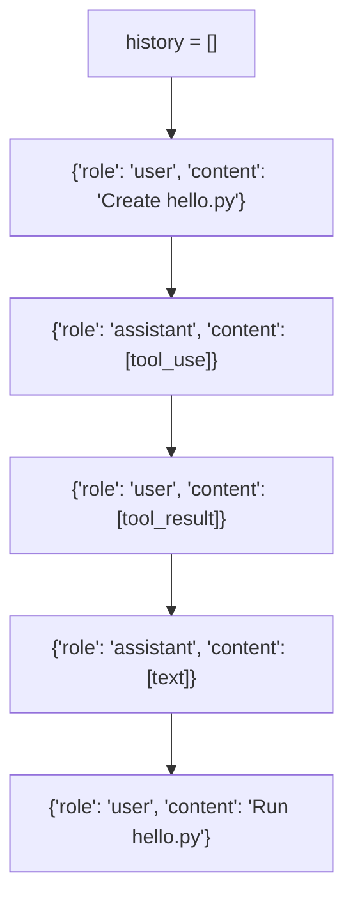

<!-- source: DeepWiki mcp.deepwiki.com · repo shareAI-lab/learn-claude-code · page 2.2 Running Your First Agent · fetched 2026-10-29 -->

# Running Your First Agent

<details>
<summary>Relevant source files</summary>

The following files were used as context for generating this wiki page:

- [agents/s01_agent_loop.py](agents/s01_agent_loop.py)
- [agents/s02_tool_use.py](agents/s02_tool_use.py)
- [agents/s04_subagent.py](agents/s04_subagent.py)
- [s01_agent_loop/README.zh.md](s01_agent_loop/README.zh.md)
- [s01_agent_loop/code.py](s01_agent_loop/code.py)

</details>


This page walks through executing `s01_agent_loop/code.py` and its legacy counterpart `agents/s01_agent_loop.py` — the minimal agent implementations that capture the foundational loop pattern. By running these scripts and observing their behavior, you will understand how the agent loop operates: message accumulation, tool execution, and stop condition checking.

For environment setup (API keys, `.env`, dependencies), see [2.1 Prerequisites and Installation](). For a conceptual explanation of the agent loop pattern, see [3.2 The Agent Loop Pattern]().

Sources: [s01_agent_loop/code.py:1-30](), [agents/s01_agent_loop.py:1-25]()

---

## Prerequisites Check

Before running the agent, verify your environment settings and file paths:

| Requirement | Check Command | Expected Result |
|------------|---------------|-----------------|
| Environment variables | `grep MODEL_ID .env` | Returns `MODEL_ID=claude-3-5-sonnet-20241022` or similar |
| API key | `grep ANTHROPIC_API_KEY .env` or check `ANTHROPIC_BASE_URL` | Valid key or base URL set |
| Dependencies | `pip list | grep anthropic` | Shows `anthropic` package installed |
| Lesson path | `ls s01_agent_loop/code.py` | File exists |

Sources: [s01_agent_loop/code.py:46-55]()

---

## Starting s01: The Minimal Agent

The `s01_agent_loop/code.py` script (and its legacy equivalent `agents/s01_agent_loop.py`) represents the smallest complete agent: one tool (`bash`), one loop (`agent_loop()`), and a Read-Eval-Print Loop (REPL). Launch it from the repository root:

```bash
python s01_agent_loop/code.py
```

The cyan prompt appears:

```
s01 >>
```

Type a task and press Enter. The agent submits the message to Claude, which decides whether to call the `bash` tool or return text. Tool calls execute, results append to the conversation history, and the loop continues until Claude returns a response without a `tool_use` stop reason.

**Example Session:**

```
s01 >> list the files in this directory

$ ls -la
total 48
drwxr-xr-x  8 user user 4096 Jan 10 12:00 .
drwxr-xr-x 20 user user 4096 Jan 10 11:59 ..
drwxr-xr-x  2 user user 4096 Jan 10 12:00 s01_agent_loop
-rw-r--r--  1 user user 1234 Jan 10 12:00 README.md
...

Here are the files in the current directory: s01_agent_loop/, docs/, web/, skills/, README.md, ...
```

**Output Conventions:**
- Shell commands appear in yellow (`\033[33m$ command\033[0m`) [s01_agent_loop/code.py:107]()
- Command output is truncated to 200 characters in the terminal display [s01_agent_loop/code.py:109]()
- Agent text responses print after all tool calls complete [s01_agent_loop/code.py:137-142]()

Sources: [s01_agent_loop/code.py:121-142](), [agents/s01_agent_loop.py:104-121]()

---

## The Agent Loop in Action

### Execution Flow Through Code Entities

The script's operation bridges natural language queries to concrete function execution through three core Python objects: `history` (the message list), `agent_loop()` (the loop driver), and `run_bash()` (the tool handler).

Title: s01 Execution Path From Natural Language to Code Entities



**Key Code Entities:**
- `history: list` — accumulates all messages across turns [s01_agent_loop/code.py:125]()
- `agent_loop(messages)` — the while-loop implementation at [s01_agent_loop/code.py:87-118]()
- `client.messages.create()` — Anthropic API invocation at [s01_agent_loop/code.py:89-92]()
- `run_bash(command)` — subprocess execution wrapper at [s01_agent_loop/code.py:71-84]()
- `TOOLS` — single-tool configuration list at [s01_agent_loop/code.py:59-67]()

Sources: [s01_agent_loop/code.py:71-118]()

### The while True Loop Structure

The `agent_loop()` function implements the fundamental state-machine iteration:

```python
def agent_loop(messages: list):
    while True:
        response = client.messages.create(
            model=MODEL, system=SYSTEM, messages=messages,
            tools=TOOLS, max_tokens=8000,
        )

        # Append assistant turn
        messages.append({"role": "assistant", "content": response.content})

        # If the model didn't call a tool, we're done
        tool_calls = [
            block for block in response.content if block.type == "tool_use"
        ]
        if not tool_calls:
            return

        # Execute each tool call, collect results
        results = []
        for block in tool_calls:
            print(f"\033[33m$ {block.input['command']}\033[0m")
            output = run_bash(block.input["command"])
            print(output[:200])
            results.append({
                "type": "tool_result",
                "tool_use_id": block.id,
                "content": output,
            })

        # Feed tool results back, loop continues
        messages.append({"role": "user", "content": results})
```

**Loop Invariants:**
- The `messages` list strictly alternates between `role: user` and `role: assistant` [s01_agent_loop/code.py:95, 117]()
- Every `tool_use` block produces a corresponding `tool_result` block carrying the identical `tool_use_id` [s01_agent_loop/code.py:111-113]()
- The loop terminates when `tool_calls` is empty — indicating the model completed its goal and returned pure text [s01_agent_loop/code.py:98-102]()

Sources: [s01_agent_loop/code.py:87-118]()

---

## Tool Schema and Tool Execution

### The TOOLS List and Tool Schema Format

The `TOOLS` list at [s01_agent_loop/code.py:59-67]() defines the capability surface exposed to Claude:

```python
TOOLS = [{
    "name": "bash",
    "description": "Run a shell command.",
    "input_schema": {
        "type": "object",
        "properties": {"command": {"type": "string"}},
        "required": ["command"],
    },
}]
```

**Schema Components:**
- `name` — The exact identifier matched by the model in `tool_use` blocks.
- `description` — Semantic instruction to guide the model on when and how to invoke the tool.
- `input_schema` — JSON Schema defining parameters required for execution.

Sources: [s01_agent_loop/code.py:59-67]()

### The run_bash() Tool Handler

The `run_bash()` function at [s01_agent_loop/code.py:71-84]() executes shell commands requested by the model:

Title: run_bash Safety and Subprocess Architecture



**Safety Mechanisms:**
- **Dangerous command blocklist**: intercepts patterns like `rm -rf /`, `sudo`, `shutdown`, and `reboot` [s01_agent_loop/code.py:72-74]()
- **Timeout protection**: limits subprocess execution to 120 seconds [s01_agent_loop/code.py:77, 80]()
- **Output truncation**: bounds output size to 50,000 characters [s01_agent_loop/code.py:78]()
- **Working directory constraint**: runs commands within `os.getcwd()` [s01_agent_loop/code.py:76]()

Sources: [s01_agent_loop/code.py:71-84]()

---

## REPL Session Management

### Input Loop and Exit Conditions

The REPL entry point at [s01_agent_loop/code.py:121-142]() manages user interaction:

```python
if __name__ == "__main__":
    print("s01: Agent Loop")
    print("Enter a question, press Enter to send. Type q to quit.\n")

    history = []
    while True:
        try:
            query = input("\033[36ms01 >> \033[0m")
        except (EOFError, KeyboardInterrupt):
            break
        if query.strip().lower() in ("q", "exit", ""):
            break
        history.append({"role": "user", "content": query})
        agent_loop(history)
```

**Exit Methods:**

| Input / Signal | Condition Checked | Action |
|----------------|-------------------|--------|
| `q` | `query.strip().lower() == "q"` | Clean exit from REPL |
| `exit` | `query.strip().lower() == "exit"` | Clean exit from REPL |
| Enter (Empty) | `query.strip() == ""` | Clean exit from REPL |
| `Ctrl+C` | `KeyboardInterrupt` exception | Caught, clean exit |
| `Ctrl+D` | `EOFError` exception | Caught, clean exit |

Sources: [s01_agent_loop/code.py:121-134]()

### Conversation State: The history List

The `history` list accumulates conversation messages across REPL turns.

Title: Conversation History Growth Across Turns



**Conversation Memory Properties:**
- Every turn appends user queries, assistant tool requests, and tool execution results [s01_agent_loop/code.py:95, 117, 134]().
- Strictly preserves alternating user/assistant message order required by the Anthropic API.
- Lacks compression; as turns accumulate, token consumption increases (addressed later in [4.5 Context Compaction]()).

Sources: [s01_agent_loop/code.py:87-142]()

---

## What to Try Next

| Goal | Script Reference | Corresponding Documentation |
|------|------------------|---------------------------|
| Expand tool dispatch maps for multiple tools | `python s02_tool_use/code.py` | [4.1 s01–s02: Agent Loop and Tool Use]() |
| Implement permission gates and hooks | `python s03_permission/code.py` | [4.2 s03–s04: Permission and Hooks]() |
| Run complete multi-feature reference harness | `python s15_integrated/code.py` | [4.11 s15: Integrated Harness]() |

Sources: [s01_agent_loop/code.py:1-30]()

---

