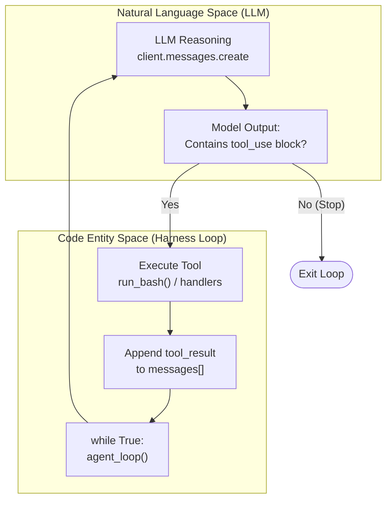
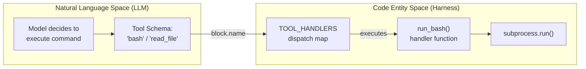
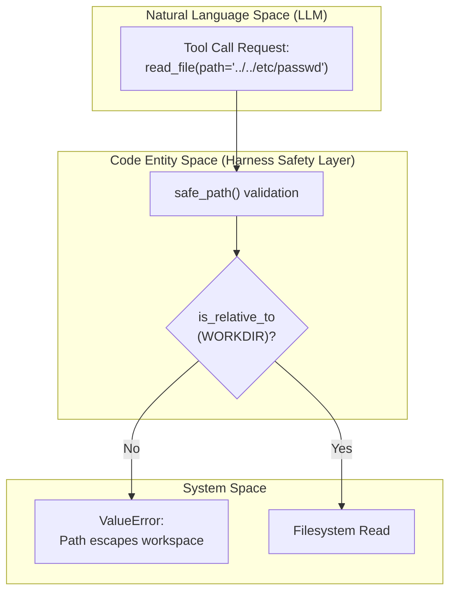

<!-- source: DeepWiki mcp.deepwiki.com · repo shareAI-lab/learn-claude-code · page 3 Core Concepts · fetched 2026-10-29 -->

# Core Concepts

Relevant source files

The following files were used as context for generating this wiki page:

- [README-ja.md](README-ja.md)
- [README-zh.md](README-zh.md)
- [README.md](README.md)
- [s01_agent_loop/README.ja.md](s01_agent_loop/README.ja.md)
- [s01_agent_loop/README.md](s01_agent_loop/README.md)

This page outlines the fundamental concepts underpinning every lesson in the `learn-claude-code` repository. These principles remain invariant across all progressive learning sessions, establishing how AI models and harness infrastructure interact.

For detailed technical breakdowns, see the respective child pages:
- [Philosophy: Agent vs Harness](#3.1)
- [The Agent Loop Pattern](#3.2)
- [Tool Dispatch Architecture](#3.3)
- [Security and Path Safety](#3.4)

---

## 3.1. Philosophy: Agent vs Harness

The central premise of this repository is that **Agency comes from the model, not the code.** [README.md:11-15]() An agent product is defined as a combination of the model (the driver providing intelligence and reasoning) and the harness (the vehicle providing tools, knowledge, observation interfaces, and permissions) [README.md:11-63]().

Harness engineering focuses on building robust operational environments rather than brittle prompt plumbing or hardcoded state machines [README.md:33-43](). By providing clean tools and boundaries, the harness enables the model to perceive and act effectively within a specific domain.

For details, see [Philosophy: Agent vs Harness](#3.1).

**Sources:** [README.md:5-63]()

---

## 3.2. The Agent Loop Pattern

The foundational mechanism of any agent is the repeating `while` loop that bridges the model's intent with external actions [s01_agent_loop/README.md:28-34](). The harness sends messages and tool definitions to the LLM via `client.messages.create`, inspects the response for `tool_use` blocks, executes the requested tools, and feeds the results back into the transcript [s01_agent_loop/README.md:43-114]().

### Diagram: The Agent Loop Lifecycle

This minimal loop runs across all sessions, serving as the core execution runtime upon which more advanced capabilities are built [s01_agent_loop/README.md:116]().

For details, see [The Agent Loop Pattern](#3.2).

**Sources:** [s01_agent_loop/README.md:28-116]()

---

## 3.3. Tool Dispatch Architecture

The harness connects the model to the real world through a tool dispatch architecture that separates LLM schema declarations from Python implementation handlers [agents/s04_subagent.py:97-102](). 

### Diagram: Bridging Model Intent to Code Execution

By maintaining a clean separation via dictionaries like `TOOL_HANDLERS`, new tools can be added to the harness without modifying the core agent loop logic.

For details, see [Tool Dispatch Architecture](#3.3).

**Sources:** [agents/s04_subagent.py:46-102]()

---

## 3.4. Security and Path Safety

Because agents possess powerful capabilities such as shell execution and file modification, the harness must enforce strict security boundaries [README.md:77-79](). Two critical mechanisms protect the host environment: path validation (`safe_path`) to prevent workspace breakouts and command filtering to block destructive operations [agents/s04_subagent.py:47-65]().

### Diagram: The Safety Harness

For details, see [Security and Path Safety](#3.4).

**Sources:** [agents/s04_subagent.py:47-65](), [README.md:77-79]()

---

