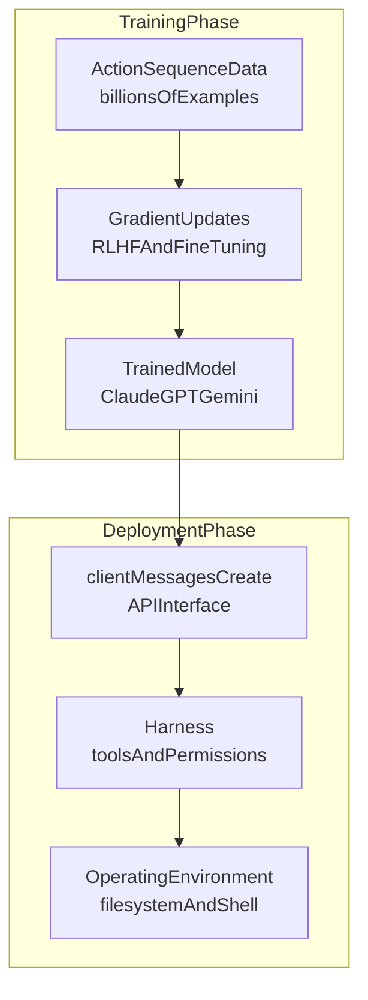
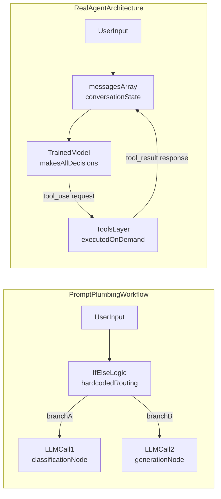
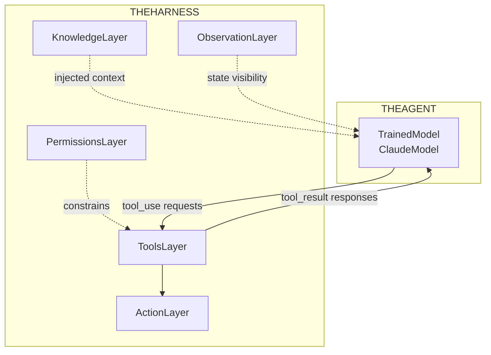
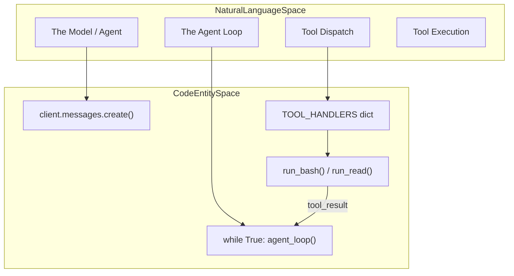
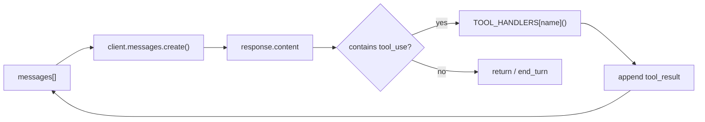

<!-- source: DeepWiki mcp.deepwiki.com · repo shareAI-lab/learn-claude-code · page 3.1 Philosophy: Agent vs Harness · fetched 2026-10-29 -->

# Philosophy: Agent vs Harness

<details>
<summary>Relevant source files</summary>

The following files were used as context for generating this wiki page:

- [README-ja.md](README-ja.md)
- [README-zh.md](README-zh.md)
- [README.md](README.md)
- [s01_agent_loop/README.ja.md](s01_agent_loop/README.ja.md)
- [s01_agent_loop/README.md](s01_agent_loop/README.md)

</details>


## Purpose and Scope

This page establishes the fundamental philosophical distinction that underlies the entire `learn-claude-code` architecture: **the model IS the agent**, and everything else is the harness. This principle determines how the codebase is designed, how components are separated, and how trust is allocated between trained intelligence and engineered infrastructure.

Understanding this distinction clarifies why lessons are structured progressively, why the core agent loop remains stable even as capabilities expand, and why engineering effort focuses on building tools and environments rather than attempting to script intelligence with brittle procedural logic.

Sources: [README.md:5-78]()

---

## What an Agent Is: The Trained Model

An agent is a neural network—a Transformer, an RNN, or a trained function—shaped by billions of gradient updates on action-sequence data to perceive an environment, reason about goals, and take actions [README.md:13-18](). Agency is learned through training, not bestowed by external code orchestration [README.md:11-16]().

Title: "The Agent is the Trained Model, Not Surrounding Code"

Sources: [README.md:13-32]()

### Historical Evidence

The historical record across reinforcement learning and LLM agent systems confirms that agency originates from the trained model:

| Year | System | Achievement | What Was the Agent? |
|------|--------|-------------|---------------------|
| 2013-2015 | DeepMind DQN | Played 49 Atari games, matched human experts [README.md:21-21]() | Single neural network trained on pixels + scores [README.md:21-21]() |
| 2019 | OpenAI Five | Defeated Dota 2 world champions (OG) 2-0 [README.md:23-23]() | Five neural networks trained through self-play [README.md:23-23]() |
| 2019 | DeepMind AlphaStar | Achieved Grandmaster in StarCraft II (top 0.15%) [README.md:25-25]() | Model trained on game state, not hand-coded strategies [README.md:25-25]() |
| 2019 | Tencent Jueyu | Defeated KPL pros in Honor of Kings 5v5 [README.md:27-27]() | Model trained through self-play [README.md:27-27]() |
| 2024-2025 | Claude / GPT / Gemini | Write code, debug, coordinate in teams [README.md:29-31]() | LLMs trained on human code and reasoning [README.md:29-31]() |

Sources: [README.md:16-32]()

---

## What an Agent Is NOT: Prompt Plumbing

The term "agent" is frequently misappropriated by prompt-plumbing systems—drag-and-drop workflow builders, no-code platforms, and procedural prompt chains that wire LLM API calls together with hardcoded `if-else` routing logic [README.md:33-41](). These systems are brittle and unscalable because they attempt to brute-force intelligence using procedural glue code [README.md:39-41]().

Title: "Prompt Plumbing vs Real Agent Architecture"

Sources: [README.md:33-43]()

---

## The Harness: Everything Else

When building agent products, engineers build the **harness**—the engineered environment that gives the model tools, knowledge, observation, action interfaces, and permissions [README.md:50-61]().

```
Harness = Tools + Knowledge + Observation + Action Interfaces + Permissions
```

Title: "Five Layers of the Harness"


| Layer | Purpose | Codebase Mechanism |
|-------|---------|--------------------|
| **Tools** | Agent's hands to act [README.md:73-74]() | `bash`, `read_file`, `write_file`, `edit_file`, `glob` [README-zh.md:97-97]() |
| **Knowledge** | Domain expertise available on demand [README.md:75-76]() | `skills/` directory, loaded via `SkillLoader` [README-zh.md:98-98]() |
| **Observation** | Environmental state visibility [README.md:58-58]() | Git diffs, error logs, file contents |
| **Action** | Execution mechanisms [README.md:59-59]() | Shell execution, API calls |
| **Permissions** | Safety constraints [README.md:79-80]() | Sandbox validation, deny lists, path safety |

Sources: [README.md:50-65](), [README-zh.md:73-81]()

---

## Architectural Boundaries and Code Mapping

The agent-harness distinction manifests directly in the codebase structure: the agent logic is encapsulated in model API calls, while the harness handles stateless iteration and tool dispatch [s01_agent_loop/README.md:111-116]().

Title: "Natural Language to Code Entity Mapping"

Sources: [README.md:50-65](), [s01_agent_loop/README.md:91-114]()

### The Agent Decision Loop

Title: "Decision Flow in agent_loop"

Sources: [s01_agent_loop/README.md:91-114]()

---

## Implications for Harness Engineers

Harness engineers do not implement intelligence; the model supplies that [README.md:68-83](). The harness engineer's role is to build a robust, safe, and observable operational environment:
- **Trust the Model:** Avoid complex procedural decision trees; provide clear tools and let the model determine execution paths [README.md:73-78]().
- **Isolate and Constrain:** Use sandboxing, permissions, and tool boundaries to ensure safe operation [README.md:79-80]().
- **Accumulate Trajectory Data:** Harness execution traces serve as valuable signals for improving future model iterations [README.md:81-82]().

Sources: [README.md:68-84]()

---

