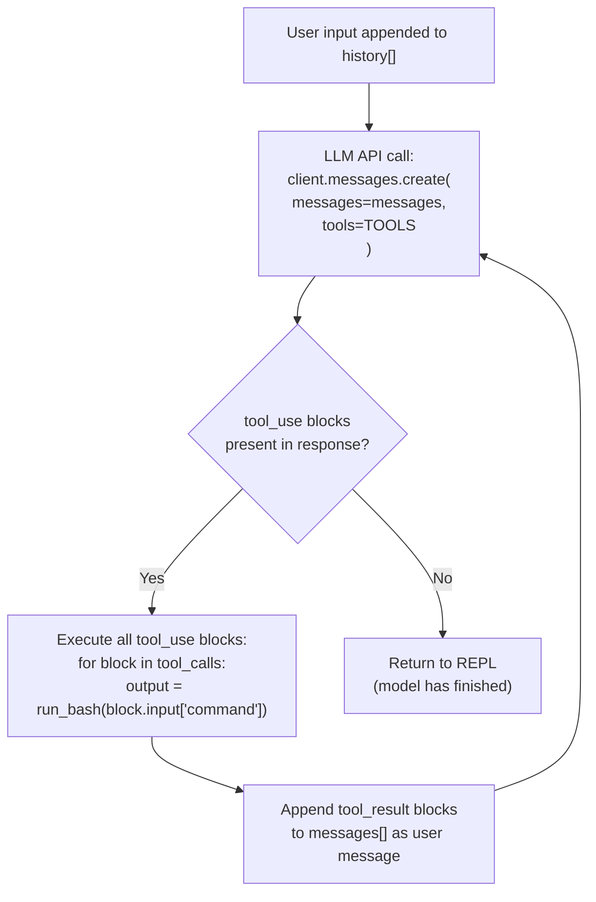
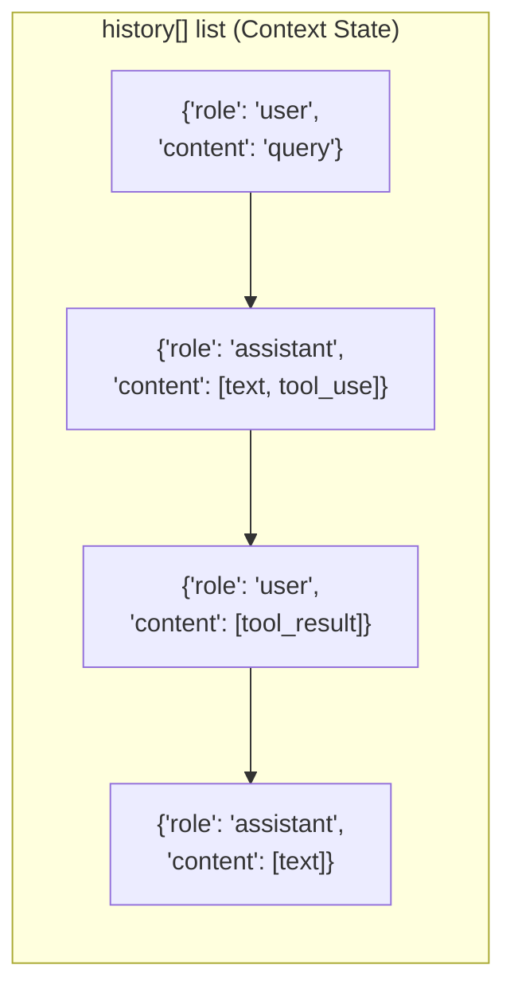
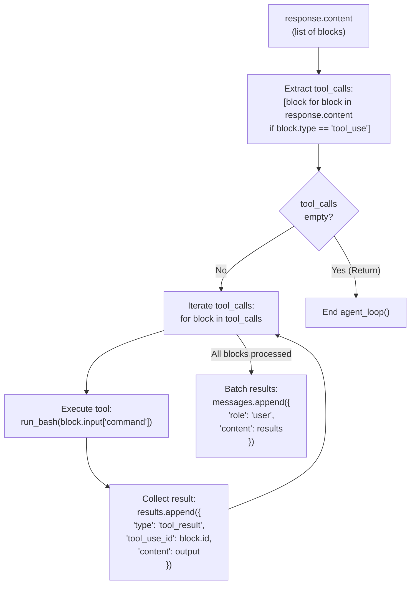
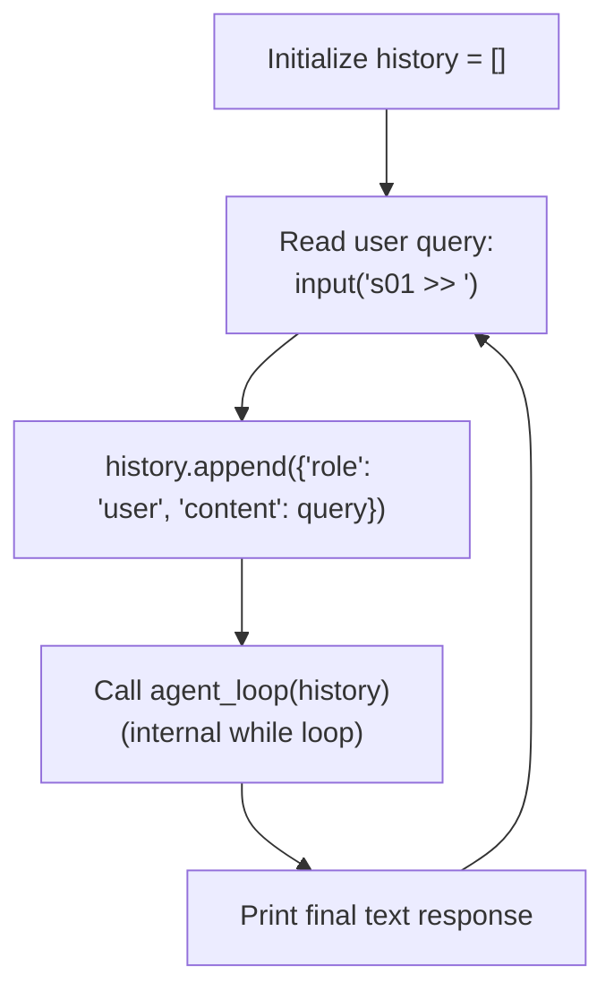

<!-- source: DeepWiki mcp.deepwiki.com · repo shareAI-lab/learn-claude-code · page 3.2 The Agent Loop Pattern · fetched 2026-10-29 -->

# The Agent Loop Pattern

<details>
<summary>Relevant source files</summary>

The following files were used as context for generating this wiki page:

- [s01_agent_loop/code.py](s01_agent_loop/code.py)
- [s01_agent_loop/images/agent-loop.en.svg](s01_agent_loop/images/agent-loop.en.svg)
- [s01_agent_loop/images/agent-loop.ja.svg](s01_agent_loop/images/agent-loop.ja.svg)
- [s01_agent_loop/images/agent-loop.svg](s01_agent_loop/images/agent-loop.svg)
- [tests/test_agent_loop_boundaries.py](tests/test_agent_loop_boundaries.py)

</details>


This page describes the fundamental agent loop pattern that forms the foundation of every agent in this repository. This is the core pattern that distinguishes real agent architectures from prompt plumbing: a continuous loop where the **model makes all decisions** about when to act and when to stop, while the harness simply executes what the model requests.

The agent loop is the bridge between natural language intelligence (the model) and the real world (tools, files, shell). Understanding this pattern is essential before exploring any advanced mechanisms.

---

## The Fundamental Pattern

Every agent in this repository follows the same four-step loop:

1. **Send** messages (conversation history) to the LLM
2. **Check** for tool calls or response completion
3. **Execute** tools if `tool_use` blocks are present in the response
4. **Append** tool results to messages and loop back to step 1

This pattern repeats until the model decides to stop (returning no tool calls). The model controls the loop—the harness simply implements the pattern.

**Loop Execution Flow:**



Sources: [s01_agent_loop/code.py:87-118]()

---

## Why This Pattern Matters

The agent loop embodies the core philosophy of this repository: **the model IS the agent**. The loop does not decide when to call tools, which tools to call, or when to stop. Those decisions belong entirely to the model. The loop's only job is to:

1. Present the conversation state to the model
2. Execute what the model requests
3. Feed results back to the model

This is fundamentally different from "prompt plumbing" architectures that use if-else logic, decision trees, or hardcoded routing to control agent behavior. In those systems, the code makes decisions and the LLM fills in gaps. In this pattern, the LLM makes all decisions and the code executes them.

The consequences of this pattern:

- **Model autonomy**: The model decides its own action sequence based on the task.
- **Extensibility**: Adding new capabilities means adding tools to the `TOOLS` list and dispatch maps, not rewriting the loop [s01_agent_loop/code.py:59-67]().
- **Simplicity**: The loop body remains essentially character-for-character identical across sessions [s01_agent_loop/code.py:87-118]().

Sources: [s01_agent_loop/code.py:1-30]()

---

## The Loop in Code

The minimal implementation of this pattern appears in `s01_agent_loop/code.py`:

```python
def agent_loop(messages: list):
    while True:
        response = client.messages.create(
            model=MODEL, system=SYSTEM, messages=messages,
            tools=TOOLS, max_tokens=8000,
        )

        # Append assistant turn
        messages.append({"role": "assistant", "content": response.content})

        # If the model didn't call a tool, we're done
        tool_calls = [
            block for block in response.content if block.type == "tool_use"
        ]
        if not tool_calls:
            return

        # Execute each tool call, collect results
        results = []
        for block in tool_calls:
            print(f"\033[33m$ {block.input['command']}\033[0m")
            output = run_bash(block.input["command"])
            print(output[:200])
            results.append({
                "type": "tool_result",
                "tool_use_id": block.id,
                "content": output,
            })

        # Feed tool results back, loop continues
        messages.append({"role": "user", "content": results})
```

This exact structure—`while True` → API call → tool check → tool dispatch → append results—appears across the learning track.

Sources: [s01_agent_loop/code.py:87-118]()

---

## Message Flow and State

The `messages` list is the agent's entire conversational memory. It is a Python list of message dictionaries that grows with each turn.

**Message State Evolution:**



Each loop iteration:
1. Sends the entire `messages[]` array to the LLM [s01_agent_loop/code.py:89-92]().
2. Appends the assistant's response as a new message [s01_agent_loop/code.py:95]().
3. If the response contains `tool_use` blocks, executes each tool and collects results in a `results` list [s01_agent_loop/code.py:98-114]().
4. Appends all tool results as a single user message [s01_agent_loop/code.py:117]().
5. Repeats until no tool calls are returned [s01_agent_loop/code.py:98-102]().

Sources: [s01_agent_loop/code.py:87-118]()

---

## Tool Dispatch and Execution Within the Loop

When `tool_use` blocks are present in `response.content`, the loop extracts them and executes a tool dispatch sequence.

**Tool Dispatch Sequence:**



Key aspects of tool execution:
1. **Batching**: All tools in a single assistant response are executed together and returned as a single user message [s01_agent_loop/code.py:105-117]().
2. **Synchronous Execution**: Tools execute sequentially within the loop iteration [s01_agent_loop/code.py:106-114]().
3. **Result Structure**: Each `tool_result` includes the `tool_use_id` to link it back to the specific request block [s01_agent_loop/code.py:110-114]().

Sources: [s01_agent_loop/code.py:87-118]()

---

## The REPL and `agent_loop()` Relationship

`agent_loop()` is not the REPL. It is called by the REPL once per user input. The REPL maintains the persistent `history` list across calls:

**REPL Architecture:**



One REPL iteration may trigger many `agent_loop()` internal iterations. The `history` list persists between queries, giving the agent multi-turn memory.

Sources: [s01_agent_loop/code.py:121-142]()

---

