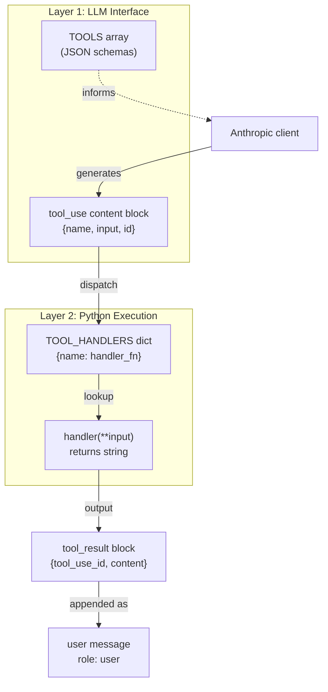
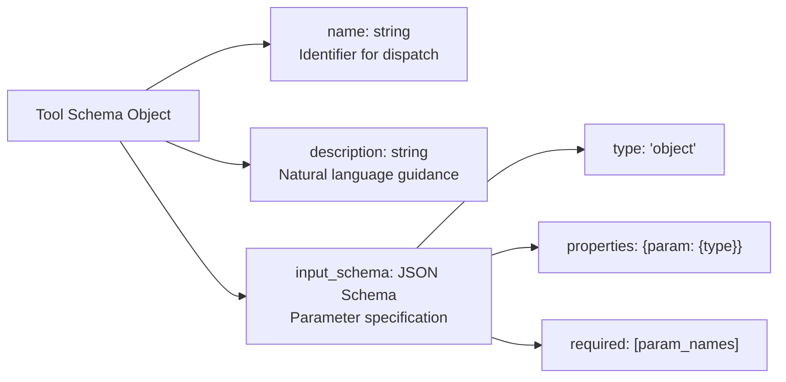
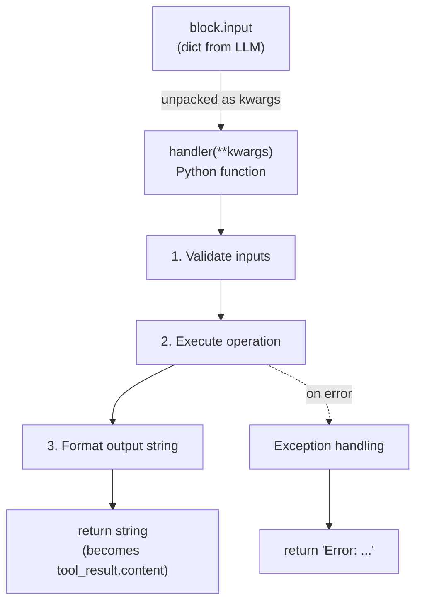
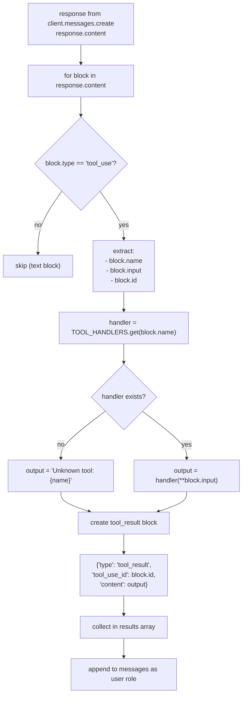
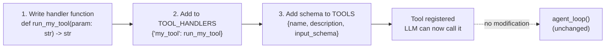

<!-- source: DeepWiki mcp.deepwiki.com · repo shareAI-lab/learn-claude-code · page 3.3 Tool Dispatch Architecture · fetched 2026-10-29 -->

# Tool Dispatch Architecture

<details>
<summary>Relevant source files</summary>

The following files were used as context for generating this wiki page:

- [agents/s01_agent_loop.py](agents/s01_agent_loop.py)
- [agents/s02_tool_use.py](agents/s02_tool_use.py)
- [agents/s04_subagent.py](agents/s04_subagent.py)
- [s02_tool_use/README.ja.md](s02_tool_use/README.ja.md)
- [s02_tool_use/README.md](s02_tool_use/README.md)
- [s02_tool_use/README.zh.md](s02_tool_use/README.zh.md)
- [s02_tool_use/code.py](s02_tool_use/code.py)

</details>


This page documents the tool dispatch mechanism that connects LLM tool requests to Python handler functions. It covers the two-layer architecture (schemas vs handlers), the `TOOL_HANDLERS` dispatch map, `execute_tool`, and the registration pattern that allows tools to be added without modifying the agent loop.

For the agent loop that invokes this dispatch, see [The Agent Loop Pattern](#3.2). For the security mechanisms applied within handler functions, see [Security and Path Safety](#3.4). For comprehensive tool documentation, see [Documentation Set and Translations](#9.3).

---

## The Two-Layer System

The tool dispatch architecture separates what the LLM sees from what Python executes. This separation enables the agent loop to remain generic while tools are added incrementally.

Title: "Tool Interface and Execution Layers"


**The Two Layers:**

| Layer | Purpose | Format | Location |
|-------|---------|--------|----------|
| **Layer 1: Schema** | Describes tools to the LLM | JSON schema (`name`, `description`, `input_schema`) | `TOOLS` array |
| **Layer 2: Handler** | Executes tool logic in Python | Python callable accepting `**kwargs` | `TOOL_HANDLERS` dict |

The LLM only sees Layer 1. The harness only executes Layer 2. The `block.name` field bridges them.

Sources: `[agents/s02_tool_use.py:102-118]()`, `[s02_tool_use/code.py:128-146]()`

---

## Tool Schema Definition

Tool schemas are JSON objects sent to the LLM API via the `tools` parameter in `client.messages.create()`. They define the contract between the model and the harness.

### Schema Structure

Title: "JSON Schema Components"


### Example: The `bash` Tool

`[agents/s02_tool_use.py:109-111]()`

```python
{"name": "bash", "description": "Run a shell command.",
 "input_schema": {"type": "object", "properties": {"command": {"type": "string"}}, "required": ["command"]}},
```

**Schema Components:**

| Field | Purpose | Example |
|-------|---------|---------|
| `name` | Dispatch key, must match `TOOL_HANDLERS` | `"bash"` |
| `description` | Guides LLM when to use tool | `"Run a shell command."` |
| `input_schema` | JSON Schema defining parameters | `{"type": "object", "properties": {...}}` |
| `required` | Mandatory parameters | `["command"]` |

The `name` field is critical—it is the identifier used for dispatch. The LLM generates `tool_use` blocks with this name, and the harness looks it up in `TOOL_HANDLERS`.

Sources: `[agents/s02_tool_use.py:109-118]`, `[s02_tool_use/code.py:128-139]()`

---

## Handler Implementation

Handlers are Python functions that implement tool logic. They must accept keyword arguments matching the tool's `input_schema` and return a string result.

### Handler Function Pattern

Title: "Internal Handler Execution Logic"


### Example: The `run_bash` Handler

`[agents/s02_tool_use.py:54-66]()`

```python
def run_bash(command: str) -> str:
    dangerous = ["rm -rf /", "sudo", "shutdown", "reboot", "> /dev/"]
    if any(d in command for d in dangerous):
        return "Error: Dangerous command blocked"
    try:
        r = subprocess.run(command, shell=True, cwd=WORKDIR,
                           capture_output=True, text=True, errors="replace",
                           timeout=120)
        out = (r.stdout + r.stderr).strip()
        return out[:50000] if out else "(no output)"
    except subprocess.TimeoutExpired:
        return "Error: Timeout (120s)"
```

**Handler Responsibilities:**

1. **Input validation** — Check parameters, validate paths using `safe_path()` `[agents/s02_tool_use.py:47-51]()`.
2. **Operation execution** — Perform the actual work (file I/O, subprocess, API call).
3. **Error handling** — Catch exceptions, return error strings (never raise exceptions to loop) `[agents/s02_tool_use.py:64-65]()`.
4. **Output formatting** — Return human-readable string, truncate if necessary `[agents/s02_tool_use.py:63-63]()`.

**Critical Rule:** Handlers must never raise exceptions into the agent loop. All errors must be returned as strings so the LLM can read and respond to them.

Sources: `[agents/s02_tool_use.py:47-98]`, `[s02_tool_use/code.py:53-124]()`

---

## The Dispatch Mechanism

The `TOOL_HANDLERS` dictionary maps tool names to handler functions. This is the central dispatch table that connects Layer 1 (schemas) to Layer 2 (handlers).

### Dispatch Dictionary Structure

`[agents/s02_tool_use.py:102-107]()`

```python
TOOL_HANDLERS = {
    "bash":       lambda **kw: run_bash(kw["command"]),
    "read_file":  lambda **kw: run_read(kw["path"], kw.get("limit")),
    "write_file": lambda **kw: run_write(kw["path"], kw["content"]),
    "edit_file":  lambda **kw: run_edit(kw["path"], kw["old_text"], kw["new_text"]),
}
```

### Dispatch Flow in Agent Loop

Title: "Agent Loop Dispatch Sequence"


### Code Reference: Dispatch Implementation

`[agents/s02_tool_use.py:130-138]()`

```python
        results = []
        for block in response.content:
            if block.type == "tool_use":
                handler = TOOL_HANDLERS.get(block.name)
                output = handler(**block.input) if handler else f"Unknown tool: {block.name}"
                print(f"> {block.name}:")
                print(output[:200])
                results.append({"type": "tool_result", "tool_use_id": block.id, "content": output})
        messages.append({"role": "user", "content": results})
```

**Dispatch Steps:**

1. **Iterate** over `response.content` blocks `[agents/s02_tool_use.py:131-131]()`.
2. **Filter** for `block.type == "tool_use"` `[agents/s02_tool_use.py:132-132]()`.
3. **Lookup** handler in `TOOL_HANDLERS.get(block.name)` `[agents/s02_tool_use.py:133-133]()`.
4. **Execute** handler with `**block.input` (unpacks dict to kwargs) `[agents/s02_tool_use.py:134-134]()`.
5. **Collect** output in `tool_result` block with matching `tool_use_id` `[agents/s02_tool_use.py:137-137]()`.
6. **Append** all results as a single `user` message `[agents/s02_tool_use.py:138-138]()`.

Sources: `[agents/s02_tool_use.py:121-139]`, `[s02_tool_use/code.py:153-175]()`

---

## The Registration Pattern

Adding a new tool requires two main steps, allowing developers to extend agent capabilities without modifying the core `agent_loop`:

### Registration Steps

Title: "Tool Registration Workflow"


### Example: Adding a New Tool

To add a new tool (such as `glob` in `s02_tool_use/code.py`):

**Step 1: Implement Handler**

`[s02_tool_use/code.py:110-124]()`
```python
def run_glob(pattern: str) -> str:
    import glob as g
    try:
        matches = sorted({
            match for match in g.glob(
                pattern, root_dir=WORKDIR, recursive=True)
            if (WORKDIR / match).resolve().is_relative_to(WORKDIR)
        })
        shown = matches[:200]
        if len(matches) > 200:
            shown.append("... (more matches omitted; narrow the pattern)")
        return "\n".join(shown) if shown else "(no matches)"
    except Exception as e:
        return f"Error: {e}"
```

**Step 2: Register in `TOOL_HANDLERS`**

`[s02_tool_use/code.py:143-146]()`
```python
TOOL_HANDLERS = {
    "bash": run_bash, "read_file": run_read, "write_file": run_write,
    "edit_file": run_edit, "glob": run_glob,
}
```

**Step 3: Define Schema in `TOOLS`**

`[s02_tool_use/code.py:128-139]()`
```python
TOOLS = [
    # ... existing tools ...
    {"name": "glob", "description": "Find files matching a glob pattern; ** matches recursively.",
     "input_schema": {"type": "object", "properties": {"pattern": {"type": "string"}}, "required": ["pattern"]}},
]
```

**The agent loop requires zero changes.** The dispatch mechanism automatically routes the new tool call.

Sources: `[s02_tool_use/code.py:110-146]`, `[s02_tool_use/README.md:26-30]()`

---

## Lambda vs Direct Function Reference

The `TOOL_HANDLERS` dictionary can use lambda wrappers or direct function references to adapt handler functions to the `**kwargs` interface.

### Two Patterns

| Pattern | Example | Use Case |
|---------|---------|----------|
| **Lambda wrapper** | `"bash": lambda **kw: run_bash(kw["command"])` | Adapt specific keyword mapping or parameter selection |
| **Direct reference** | `"glob": run_glob` | Handler accepts parameters matching the schema parameters directly |

**Why Lambdas?**

In `agents/s02_tool_use.py`, lambdas are used to map specific dictionary keys to function arguments:
```python
"read_file": lambda **kw: run_read(kw["path"], kw.get("limit"))
```
`[agents/s02_tool_use.py:104-104]()`

This provides explicit control over parameter passing while maintaining the flexible `**kwargs` dispatch interface used in the loop:
```python
output = handler(**block.input)
```
`[agents/s02_tool_use.py:134-134]()`

Sources: `[agents/s02_tool_use.py:102-107]`, `[s02_tool_use/code.py:143-146]()`

---

## Error Handling in Dispatch

The dispatch mechanism includes graceful degradation for unknown tools and exception handling within handlers.

### Unknown Tool Handling

`[agents/s02_tool_use.py:133-134]()`

```python
handler = TOOL_HANDLERS.get(block.name)
output = handler(**block.input) if handler else f"Unknown tool: {block.name}"
```

If the LLM requests a tool not present in `TOOL_HANDLERS`, the harness returns an error string instead of crashing. This allows the LLM to read the error and potentially correct its tool invocation.

### Exception Handling in Handlers

All handlers follow a defensive exception-catching pattern:

```python
def run_read(path: str, limit: int | None = None) -> str:
    try:
        # operation logic
        return text
    except Exception as e:
        return f"Error: {e}"
```
`[s02_tool_use/code.py:78-85]()`

Exceptions are caught and converted to error strings. This ensures the agent loop never crashes due to tool execution failures—the LLM always receives structured feedback.

Sources: `[agents/s02_tool_use.py:68-76]`, `[s02_tool_use/code.py:78-85]()`

---

## Summary

The tool dispatch architecture implements a clean separation between the LLM interface and Python execution:

- **`TOOLS` array** defines JSON schemas visible to the LLM `[agents/s02_tool_use.py:109-118]()`.
- **`TOOL_HANDLERS` dict** maps tool names to Python functions `[agents/s02_tool_use.py:102-107]()`.
- **`safe_path()` validation** protects filesystem boundaries at the tool level `[agents/s02_tool_use.py:47-51]()`.
- **Registration pattern** allows tools to be added without modifying the agent loop `[s02_tool_use/README.md:26-30]()`.
- **Error handling** ensures graceful degradation on unknown tools or handler failures `[agents/s02_tool_use.py:133-134]()`.

This architecture enables the progressive learning path: subsequent lessons add increasingly sophisticated tools (such as subagents, permissions, skills, memory, and tasks) without ever altering the core dispatch design established in `s02`.

Sources: `[agents/s02_tool_use.py:102-139]`, `[s02_tool_use/code.py:121-175]()`

---

