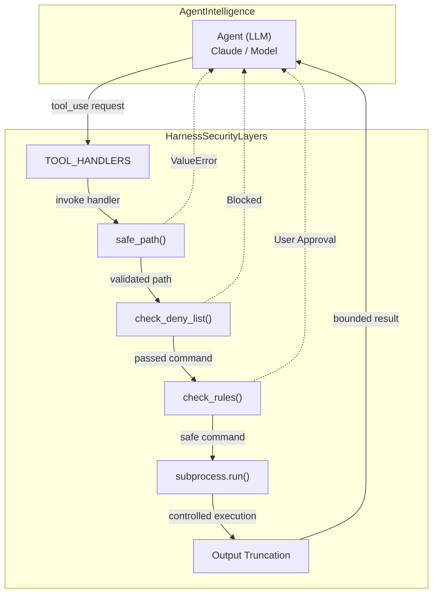
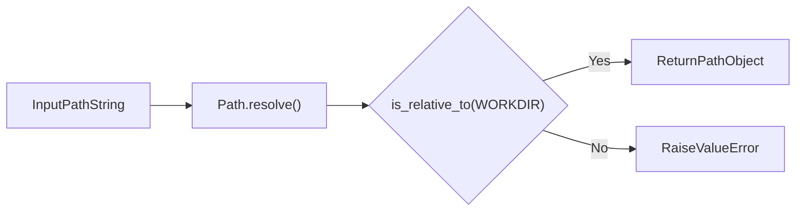
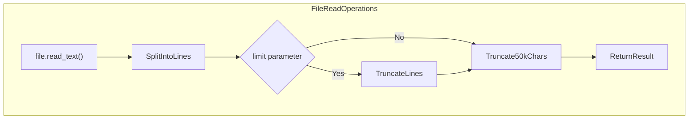

<!-- source: DeepWiki mcp.deepwiki.com · repo shareAI-lab/learn-claude-code · page 3.4 Security and Path Safety · fetched 2026-10-29 -->

# Security and Path Safety

<details>
<summary>Relevant source files</summary>

The following files were used as context for generating this wiki page:

- [s03_permission/README.ja.md](s03_permission/README.ja.md)
- [s03_permission/README.md](s03_permission/README.md)
- [s03_permission/README.zh.md](s03_permission/README.zh.md)
- [s04_hooks/README.ja.md](s04_hooks/README.ja.md)
- [s04_hooks/README.md](s04_hooks/README.md)
- [s04_hooks/README.zh.md](s04_hooks/README.zh.md)
- [tests/test_permission_command_words.py](tests/test_permission_command_words.py)
- [tests/test_subprocess_output_encoding.py](tests/test_subprocess_output_encoding.py)

</details>


This document covers the security mechanisms built into the harness layer to constrain agent actions within safe boundaries. These protections operate at the tool implementation level, ensuring that regardless of what the model requests, the harness enforces workspace isolation, blocks dangerous operations, prevents resource exhaustion, and safely handles subprocess encodings.

**Scope**: This page focuses on harness-level safety mechanisms in tool implementations (`safe_path`, `run_bash`, deny lists, regex destructive command detection, output truncation, and encoding safety). For information about the permission pipeline introduced in session 03, see [s03: Permission and s04: Hooks](). For git worktree isolation boundaries, see [Task Isolation with Worktrees]().

---

## The Trust Model: Agent Intelligence vs Harness Boundaries

The `learn-claude-code` architecture embodies a specific trust philosophy: **trust the model's intelligence, but constrain its reach**. The agent (LLM) makes all decisions about which tools to call and when—the harness never overrides these decisions with natural language safety prompts. Instead, the harness enforces security at the **tool implementation boundary** where abstract requests become concrete filesystem or shell operations.

**Harness Security Data Flow**


**Key principle**: The model decides strategy and tactics. The harness enforces physical constraints using code entities like `safe_path()`, `check_deny_list()`, and `check_rules()`.

Sources: [s02_tool_use/code.py:41-59](), [s03_permission/code.py:131-147]()

---

## Path Validation: The `safe_path()` Function

Every file operation passes through the `safe_path()` function, which enforces **workspace boundary isolation**. This function prevents path traversal attacks and ensures agents cannot access files outside the designated working directory.

### Implementation Pattern

**Path Validation Flow**


The function operates in three steps:
1. Combines the requested path with `WORKDIR` using pathlib's `/` operator [s02_tool_use/code.py:42]().
2. Calls `.resolve()` to expand symlinks and normalize `..` references [s02_tool_use/code.py:42]().
3. Checks if the resolved path is contained within `WORKDIR` boundaries using `is_relative_to` [s02_tool_use/code.py:43-44]().

Sources: [s02_tool_use/code.py:41-45](), [s03_permission/code.py:125-129]()

---

## Permission Pipeline, Deny Lists, and Destructive Commands

Starting in session 03, the harness introduces a three-gate permission pipeline (`check_deny_list`, `check_rules`, and `ask_user`) that sits between the LLM request and tool execution [s03_permission/README.en.md:24]().

### Destructive Command Detection via Regex

To detect shell commands attempting destructive actions (like file deletion), the harness uses a compiled regular expression `DESTRUCTIVE_COMMAND_WORD` alongside keyword checks [s03_permission/README.en.md:62-67]().

```python
DESTRUCTIVE_COMMAND_WORD = re.compile(
    r"(?i)(?:^|[;&|()\n])\s*(?:rm|del)(?=\s|$|[;&|()])"
)
```

This regular expression ensures that commands like `rm file.txt`, `DEL file.txt`, or chained commands (`echo ready && del file.txt`) are correctly flagged as destructive while avoiding false positives on words containing `rm` or `del` as substrings (e.g., `model`, `delimiter`, `echo del file.txt`) [tests/test_permission_command_words.py:91-107]().

Sources: [s03_permission/code.py:60-80](), [tests/test_permission_command_words.py:1-127]()

---

## Output Truncation: Preventing Token Exhaustion

Both file operations and bash commands enforce **hard limits on output length** to prevent a single tool call from consuming the entire context window.

### Truncation Boundaries

**Resource Protection Pipeline**


Sources: [s02_tool_use/code.py:61-69](), [s02_tool_use/code.py:53-58]()

---

## Subprocess Encoding Safety

When executing shell commands via `run_bash()`, capturing standard output and standard error can fail if the subprocess uses a non-UTF-8 encoding (such as `gbk` on Windows) or emits arbitrary invalid byte sequences [tests/test_subprocess_output_encoding.py:30-49]().

To prevent agents from crashing due to `UnicodeDecodeError`, subprocess text decoding must enforce error fallback policies [tests/test_subprocess_output_encoding.py:96-113]() and handle empty output or timeouts gracefully:

- **Encoding Error Handling**: Subprocess text reads use `errors="replace"` to substitute unparseable bytes with replacement characters (`\ufffd`) rather than raising exceptions [tests/test_subprocess_output_encoding.py:90-93]().
- **Empty Output**: When a command produces no stdout/stderr, `run_bash()` returns `"(no output)"` [tests/test_subprocess_output_encoding.py:59]().
- **Timeouts**: If `subprocess.run()` raises `subprocess.TimeoutExpired`, it catches the exception and returns `"Error: Timeout (120s)"` [tests/test_subprocess_output_encoding.py:62-70]().

Sources: [tests/test_subprocess_output_encoding.py:1-113]()

---

## Security Pattern Consistency Across Sessions

All security mechanisms are established early and propagated through subsequent sessions via hooks and handlers.

| Session | `safe_path()` | Dangerous Cmd Block | Output Truncation | Timeout |
|---------|-------------|---------------------|-------------------|---------|
| s01 | ❌ | ✅ [s01_agent_loop/code.py:66-68]() | ✅ [s01_agent_loop/code.py:73]() | ✅ [s01_agent_loop/code.py:71]() |
| s02 | ✅ [s02_tool_use/code.py:41-45]() | ✅ [s02_tool_use/code.py:49-51]() | ✅ [s02_tool_use/code.py:56, 67]() | ✅ [s02_tool_use/code.py:54]() |
| s04 | ✅ [s04_hooks/code.py:113-116]() | ✅ [s04_hooks/code.py:108-110]() | ✅ [s04_hooks/code.py:125-126]() | ✅ [s04_hooks/code.py:59]() |

Sources: [s01_agent_loop/code.py:65-75](), [s02_tool_use/code.py:41-69](), [s04_hooks/code.py:105-131]()

---

