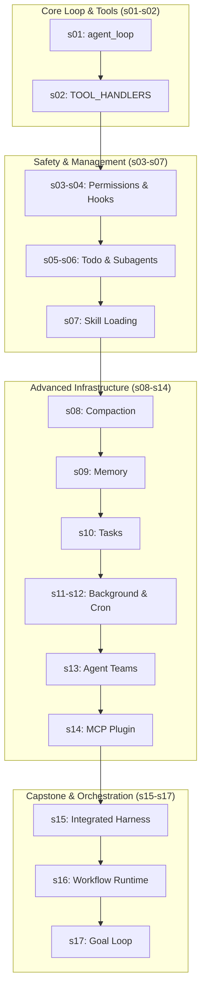
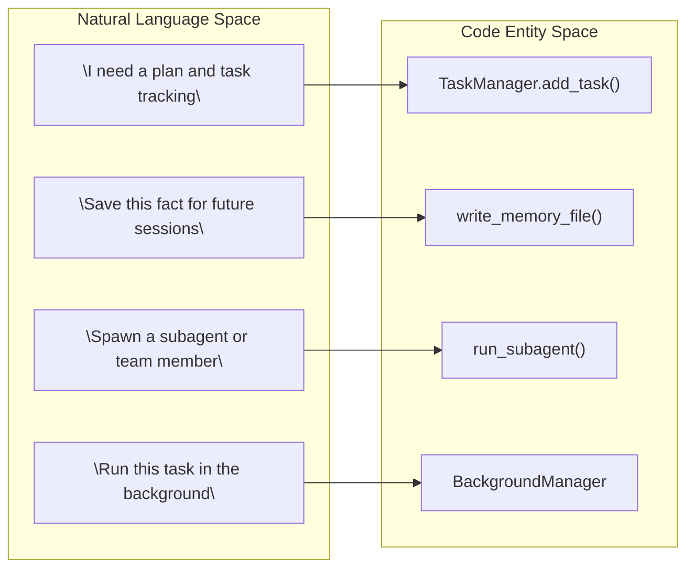

<!-- source: DeepWiki mcp.deepwiki.com · repo shareAI-lab/learn-claude-code · page 4 Learning Path: The Seventeen Lessons · fetched 2026-10-29 -->

# Learning Path: The Seventeen Lessons

Relevant source files

The following files were used as context for generating this wiki page:

- [README-ja.md](README-ja.md)
- [README-zh.md](README-zh.md)
- [README.md](README.md)
- [s01_agent_loop/README.ja.md](s01_agent_loop/README.ja.md)
- [s01_agent_loop/README.md](s01_agent_loop/README.md)
- [web/src/data/generated/docs.json](web/src/data/generated/docs.json)
- [web/src/data/generated/versions.json](web/src/data/generated/versions.json)

## Purpose and Scope

This page serves as the high-level parent guide for the 17-lesson progressive course (`s01` through `s17`) in `learn-claude-code`. The curriculum spans from a bare agent loop executing shell commands to an integrated capstone harness, workflow runtime, and autonomous goal loop. 

Because this is a PARENT page, detailed technical breakdowns are delegated to child pages. Below is an overview of the stages, architectural evolution, and code entity mappings that govern the course.

Sources: [`web/src/data/generated/versions.json:1-106](), [`README.md:165-175]()

---

## The Evolution of the Seventeen Lessons

The learning path follows a strict incremental philosophy: each lesson introduces a single harness mechanism without altering the fundamental agent loop pattern. The journey scales from basic tool execution to multi-agent teams, workflow runtimes, and goal-directed termination.

**Title:** "Harness Evolution from Single Loop to Goal Loop"

Sources: [`web/src/data/generated/versions.json:1-106](), [`README.md:165-175]()

---

## Bridging Natural Language to Code Entities

To connect agent behaviors expressed in natural language to concrete implementation points, the following diagram maps high-level intents to their corresponding codebase symbols and managers.

**Title:** "Mapping Agent Concepts to Code Entities"

Sources: [`web/src/data/generated/versions.json:1-106](), [`web/src/data/generated/docs.json:1-7]()

---

## Lesson Navigation

### 4.1. s01–s02: Agent Loop and Tool Use
Master the foundational `while True` loop that sends messages to the LLM, checks `stop_reason`, and evaluates `tool_use` blocks. `s01` introduces the bare bash loop (`[s01_agent_loop/code.py:87-115]()`), while `s02` expands capabilities using a clean tool dispatch map (`TOOL_HANDLERS`) for file read, write, edit, and glob operations.
For details, see [s01–s02: Agent Loop and Tool Use](#4.1).

Sources: [`web/src/data/generated/versions.json:1-97](), [`s01_agent_loop/code.py:87-115]()

### 4.2. s03–s04: Permission and Hooks
Implement the three-gate permission pipeline (deny list, rules, user approval) protecting destructive commands, paired with the `HOOKS` event registry (`UserPromptSubmit`, `PreToolUse`, `PostToolUse`, `Stop`) enabling non-invasive extension of the runtime.
For details, see [s03–s04: Permission and Hooks](#4.2).

Sources: [`web/src/data/generated/versions.json:1-106](), [`web/src/data/generated/docs.json:1-7]()

### 4.3. s05–s06: TodoWrite and Subagents
Explore self-tracking via `TodoManager` with staleness reminders, alongside task delegation through `run_subagent`, which spawns isolated child message contexts returning structured tool results.
For details, see [s05–s06: TodoWrite and Subagents](#4.3).

Sources: [`web/src/data/generated/versions.json:1-106](), [`web/src/data/generated/docs.json:1-7]()

### 4.4. s07: Skill Loading
Learn the two-layer injection strategy: exposing a compact catalog of available skills in the system prompt, and returning the full body of a requested `SKILL.md` dynamically via the `load_skill` tool result.
For details, see [s07: Skill Loading](#4.4).

Sources: [`web/src/data/generated/versions.json:1-106](), [`web/src/data/generated/docs.json:1-7]()

### 4.5. s08: Context Compaction
Master the four-step compaction pipeline (`tool_result_budget`, `snip_compact`, `micro_compact`, `compact_history`), alongside reactive compaction triggers and tool-pair safety to maintain long session stability.
For details, see [s08: Context Compaction](#4.5).

Sources: [`web/src/data/generated/versions.json:1-106](), [`web/src/data/generated/docs.json:1-7]()

### 4.6. s09: Memory System
Understand persistent memory storage under `.memory/`, utilizing functions like `write_memory_file`, `MEMORY.md` indexing, selective memory retrieval, extraction, and consolidation across sessions.
For details, see [s09: Memory System](#4.6).

Sources: [`web/src/data/generated/versions.json:1-106](), [`web/src/data/generated/docs.json:1-7]()

### 4.7. s10: Task System
Examine the file-backed task graph maintained in `.tasks/`, supporting `blockedBy` dependencies, full CRUD operations, atomic claims, and structured coordination that surpasses basic todo lists.
For details, see [s10: Task System](#4.7).

Sources: [`web/src/data/generated/versions.json:1-106](), [`web/src/data/generated/docs.json:1-7]()

### 4.8. s11–s12: Background Tasks and Cron Scheduler
Handle asynchronous command execution via daemon threads paired with notification queues, and integrate time-triggered task injection through the `CronScheduler`.
For details, see [s11–s12: Background Tasks and Cron Scheduler](#4.8).

Sources: [`web/src/data/generated/versions.json:1-106](), [`web/src/data/generated/docs.json:1-7]()

### 4.9. s13: Agent Teams
Scale from single agents to coordinated multi-agent teams using persistent teammates, JSONL mailboxes, protocol state machines, atomic task claims, and task-bound git worktrees.
For details, see [s13: Agent Teams](#4.9).

Sources: [`web/src/data/generated/versions.json:1-106](), [`web/src/data/generated/docs.json:1-7]()

### 4.10. s14: MCP Plugin
Integrate external Model Context Protocol (MCP) servers, supporting server discovery, unified tool pool assembly, and namespace-prefixed tool dispatch (`mcp__server__tool`).
For details, see [s14: MCP Plugin](#4.10).

Sources: [`web/src/data/generated/versions.json:1-106](), [`web/src/data/generated/docs.json:1-7]()

### 4.11. s15: Integrated Harness
Review the capstone runtime that unifies tasks, worktrees, teams, memory, background scheduling, cron jobs, MCP plugins, and compaction into a single robust agent loop.
For details, see [s15: Integrated Harness](#4.11).

Sources: [`web/src/data/generated/versions.json:1-106](), [`web/src/data/generated/docs.json:1-7]()

### 4.12. s16: Workflow Runtime
Execute deterministic scripted orchestrations featuring resumable journals, multi-phase pipelines, parallel resource budgets, and strict execution run locks.
For details, see [s16: Workflow Runtime](#4.12).

Sources: [`web/src/data/generated/versions.json:1-106](), [`web/src/data/generated/docs.json:1-7]()

### 4.13. s17: Goal Loop
Conclude the curriculum with independent goal evaluation governing loop termination, managed by `GoalController`, `PromptGoalEvaluator`, and handling achieved, deferred, failed, or budget-limited outcomes.
For details, see [s17: Goal Loop](#4.13).

Sources: [`web/src/data/generated/versions.json:1-106](), [`web/src/data/generated/docs.json:1-7]()

---

