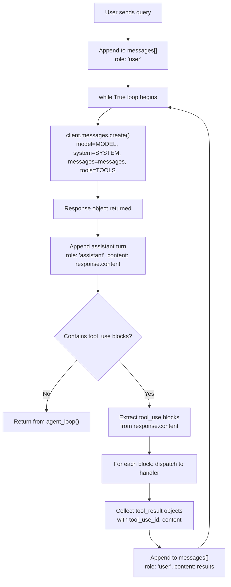
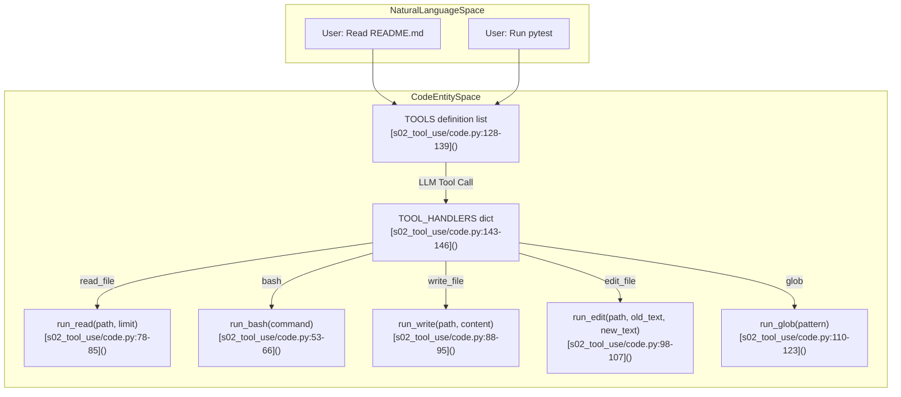
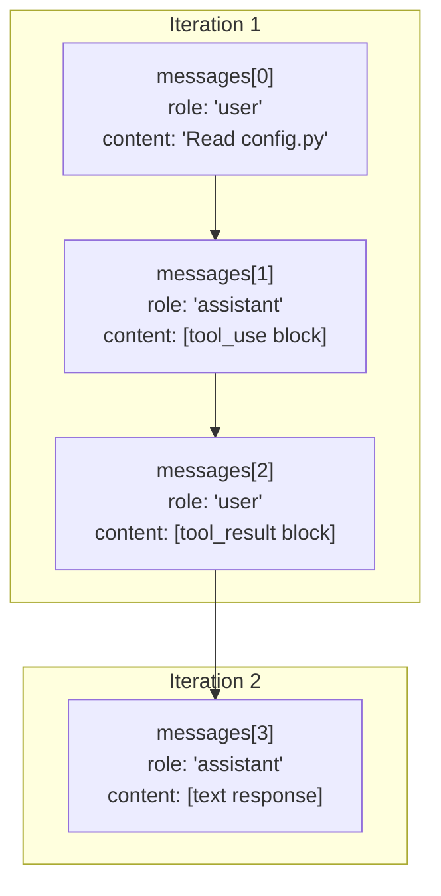

<!-- source: DeepWiki mcp.deepwiki.com · repo shareAI-lab/learn-claude-code · page 4.1 s01–s02: Agent Loop and Tool Use · fetched 2026-10-29 -->

# s01–s02: Agent Loop and Tool Use

<details>
<summary>Relevant source files</summary>

The following files were used as context for generating this wiki page:

- [s01_agent_loop/code.py](s01_agent_loop/code.py)
- [s02_tool_use/README.ja.md](s02_tool_use/README.ja.md)
- [s02_tool_use/README.md](s02_tool_use/README.md)
- [s02_tool_use/README.zh.md](s02_tool_use/README.zh.md)
- [s02_tool_use/code.py](s02_tool_use/code.py)

</details>


This document covers the foundational agent loop pattern and tool dispatch architecture implemented in `s01_agent_loop/code.py` and `s02_tool_use/code.py`. It establishes the minimal harness required to connect a language model to the real world through tool execution, scaling from a single `bash` tool to a modular dispatch map supporting multiple specialized tools.

**Sources:** [s01_agent_loop/code.py:1-142](), [s02_tool_use/code.py:1-182]()

---

## Purpose and Scope

Sessions s01 and s02 establish the core **agent loop pattern** and **tool dispatch architecture** that remain foundational across all subsequent lessons (s01–s17). 

- **s01** introduces the minimal state-machine loop: send messages to the LLM, inspect tool requests, execute commands, append results, and repeat until the model stops [s01_agent_loop/code.py:87-118]().
- **s02** introduces the dispatch pattern (`TOOL_HANDLERS`), showing how the agent loop remains completely unchanged while expanding the tool pool from a single `bash` tool to five specialized tools (`bash`, `read_file`, `write_file`, `edit_file`, `glob`) protected by workspace boundary checks [s02_tool_use/code.py:71-146]().

The repository philosophy posits that "the model IS the agent," while these scripts provide the harness infrastructure.

**Sources:** [s01_agent_loop/code.py:3-30](), [s02_tool_use/code.py:5-22]()

---

## The Agent Loop Pattern

### Conceptual Flow

The agent loop is a stateless cycle from the model's perspective. All state resides in the `messages` array, which grows monotonically with each turn. The model examines this history and decides whether to invoke tools or finish its turn.



**Diagram: Core Agent Loop Cycle**

The model makes all control flow decisions via its output tokens. When no `tool_use` blocks are present in the response, the loop terminates [s01_agent_loop/code.py:97-102](), [s02_tool_use/code.py:161-165]().

**Sources:** [s01_agent_loop/code.py:87-118](), [s02_tool_use/code.py:153-176]()

---

## Tool Dispatch Architecture

### From Hardcoded Execution to Dispatch Maps

In s01, tool execution is hardcoded specifically for the `bash` command [s01_agent_loop/code.py:108](). In s02, this is generalized into a dispatch dictionary (`TOOL_HANDLERS`) and a schema array (`TOOLS`) [s02_tool_use/code.py:128-146]().



**Diagram: Natural Language Space to Code Entity Space for Tool Dispatch**

Adding a new tool requires precisely two additions:
1. A JSON schema definition added to the `TOOLS` list [s02_tool_use/code.py:128-139]().
2. A handler mapping added to the `TOOL_HANDLERS` dictionary [s02_tool_use/code.py:143-146]().

The core `agent_loop` function remains entirely unmodified when adding new tools [s02_tool_use/code.py:153-176]().

**Sources:** [s02_tool_use/code.py:53-146](), [s02_tool_use/code.py:153-176]()

---

## File Tools and Path Safety

### Workspace Boundary Enforcement

While s01's `run_bash` executes shell commands with a basic blocklist for dangerous terms (`rm -rf /`, `sudo`, etc.) [s01_agent_loop/code.py:71-74](), s02 introduces file-specific tools (`read_file`, `write_file`, `edit_file`, `glob`) that must be constrained to the working directory (`WORKDIR`) [s02_tool_use/code.py:44]().

The `safe_path` helper validates that any target path resolves strictly within the current working directory [s02_tool_use/code.py:71-75]():

```python
def safe_path(p: str) -> Path:
    path = (WORKDIR / p).resolve()
    if not path.is_relative_to(WORKDIR):
        raise ValueError(f"Path escapes workspace: {p}")
    return path
```

**Sources:** [s01_agent_loop/code.py:71-74](), [s02_tool_use/code.py:71-75]()

---

## Messages Array Data Flow

### Turn Sequence and State Accumulation

The `messages` array alternates between `user` and `assistant` roles across iterations:



**Diagram: Messages Array Growth Pattern**

Each tool-use turn appends an assistant message containing tool call blocks, followed immediately by a user message containing an array of `tool_result` objects referencing each call's unique `tool_use_id` [s02_tool_use/code.py:159-175]().

**Sources:** [s01_agent_loop/code.py:87-118](), [s02_tool_use/code.py:153-176]()

---

