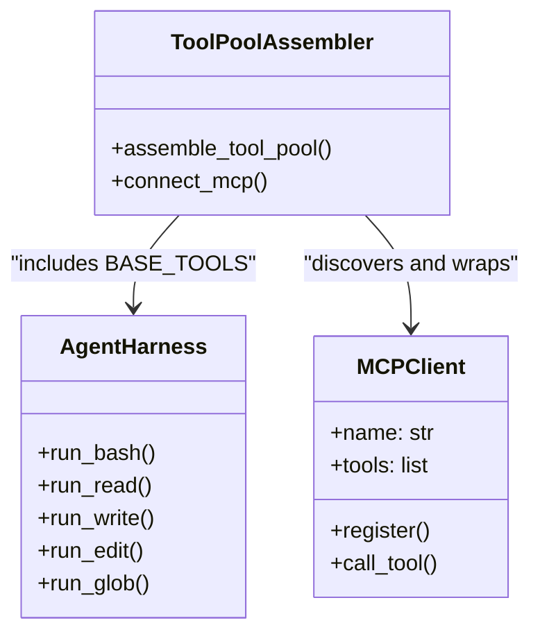

<!-- source: DeepWiki mcp.deepwiki.com · repo shareAI-lab/learn-claude-code · page 4.10 s14: MCP Plugin · fetched 2026-10-29 -->

# s14: MCP Plugin

<details>
<summary>Relevant source files</summary>

The following files were used as context for generating this wiki page:

- [s14_mcp_plugin/README.md](s14_mcp_plugin/README.md)
- [s14_mcp_plugin/code.py](s14_mcp_plugin/code.py)

</details>


The Model Context Protocol (MCP) plugin lesson (`s14_mcp_plugin/code.py`) introduces external tool discovery and unified pool assembly. Rather than relying solely on a closed, hardcoded set of local tools, the agent harness can dynamically connect to MCP servers, discover their tool definitions, and register them into the active tool pool.

Sources: [s14_mcp_plugin/code.py:1-23](), [s14_mcp_plugin/README.md:1-16]()

---

## 1. Purpose and Architecture

The integration follows a client-server architecture where the agent harness discovers tools from external servers at runtime. The implementation provides `MCPClient` as an in-process stand-in for MCP protocols, `connect_mcp()` to establish connections, and `assemble_tool_pool()` to merge base tools with dynamically discovered capabilities.

### Tool Integration and Dispatch Flow

```mermaid
sequenceDiagram
    participant LLM as "Anthropic Model"
    participant Loop as "agent_loop"
    participant Pool as "assemble_tool_pool"
    participant Client as "MCPClient"
    
    LLM->>Loop: "tool_use(mcp__docs__search, {query: 'hooks'})"
    Loop->>Pool: "handlers['mcp__docs__search'](query='hooks')"
    Pool->>Client: "call_tool('search', {query: 'hooks'})"
    Client-->>Pool: "return search_results_string"
    Pool-->>Loop: "tool_result"
    Loop-->>LLM: "append message history"
```

Sources: [s14_mcp_plugin/code.py:163-185](), [s14_mcp_plugin/README.md:33-54]()

---

## 2. Key Components and Code Entities

### `MCPClient` Class

The `MCPClient` class stores discovered tool schemas and maps them to local or in-process invocation handlers.

```python
class MCPClient:
    def __init__(self, name: str):
        self.name = name
        self.tools: list[dict] = []
        self._handlers: dict[str, callable] = {}
```

- `register()` validates tool definitions and ensures all tools have valid handlers [s14_mcp_plugin/code.py:171-182]().
- `call_tool()` executes the requested handler with arguments and catches exceptions to return error strings to the model [s14_mcp_plugin/code.py:183-195]().

Sources: [s14_mcp_plugin/code.py:163-195]()

### Tool Pool Assembly

Before each model iteration, `assemble_tool_pool()` merges `BASE_TOOLS` with all registered MCP tool definitions, prefixing the server tools to prevent namespace collisions.



Sources: [s14_mcp_plugin/code.py:125-158](), [s14_mcp_plugin/README.md:25-30]()

---

## 3. Naming Convention and Security Policy

### Namespace Prefixing: `mcp__server__tool`

To avoid name collisions across multiple connected servers, all discovered tools are normalized and assigned a structured prefix:

```text
mcp__{server_name}__{tool_name}
```

The harness checks for normalization collisions and enforces a strict naming schema before exposing tools to the model [s14_mcp_plugin/README.md:96-113]().

### Host-Side Permissions

While MCP servers may supply hints (such as read-only flags), authorization is strictly enforced by the host harness policy:

```python
MCP_HOST_POLICY = {
    ("docs", "search"): "allow",
    ("docs", "get_version"): "allow",
    ("deploy", "status"): "allow",
    ("deploy", "trigger"): "confirm",
}
```

Unconfigured external tools default to requiring explicit user confirmation before execution [s14_mcp_plugin/README.md:132-144]().

Sources: [s14_mcp_plugin/README.md:96-144]()

---

## 4. Summary Table: Local Tools vs MCP Tools

| Feature | Local Tools (s01–s04) | MCP Tools (s14) |
| :--- | :--- | :--- |
| **Source** | Hardcoded in `BASE_TOOLS` [s14_mcp_plugin/code.py:125-150]() | Discovered dynamically via `MCPClient` [s14_mcp_plugin/code.py:163-185]() |
| **Naming** | Simple names (`bash`, `read_file`) [s14_mcp_plugin/code.py:125-150]() | Prefixed namespace (`mcp__server__tool`) [s14_mcp_plugin/README.md:96-103]() |
| **Authorization** | Shell & path safety checks [s14_mcp_plugin/code.py:56-123]() | Host-side `MCP_HOST_POLICY` rules [s14_mcp_plugin/README.md:132-144]() |
| **Error Handling** | Caught locally | Returned as error `tool_result` blocks [s14_mcp_plugin/README.md:146-154]() |

Sources: [s14_mcp_plugin/code.py:56-150](), [s14_mcp_plugin/README.md:96-154]()

---

