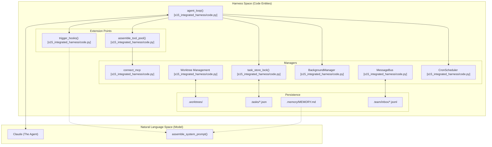
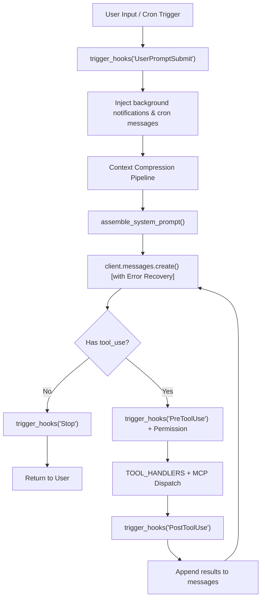
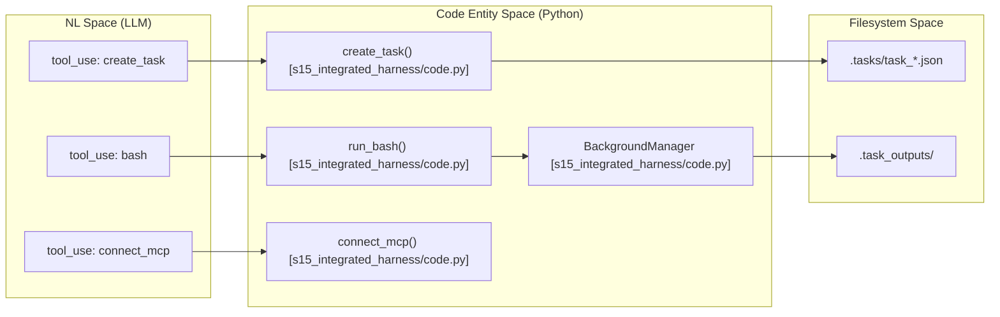

<!-- source: DeepWiki mcp.deepwiki.com · repo shareAI-lab/learn-claude-code · page 4.11 s15: Integrated Harness · fetched 2026-10-29 -->

# s15: Integrated Harness

Relevant source files

The following files were used as context for generating this wiki page:

- [s15_integrated_harness/README.ja.md](s15_integrated_harness/README.ja.md)
- [s15_integrated_harness/README.md](s15_integrated_harness/README.md)
- [s15_integrated_harness/README.zh.md](s15_integrated_harness/README.zh.md)
- [s15_integrated_harness/code.py](s15_integrated_harness/code.py)
- [s15_integrated_harness/images/system-architecture.en.svg](s15_integrated_harness/images/system-architecture.en.svg)
- [s15_integrated_harness/images/system-architecture.ja.svg](s15_integrated_harness/images/system-architecture.ja.svg)
- [s15_integrated_harness/images/system-architecture.svg](s15_integrated_harness/images/system-architecture.svg)
- [tests/test_agent_teams_runtime.py](tests/test_agent_teams_runtime.py)
- [tests/test_goal_loop.py](tests/test_goal_loop.py)
- [tests/test_web_scenarios.py](tests/test_web_scenarios.py)
- [tests/test_workflow_goal_lessons.py](tests/test_workflow_goal_lessons.py)
- [web/public/course-assets/s15_integrated_harness/system-architecture.en.svg](web/public/course-assets/s15_integrated_harness/system-architecture.en.svg)
- [web/public/course-assets/s15_integrated_harness/system-architecture.ja.svg](web/public/course-assets/s15_integrated_harness/system-architecture.ja.svg)
- [web/public/course-assets/s15_integrated_harness/system-architecture.svg](web/public/course-assets/s15_integrated_harness/system-architecture.svg)
- [web/src/components/visualizations/index.tsx](web/src/components/visualizations/index.tsx)
- [web/src/data/execution-flows.ts](web/src/data/execution-flows.ts)

## Purpose and Scope

`s15_integrated_harness/code.py` serves as the capstone runtime of the 17-lesson pedagogical course, merging all preceding mechanisms (s01–s14) into a single, comprehensive harness. While earlier lessons isolate specific capabilities—such as tool dispatch, permissions, memory, tasks, teams, cron scheduling, and Model Context Protocol (MCP) plugins—s15 demonstrates how these components interoperate within a single `while True` agent loop.

**Key capabilities of the s15 integrated harness:**
- **Unified Loop Lifecycle:** Integrates `UserPromptSubmit` hooks, cron message queues, background notifications, and the multi-layer compaction pipeline before every LLM invocation [s15_integrated_harness/code.py:1100-1180]().
- **Advanced Tooling Pool:** Combines 26 built-in filesystem, shell, task, cron, team, worktree, and memory tools with dynamically discovered `mcp__server__tool` endpoints [s15_integrated_harness/README.md:82-93]().
- **Multi-Agent Coordination:** Supports persistent teammate threads with JSONL-based mailboxes, atomic task claiming via `task_store_lock()`, and git worktree isolation [s15_integrated_harness/code.py:135-206]() [s15_integrated_harness/README.md:132-138]().
- **Robust Error Recovery:** Handles API rate limits (429), server overloads (529) with exponential backoff and optional fallback models, context length overflows via reactive compaction, and prompt token escalation [s15_integrated_harness/code.py:64-72]().

Sources: [s15_integrated_harness/code.py:1-19](), [s15_integrated_harness/README.md:7-29]()

---

## System Architecture & Harness vs. Agent

The s15 architecture distinguishes between the **Agent** (Claude, residing in natural language space) and the **Harness** (the Python runtime managing state, permissions, scheduling, and external connectivity).

### Harness vs. Agent Architecture

Sources: [s15_integrated_harness/code.py:80-150](), [s15_integrated_harness/README.md:33-56]()

---

## The Integrated Agent Loop

The core execution loop follows the standard request-response cycle while incorporating pre-LLM message injections and post-tool execution permission gates.

### Integrated Loop Execution Flow

**Key Loop Enhancements:**
1. **Pre-LLM Injection:** Cron scheduled prompts and completed background task notifications are automatically injected into `messages[]` before calling the model [s15_integrated_harness/README.md:64-67]().
2. **Dynamic Tool Pool Assembly:** `assemble_tool_pool()` combines the 26 built-in tools with dynamically connected MCP server tools every round [s15_integrated_harness/README.md:95-100]().
3. **Permission Interception:** Tool execution is guarded by `PreToolUse` hooks rather than hardcoded checks, ensuring consistent logging and security boundaries [s15_integrated_harness/README.md:104-115]().

Sources: [s15_integrated_harness/code.py:1100-1180](), [s15_integrated_harness/README.md:59-75]()

---

## Tooling and Dynamic Dispatch

The s15 harness provides a rich set of 26 built-in tools organized across filesystem operations, single-agent state, durable tasks, cron scheduling, team coordination, and external MCP integration.

### Tool Registry and Handlers

| Category | Tools | Code Implementation |
| :--- | :--- | :--- |
| **Filesystem & Shell** | `bash`, `read_file`, `write_file`, `edit_file`, `glob` | Built-in handlers with path boundary checks [s15_integrated_harness/README.md:82-85]() |
| **Single-Agent** | `todo_write`, `task`, `load_skill`, `compact` | In-memory todo management and skill loading [s15_integrated_harness/README.md:86]() |
| **Durable Tasks** | `create_task`, `update_task`, `list_tasks`, `get_task`, `claim_task`, `complete_task` | File-backed task graph under `.tasks/` [s15_integrated_harness/README.md:87]() |
| **Scheduling & Async** | `schedule_cron`, `list_crons`, `cancel_cron`, background bash | Cron daemon and background daemon threads [s15_integrated_harness/README.md:88]() |
| **Teamwork** | `spawn_teammate`, `list_teammates`, `send_message`, `request_shutdown`, `request_plan`, `review_plan` | Persistent teammate threads & JSONL mailboxes [s15_integrated_harness/README.md:89-90]() |
| **Isolation & Plugins** | `create_worktree`, `connect_mcp` | Git worktree lifecycle and MCP discovery [s15_integrated_harness/README.md:91-92]() |

### Bridging NL Space to Code Entity Space

The association between Natural Language tool invocations and the underlying Python functions and filesystem entities is structured as follows:

Sources: [s15_integrated_harness/code.py:135-206](), [s15_integrated_harness/README.md:82-93]()

---

## Advanced Coordination Mechanisms

### Multi-Layer Context Compression
To support long-running sessions without hitting token ceilings, s15 integrates a multi-step compression pipeline executed prior to LLM calls:
1. **tool_result_budget:** Allocates token budgets for tool outputs and persists large results to disk [s15_integrated_harness/README.md:66]().
2. **snip_compact:** Archives complete conversation history before truncating intermediary turns [s15_integrated_harness/README.md:156]().
3. **micro_compact:** Replaces older read results with placeholders while preserving recent turns [s15_integrated_harness/README.md:157]().
4. **compact_history:** Summarizes historical context when thresholds are exceeded [s15_integrated_harness/README.md:158]().

Sources: [s15_integrated_harness/README.md:151-165]()

### Autonomous Teammate Threads and Worktrees
Teammate threads operate independently alongside the Lead agent:
- **IDLE Polling & Claiming:** Idle teammates check the `MessageBus` for direct instructions and atomically scan unclaimed tasks under `.tasks/` using `task_store_lock()` [s15_integrated_harness/code.py:135-174]() [s15_integrated_harness/README.md:137]().
- **Worktree Binding:** When assigned a task linked to a git worktree, all filesystem operations executed by that teammate are scoped to the designated branch directory [s15_integrated_harness/README.md:183-187]().

Sources: [s15_integrated_harness/code.py:135-206](), [s15_integrated_harness/README.md:132-141](), [tests/test_agent_teams_runtime.py:133-149]()

### Background Tasks and Cron Scheduling
- **CronScheduler:** Runs as a daemon thread evaluating job specifications every second, injecting due prompts into the processing queue [s15_integrated_harness/README.md:178]().
- **Background Execution:** Long-running shell commands tagged with `run_in_background=true` are spawned in daemon threads, immediately returning a placeholder result to the model loop while notifications flow back asynchronously [s15_integrated_harness/README.md:168-175]().

Sources: [s15_integrated_harness/README.md:166-178]()

---

