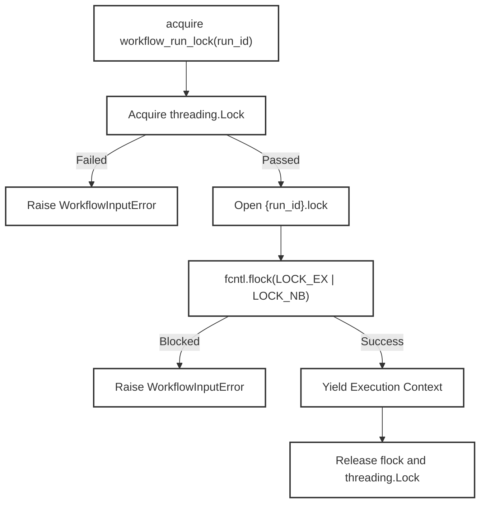
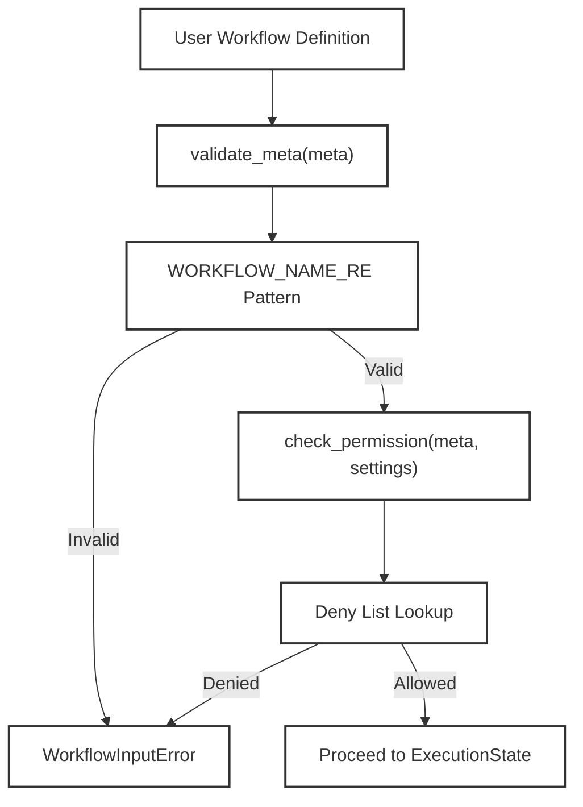

<!-- source: DeepWiki mcp.deepwiki.com · repo shareAI-lab/learn-claude-code · page 4.12 s16: Workflow Runtime · fetched 2026-10-29 -->

# s16: Workflow Runtime

Relevant source files

The following files were used as context for generating this wiki page:

- [s15_integrated_harness/code.py](s15_integrated_harness/code.py)
- [s16_workflow_runtime/code.py](s16_workflow_runtime/code.py)
- [tests/test_agent_teams_runtime.py](tests/test_agent_teams_runtime.py)
- [tests/test_goal_loop.py](tests/test_goal_loop.py)
- [tests/test_web_scenarios.py](tests/test_web_scenarios.py)
- [tests/test_workflow_goal_lessons.py](tests/test_workflow_goal_lessons.py)
- [web/src/components/visualizations/index.tsx](web/src/components/visualizations/index.tsx)
- [web/src/data/execution-flows.ts](web/src/data/execution-flows.ts)

## Purpose and Scope
Section 4.12 covers the **Workflow Runtime** (`s16_workflow_runtime/code.py`), which implements deterministic scripted orchestration for complex agent workflows [s16_workflow_runtime/code.py:1-19](). Unlike free-form agent loops, s16 provides reproducible execution pipelines featuring resumable JSONL journals, parallel execution budgets, semaphore-based concurrency caps, phase tracking, and file/thread-level run locking to prevent execution collisions [s16_workflow_runtime/code.py:35-117]().

Sources: `[s16_workflow_runtime/code.py:1-19]`, `[tests/test_workflow_goal_lessons.py:53-65]()`

---

## 1. Runtime Guards and Identity Management
The workflow runtime establishes strict system limits and deterministic identity allocators to ensure isolated and safe orchestration runs [s16_workflow_runtime/code.py:35-77]().

- **`AGENT_CAP`**: Hard upper bound (`1000`) on `agent()` invocations per run to prevent runaway loops [s16_workflow_runtime/code.py:36]().
- **`CONCURRENCY`**: Parallelism cap (`8`) enforced via an asyncio semaphore for parallel tasks [s16_workflow_runtime/code.py:37]().
- **`STORE`**: Filesystem directory (`.runtime`) where execution snapshots, run locks, and JSONL journals are persisted [s16_workflow_runtime/code.py:38]().
- **`_stable_hash(s)`**: Computes a SHA-256 digest converted to an integer, bypassing Python's process-salted `hash()` function to guarantee consistent caching keys across separate execution and resumption processes [s16_workflow_runtime/code.py:44-47]().
- **`reserve_run_id(meta)`**: Atomically allocates a unique run ID (`wf_{name}_{hex}`) and creates an exclusive lock file via `os.O_CREAT | os.O_EXCL` before any journal truncation can happen [s16_workflow_runtime/code.py:50-66]().

Sources: `[s16_workflow_runtime/code.py:35-77]()`

---

## 2. Concurrency Control and Run Locks
To prevent concurrent modifications or duplicate execution of the same workflow run ID across threads or host processes, s16 implements a dual-layer locking mechanism [s16_workflow_runtime/code.py:84-117]().

- **`_run_locks`**: In-memory dictionary protected by `_run_locks_guard` mapping run IDs to `threading.Lock` instances [s16_workflow_runtime/code.py:84-92]().
- **`workflow_run_lock(run_id)`**: A context manager that acquires both the thread-level lock (`blocking=False`) and a cross-process advisory lock via `fcntl.flock(handle.fileno(), fcntl.LOCK_EX | fcntl.LOCK_NB)` on `{run_id}.lock` [s16_workflow_runtime/code.py:88-117](). Raises `WorkflowInputError` if the workflow run is already active [s16_workflow_runtime/code.py:93-94]().

Title: "Workflow Run Lock Acquisition Flow"

Sources: `[s16_workflow_runtime/code.py:84-117]`, `[tests/test_workflow_goal_lessons.py:29-39]()`

---

## 3. Metadata Validation and Permission Gate
Before executing any workflow, metadata and permissions must be validated [s16_workflow_runtime/code.py:120-146]().

- **`validate_meta(meta)`**: Validates that `meta` is a dictionary containing a non-empty `name` matching `WORKFLOW_NAME_RE` (1–64 characters using letters, numbers, `.`, `_`, `-`), a string `description`, and an optional list of non-empty `phases` [s16_workflow_runtime/code.py:120-137]().
- **`check_permission(meta, settings)`**: Integrates with the s03 permission model, verifying whether the workflow `name` appears in the `deny` list of user settings and raising `WorkflowInputError` if blocked [s16_workflow_runtime/code.py:140-146]().

Title: "Metadata Validation to Code Entities"

Sources: `[s16_workflow_runtime/code.py:120-146]`, `[tests/test_workflow_goal_lessons.py:66-82]()`

---

## 4. Schema Validation (`SimpleJsonSchema`)
The runtime implements a lightweight JSON Schema validator (`SimpleJsonSchema`) to validate structured agent outputs and tool arguments without external heavy dependencies [s16_workflow_runtime/code.py:149-184]().

- **Supported Types**: `object` (with `required` keys and `properties`), `array` (with `items`), `string`, `boolean`, and `number` [s16_workflow_runtime/code.py:159-184]().
- **Enums**: Validates values against explicit `enum` lists [s16_workflow_runtime/code.py:158]().
- **Return Format**: Returns a tuple `(bool, str | None)` indicating success status and an error description on failure [s16_workflow_runtime/code.py:158-182]().

Sources: `[s16_workflow_runtime/code.py:149-184]`, `[tests/test_workflow_goal_lessons.py:75-81]()`

---

## 5. Resumable Journals and State Recovery
Workflows maintain durable progress records in JSONL journal files (`{run_id}.journal.jsonl`), enabling failure recovery and execution resumption [tests/test_workflow_goal_lessons.py:53-65]().

- **`WorkflowJournal`**: Appends step execution records, caching results based on stable hashes of step parameters. When resumed, completed steps return cached outputs instantly without re-invoking underlying models or tools.
- **Argument Verification**: When resuming an existing `run_id`, the runtime validates that the provided arguments match the original invocation snapshot [tests/test_workflow_goal_lessons.py:182-189](). Corrupt journal lines trigger immediate `WorkflowInputError` exceptions [tests/test_workflow_goal_lessons.py:129-138]().

Sources: `[s16_workflow_runtime/code.py:35-184]`, `[tests/test_workflow_goal_lessons.py:53-138]()`

---

## 6. Tool Adapters and Registration
The workflow runtime exposes orchestration capabilities to the agent via standard tool declarations (`WORKFLOW_TOOL`) and handler mappings (`WORKFLOW_HANDLERS`) [tests/test_workflow_goal_lessons.py:140-168]().

- **`Workflow` Tool**: Accepts a `name` and optional `args`, invoking `run_workflow` and returning structured JSON results containing task status, run ID, and execution data [tests/test_workflow_goal_lessons.py:140-168]().

Sources: `[s16_workflow_runtime/code.py:1-184]`, `[tests/test_workflow_goal_lessons.py:140-168]()`

---

