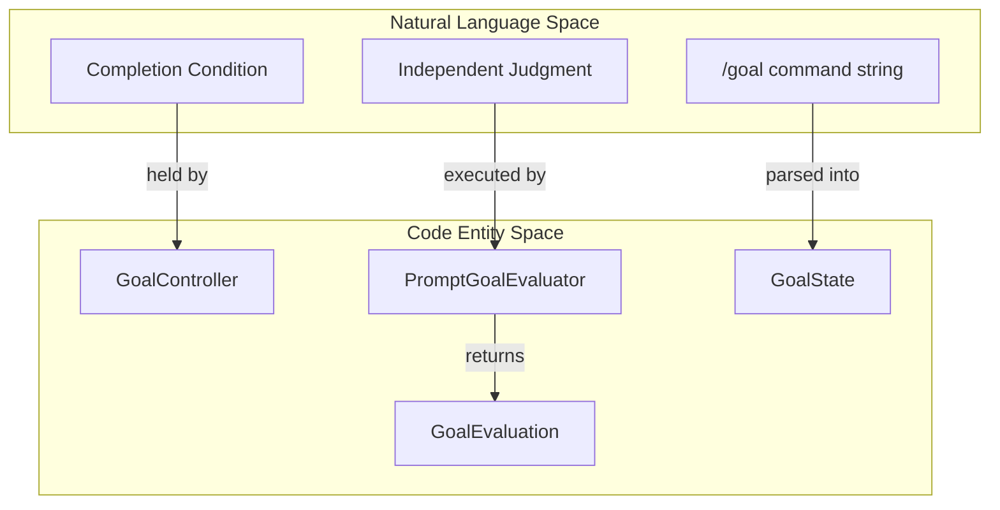
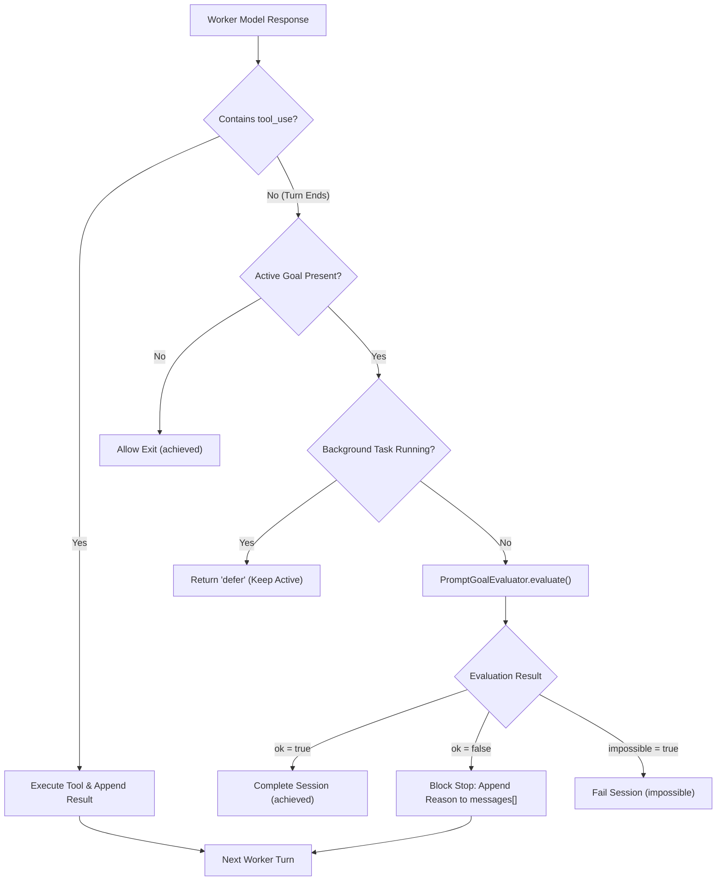

<!-- source: DeepWiki mcp.deepwiki.com · repo shareAI-lab/learn-claude-code · page 4.13 s17: Goal Loop · fetched 2026-10-29 -->

# s17: Goal Loop

Relevant source files

The following files were used as context for generating this wiki page:

- [s15_integrated_harness/code.py](s15_integrated_harness/code.py)
- [s17_goal_loop/README.md](s17_goal_loop/README.md)
- [s17_goal_loop/code.py](s17_goal_loop/code.py)
- [tests/test_agent_teams_runtime.py](tests/test_agent_teams_runtime.py)
- [tests/test_goal_loop.py](tests/test_goal_loop.py)
- [tests/test_web_scenarios.py](tests/test_web_scenarios.py)
- [tests/test_workflow_goal_lessons.py](tests/test_workflow_goal_lessons.py)
- [web/src/components/visualizations/index.tsx](web/src/components/visualizations/index.tsx)
- [web/src/data/execution-flows.ts](web/src/data/execution-flows.ts)

## Purpose and Scope

This page documents lesson `s17`, which introduces independent goal evaluation gating loop termination in `learn-claude-code` [s17_goal_loop/code.py:3-8](). In standard agent loops (`s01`–`s16`), a turn terminates when the model finishes calling tools (i.e., returns no `tool_use` blocks) [s17_goal_loop/README.md:15](). While sufficient for conversational queries, complex multi-step tasks require a verification gate: the model may believe a task is complete when criteria are only partially met [s17_goal_loop/README.md:17](). Lesson `s17` adds a session-scoped Stop hook managed by `GoalController` and `PromptGoalEvaluator` to judge completion before allowing the session to exit [s17_goal_loop/code.py:5-8](), [s17_goal_loop/README.md:21-32]().

Sources: `s17_goal_loop/code.py:1-26`, `s17_goal_loop/README.md:1-48`

---

## 1. Conceptual Architecture & System Mapping

The Goal Loop architecture bridges natural language instructions (such as `/goal pytest exits with code 0`) into precise Python runtime structures [s17_goal_loop/code.py:10-13](). 

### Natural Language to Code Entity Space

*Figure 1: Mapping natural language goal commands to `GoalController`, `PromptGoalEvaluator`, and `GoalState` entities.*

Sources: `s17_goal_loop/code.py:63-77`, `s17_goal_loop/README.md:19-58`, `tests/test_goal_loop.py:75-94`

---

## 2. Evaluation Data Flow

When the worker model completes a turn without issuing tool calls, the execution flow passes through the `GoalController` rather than instantly terminating [s17_goal_loop/README.md:31-47]().

### Goal Evaluation Execution Flow

*Figure 2: Sequence of checks executed at the end of every worker turn when a goal is active.*

Sources: `s17_goal_loop/code.py:212-290`, `s17_goal_loop/README.md:31-134`, `tests/test_goal_loop.py:96-132`

---

## 3. Key Classes and Implementation Details

The implementation of `s17` is structured around immutable data classes, a dedicated evaluator client, and a controller that gates session termination [s17_goal_loop/code.py:63-290]().

### Data Structures

The state and outcomes of goal evaluation are modeled via dataclasses defined in `s17_goal_loop/code.py` [s17_goal_loop/code.py:63-91]():

- `GoalState`: Tracks the active goal condition string, iteration count, start timestamp, starting token count, and last failure reason [s17_goal_loop/code.py:63-70]().
- `GoalEvaluation`: Represents the output of the evaluator model containing an `ok` boolean, a required explanation `reason`, and an optional `impossible` flag [s17_goal_loop/code.py:72-77]().
- `StopDecision`: Defines the controller's action (`block`, `defer`, `allow`) and associated message [s17_goal_loop/code.py:79-83]().
- `SessionResult`: Wraps the final output text, completion status, and reason [s17_goal_loop/code.py:85-91]().

Sources: `s17_goal_loop/code.py:63-91`

### PromptGoalEvaluator and Transcript Trimming

`PromptGoalEvaluator` is a tool-free model wrapper whose sole responsibility is evaluating the conversation transcript against the goal condition [s17_goal_loop/code.py:212-215](). It reads the conversation via `transcript_text()`, which preserves recent complete messages while trimming oversized content safely [s17_goal_loop/code.py:148-176]() to fit within the evaluator's token limits (`DEFAULT_EVALUATOR_MAX_TOKENS`) [s17_goal_loop/code.py:44]().

The evaluator returns a JSON object parsed and validated by `_parse_json_object()` [s17_goal_loop/code.py:179-210](), ensuring that:
1. `ok` is a strict boolean [s17_goal_loop/code.py:194-195]().
2. `reason` is a non-empty string [s17_goal_loop/code.py:196-197]().
3. `impossible` is a boolean (and cannot be true simultaneously with `ok=True`) [s17_goal_loop/code.py:198-204]().

Sources: `s17_goal_loop/code.py:148-210`, `s17_goal_loop/README.md:51-75`

---

## 4. Outcomes and Edge Cases

`GoalController` manages four distinct outcomes for a session stop attempt:

1. **Achieved (`ok=true`)**: The evaluator confirms the condition has been met. The goal is cleared (`self.active = None`), and the session returns a successful result [s17_goal_loop/README.md:38-46](), [tests/test_goal_loop.py:96-132]().
2. **Blocked / Continued (`ok=false`)**: The condition is unmet. The controller wraps the evaluator's `reason` into a user message, appends it to `messages[]`, and forces the agent loop to continue without user intervention [s17_goal_loop/README.md:39-44](), [tests/test_goal_loop.py:96-132]().
3. **Deferred (`background_running=True`)**: If asynchronous background tasks are still executing, evaluation is deferred to prevent premature judging before tool outputs return [s17_goal_loop/README.md:129-134](), [tests/test_goal_loop.py:196-213]().
4. **Impossible / Failed (`impossible=true`)**: If the evaluator determines the goal cannot be achieved given the environment or constraints, the session terminates with failure status [s17_goal_loop/README.md:75]().

To prevent infinite loops when a goal remains stubbornly unachieved, the controller enforces a maximum stop hook block cap (`DEFAULT_STOP_HOOK_BLOCK_CAP = 8`) [s17_goal_loop/code.py:45]().

Sources: `s17_goal_loop/code.py:43-46`, `s17_goal_loop/README.md:129-143`, `tests/test_goal_loop.py:196-213`

---

