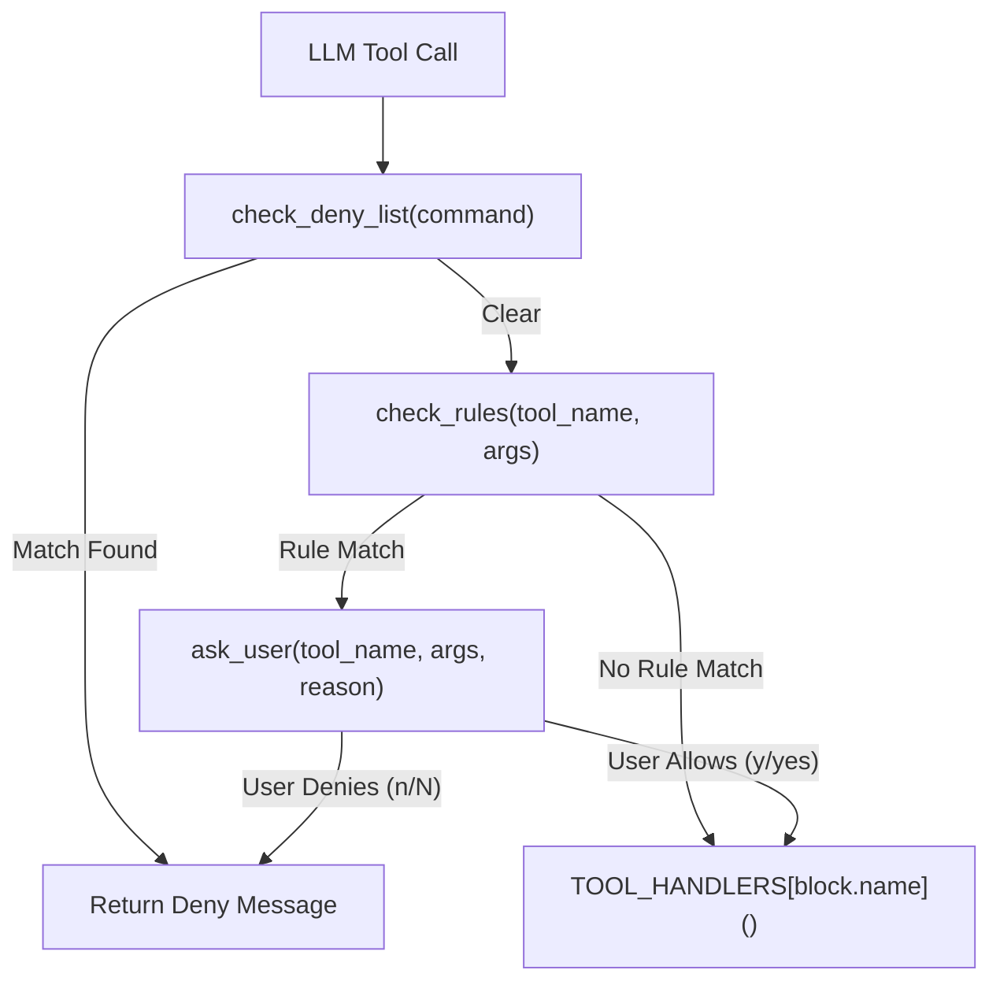
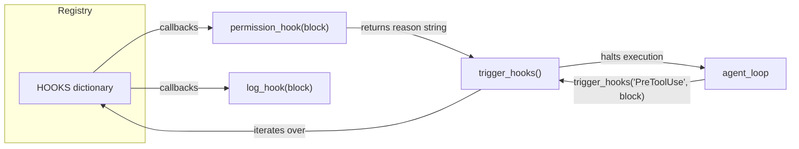
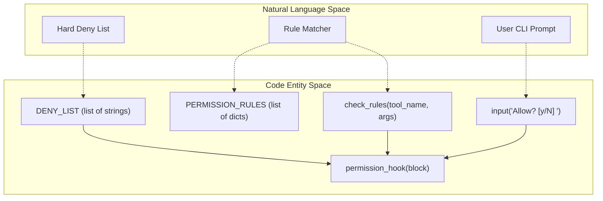
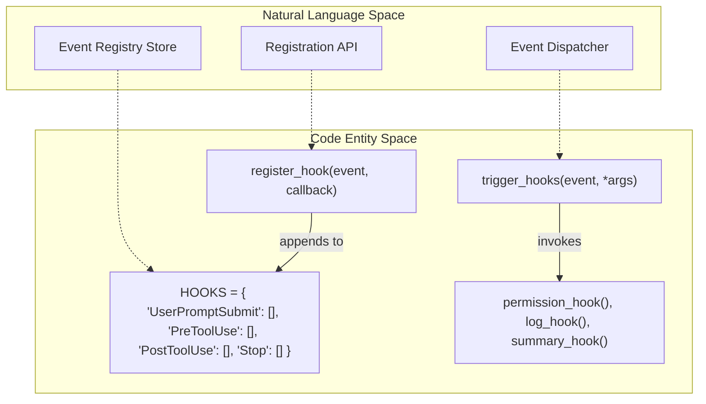

<!-- source: DeepWiki mcp.deepwiki.com · repo shareAI-lab/learn-claude-code · page 4.2 s03–s04: Permission and Hooks · fetched 2026-10-29 -->

# s03–s04: Permission and Hooks

<details>
<summary>Relevant source files</summary>

The following files were used as context for generating this wiki page:

- [s03_permission/README.ja.md](s03_permission/README.ja.md)
- [s03_permission/README.md](s03_permission/README.md)
- [s03_permission/README.zh.md](s03_permission/README.zh.md)
- [s03_permission/code.py](s03_permission/code.py)
- [s03_permission/images/permission-overview.en.svg](s03_permission/images/permission-overview.en.svg)
- [s03_permission/images/permission-overview.ja.svg](s03_permission/images/permission-overview.ja.svg)
- [s03_permission/images/permission-overview.svg](s03_permission/images/permission-overview.svg)
- [s04_hooks/README.ja.md](s04_hooks/README.ja.md)
- [s04_hooks/README.md](s04_hooks/README.md)
- [s04_hooks/README.zh.md](s04_hooks/README.zh.md)
- [s04_hooks/code.py](s04_hooks/code.py)

</details>


## Purpose and Scope

This page documents the transition from raw tool execution to a secure, extensible harness architecture through lessons `s03_permission` and `s04_hooks`. It covers the implementation of the three-gate permission pipeline (`DENY_LIST`, `PERMISSION_RULES`, and user confirmation) and the event-driven `HOOKS` registry (`UserPromptSubmit`, `PreToolUse`, `PostToolUse`, and `Stop`) that decouples extension logic from the core agent loop.

Sources: [s03_permission/README.md:1-10](), [s04_hooks/README.md:1-10]()

---

## s03: The Permission Pipeline

While file system tools can be constrained using workspace path validation, shell access via `bash` presents significant security risks. Lesson `s03_permission` introduces a three-gate permission pipeline that intercepts tool calls before execution. If a tool call is blocked, execution is aborted, and a denial message is returned directly to the model as a `tool_result`.

### The Three-Gate Architecture

Every tool invocation generated by the LLM passes through three sequential validation gates:

| Gate | Purpose | Implementation | On Match |
| :--- | :--- | :--- | :--- |
| **1. Deny List** | Permanently forbid catastrophic commands. | Simple string containment check against `DENY_LIST` patterns. | Immediate rejection without execution. [s03_permission/README.md:30-30]() |
| **2. Rule Matching** | Identify context-sensitive risks (e.g., workspace escapes, destructive regex words). | Lambda rule evaluators iterating over `PERMISSION_RULES`. [s03_permission/README.md:165-168]() | Hand-off to Gate 3. [s03_permission/README.md:31-31]() |
| **3. User Approval** | Human-in-the-loop interactive confirmation. | CLI prompt (`input("Allow? [y/N] ")`). [s03_permission/README.md:94-98]() | User decides `allow` or `deny`. [s03_permission/README.md:32-32]() |

Sources: [s03_permission/README.md:26-35](), [s03_permission/code.py:143-180]()

### Implementation Details

The pipeline is enforced via `check_permission()`, invoked inside the tool execution loop before handlers are dispatched.

**Diagram: Permission Pipeline Flow**



Sources: [s03_permission/README.md:104-120](), [s03_permission/code.py:146-180]()

#### Gate 1: Hard Deny List
```python
DENY_LIST = ["rm -rf /", "sudo", "shutdown", "reboot", "mkfs", "dd if=", "> /dev/sda"]
def check_deny_list(command: str) -> str | None:
    for pattern in DENY_LIST:
        if pattern in command:
            return f"Blocked: '{pattern}' is on the deny list"
    return None
```
Sources: [s03_permission/code.py:146-152]()

#### Gate 2: Rule Matching
```python
PERMISSION_RULES = [
    {"tools": ["read_file", "write_file", "edit_file"],
     "check": lambda args: not (WORKDIR / args.get("path", "")).resolve().is_relative_to(WORKDIR),
     "message": "Writing outside workspace"},
    {"tools": ["bash"],
     "check": lambda args: contains_destructive_command(args.get("command", "")) or
     any(kw in args.get("command", "") for kw in ["rm ", "> /etc/", "chmod 777"]),
     "message": "Potentially destructive command"},
]
```
Sources: [s03_permission/code.py:165-173]()

Sources: [s03_permission/README.md:38-128](), [s03_permission/code.py:143-180]()

---

## s04: The HOOKS Event Registry

As features such as logging, audit trails, and automatic post-processing accumulate, hardcoding checks directly into `agent_loop` causes code bloat. Lesson `s04_hooks` introduces an event registry pattern that allows extension logic to "hang on the loop" without modifying its core structure.

### The Agent Cycle Events

The hook system defines four interception points across the agent execution lifecycle:

| Event Name | Trigger Timing | Typical Use Case |
| :--- | :--- | :--- |
| `UserPromptSubmit` | After user input, before submitting to the LLM. | Input validation, context injection (e.g. injecting `WORKDIR`). [s04_hooks/README.md:48-48]() |
| `PreToolUse` | Before a tool handler executes. | Permission verification, telemetry logging. [s04_hooks/README.md:49-49]() |
| `PostToolUse` | After a tool handler returns its output. | Truncation checks, side-effect triggers (`auto git add`). [s04_hooks/README.md:50-50]() |
| `Stop` | When the model produces no tool calls and the loop is about to exit. | Session summaries, cleanup, or forcing continuation via returned messages. [s04_hooks/README.md:51-51]() |

Sources: [s04_hooks/README.md:44-52](), [s04_hooks/code.py:128-138]()

### Hook Registry and Triggering

The registry is represented by a dictionary mapping event names to lists of callback functions.

```python
HOOKS = {"UserPromptSubmit": [], "PreToolUse": [], "PostToolUse": [], "Stop": []}

def register_hook(event: str, callback):
    HOOKS[event].append(callback)

def trigger_hooks(event: str, *args):
    for callback in HOOKS[event]:
        result = callback(*args)
        if result is not None:  # A non-None return value halts or alters control flow.
            return result
        return None
```
Sources: [s04_hooks/code.py:128-139]()

**Diagram: Hook Dispatch Architecture**



Sources: [s04_hooks/README.md:59-78](), [s04_hooks/code.py:128-139]()

---

## Code Entity Mapping

To bridge conceptual harness components with concrete implementation artifacts, the following diagrams associate natural language entities with their exact codebase identifiers.

### Diagram: Permission Pipeline Entity Mapping



Sources: [s03_permission/code.py:146-179](), [s04_hooks/code.py:153-175]()

### Diagram: Hook Registry Entity Mapping



Sources: [s04_hooks/code.py:128-139](), [s04_hooks/code.py:153]()

---

## Comparison: s03 vs s04 Architecture

| Component | s03 (Hardcoded Pipeline) | s04 (Event Hooks) |
| :--- | :--- | :--- |
| **Permission Integration** | `check_permission(block)` hardcoded directly inside `agent_loop`. [s03_permission/README.md:123-123]() | `permission_hook` registered under `PreToolUse` and triggered via `trigger_hooks()`. [s04_hooks/README.md:105-117]() |
| **Loop Extensibility** | Adding features requires direct modifications to `agent_loop`. [s04_hooks/README.md:15-16]() | Features register custom callbacks via `register_hook()`. [s04_hooks/README.md:53-53]() |
| **Control Flow Modification** | Fixed return paths for blocks. | `Stop` hook can return a string to force loop continuation. [s04_hooks/README.md:80-80]() |

Sources: [s03_permission/README.md:104-128](), [s04_hooks/README.md:187-197]()

---

