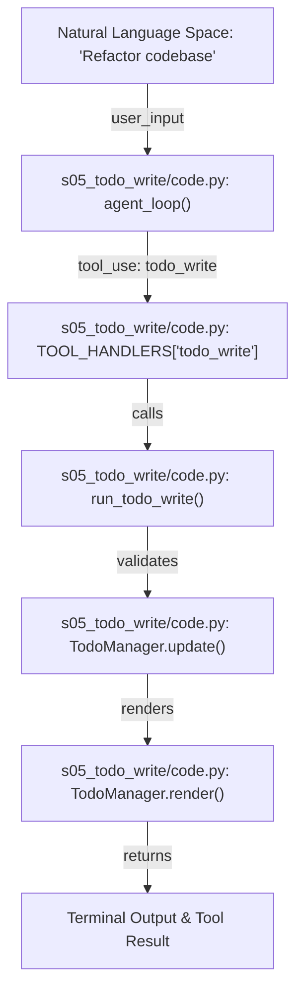
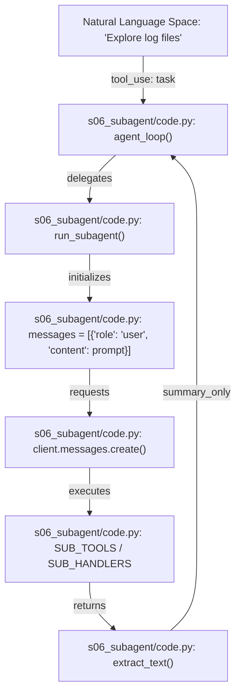

<!-- source: DeepWiki mcp.deepwiki.com · repo shareAI-lab/learn-claude-code · page 4.3 s05–s06: TodoWrite and Subagents · fetched 2026-10-29 -->

# s05–s06: TodoWrite and Subagents

<details>
<summary>Relevant source files</summary>

The following files were used as context for generating this wiki page:

- [s05_todo_write/README.ja.md](s05_todo_write/README.ja.md)
- [s05_todo_write/README.md](s05_todo_write/README.md)
- [s05_todo_write/README.zh.md](s05_todo_write/README.zh.md)
- [s05_todo_write/code.py](s05_todo_write/code.py)
- [s06_subagent/README.ja.md](s06_subagent/README.ja.md)
- [s06_subagent/README.md](s06_subagent/README.md)
- [s06_subagent/README.zh.md](s06_subagent/README.zh.md)
- [s06_subagent/code.py](s06_subagent/code.py)

</details>


## Purpose and Scope

This page covers two foundational harness capabilities implemented in `learn-claude-code`: **TodoManager** self-tracking with staleness reminders (`s05_todo_write/code.py`) and `run_subagent` delegation with isolated conversation histories (`s06_subagent/code.py`). 

**TodoWrite** addresses task drift by enforcing structured planning where agents maintain an in-memory task graph with status markers (`pending`, `in_progress`, `completed`), augmented by a nag reminder counter (`rounds_since_todo`). **Subagents** solve context bloating by spawning independent, nested agent loops with fresh `messages[]` arrays, returning only the final result to the parent conversation.

Sources: [s05_todo_write/code.py:2-25](), [s06_subagent/code.py:2-25]()

---

## TodoWrite Mechanics and TodoManager

As an agent conversation lengthens, tool results saturate the context window and dilute the influence of the system prompt. To prevent the model from losing track of multi-step goals, session `s05` introduces the `TodoManager` class and `todo_write` tool.


**Diagram 1: TodoWrite Architecture Bridging Natural Language to Code Entities**

### Key Components of TodoManager
- **`TodoManager` Class**: Located in `[s05_todo_write/code.py:115-173]()`, it manages an internal list of todo items. 
- **Validation**: `TodoManager.update()` [s05_todo_write/code.py:119-154]() parses incoming lists or JSON/Python literal strings, enforces a limit of 20 items, ensures each item has non-empty content, and guarantees that at most one item has status `in_progress`.
- **Status Markers**: `TodoManager.render()` [s05_todo_write/code.py:156-172]() formats items with `[ ]` (`pending`), `[>]` (`in_progress`), and `[x]` (`completed`).
- **Nag Reminders**: The harness tracks `rounds_since_todo`. If three tool-use rounds pass without a call to `todo_write`, a `<reminder>Update your todos.</reminder>` text block is injected alongside the tool results [s05_todo_write/code.py:218-223]().

Sources: [s05_todo_write/code.py:115-173]()

---

## Subagents and Context Isolation

Session `s06` introduces the `task` tool, which delegates exploratory or self-contained tasks to a subagent running in a separate, fresh message context.


**Diagram 2: Subagent Delegation Bridging Natural Language to Code Entities**

### Subagent Implementation Details
- **`run_subagent(prompt: str)`**: Defined in `[s06_subagent/code.py:36-58]()`, it initializes a local `messages` list containing only the user prompt.
- **Iteration Limit**: Runs a bounded loop of up to `30` turns (`range(30)`) to prevent runaway execution [s06_subagent/code.py:39]() before returning a fallback message.
- **Recursion Guard**: Subagents utilize `SUB_TOOLS` which explicitly excludes the `task` tool, limiting delegation strictly to one level [s06_subagent/code.py:34]() and preventing recursive spawning.
- **Filesystem Sharing**: Subagents share the same `WORKDIR` and process environment as the parent loop, meaning file modifications and shell commands operate on the same workspace [s06_subagent/code.py:42]().

Sources: [s06_subagent/code.py:36-58]()

---

## Technical Comparison: TodoWrite vs Subagents

| Feature | TodoWrite (`s05`) | Subagents (`s06`) |
| :--- | :--- | :--- |
| **Primary Purpose** | Plan tracking and preventing task drift | Context window conservation via isolation |
| **State Structure** | Global `TodoManager` instance | Isolated local `messages[]` per sub-loop |
| **Execution Tool** | `todo_write` [s05_todo_write/code.py:177]() | `task` [s06_subagent/code.py:165]() |
| **Inter-loop Communication** | Rendered text string returned to model | Final text summary returned as tool result |
| **Delegation Depth** | N/A | Single level (`SUB_TOOLS` omits `task`) [s06_subagent/code.py:34]() |

Sources: [s05_todo_write/code.py:177](), [s06_subagent/code.py:34](), [s06_subagent/code.py:165]()

---

## Tool Schemas and Dispatch

### TodoWrite Schema
The `todo_write` tool accepts a structured array of task objects validated at runtime:

```json
{
  "name": "todo_write",
  "description": "Create and manage a task list with status tracking.",
  "input_schema": {
    "type": "object",
    "properties": {
      "todos": {
        "type": "array",
        "items": {
          "type": "object",
          "properties": {
            "content": {"type": "string"},
            "status": {"type": "string", "enum": ["pending", "in_progress", "completed"]}
          },
          "required": ["content", "status"]
        }
      }
    },
    "required": ["todos"]
  }
}
```
Sources: [s05_todo_write/code.py:190-210]()

### Subagent Task Schema
The `task` tool exposes subagent delegation to the parent model:

```json
{
  "name": "task",
  "description": "Run a subagent with fresh conversation context and return its final text.",
  "input_schema": {
    "type": "object",
    "properties": {
      "prompt": {"type": "string", "description": "The task description for the subagent."}
    },
    "required": ["prompt"]
  }
}
```
Sources: [s06_subagent/code.py:160-170]()

---

## Security and Workspace Boundary Enforcement

Both sessions inherit security checks from earlier lessons. Path resolution enforces workspace containment via `.resolve().is_relative_to(WORKDIR)` checks for read/write/edit operations [s05_todo_write/code.py:68-75](), [s06_subagent/code.py:70-78](). Destructive shell commands are caught by `permission_hook()` [s05_todo_write/code.py:150-184](), [s06_subagent/code.py:168-202]() to prevent unauthorized system modifications across both parent and subagent executions.

Sources: [s05_todo_write/code.py:68-75](), [s06_subagent/code.py:70-78]()

---

