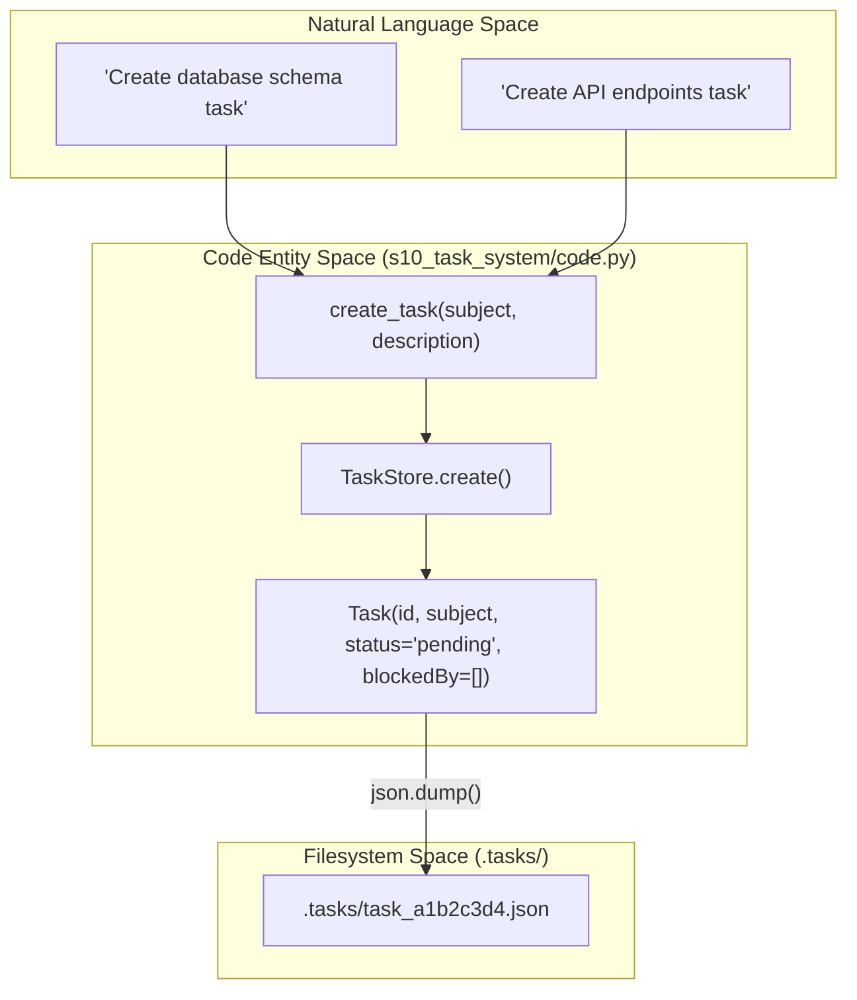
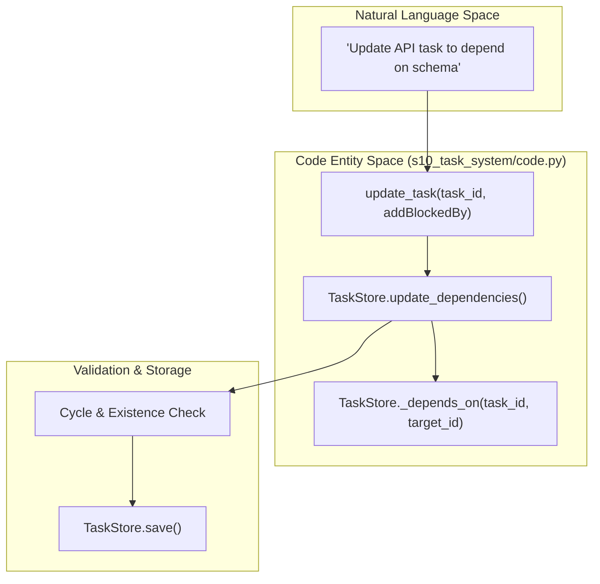
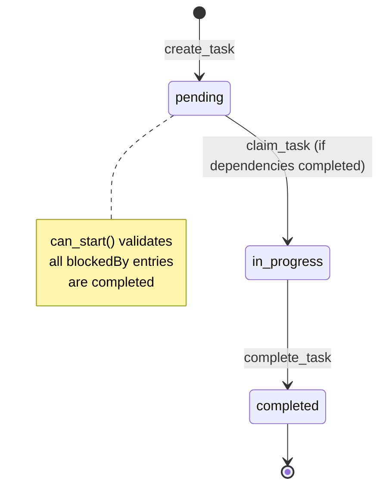

<!-- source: DeepWiki mcp.deepwiki.com · repo shareAI-lab/learn-claude-code · page 4.7 s10: Task System · fetched 2026-10-29 -->

# s10: Task System

<details>
<summary>Relevant source files</summary>

The following files were used as context for generating this wiki page:

- [s10_task_system/README.ja.md](s10_task_system/README.ja.md)
- [s10_task_system/README.md](s10_task_system/README.md)
- [s10_task_system/README.zh.md](s10_task_system/README.zh.md)
- [s10_task_system/code.py](s10_task_system/code.py)
- [s10_task_system/images/task-system-overview.en.svg](s10_task_system/images/task-system-overview.en.svg)
- [s10_task_system/images/task-system-overview.ja.svg](s10_task_system/images/task-system-overview.ja.svg)
- [s10_task_system/images/task-system-overview.svg](s10_task_system/images/task-system-overview.svg)
- [s13_agent_teams/README.ja.md](s13_agent_teams/README.ja.md)
- [s13_agent_teams/README.md](s13_agent_teams/README.md)
- [s13_agent_teams/README.zh.md](s13_agent_teams/README.zh.md)

</details>


## Purpose and Scope
This page documents the persistent task management system implemented in `s10_task_system/code.py`. The task system transitions the harness from a flat, session-scoped checklist (`TodoManager`) to a file-backed Directed Acyclic Graph (DAG) stored in `.tasks/` with explicit `blockedBy` dependencies, atomic updates, and agent ownership.

Sources: [s10_task_system/README.md:5-10](), [s10_task_system/code.py:5-22]()

---

## 1. Overview: TodoWrite vs. Task System
While `TodoManager` (introduced in s05) manages temporary internal checklist steps within an active session, the `TaskStore` manages project-level state across sessions.

| Feature | TodoWrite (s05) | Task System (s10) |
| :--- | :--- | :--- |
| **Storage** | In-process memory | Disk-based JSON files under `.tasks/{id}.json` |
| **Dependencies** | None (flat list) | Explicit `blockedBy` graph |
| **Lifecycle** | Current session only | Cross-session persistence |
| **Coordination** | Implicit single-agent steps | `owner` assignment and claim mechanism |
| **Update Contract** | Replace entire list | Individual record CRUD operations |

Sources: [s10_task_system/README.md:31-43]()

---

## 2. Data Structure and TaskStore Implementation
Tasks are instantiated as `Task` dataclasses and serialized to disk via `TaskStore`. Each task file is named using a runtime-generated identifier matching `TASK_ID_PATTERN` (`task_[0-9a-f]{8}`).

```python
@dataclass
class Task:
    id: str
    subject: str
    description: str
    status: str          # pending | in_progress | completed
    owner: str | None    # Assigned agent identifier
    blockedBy: list[str] # Prerequisite task IDs
```

The `TaskStore` class handles path safety validation to ensure store operations remain within the workspace boundary (`WORKDIR / ".tasks"`), alongside atomic allocations using unique hex tokens (`secrets.token_hex(4)`).

Sources: [s10_task_system/code.py:64-100](), [s10_task_system/code.py:102-125]()

### Natural Language to Code Entity Space: Task Store Architecture

Sources: [s10_task_system/code.py:68-126](), [s10_task_system/code.py:199-200]()

---

## 3. Two-Phase Task Graph Construction
Because language models may emit multiple sibling tool calls in a single response before any tool results return, dependency edges cannot reference IDs created in the same turn. The harness enforces a strict two-phase contract:

1. **Phase 1**: Create all task nodes using `create_task`, which returns runtime-generated IDs.
2. **Phase 2**: Call `update_task` (backed by `TaskStore.update_dependencies`) using those exact IDs to attach prerequisites to `blockedBy`.

```python
def update_task(task_id: str, addBlockedBy: list[str]) -> Task:
    return TASKS.update_dependencies(task_id, addBlockedBy)
```

`TaskStore.update_dependencies` performs strict validation:
* Verifies target task status is `pending` and `owner` is `None`.
* Rejects self-dependencies.
* Validates existence of all dependency IDs.
* Runs a cycle-detection check using transitive traversal (`TaskStore._depends_on`).

Sources: [s10_task_system/code.py:54-59](), [s10_task_system/code.py:127-171](), [s10_task_system/code.py:203-204]()

### Natural Language Space to Code Entity Space: Dependency Graph Resolution

Sources: [s10_task_system/code.py:127-171](), [s10_task_system/code.py:203-204]()

---

## 4. Task Lifecycle and State Machine
Tasks transition through three distinct states governed by lifecycle utility functions: `pending`, `in_progress`, and `completed`.



* **`can_start(task_id)`**: Verifies that all prerequisite tasks listed in `blockedBy` have reached `completed` status and their backing JSON files exist.
* **`claim_task(task_id, owner)`**: Sets the task `owner` and transitions status from `pending` to `in_progress` if unblocked.
* **`complete_task(task_id, owner)`**: Validates ownership and `in_progress` status, marks the task `completed`, and scans remaining tasks to identify downstream items newly unblocked by the transition.

Sources: [s10_task_system/README.md:89-145]()

---

## Summary of Task Tools
The harness exposes 6 core task operations to the model handler registry:
* `create_task`: Allocates a new task record in `.tasks/`.
* `update_task`: Appends validated dependency identifiers to `blockedBy`.
* `list_tasks`: Renders summaries of all stored tasks.
* `get_task`: Fetches full JSON metadata and description.
* `claim_task`: Assumes ownership and moves tasks to `in_progress`.
* `complete_task`: Finalizes execution and triggers downstream unblocking.

Sources: [s10_task_system/README.md:29-43](), [s10_task_system/code.py:188-205]()

---

