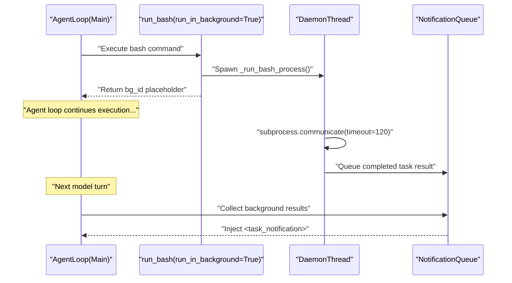
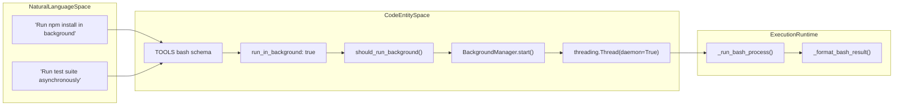
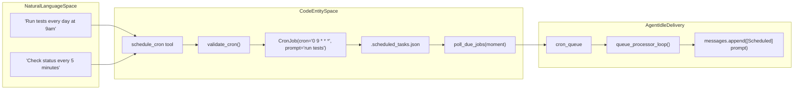

<!-- source: DeepWiki mcp.deepwiki.com · repo shareAI-lab/learn-claude-code · page 4.8 s11–s12: Background Tasks and Cron Scheduler · fetched 2026-10-29 -->

# s11–s12: Background Tasks and Cron Scheduler

<details>
<summary>Relevant source files</summary>

The following files were used as context for generating this wiki page:

- [s11_background_tasks/README.md](s11_background_tasks/README.md)
- [s11_background_tasks/code.py](s11_background_tasks/code.py)
- [s12_cron_scheduler/README.md](s12_cron_scheduler/README.md)
- [s12_cron_scheduler/code.py](s12_cron_scheduler/code.py)

</details>


## Purpose and Scope

This page covers the architecture and implementation of asynchronous command execution and time-triggered task scheduling in lessons `s11` and `s12`. These mechanisms enable the agent harness to handle long-running operations without blocking the main event loop and to initiate work automatically based on cron expressions.

- **s11 (Background Tasks)**: Offloads slow shell commands to daemon threads via a `run_in_background` parameter on the `bash` tool, collecting results asynchronously on later turns [s11_background_tasks/README.md:1-28]().
- **s12 (Cron Scheduler)**: Implements persistent time-triggered job scheduling using five-field cron expressions, injecting scheduled prompts into the agent loop when the agent is idle [s12_cron_scheduler/README.md:1-29]().

Sources: [s11_background_tasks/README.md:1-28](), [s12_cron_scheduler/README.md:1-29]()

---

## Background Task Execution (s11)

### The Problem and Solution

Synchronous execution of long-running operations (such as installing dependencies or running full test suites) blocks the agent harness, preventing it from processing subsequent tool calls or model turns [s11_background_tasks/README.md:13-19](). In `s11`, the model explicitly requests background execution by setting the `run_in_background` parameter to `true` in the `bash` tool call [s11_background_tasks/README.md:42-45](). The harness starts a daemon thread, immediately returns a placeholder result, and collects completed results on subsequent turns [s11_background_tasks/README.md:27-36]().

Sources: [s11_background_tasks/README.md:13-36]()

### Background Task Flow


Sources: [s11_background_tasks/README.md:56-92](), [s11_background_tasks/code.py:83-123]()

### Natural Language to Code Entity Space: Background Tasks


Sources: [s11_background_tasks/README.md:42-81](), [s11_background_tasks/code.py:83-123]()

---

## Cron Scheduler (s12)

### Cron Job Structure and Durable Storage

The cron scheduler enables time-triggered task injection [s12_cron_scheduler/README.md:9-13](). Jobs are defined using `CronJob` data classes containing cron expressions, prompts, recurring flags, and durability settings [s12_cron_scheduler/README.md:36-48](). Durable jobs are persisted to `.scheduled_tasks.json` via atomic file replacement (`os.replace()`) [s12_cron_scheduler/README.md:107-115]().

```python
@dataclass
class CronJob:
    id: str
    cron: str
    prompt: str
    recurring: bool
    durable: bool
    pending_delivery: bool = False
    last_fired: str | None = None
```
Sources: [s12_cron_scheduler/README.md:36-50](), [s12_cron_scheduler/code.py:23-45]()

### Natural Language to Code Entity Space: Cron Scheduler


Sources: [s12_cron_scheduler/README.md:36-106](), [s12_cron_scheduler/code.py:45-52]()

### Polling and Idle Delivery

The scheduler thread polls local time once per second (`poll_due_jobs`), checking whether any registered job matches the current minute marker without having already fired [s12_cron_scheduler/README.md:64-78](). When due, the job is added to an internal queue [s12_cron_scheduler/README.md:64-67](). The `queue_processor_loop` waits until the agent is idle (acquiring `agent_lock`) before injecting the scheduled prompt as a user message into the conversation history [s12_cron_scheduler/README.md:81-105]().

Sources: [s12_cron_scheduler/README.md:64-105]()

---

