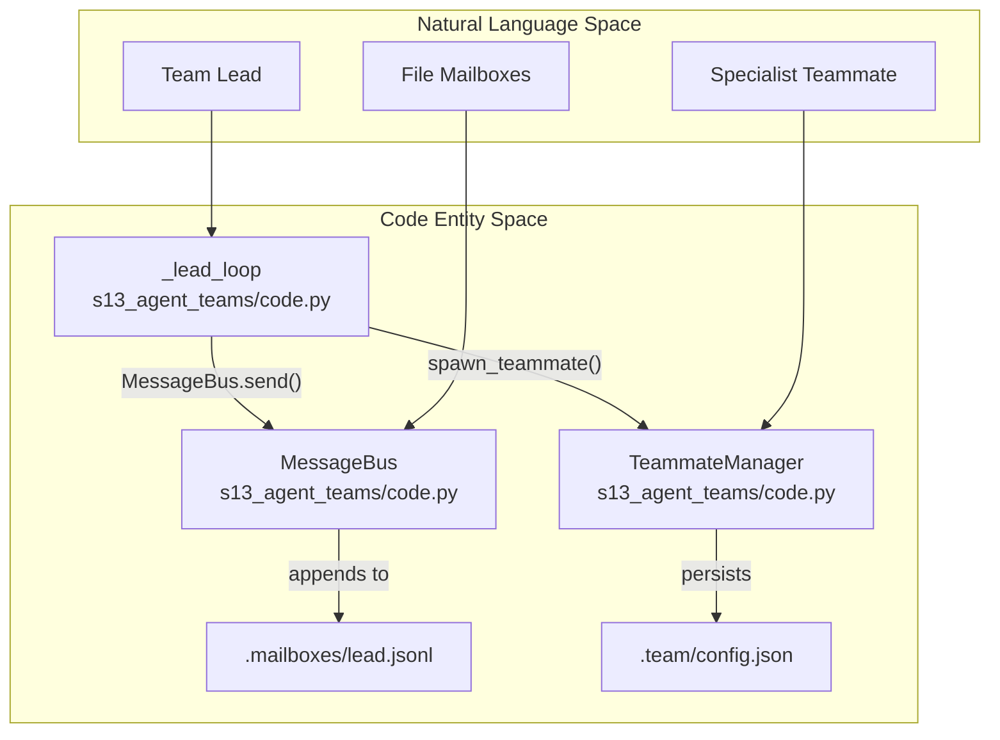
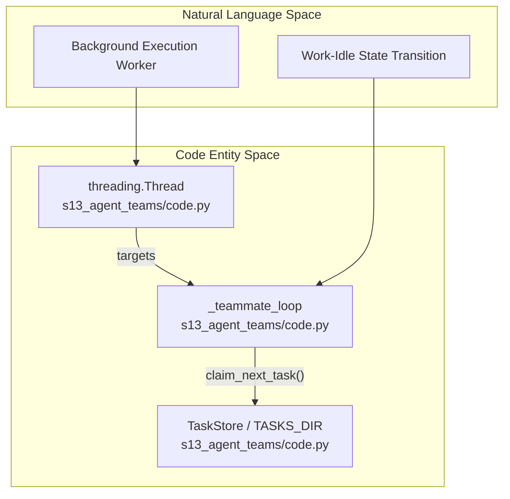
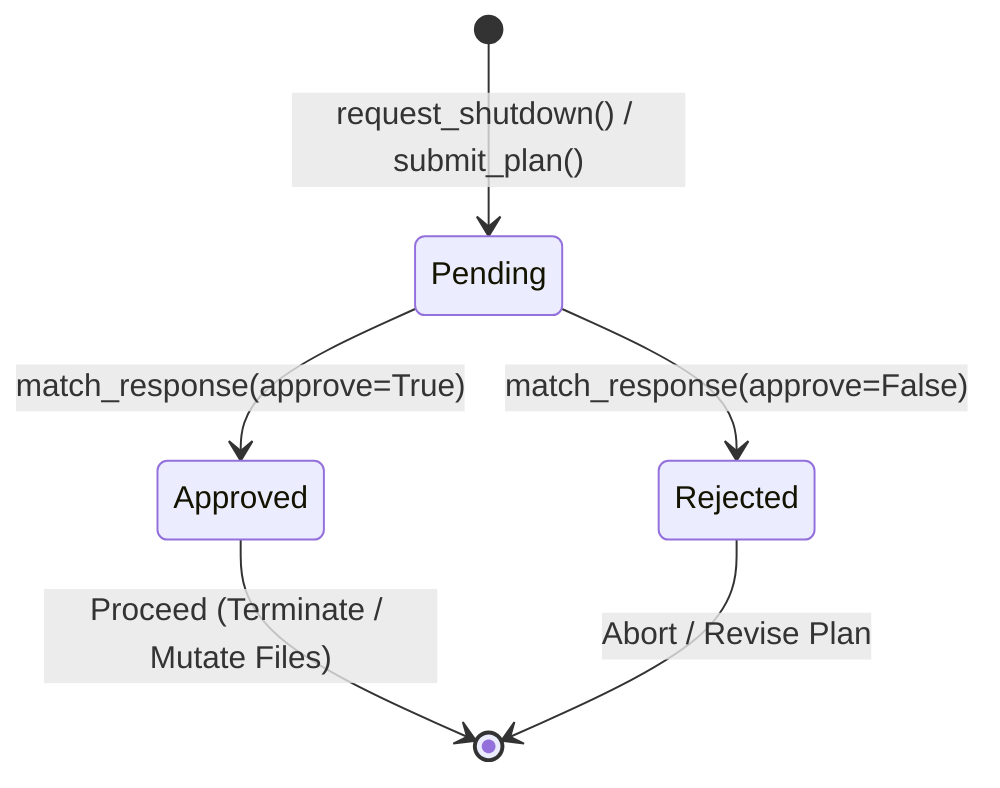

<!-- source: DeepWiki mcp.deepwiki.com · repo shareAI-lab/learn-claude-code · page 4.9 s13: Agent Teams · fetched 2026-10-29 -->

# s13: Agent Teams

Relevant source files

The following files were used as context for generating this wiki page:

- [agents/s09_agent_teams.py](agents/s09_agent_teams.py)
- [agents/s10_team_protocols.py](agents/s10_team_protocols.py)
- [s10_task_system/README.ja.md](s10_task_system/README.ja.md)
- [s10_task_system/README.md](s10_task_system/README.md)
- [s10_task_system/README.zh.md](s10_task_system/README.zh.md)
- [s13_agent_teams/README.ja.md](s13_agent_teams/README.ja.md)
- [s13_agent_teams/README.md](s13_agent_teams/README.md)
- [s13_agent_teams/README.zh.md](s13_agent_teams/README.zh.md)
- [s13_agent_teams/code.py](s13_agent_teams/code.py)

## Purpose and Scope

Session 13 consolidates persistent teammates, JSONL mailboxes, coordination protocols, atomic task claims, and task-bound worktrees into a unified multi-agent runtime [`s13_agent_teams/code.py:3-21`](). It scales the harness from single-agent loops to a collaborative team under a Lead agent's control [`s13_agent_teams/README.md:7-9`]().

**Key Concepts**:
*   **Persistent Teammates**: Background execution units that alternate between `WORK` and `IDLE` states across multiple assignments [`s13_agent_teams/code.py:8-10`]().
*   **MessageBus**: File-backed JSONL mailboxes (`.mailboxes/`) providing decoupled communication channels outside model context [s13_agent_teams/README.md:98-102]().
*   **Team Protocols**: Request-response state machines (FSMs) for shutdown handshakes and plan approvals using `request_id` correlation [agents/s10_team_protocols.py:6-47]().
*   **Atomic Task Claims**: Lock-protected task board scanning and claiming to prevent race conditions among concurrent teammates [s13_agent_teams/README.ja.md:196-210]().

**Sources**: [`s13_agent_teams/code.py:3-21`](), [s13_agent_teams/README.md:7-9](), [agents/s10_team_protocols.py:6-47]()

---

## Architecture: MessageBus and JSONL Mailboxes

The `MessageBus` class handles inter-agent communication by writing and reading append-only JSONL files under the mailbox directory [agents/s09_agent_teams.py:83-127]().

### Communication Flow
1.  **Send**: An agent invokes a send mechanism, calling `MessageBus.send()`. This appends a serialized JSON message object to the recipient's `.jsonl` file [agents/s09_agent_teams.py:93-114]().
2.  **Wait / Peek**: Recipients block on or peek into their mailbox using threading conditions (`self._changed.wait()`), avoiding busy-wait polling [s13_agent_teams/README.md:119-131]().
3.  **Drain**: `MessageBus.read_inbox()` reads all messages and clears the inbox file, ensuring each message is processed exactly once [agents/s09_agent_teams.py:116-126]().

### System Mapping: Team Coordination

**Sources**: [agents/s09_agent_teams.py:83-127](), [s13_agent_teams/README.md:98-131]()

---

## Teammate Lifecycle and Runtime

Teammates are managed by `TeammateManager` and executed inside daemon threads running `_teammate_loop` [agents/s09_agent_teams.py:131-180]().

### Lifecycle States
| State | Description |
| :--- | :--- |
| **Working** | Teammate is actively running its agent loop, executing tool calls, or processing an assignment [agents/s09_agent_teams.py:28-31](). |
| **Idle** | Teammate has completed its work, drained its inbox, and is scanning for ready tasks or waiting for messages [s13_agent_teams/README.ja.md:174-192](). |
| **Shutdown** | Teammate has acknowledged a shutdown request and exited its execution thread [agents/s10_team_protocols.py:28](). |

### System Mapping: Runtime Teammate Execution

**Sources**: [agents/s09_agent_teams.py:131-180](), [s13_agent_teams/README.md:83-97]()

---

## Team Protocols and FSMs

Session 13 integrates formal coordination protocols using `request_id` correlation to prevent ambiguity in free-text messaging [agents/s10_team_protocols.py:3-48]().

### Protocol State Machine (FSM)

### Key Protocols
1.  **Shutdown Protocol**: The Lead sends a `shutdown_request` with a unique `request_id`. The teammate responds with `shutdown_response` before its thread terminates [agents/s10_team_protocols.py:8-28]().
2.  **Plan Approval Protocol**: A teammate submits a plan via `plan_approval`. The Lead reviews it, and mutating tools remain blocked until an `approved` response is recorded [agents/s10_team_protocols.py:30-44]().

**Sources**: [agents/s10_team_protocols.py:3-48]()

---

## Autonomous Task Claiming and Worktrees

Idle teammates do not block on manual assignments; they participate in autonomous task discovery through the shared task board [s13_agent_teams/README.ja.md:174-192]().

### Autonomous Claiming Sequence
1.  **Scan**: Teammates list unclaimed tasks where status is `pending` and `blockedBy` dependencies are fully completed [s13_agent_teams/README.ja.md:197-207]().
2.  **Atomic Claim**: Under `task_store_lock()`, the task status changes to `in_progress`, `owner` is set, and versioning constraints are applied [s13_agent_teams/README.ja.md:209-230]().
3.  **Worktree Binding**: If a task is bound to a git worktree, the execution context (`assignment_cwd`) redirects to that worktree directory to prevent filesystem collisions [s13_agent_teams/README.md:46-47]().

**Sources**: [s13_agent_teams/README.md:45-48](), [s13_agent_teams/README.ja.md:174-230]()

---

## Tools Reference

### Lead Tools
| Tool | Purpose |
| :--- | :--- |
| `spawn_teammate` | Spawns a persistent background agent thread with a specific role and initial task [s13_agent_teams/README.md:81-94](). |
| `send_message` | Sends structured JSON messages or control events to a teammate's inbox [s13_agent_teams/README.md:103-112](). |
| `request_shutdown` | Initiates the graceful shutdown protocol for a teammate [agents/s10_team_protocols.py:14-16](). |
| `review_plan` | Approves or rejects a teammate's pending plan [agents/s10_team_protocols.py:40-42](). |

### Teammate Tools
| Tool | Purpose |
| :--- | :--- |
| `submit_plan` | Submits a proposed execution plan to the Lead for review [agents/s10_team_protocols.py:34-36](). |
| `claim_task` | Atomically claims an available task from the shared task board [s13_agent_teams/README.ja.md:185-191](). |
| `complete_task` | Marks an owned task as completed and unlocks downstream dependencies [s10_task_system/README.md:120-144](). |

**Sources**: [s13_agent_teams/README.md:81-112](), [agents/s10_team_protocols.py:14-44](), [s10_task_system/README.md:120-144]()

---

