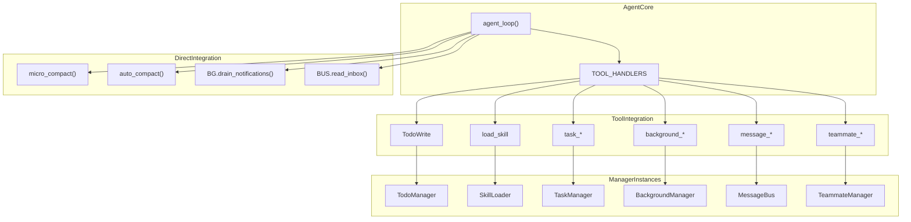
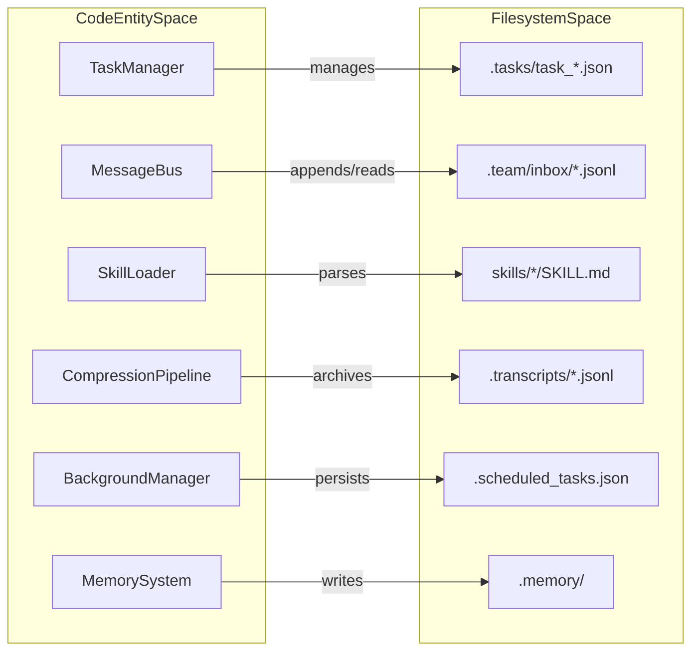

<!-- source: DeepWiki mcp.deepwiki.com · repo shareAI-lab/learn-claude-code · page 5 Manager Components Reference · fetched 2026-10-29 -->

# Manager Components Reference

Relevant source files

The following files were used as context for generating this wiki page:

- [agents/s08_background_tasks.py](agents/s08_background_tasks.py)
- [agents/s_full.py](agents/s_full.py)
- [tests/test_s_full_background.py](tests/test_s_full_background.py)

## Purpose and Scope

This document provides a high-level technical overview of the manager classes that encapsulate domain-specific functionality across the `learn-claude-code` repository. Each manager handles a specific concern—such as planning, knowledge injection, context compression, task persistence, background execution, or team coordination—and exposes its capabilities through tools or direct integration with the agent loop.

The capstone implementation in `agents/s_full.py` combines all these mechanisms into a single reference agent [agents/s_full.py:1-9]().

---

## Manager Architecture Pattern

Managers integrate with the agent loop through three primary patterns:

1.  **Direct Pre-LLM Integration:** Logic called before every API request to maintain context hygiene or inject async notifications [agents/s08_background_tasks.py:56-115]().
2.  **Tool-Based Integration:** Managers expose capabilities via the `TOOL_HANDLERS` dictionary, which the agent loop dispatches during `tool_use` stops [agents/s08_background_tasks.py:169-176]().
3.  **Composition:** Higher-level managers utilize underlying data structures and message passing primitives to facilitate coordination [agents/s_full.py:400-405]().

Sources: [agents/s_full.py:1-37](), [agents/s08_background_tasks.py:56-115]()

---

## Component Overview

| Component | Page | Primary Purpose | Persistence Location |
| :--- | :--- | :--- | :--- |
| `TodoManager` & `SkillLoader` | [TodoManager and SkillLoader](#5.1) | In-memory checklist & on-demand knowledge | In-memory / `skills/*/SKILL.md` |
| Context Pipeline | [Context Compression Pipeline](#5.2) | Three-layer context management | `.transcripts/*.jsonl` |
| `TaskManager` & Worktrees | [TaskManager and Worktree Binding](#5.3) | Persistent task CRUD & git worktree isolation | `.tasks/` & `.worktrees/` |
| `BackgroundManager` & Cron | [BackgroundManager and CronScheduler](#5.4) | Async command execution & cron scheduling | In-memory / `.scheduled_tasks.json` |
| `TeammateManager` & MessageBus | [TeammateManager and MessageBus](#5.5) | Team lifecycle, mailboxes & protocols | `.team/` |
| Memory System | [Memory System Internals](#5.6) | Persistent knowledge store & extraction | `.memory/` |

---

## Detailed Component Reference

### [TodoManager and SkillLoader](#5.1)
The `TodoManager` maintains an in-memory checklist enforcing strict status validation (`pending`, `in_progress`, `completed`) and limiting active tasks to prevent scope creep [agents/s_full.py:129-164](). The `SkillLoader` handles discovery, frontmatter parsing, and two-layer injection of structured markdown skills. For details, see [TodoManager and SkillLoader](#5.1).

### [Context Compression Pipeline](#5.2)
This system prevents context window overflow through multi-tier compaction: output snippet pruning, micro-compacting old tool interactions, automated threshold-based summarization, and transcript archiving. For details, see [Context Compression Pipeline](#5.2).

### [TaskManager and Worktree Binding](#5.3)
The `TaskManager` provides file-backed task graphs with dependency tracking (`blockedBy`), while worktree binding isolates independent task branches into separate git worktrees. For details, see [TaskManager and Worktree Binding](#5.3).

### [BackgroundManager and CronScheduler](#5.4)
The `BackgroundManager` spawns daemon threads for asynchronous subprocess execution, routing outputs through a thread-safe notification queue [agents/s08_background_tasks.py:56-115](). The `CronScheduler` handles periodic task injection. For details, see [BackgroundManager and CronScheduler](#5.4).

### [TeammateManager and MessageBus](#5.5)
The `TeammateManager` coordinates persistent multi-agent execution, while the `MessageBus` facilitates JSONL-backed mailbox communication, point-to-point messaging, and broadcasts. For details, see [TeammateManager and MessageBus](#5.5).

### [Memory System Internals](#5.6)
The memory system manages long-term persistence under `.memory/`, supporting file writing, index generation (`MEMORY.md`), retrieval scoring, and automatic memory consolidation. For details, see [Memory System Internals](#5.6).

---

## Component Persistence Map

This diagram maps manager code entities to their physical representation on disk.

Sources: [agents/s_full.py:60-70](), [agents/s08_background_tasks.py:56-115]()

---

